# Enabling Joule for SAP S/4HANA Cloud Public Edition

*The Joule Booster does most of the work — this chapter is everything you still have to validate and wire up by hand afterward.*

> [!NOTE]
> **📍 At a glance**
> - **You will learn:** the concrete, hands-on configuration steps that follow a Joule Booster run for SAP S/4HANA Cloud Public Edition — destinations, communication arrangements, content exposure, and the Identity Provisioning source/target systems that actually replicate users and roles
> - **You will build:** nothing runnable here — this is BTP/S4 administration, not code — but you will walk through the exact screens and field values a real activation requires
> - **Level:** intermediate · **Time:** about 26 minutes
> - **Builds on:** [Joule's identity and platform foundation](btp-identity-foundation.md) (the Joule Booster, Private vs. Public Edition) and [Extending Joule beyond a single application](btp-extending-joule.md) (SAP Build Work Zone). **Leads to:** [Enabling Joule for other SAP products](enabling-other-products.md)

**After this chapter you can:**

- Name the 5 destinations and 2+ communication arrangements a working S/4HANA Joule activation depends on
- Explain why SAP_COM_0193 and Identity Provisioning's Read Job are what actually moves users and roles into Joule's reach
- Recognize the specific host-domain mistake that silently breaks role replication, and the missing-suffix mistake that breaks app navigation
- Know where to go first when a real activation starts failing ("I cannot retrieve data," missing intents, double logins)

## 1. Architecture and prerequisites

This chapter picks up **after** a Joule Booster run for S/4HANA Cloud Public Edition — the booster automates most of the platform wiring, but a real activation still needs every piece below validated or configured by hand. Before starting, confirm:

| Prerequisite | Why it matters |
|---|---|
| SAP BTP set up per [the unified Joule setup flow](btp-identity-foundation.md) | Joule Service, SAP Build Work Zone (foundation or standard plan), and Cloud Foundry must already be active |
| SAP S/4HANA Cloud Public Edition, with an admin role assigned | You need write access to Communication Arrangements, Communication Systems, and Content Security Policy |
| SAP Cloud Identity Services tenant (test or production) linked to the BTP subaccount | Same identity foundation as every other LoB chapter in this book |

- Do this on a **test tenant first**, then production — the setup **cannot be transported** between tenants; each one needs its own run.
- If you also want Document Grounding, finish this S/4HANA activation first, then follow the separate Document Grounding setup.

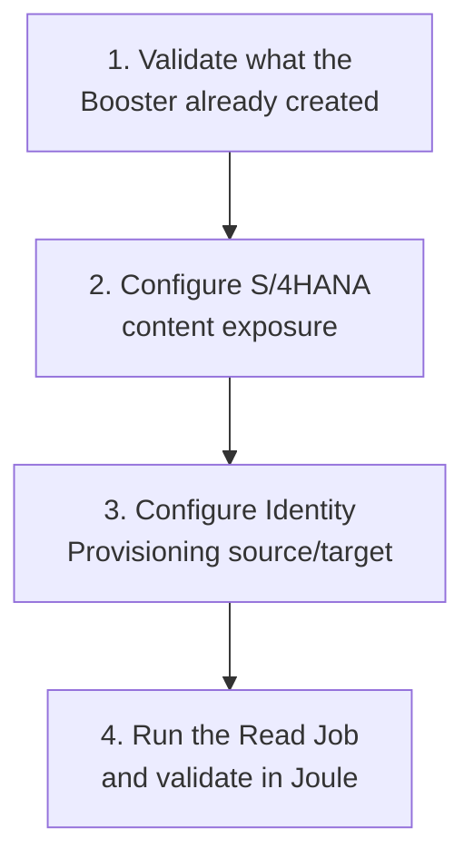

## 2. Validate what the Booster already created

The booster already ran once, following the end-to-end unified setup from [the identity foundation chapter](btp-identity-foundation.md). Before touching anything new, validate what it produced — a surprising share of real activation failures trace back to one of these five checks.

### 2.1 Work Zone Provider ID

Create (or confirm) your BTP subaccount user through SAP Cloud Identity Services, then assign the required Role Collections:

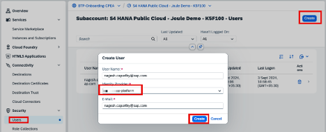

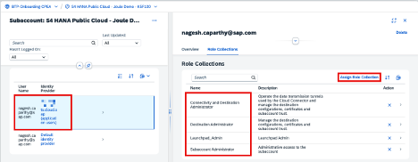

Open **Instances and Subscriptions → SAP Work Zone, standard edition**. You're redirected to pick the Cloud Identity Service to authenticate with:

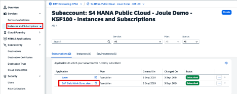

Inside Work Zone, open **Channel Manager** and note the S/4HANA Cloud Public Edition content provider's **ID value** — you need it later for the Identity Provisioning (IPS) target system.

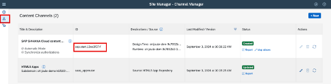

### 2.2 Destination certificates

Under **Connectivity → Destination Certificates**, confirm the booster created a valid certificate:

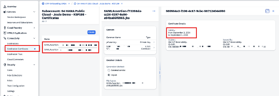

### 2.3 Destinations, and creating NavigationService by hand

A working setup needs **5** destinations. The booster creates 4 automatically — the 5th (`NavigationService`) you create yourself.

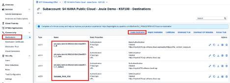

| Field | Value |
|---|---|
| Name | `NavigationService` (exact case) |
| Type | HTTP |
| URL | the `portal-service` URL from the SAP Build Work Zone service key |
| Proxy Type | Internet |
| Authentication | OAuth2UserTokenExchange |
| Client ID / Client Secret | from the Work Zone service key |
| Token Service URL Type | Dedicated |
| Token Service URL | `https://<uaa-url>/oauth/token` — from the same service key, just below the Client Secret |
| Additional Properties | enable **Use default JDK trust store** |

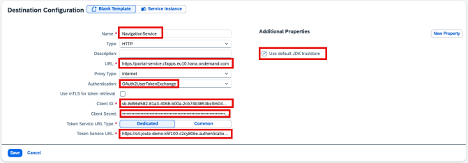

> [!WARNING]
> **⚠️ Pitfall: a missing `/oauth/token` suffix breaks app navigation, not authentication**
> One reported real-world failure (via a reader comment on the original SAP Community post, confirmed and fixed by a second commenter): leaving the `/oauth/token` suffix off the NavigationService Token Service URL doesn't fail outright — it surfaces later as **"no intents"** errors for a specific semantic object (e.g. a Sales Order), because navigation resolution silently fails for that object type. The fix is deleting and recreating the destination with the full, correctly-suffixed URL — not patching the existing one in place.

### 2.4 Communication Arrangements and Systems

Confirm the booster created **SAP_COM_0882** and **SAP_COM_0647**:

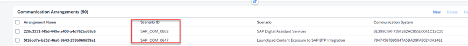

And that the corresponding Communication Systems are linked to the destination certificate from 2.2:

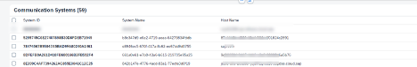

### 2.5 SAP Cloud Identity Services, post-booster

In your Cloud Identity Services tenant, confirm **das-ias** and **document grounding** are listed under Applications and Resources:

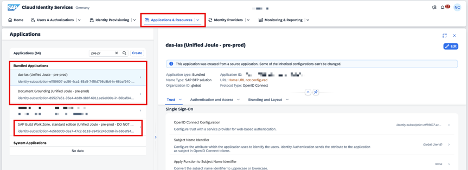

> [!WARNING]
> **⚠️ Pitfall: a third-party IDP needs the same conditional-auth rule mirrored onto `das-ias`**
> If S/4HANA authenticates through Azure Entra, Okta, or another external IdP, that same mechanism has to be configured for **das-ias** specifically, not just for the S/4HANA application entry. Skipping this is a reported cause of users hitting a **double login prompt** — once for S/4, once for Joule — even though "the IdP is already set up."

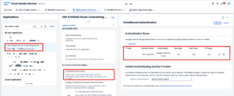

## 3. Configure S/4HANA content with Joule

### 3.1 Expose SAP Fiori Launchpad content to SAP BTP

By default, the Communication Arrangement for **SAP_COM_0647** exposes **all** roles:

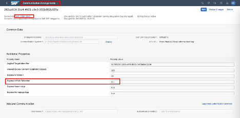

- If "All" is selected, SAP recommends **no more than 3,000 apps** assigned to any single Role, Group, or Catalog — exceeding this can error out a Work Zone refresh.
- To expose roles individually instead, set Exposure Role Selection to **SELECTED**, then open **Maintain Business Roles**, open each role (e.g. `BR_PURCHASER`), and set **Access Categories → Exposed to BTP**:

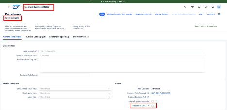

### 3.2 Maintain Communication Arrangement SAP_COM_0193

SAP_COM_0193 is what Identity Provisioning (IPS) uses to treat S/4HANA as a **source system** later in this chapter:

**3.2.1 Create a Communication User** (inbound) — `Maintain Communication Users → New`:

- **User name:** `JOULE_INBOUND_IPS`
- **Password:** use "Propose Password" (≥20 characters, at least one special character) — save it, you'll need it again

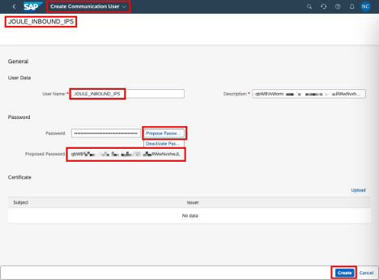

> [!NOTE]
> This guide uses Basic Authentication for simplicity. Certificate-based authentication is also supported — see the IPS source-system procedure for S/4HANA Cloud if your organization requires it.

**3.2.2 Create a Communication System** representing the S/4 system itself:

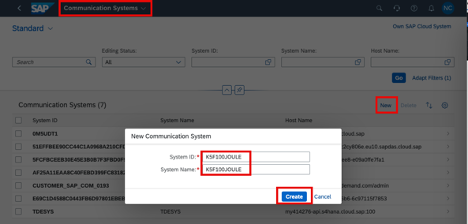

**3.2.3 Assign the communication user to the Communication System.** The **Host Name** field is your S/4HANA Cloud URL **without** `https://`:

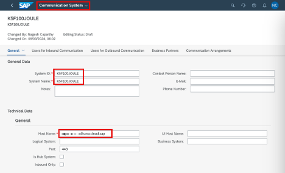

Under **Users for Inbound Communication**, add the user with Authentication Method = User Name and Password:

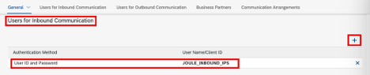

> [!WARNING]
> **⚠️ Pitfall: this Host field is where a real activation can silently half-fail**
> This blog's own instructions (and this chapter, following them) use the **S/4HANA Cloud URL** as the Host. A reader flagged a real conflict: SAP's own **Discovery Center Mission** ("Activate Joule with SAP S/4HANA Cloud Public Edition") instead instructs using the **IAS tenant (Cloud Identity Service) domain** as the Host. Using the wrong one doesn't throw an error — it lets role replication fail silently, leaving every user "unauthorized" in Joule with vague, generic answers instead of a clear permission error. If users report Joule giving suspiciously generic answers after setup, re-check this field against both sources before assuming it's an authorization-design problem.

**3.2.4 Create Communication Arrangement SAP_COM_0193** itself — search for the scenario and select it:

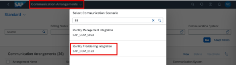

Name it (e.g. `Joule_Communication_0193`) and create:

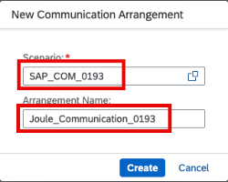

**3.2.5 Activate it** — select the Communication System created in 3.2.2:

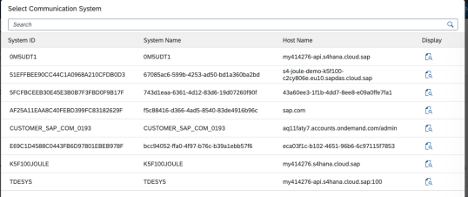

...then select the `JOULE_INBOUND_IPS` user and save:

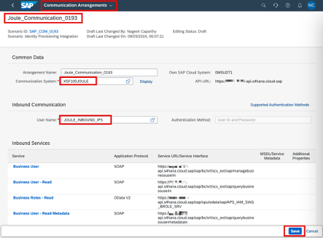

### 3.3 Manage Content Security Policy

Joule needs to load inside an iFrame in the Fiori Launchpad, which means its service URL has to be explicitly trusted. Copy the Joule service URL from **Instances and Subscriptions**:

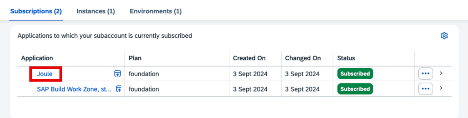

Confirm the service responds (authenticate via Cloud Identity Services if prompted):

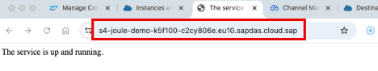

In S/4HANA, go to **Manage Content Security Policy → Trusted Sites → UI_RESOURCE_SCRIPTS**:

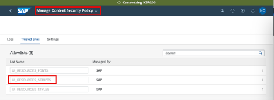

Under **Managed by Customer**, add the Joule URL you copied and save:

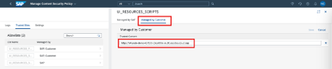

## 4. SAP Cloud Identity Services: source and target systems

This is the step that actually moves users, groups, and role assignments from S/4HANA into Joule's reach. It uses **Identity Provisioning (IPS)** to connect a **source system** (S/4HANA) to a **target system** (Identity Authentication + SAP Build Work Zone).

You can configure both manually, or import ready-made template files (provided as attachments on the original source post — `SourceFile_Joule1.txt` and `TargetFile_Joule1.txt`, each renamed to `.json` before import) and just fix the account-specific values.

**Source system** — import the file, then fix the Properties tab:

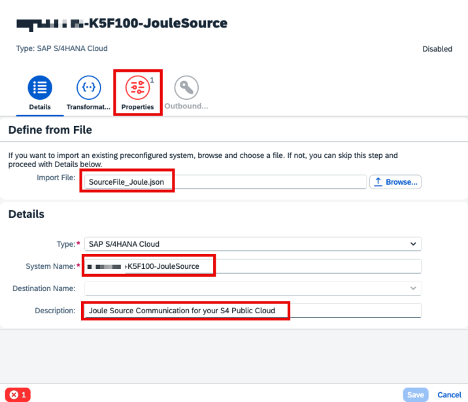

- **URL:** from the API-URL field of the SAP_COM_0193 communication arrangement (section 3.2.4/3.2.5)
- **User:** the `JOULE_INBOUND_IPS` user created in 3.2.1

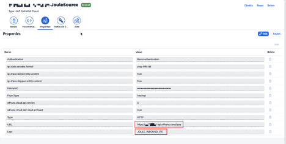

If you set Exposure Role Selection to **SELECTED** in section 3.1, also maintain the field `s4hana.cloud.roles.filter — cFLGExposure eq true`. If you left it at **All**, skip this field entirely:

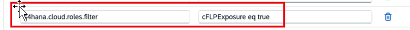

**Target system** — import the target file, pointing its Source System field at the one you just created:

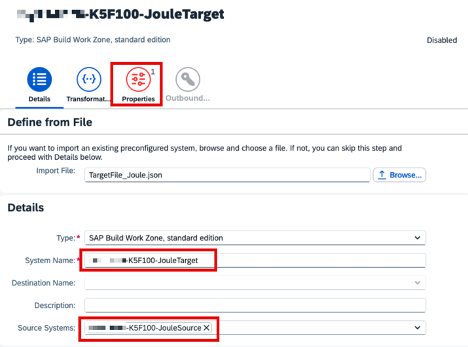

Fix the Properties using values from the SAP Build Work Zone service key:

| Parameter | Value |
|---|---|
| `cflp.providerId` | The Joule Provider ID from Work Zone's Channel Manager (section 2.1) |
| `OAuth2TokenServiceURL` | `<uaa.url>/oauth/token` from the Work Zone service key |
| `URL` | The Work Zone API URL, endpoint `portal-service` |
| `User` | OAuth Client ID (`uaa.clientid`) from the service key |
| `Password` | OAuth Client Secret (`uaa.clientsecret`) from the service key |

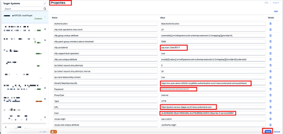

> [!WARNING]
> **⚠️ Pitfall: if the token URL is missing a role, Launchpad_admin usually fixes it**
> If authentication fails specifically at this provider-ID/token step, the quickest fix reported is assigning the **`Launchpad_admin`** role collection to the subaccount user used for the sync — not re-entering the values, which are usually already correct.

Save, then confirm the Work Zone **Content Channel** status and click **Refresh**:

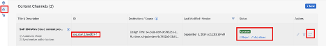

Finally, run the actual sync: open the **source system's Jobs tab** and click **Run Now** on the **Read Job** — this is what replicates users, groups, and roles from S/4 into Joule's reach:

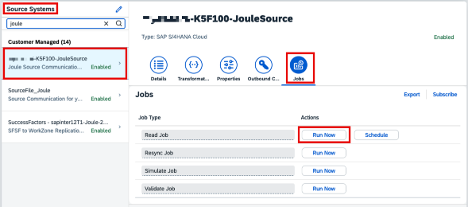

Check the result in **Provisioning Logs**, under the job's Statistics section (entity/system counts for Users and Groups):

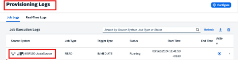
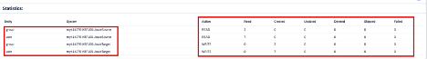

> [!NOTE]
> Schedule this Read Job to run on a recurring basis — users, groups, and role assignments in S/4HANA change over time, and a one-time sync goes stale.

## 5. Validate in Joule

Launch Joule from the diamond icon in the Fiori shell bar:

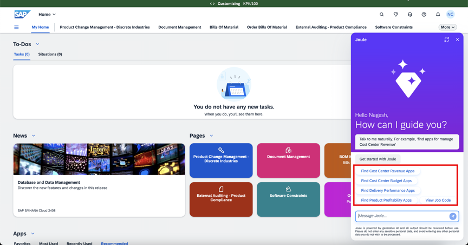

Test with a real query against an exposed business object, e.g. "Show Purchase Orders":

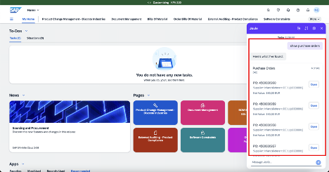

- **Support component**, if you need to log a ticket: `CA-FLP-EXT-JOU`.
- The full list of business objects Joule supports for S/4HANA Cloud Public Edition is maintained as a separate SAP Note, linked from the original setup guide — check it rather than assuming every object type is covered.

## 6. When it still doesn't work: field-reported fixes

These aren't from the official guide — they're patterns that showed up repeatedly across real activation attempts in the comments on the original SAP Community post, worth checking before re-doing the whole setup from scratch.

| Symptom | Likely cause / fix |
|---|---|
| "I cannot retrieve data" or Joule can't navigate to an app at all | The most commonly reported fix: **delete the Joule application** under Instances and Subscriptions in the subaccount, then **re-run the booster** — rather than debugging the existing instance further |
| A second S/4HANA tenant won't connect to the same Joule setup | **One subaccount connects to only one production system per application type.** A second S/4 production tenant needs its own subaccount — this isn't a bug, it's the architecture |
| Users authenticated, but Joule gives vague/generic answers instead of real data | Recheck the Communication System **Host** field (section 3.2.3) against both this guide and SAP's Discovery Center Mission — they disagree, and the wrong one fails silently |

### 6.1 Booster-time activation errors

A dedicated troubleshooting source gives the exact error text for four Booster-stage failures, each with its fix:

| Error (as shown) | Cause | Fix |
|---|---|---|
| "Some of the entitlements are not available in the selected subaccount" | Joule or Work Zone standard edition isn't entitled in this subaccount | BTP Global Account → Entity Assignments → confirm both are entitled; if missing, the entitlement needs to be procured first |
| `das-application-ias` sync with Cloud Identity Services fails (e.g. "application in IAS not found") | Sync between Joule and Cloud Identity Services broke | Resynchronize; if it persists, raise a ticket under component **BC-CP-MP-FOR** with the technical details shown |
| "No registered systems of type SAP S/4HANA Cloud" | Formation prerequisites aren't met | Register at least one S/4HANA Cloud system in the global account first (the "Register SAP S/4HANA Cloud Public Edition" mission step) |
| Formation sync errors citing component **CA-JOULE-PRV** and a formation ID, persisting even after Resynchronize | Two reported causes | **(1)** On the Select Capabilities step, **leave "Store conversation data submitted by users for the improvement of Joule" unticked** — a concrete reported bug ties this exact checkbox to formation sync failures; **(2)** manually add a dependency per SAP Note/KBA 3646589 |

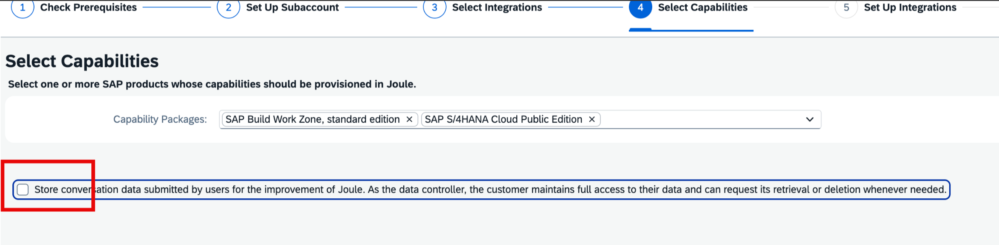

### 6.2 Why Joule doesn't respond as expected

| Symptom | Fix |
|---|---|
| Joule icon missing from S/4HANA Cloud after completing the setup mission | Re-check the "Update Content Security Policy Settings" mission step; try an Incognito window to rule out caching; clear cache/cookies if it appears there (SAP Note/KBA 3657080) |
| Joule asks for separate login credentials every time | Joule needs a session already established by the hosting app — confirm the Cloud Identity Services domain used at S/4 login matches the one set in BTP Cockpit → Joule subaccount → Trust Configuration → Domain, and that IdP/Conditional Authentication config matches exactly between the S/4 and Joule apps |
| Joule returns the wrong document or object (e.g. a SAP Help doc instead of a sales order; a purchase requisition instead of a purchase order) | Check SAP Note 3545050's enabled-business-objects list; verify the CDM sync via Channel Manager → Report; verify the user's business-catalog/group assignment via the Explore Role Assignments screen |
| Joule responds "I cannot [x] due to system limitations. However..." to a navigational/transactional request | SAP Note/KBA 3660276 and 3679305. Two concrete real-world causes beyond the official note: the IPS search box disabled with a `403 Forbidden ... subscribe to WORKZONE with paid plan` trace error (fix: use a paid Work Zone plan, not free); or more than 3,000 apps assigned to a single Role/Group/Catalog (SAP Note 3107801) |
| Joule in S/4HANA Cloud says "Not authorized" | A **Common Name (CN) mismatch** between the `S4HANA_PUB_SSO` BTP destination's certificate and the S/4 Communication System's SAML Bearer Assertion Provider certificate — the two CNs have to match exactly |
| Joule times out / can't connect to S/4HANA Cloud Public Edition | Confirmed root cause in one documented case: a broken `S4HANA_PUB_SSO` destination behind component **BC-EIM-ESH** (the enterprise search service); fixed per SAP Note 3804793, after which the same query returned a proper result instead of timing out |
| Nothing above resolves it | Open a ticket under component **CA-JOULE**, and attach the Joule web client's own trace file — it meaningfully speeds up resolution |

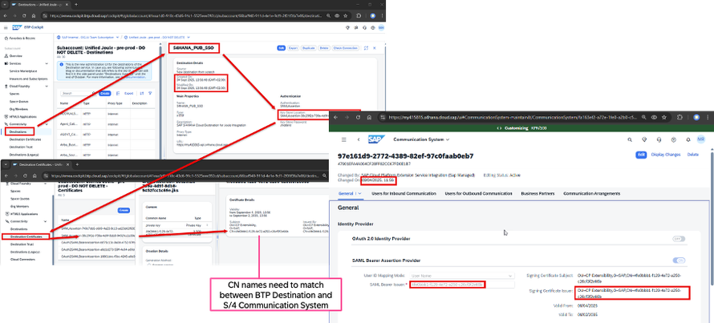

> [!NOTE]
> One commenter asked about per-interaction cost while scoping a narrow pilot (one process, not a full rollout) — the author's confirmed answer: **Joule Base currently has unlimited usage**, no per-token metering to plan around for a pilot.

> [!WARNING]
> **⚠️ Pitfall: an identical prompt can behave inconsistently**
> A reported, unresolved pattern: the first attempt or two at an identical prompt returns a generic "guidance mode" answer (pointing to SAP Help docs) before a later retry actually fetches real data. If this happens, the suggested path is downloading the Joule web client's trace file (as above) and reporting it against the specific AI feature's component via the AI feature catalog, rather than assuming the setup itself is wrong.

> [!CAUTION]
> **🔒 Open question worth verifying directly with SAP, not assuming**
> A reader asked, in the original post's comments, for documentation confirming that Joule can never "infer" or surface data beyond what a user's replicated S/4HANA role already permits — and got no reply in the thread. The architecture described throughout this book (Joule inherits the acting user's existing authorizations, never more) strongly implies the answer is "it can't," but if this matters for a compliance sign-off, get it confirmed against current official documentation rather than citing this chapter.

## 7. Added by Claude, not from the sources

- Section 6's table is this book's own synthesis of recurring patterns across dozens of reader comments on the original SAP Community post (spanning 2025–2026) — each fix is attributed to what commenters actually reported, not invented.
- Sections 6.1 and 6.2 draw on a second, dedicated troubleshooting source; splitting it into "Booster-time errors" vs. "wrong/no response" is this book's organization, the symptoms and fixes themselves are the source's.
- The explicit cross-reference between this guide's Host-field instruction and the conflicting Discovery Center Mission guidance (section 3.2.3's pitfall) is a real discrepancy a reader flagged publicly — included here as a genuine pitfall, not smoothed over.
- Not run: this chapter is BTP/S4 administration guidance, not code; nothing was independently executed. The field values and screenshots are the source author's own activation, not a setup performed for this book.

## 8. Interview corner

**What interviewers listen for:** you know this is booster-plus-manual-validation, not booster-only; you can name what SAP_COM_0193 and the IPS Read Job actually do (role/user replication, not just "some config"); and you don't confuse a licensing gap with a configuration bug.

### 🟢 Basic

1. How many destinations does a working S/4HANA Joule activation need, and how many does the Booster create automatically?

- 5 total; the Booster creates 4 (SSO, Joule Design time, Joule Run time, Runtime Default/Data) and `NavigationService` is created manually

2. What does SAP_COM_0193 actually enable?

- It's the Communication Arrangement that exposes the API endpoints Identity Provisioning (IPS) needs to treat S/4HANA as a source system — without it, IPS has nothing to read user/role data from

### 🟡 Intermediate

3. A customer's Joule setup authenticates fine but keeps giving generic, vague answers instead of real S/4 data. What's the first thing you check?

- The Host field used when creating the Communication System for SAP_COM_0193 — this guide and SAP's own Discovery Center Mission disagree (S/4 URL vs. IAS tenant domain), and the wrong one causes role replication to fail silently rather than erroring out
- *Stronger answer:* also confirm the IPS Read Job actually ran successfully and check its Provisioning Log statistics for non-zero user/group counts, rather than assuming a config field is the only possible cause

4. Why would a semantic object like "Sales Order" specifically fail to navigate, while everything else works?

- A missing `/oauth/token` suffix on the NavigationService destination's Token Service URL — this fails silently for specific semantic objects rather than breaking the whole integration, which is what makes it hard to spot

### 🔴 Senior

5. A customer wants "one Joule" across two S/4HANA Cloud Public Edition production tenants. What do you tell them, and why?

- Not possible with one subaccount — a single BTP subaccount connects to only one production system per application type; a second S/4 production tenant requires its own subaccount
- *Stronger answer:* this is consistent with the broader "unified Joule instance" rule from [the identity foundation chapter](btp-identity-foundation.md) — unification is scoped per IAS tenant and per subaccount, not an unlimited many-to-one relationship

6. Joule tells a user "Not authorized" even though their S/4 roles look correct. What's a concrete, non-obvious thing to check?

- A Common Name (CN) mismatch between the `S4HANA_PUB_SSO` BTP destination's certificate and the S/4 Communication System's SAML Bearer Assertion Provider certificate — the two have to match exactly
- *Stronger answer:* this is a certificate-trust problem, not an authorization problem — don't start by re-checking the user's Fiori roles, check the two certificates' CN values side by side first

> [!TIP]
> **🧩 Design question**
> *"A customer's Joule pilot for S/4HANA Cloud Public Edition works for most users, but a subset report 'unauthorized' or oddly generic answers, and a few report being prompted to log in twice."* Talk about: the double-login symptom pointing specifically at a missing Conditional Authentication mirror for `das-ias` (section 2.5's pitfall), the generic-answer symptom pointing at the Host-field discrepancy in the Communication System (section 3.2.3), and why you'd check the IPS Provisioning Log statistics before assuming either fix, since a partially-successful Read Job can produce exactly this "some users work, some don't" pattern.

## Cheat sheet

| Thing | Detail |
|---|---|
| Destinations needed | 5 total — 4 from the Booster, `NavigationService` created manually |
| Role-replication arrangement | SAP_COM_0193, tied to a dedicated Communication User (e.g. `JOULE_INBOUND_IPS`) |
| What actually syncs users/roles | IPS source system's **Read Job** — not a one-time setup, schedule it |
| Host-field trap | This guide says S/4 URL; SAP's Discovery Center Mission says IAS tenant domain — they conflict |
| Navigation-breaking trap | Missing `/oauth/token` suffix on the NavigationService Token Service URL |
| Multi-tenant limit | One subaccount = one production system per application type |
| First troubleshooting move | Delete the Joule app in Instances/Subscriptions, re-run the Booster |
| Formation sync fails at Select Capabilities | Leave "Store conversation data..." unticked — ticking it is tied to a reported sync bug |
| "Not authorized" despite correct roles | Check CN match: `S4HANA_PUB_SSO` destination cert vs. Communication System's SAML cert |
| Joule base cost for a pilot | Unlimited usage, confirmed by SAP — no per-token metering to plan around |

## Recap

- The Booster automates most of the platform wiring, but a real activation still needs 5 destinations, 2+ Communication Arrangements, content exposure, and IPS source/target systems validated or built by hand
- SAP_COM_0193 plus a dedicated Communication User is what lets Identity Provisioning treat S/4HANA as a source system for role/user replication
- The IPS **Read Job** is the step that actually moves data — run it, check its Provisioning Log statistics, and schedule it to recur
- Two real-world traps cause silent (not loud) failures: the Communication System Host field (two SAP sources disagree) and a missing `/oauth/token` suffix on NavigationService
- When nothing else works, deleting the Joule app and re-running the Booster is the most commonly reported fix — try that before deep debugging
- Four Booster-time errors have documented fixes, and the "Store conversation data" checkbox is tied to a real reported formation-sync bug if ticked
- A CN mismatch between two SSL certificates — not a role/authorization problem — is a real, concrete cause of "Not authorized" errors despite correct Fiori roles

## Practice

1. List, without looking back, the 5 destinations a working S/4HANA Joule activation needs and which one you create by hand
2. Explain in one sentence what the IPS Read Job actually does, and why it needs to be scheduled rather than run once
3. A user reports Joule logs them in twice. Name the specific configuration step most likely missing

## How this chapter was checked

- The full SAP Community blog post "Joule in SAP S/4HANA Cloud Public Edition - Setup Guide" (nageshcaparthy, 19 Dec 2024) was read in full, including its 49-comment discussion thread, 12–13 Nov 2026.
- All 43 images found in the article were downloaded; 38 are used here. 3 were exact byte-duplicates of two small decorative glyphs (a pointing-hand icon and a note-bullet icon) that repeat inline throughout the article as generic UI markers with no distinguishing content — one representative copy of each was kept rather than silently dropping them, and both are acknowledged here rather than embedded individually, since embedding repeated identical icons adds no teaching value. Every numbered screenshot ("Image 1" through "Image 36," including the two multi-part ones) is embedded above. Nothing substantive was skipped.
- Section 6's troubleshooting table and the two pitfalls in sections 2.3 and 3.2.3 are drawn directly from the comment thread, not the article body — attributed as field-reported patterns, not official guidance.
- Sections 6.1 and 6.2 were added 13 Nov 2026 from a dedicated troubleshooting source, "How to solve Joule activation error? [Public Cloud ERP]" (LilingJia, Oct 2025), including 9 of its 10 comments (1 untranslatable/unreadable). 22 images were found, 1 confirmed byte-identical duplicate was removed (21 kept); 2 are embedded above, each opened and visually verified before captioning. The rest document the remaining symptoms' UI in sequence and are kept in `images/` (`sj147-*`) without being individually embedded, since the tables already convey each fix completely.
- Nothing in this chapter is code; nothing was run. This is BTP/S4 administration guidance.

## Sources and further reading

- SAP Community, nageshcaparthy, *Joule in SAP S/4HANA Cloud Public Edition - Setup Guide* — https://community.sap.com/t5/technology-blog-posts-by-sap/joule-in-sap-s-4hana-cloud-public-edition-setup-guide/ba-p/13965333 (article and comment thread, read in full 12–13 Nov 2026)
- SAP Community, LilingJia, *How to solve Joule activation error? [Public Cloud ERP]* — https://community.sap.com/t5/enterprise-resource-planning-blog-posts-by-sap/how-to-solve-joule-activation-error-why-joule-doesn-t-response-as-expected/ba-p/14251657 (read in full 13 Nov 2026)

Previous: [Enabling Joule for SAP S/4HANA Cloud Private Edition](enabling-s4hana-private-edition.md) · Next: [Enabling Joule for other SAP products](enabling-other-products.md)
