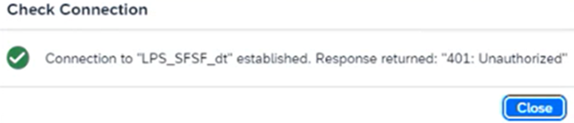
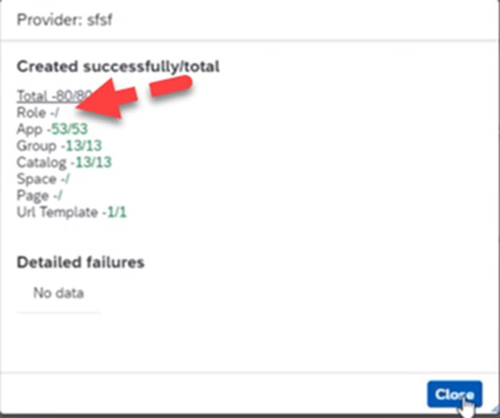

# Enabling Joule for SAP SuccessFactors

*SuccessFactors is the reference scenario SAP uses to teach how any Line of Business gets Joule — learn the pattern here once.*

> [!NOTE]
> **📍 At a glance**
> - **You will learn:** how Joule actually relates to SuccessFactors architecturally, the specific prerequisites for activation, and 19 documented real-world activation issues with their fixes
> - **You will build:** nothing — this is activation/architecture knowledge, not a code tutorial
> - **Level:** beginner · **Time:** about 12 minutes
> - **Builds on:** [Joule's identity and platform foundation](btp-identity-foundation.md). **Leads to:** [Joule Studio tutorial 1: environment and connectivity setup](joule-studio-tutorial-1-environment-setup.md), the first of the Joule Tutorials

**After this chapter you can:**

- Explain why Joule "feels native" in SuccessFactors despite running on BTP
- State SuccessFactors' specific entitlement and licensing prerequisites for Joule
- Recognize this as the template every other LoB-specific enablement follows
- Diagnose the most common real-world activation failures, from trust misconfiguration to a missing navigation button

## 1. Why SuccessFactors is the reference scenario

Activating Joule for a Line-of-Business solution is **not** a repeat of the platform setup from the previous two chapters. Joule is provisioned centrally — but its *behavior* is defined locally, by the business system it operates in.

SAP SuccessFactors was one of the first SAP solutions to support Joule, so SAP uses it to teach the general pattern: how Joule integrates with a SaaS application, uses identity and authorizations at runtime, and executes navigational and transactional interactions in a real business context.

## 2. The architecture, stated precisely

Joule is embedded within the SuccessFactors UI — it looks native, but it isn't running inside SuccessFactors itself.

- **SuccessFactors remains the system of record** for HR data and processes.
- **Joule is a service on SAP BTP** acting as an interaction and orchestration layer — it interprets intent and invokes SuccessFactors capabilities, it doesn't replace them.
- **All data access and actions Joule performs are governed by existing SuccessFactors authorizations.** Joule never operates with privileges a human user in that role wouldn't already have.

This separation is the point: Joule adds usability without bypassing SAP's existing security or business logic. It's worth internalizing this exact framing, because every other LoB chapter (and the extension boundary from the previous chapter) repeats the same shape: *embedded UI, BTP-hosted service, local system's authorizations govern everything.*

## 3. Prerequisites specific to SuccessFactors

| Prerequisite | Note |
|---|---|
| **SAP BTP account with Joule entitlement** (`das-application`) | Check this specific entitlement in your Global Account. If you hold a SuccessFactors license but this entitlement is missing, contact your SAP Account Executive — it's a licensing gap, not a configuration one |
| **SAP Build Work Zone, standard edition / SAP Start** | The navigation layer from the previous chapter |
| **SuccessFactors license and Joule Data Center availability** | Not every data center supports Joule yet — availability is a real constraint to check, not an assumption |
| **SAP Cloud Identity Services with active tenants** | Same identity foundation from [Joule's identity and platform foundation](btp-identity-foundation.md) |

SAP provides step-by-step activation guidance through **SAP Discovery Center missions**, specifically "Activate Joule for SAP SuccessFactors" — these translate the high-level model above into concrete configuration steps and automate parts of it through BTP tooling.

### 3.1 SuccessFactors Mobile needs one extra check

Joule in **SAP SuccessFactors Mobile** relies on **BTP Mobile Services** for authentication — a different mechanism from the web activation covered above. The one concrete step: in Cloud Identity Services, open the **SFSF Mobile Service** application's **Trust → Dependencies** tab and confirm an API dependency exists with Application starting `das-ias` and API `joule-api` (named `JOULE`). If it's missing, add it manually rather than assuming mobile will just inherit the web setup. SAP Note 3583836 has further configuration detail.

## 4. Troubleshooting: 19 common SuccessFactors activation issues

A dedicated troubleshooting source collects the recurring real-world problems from actual SuccessFactors activations, each as symptom → cause → fix:

| # | Symptom | Cause | Fix |
|---|---|---|---|
| 1 | Joule doesn't work at all in the SFSF account | Trusted Domains misconfigured | Configure Trusted Domains in both SAP Authorization & Trust Management Service and Cloud Identity Services |
| 2 | Joule shows both "Default Login" and "IAS Login" options | Both Default Logon and IAS are available for user logon in the BTP subaccount | BTP Cockpit → Joule subaccount → Security → Trust Configuration → edit the `sap.default` IdP → untick "Available for User Logon" |
| 3 | Blank screen when using Azure AD/OKTA as a proxy via Cloud Identity | SSO forwarding / conditional authentication misconfigured | Turn **off** "Forward All SSO Requests to Corporate IDP"; set Conditional Authentication's Default Authentication IdP to the actual Azure AD/OKTA provider for the Joule BTP app |
| 4 | `LPS_SFSF_dt` destination check fails with 401 Unauthorized, or Work Zone Content Channel creation fails | Wrong URL/user/password, or IP restrictions | Verify the SFSF API URL (SAP Note 2215682), check NAT IP restrictions on both the BTP region and SFSF side, use a dedicated technical user with a non-expiring password |
| 5 | A user sees a colleague's Joule chat history | Dev/Preview systems reusing shared dummy emails | Use real per-user emails, or switch the Subject Name Identifier from Email to Login Name in Cloud Identity Services |
| 6 | Joule's Navigation button disappears after a Job run/sync | NavigationService destination's Token Service URL Type is set to "Common" instead of "Dedicated" | Export the destination, confirm/fix `tokenServiceURLType: Dedicated`; if still broken, manually refresh the Content Channel in Work Zone |
| 7 | Channel Manager / Site Manager launch error from SFSF | User sync incomplete | Assign the `Launchpad_Admin` role; run the "Refresh Synthetic Group Data" job in Admin Center |
| 8 | IPS target-system creation shows no "Work Zone, standard edition" option | IPS landscape is still on the legacy SAP NEO console, not migrated to multi-cloud | Upgrade IPS to multi-cloud (roughly 1 hour to 1 day) |
| 9 | Unsure whether IPS source uses SCIM or OData | Work Zone **Groups** specifically require SCIM 2.0 — OData is not recommended for that | Check the Source System's Properties URL in Cloud Identity Services |
| 10 | Want a faster setup than manual field-by-field configuration | — | Import the attached `SourceFile`/`TargetFile` JSON templates (rename `.txt` → `.json`), then just fix the account-specific Properties |
| 11 | Joule authentication fails when third-party cookies are blocked | Browser cookie policy, or an incognito window | Disable third-party cookie blocking (SAP Note 3428564) |
| 12 | Need to confirm which Joule groups were actually created | — | Work Zone subaccount → Instances/Subscriptions → Settings tab → enter the user's email or Global User ID, check assigned roles |
| 13 | URL validation fails during the Booster after a Common Super Domain (CSD) migration | The SuccessFactors Admin URL changed as part of the CSD migration | Match the SuccessFactors Admin URL per the CSD Migration Guide, chapter 5 |
| 14 | Can't use Joule in an Incognito/private browser window | Third-party cookies blocked | Same fix as issue 11 |
| 15 | Joule Booster execution fails outright | Trust between the BTP subaccount and Cloud Identity Services was never established | Complete the Cloud Identity Services trust configuration step before running the Booster — it's a hard prerequisite, not optional |
| 16 | Generic "Oops, something went wrong" error | A Global User ID mismatch (SAP Note/KBA 3488269), or per-user IP/login-policy restrictions | Check IP Restriction Management and "Set API login exceptions" per user; add the BTP region's actual NAT IPs |
| 17 | Phone number field behaves oddly inside Joule/SFSF | — | SAP Note/KBA 3458399 |
| 18 | "Processing Error" with a WebSocket error visible in the browser's Network tab | Local IT or network policy is blocking Joule as a third-party app | Ask local IT to whitelist it |
| 19 | A previously-working use case breaks after a monthly release | — | SAP Note 3612244 |

> [!CAUTION]
> **🔒 Adding IP restrictions where none existed before can lock out legitimate users**
> For issue 16's IP-restriction fix: only add BTP NAT IPs to an **existing** restriction list. Introducing IP Restriction Management where the account had none before is a real way to accidentally lock out users who weren't restricted — confirm there's already a restriction policy in place before adding to it.

- **Two unresolved real-world reports worth knowing about, not just the documented fixes above:** one user got business apps found but zero business data returned on an S/4 Public Edition customizing tenant despite SAP support confirming the configuration was correct — no public resolution was ever posted. A second reported some employees' Joule prompts silently failing while others with identical access and browser configuration worked fine — also unresolved. If a fix above doesn't resolve a symptom, these are a reminder that not everything in this space has a known fix yet.
- **Multi-system demo landscapes**: SuccessFactors sales-demo (TDD) systems can't change their IAS tenant. If a demo needs Joule across both SuccessFactors and S/4 demo systems, the S/4 TDD has to be aligned to the same IAS tenant, or a second Joule TDD tenant is needed — at the cost of losing cross-product demo capability (SAP Note/KBA 2944990).

## 5. Added by Claude, not from the sources

- Framing this chapter as "the template every other LoB chapter follows" is this book's own observation, made explicit because the next chapter (covering six more products) deliberately doesn't repeat this architectural explanation in full.
- Not run: this chapter is architecture and prerequisite guidance; nothing was independently executed.

## 6. Interview corner

1. Does Joule run inside SuccessFactors?

- No — it's embedded in the SuccessFactors UI but runs as a separate service on SAP BTP; SuccessFactors stays the system of record

2. What governs what Joule is allowed to do in SuccessFactors?

- Existing SuccessFactors authorizations — Joule never bypasses them or operates with elevated privileges

3. A customer has a SuccessFactors license but can't find the Joule entitlement in their BTP account. What's the likely cause?

- A missing `das-application` entitlement — this requires contacting the SAP Account Executive, it's not something fixable through self-service configuration
- *Stronger answer:* also check Joule Data Center availability for their region — SuccessFactors licensing alone doesn't guarantee Joule is available in their specific data center yet

4. Joule's navigation button has disappeared after a sync job ran. Where do you look first?

- The NavigationService destination's Token Service URL Type — it needs to be "Dedicated," not "Common"
- *Stronger answer:* confirm via the Content Channel sync report in Channel Manager — a Role count of 0 while App/Group/Catalog all synced fully is the diagnostic signature of this exact issue

5. Users report a blank screen when logging into Joule through a corporate IdP like Azure AD or OKTA. What's the likely fix?

- Turn off "Forward All SSO Requests to Corporate IDP," then set Conditional Authentication's Default Authentication IdP to the actual corporate provider for the Joule BTP app
- *Stronger answer:* this is a conditional-authentication routing problem, not a trust-configuration problem — don't reach for the trusted-domains fix (issue 1) by default, confirm which one actually applies

> [!TIP]
> **🧩 Design question**
> *"An HR admin asks why Joule can show them one employee's salary but refuses to show them another's."* Talk about: this is authorization working as designed, not a bug — Joule inherits the admin's existing SuccessFactors permissions exactly, so if the admin couldn't see that employee's salary through the normal SuccessFactors UI, Joule won't surface it either.

## Cheat sheet

| Fact | Detail |
|---|---|
| Where Joule runs | SAP BTP (not inside SuccessFactors) |
| Who governs its actions | Existing SuccessFactors authorizations |
| Key entitlement | `das-application` in the BTP Global Account |
| Availability gate | Joule Data Center availability per region |
| Guided setup | SAP Discovery Center mission: "Activate Joule for SAP SuccessFactors" |
| Missing nav button | NavigationService Token Service URL Type must be "Dedicated" |
| Blank login screen (corporate IdP) | Fix Conditional Authentication's Default IdP, not Trusted Domains |
| "Oops, something went wrong" | Global User ID mismatch, or per-user IP/login-policy restriction |

## Recap

- Joule in SuccessFactors is a BTP-hosted orchestration layer, not a SuccessFactors-native feature — SuccessFactors stays the system of record
- Every action Joule takes is bound by the acting user's existing SuccessFactors authorizations
- The specific entitlement to check is `das-application`; a missing one means contacting your Account Executive, not debugging configuration
- This architecture (embedded UI, BTP service, local authorizations govern everything) is the pattern every other Line-of-Business enablement repeats
- 19 documented real-world activation issues exist, from trusted-domain misconfiguration to a missing navigation button to generic "Oops" errors — most trace back to identity/trust routing or incomplete user-sync, not to Joule itself being broken

## Practice

1. Explain out loud why "Joule feels native in SuccessFactors" is true even though it's architecturally a separate BTP service
2. Name the specific entitlement to check first when SuccessFactors Joule access is missing

## How this chapter was checked

- "Setting Up Joule for SAP SuccessFactors" (Unit 3, lesson 1 of 7) from "Setting Up Joule Across your Organizational System Landscapes" was read in full, 10 Nov 2026.
- No images appeared in this lesson — none were skipped.
- Section 3.1 was added 13 Nov 2026 from the official SAP Help doc "Setting Up Joule in SAP SuccessFactors Mobile" — short, no content images (one generic "SAP link" icon, excluded).
- Section 4 was added 13 Nov 2026 from a dedicated troubleshooting source, including its 8-comment thread. 37 real content screenshots were found and downloaded (0 duplicates, 0 failures); 2 are embedded above as the clearest diagnostic illustration of their issue, each opened and visually verified before captioning (one initial caption was corrected after opening the file showed a different screen than assumed from its filename). The remaining 35 are additional sequential step-by-step screenshots for issues 3, 4, 6, 7, 10, and 16 (each of which has 3–7 screenshots walking the same fix) — all downloaded and kept in `images/` (filenames `sj145-*`), not individually embedded here to keep the chapter readable, since the table above and the two embedded screenshots already convey each fix completely.
- Nothing in this chapter is code; nothing was run.

## Sources and further reading

- SAP Learning, *Setting Up Joule Across your Organizational System Landscapes* — https://learning.sap.com/courses/setting-up-joule-across-your-organizational-system-landscapes, "Setting Up Joule for SAP SuccessFactors" (read in full 10 Nov 2026)
- SAP Community, nageshcaparthy, *Joule with SFSF – Common Setup Issues* — https://community.sap.com/t5/technology-blog-posts-by-sap/joule-with-sfsf-common-setup-issues/ba-p/13650311 (article and comment thread, read in full 13 Nov 2026)
- SAP Help Portal, *Setting Up Joule in SAP SuccessFactors Mobile* — https://help.sap.com/docs/successfactors-platform/setting-up-and-using-joule-in-sap-successfactors/setting-up-joule-in-sap-successfactors (read in full 13 Nov 2026)

Previous: [How business users actually use Joule](05-how-business-users-use-joule.md) · Next: [Joule Studio tutorial 1: environment and connectivity setup](joule-studio-tutorial-1-environment-setup.md)
