# Document grounding, analytics, and developer tooling

*Three capabilities that turn Joule from "answers generically" into "answers from your documents, your data, and inside your own IDE."*

> [!NOTE]
> **📍 At a glance**
> - **You will learn:** how Document Grounding actually retrieves (not trains on) your content, the concrete setup and troubleshooting for Analytical Insights (destinations, OAuth clients, IPS), and what SAP Joule for Developers does inside ABAP Cloud and SAP Build
> - **You will build:** nothing yet — this is the capability map before you configure any of the three
> - **Level:** intermediate · **Time:** about 20 minutes
> - **Builds on:** [What Joule actually is](01-what-is-joule.md) (grounding, 1.2) and [Joule Studio and the agent development lifecycle](02-joule-studio-lifecycle.md). **Leads to:** [How business users actually use Joule](05-how-business-users-use-joule.md)

**After this chapter you can:**

- Explain why Document Grounding is retrieval, not training, and why that distinction matters for data governance
- Describe what Document Grounding with Contextualization adds on top of plain grounding
- Say what Analytical Insights connects to, and what kind of results it returns
- Set up the 5 destinations and 2 OAuth clients Analytical Insights needs, and diagnose its 4 most common failure modes
- List what SAP Joule for Developers actually does, and where it runs
- Know the one licensing gotcha that makes SAP Joule for Developers invisible in your entitlements list

## 1. Document Grounding: retrieval, not training

Document Grounding lets Joule answer from **customer-specific documents** — internal policies, manuals, procedures — instead of only generic model knowledge.

The distinction that matters: Joule does **not** treat these documents as training data. It retrieves relevant content **at runtime** from a grounding pipeline and uses it to ground the response.

- Answers stay aligned with your actual content, not a stale snapshot baked into model weights
- Responses reflect the current version of a document — update the source, the next answer reflects it
- Access respects existing authorizations — grounding doesn't create a side-channel around permissions

### Document Grounding with Contextualization

Plain grounding retrieves from the whole document set. **Contextualization** adds metadata to documents — application, business domain, or other classification attributes — so Joule narrows retrieval to documents matching the user's actual context.

- Responses get more precise and less ambiguous
- Grounding scales to larger document sets without diluting relevance
- It changes *which documents Joule selects*, not how users access documents directly

## 2. Analytical Insights: conversation meets SAP Analytics Cloud

Analytical Insights lets users ask analytical questions in natural language and get answers from **governed enterprise data** — not transactional data read directly, but results from analytical models made available for conversational analytics.

- Joule translates the user's intent into an analytical query
- Results come back as structured output — charts or key figures — alongside free-form text, not text-only
- The integration point is **SAP Analytics Cloud**

This is the same "Analytical" interaction pattern covered in [How business users actually use Joule](05-how-business-users-use-joule.md), 5.2 — here's what actually powers it on the backend, before you get there.

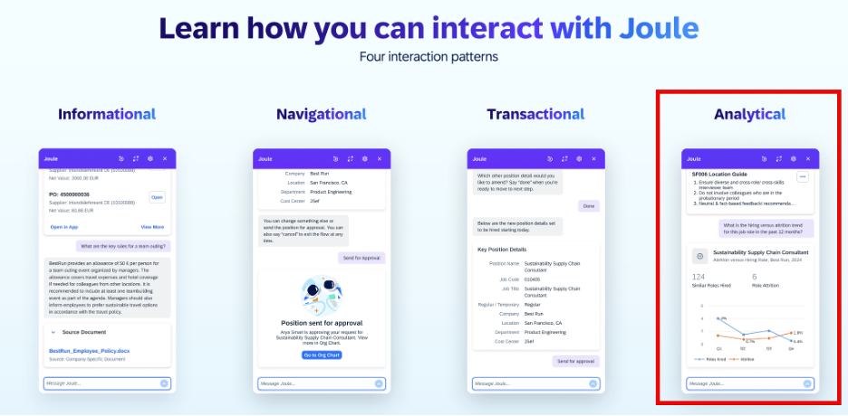

### 2.1 What it actually does

- **Question types supported:** Descriptive ("total revenue Q1"), Comparative ("compare sales 2023 vs. 2024"), Time Series ("sales by month"), and Top/Bottom N ("top 5 sales by store").
- **Model Disambiguation:** if a query matches more than one indexed model, Joule asks which one to use rather than guessing.

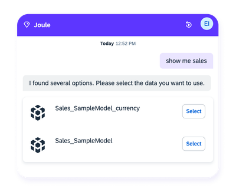

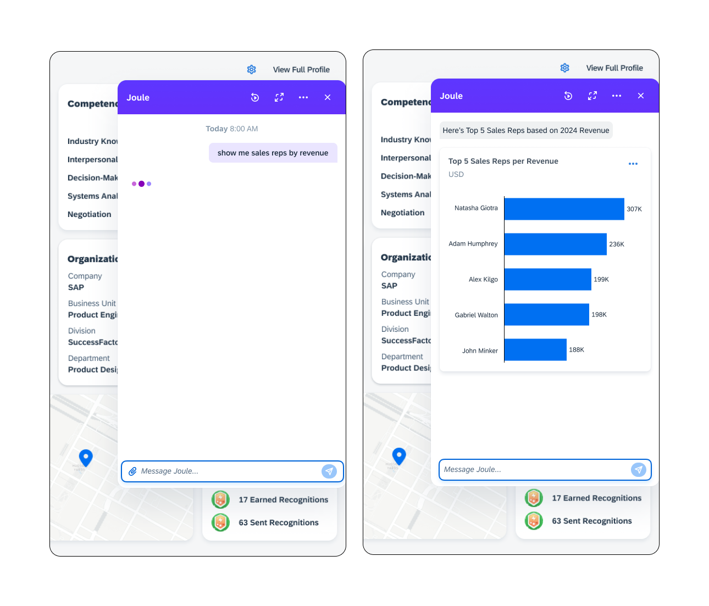

- **Data is configured through SAC's "Just Ask" feature:** admins index SAP Datasphere models (surfaced via SAP Business Data Cloud) and acquired models through SAC's **Manage Models**. Admins can also define **synonym mapping** (e.g. "revenue" → "total sales") and **context rules** (e.g. auto-adding "by sales agents" to an ambiguous query).
- **Prerequisites:** a Joule entitlement, SAP Build Work Zone, and an **SAP Analytics Cloud Enterprise license** specifically — it is *not* available through LoB-embedded-analytics SAC licenses.
- **Languages supported:** English, French, German, Italian, Spanish.

### 2.2 Setting it up, concretely

> [!CAUTION]
> **🔒 As of the Joule 2506 release, SAP Build Work Zone is mandatory, not optional**
> This changed the integration: Work Zone is now required to provision and sync users and roles from SAC. If your setup predates 2506 and didn't include Work Zone, it needs to be redone — there's no way to add it on afterward without rebuilding the sync.

Two paths, depending on where you're starting from:

- **Brand-new Joule setup:** run the Booster, skip the S/4-specific and SuccessFactors-specific steps, and at the Select Capabilities step choose **SAP Analytics Cloud + SAP Build Work Zone**.
- **Existing Joule formation:** go to **System Landscapes → Formations → Include System**, add the SAC system, and check **Enable Capability Deployment** — sync takes roughly 5–8 minutes.

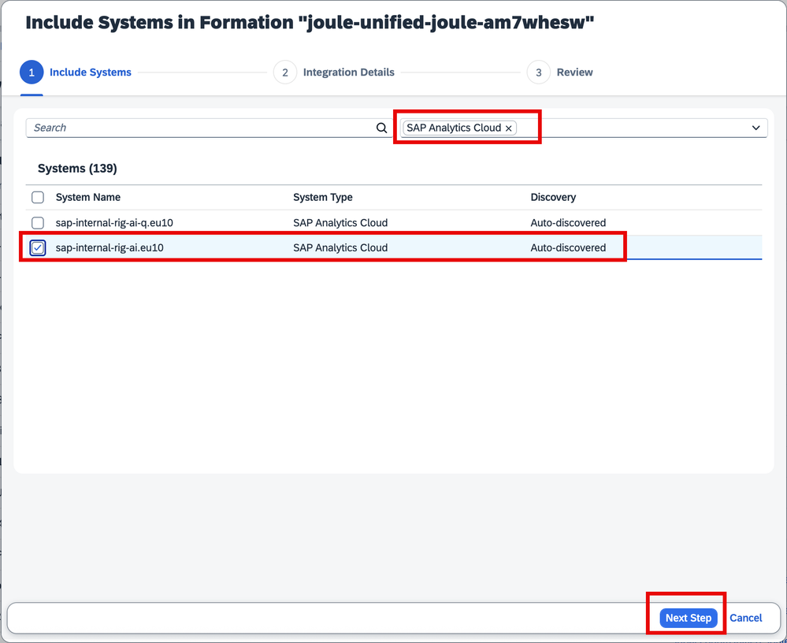
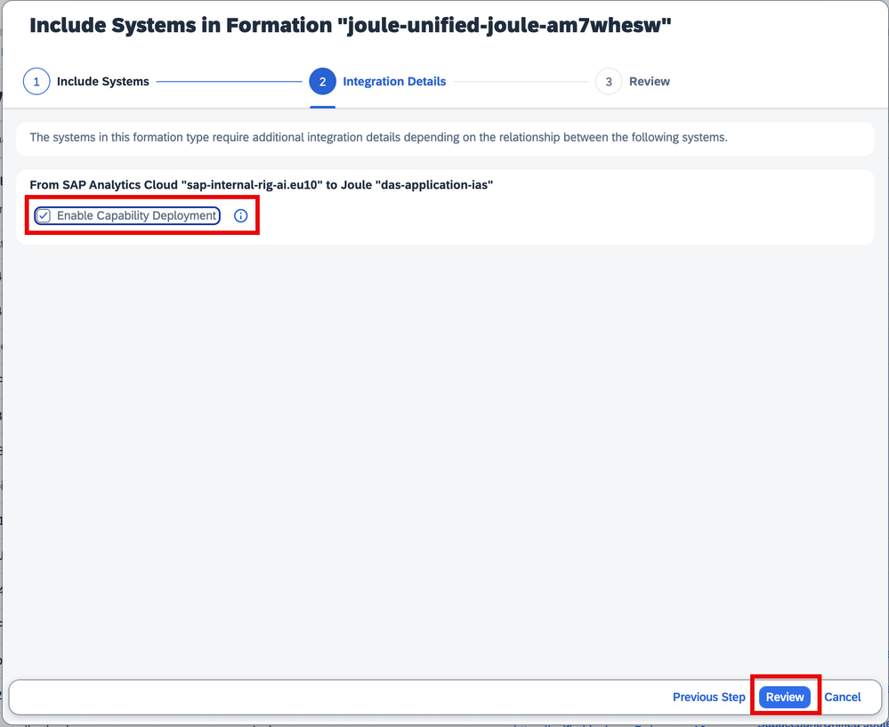
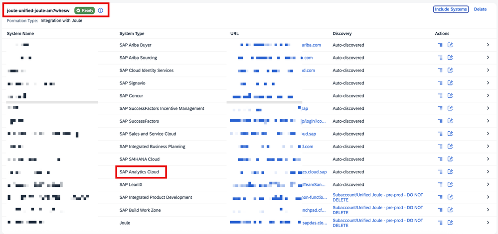

**Post-integration checks**, before assuming it worked:

- A destination named **`DYN_SAC_SSO`** should appear automatically in BTP Connectivity — you don't create it, its presence just confirms the setup worked.

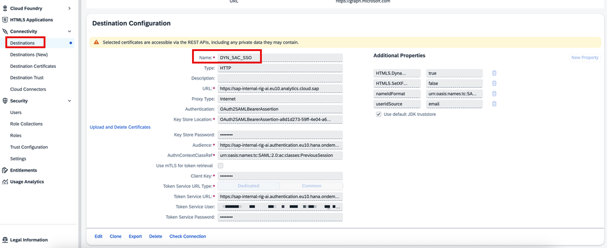

- SAC's own Roles list should show a **Joule** role with **Read** permission.

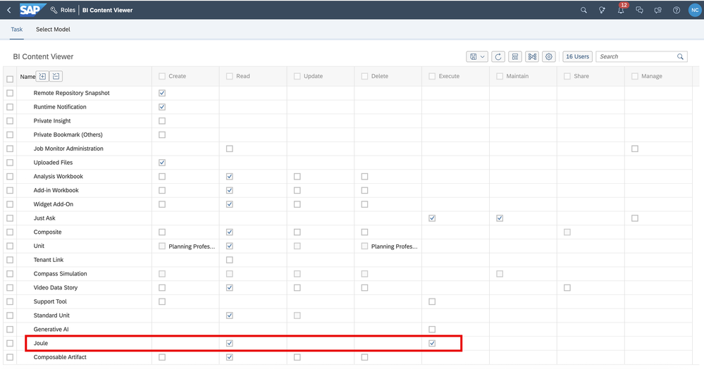

**5 destinations total** are needed (the first exists already from the base Joule activation; the rest are created for this integration specifically): `DYN_SAC_SSO` (auto-created), `NavigationService`, `SAC_SWZ_DT` (design-time), `SAC_SWZ_RT` (runtime, cloned from `DYN_SAC_SSO`), and `SWZ_JOULE`.

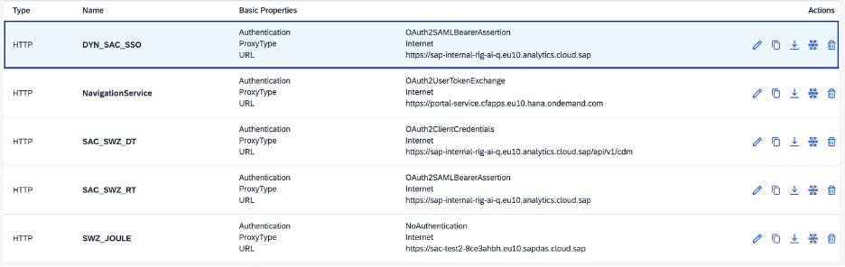

> [!WARNING]
> **⚠️ Pitfall: `NavigationService` is deprecated — check the date before following older instructions**
> SAP has since confirmed: if you're setting up Joule after **13 October 2025**, SAP handles the `NavigationService` step automatically and it won't appear in your subaccount — skip it. Don't follow step-by-step instructions written before that date without checking whether this step still applies to your setup.

Two separate **OAuth clients** are needed in SAC, with genuinely different configurations — easy to configure identically by mistake:

| Client | Purpose | Access | Authorization Grant |
|---|---|---|---|
| `sac-buildworkzone-dt` | API Access | User Provisioning | **Client Credentials** |
| `sac-buildworkzone-rt` | API Access | Data Export Service | **SAML2.0 Bearer** |

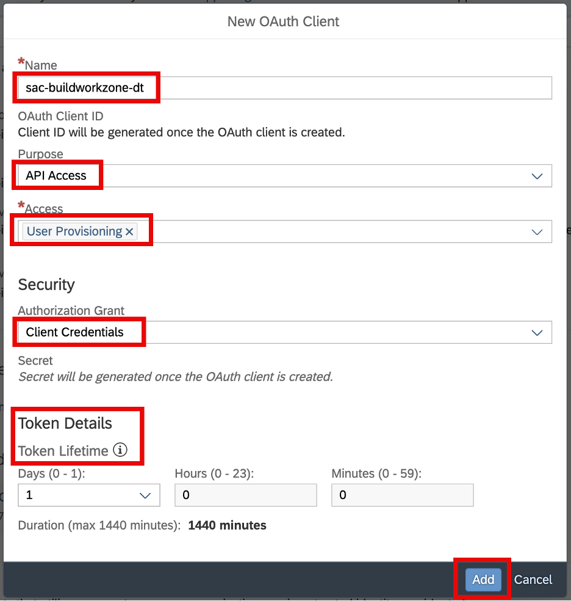
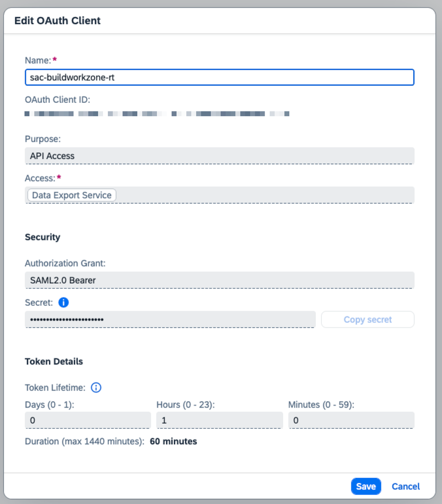

Set up the Work Zone **Content Provider**: Title/ID `sac.analytics`, pointing at the DT/RT destinations, with **"Automatically add all content items"** and **"Use Identity Provisioning service to provision user authorizations"** both enabled.

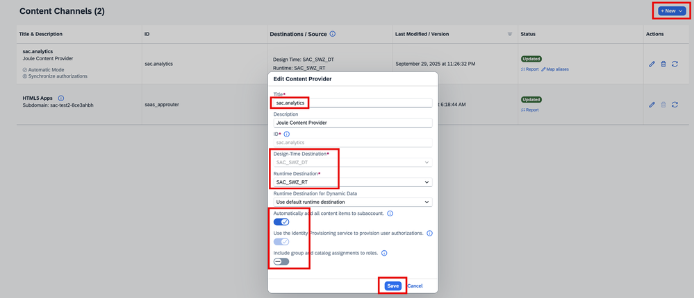

> [!NOTE]
> Role or permission changes made in SAC **after** this initial import aren't automatically reflected — you have to manually hit refresh on the `sac.analytics` content provider in Channel Manager. As of a confirmed **13 Feb 2026** release note, automatic synchronization of teams/roles/permissions from SAC is shipping — **available in Joule preview from Feb 2026, generally available from 15 March 2026**. If you're setting this up after that date, check whether manual refresh is even still necessary before assuming it is.

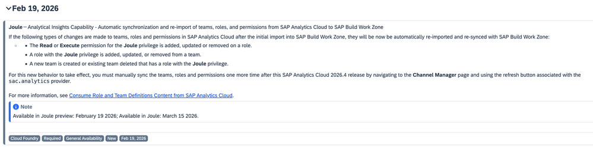

**IPS source/target setup:**

- **Source** = SAP Analytics Cloud (type "SAP Cloud Analytics"), with a required property **`sac.api.version = 2`** — version 1 lacks group-reading and other functionality this integration needs.
- **Target** = SAP Build Work Zone, with `cflp.providerId` recommended as `sac.analytics` (matching the Content Provider ID above) — plus target-specific properties `cflp.group.unique.attribute`, `cflp.patch.group.members.above.threshold` (default 5000), and `cflp.user.unique.attribute`.

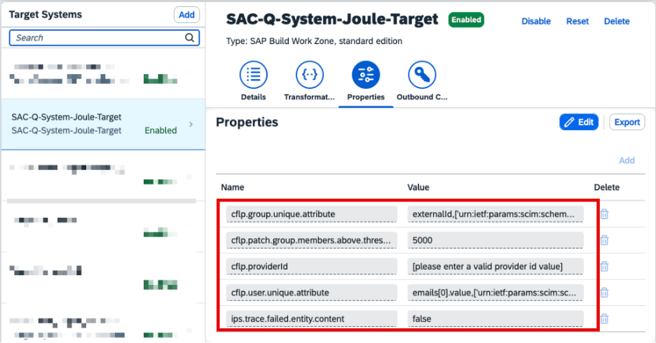

Both can be set up from downloadable JSON templates (SAP's GitHub) instead of field-by-field entry.

**Validate**: run the Read Job, then check Provisioning Log statistics for real entity counts (not zero):

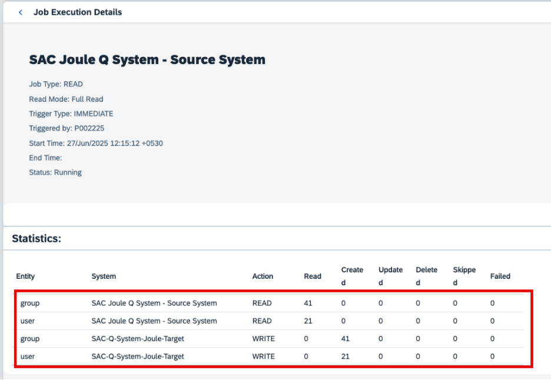

Also confirm via **Settings → Identity Provisioning → Explore Role Assignments**, entering a user's email, that the expected roles actually landed:

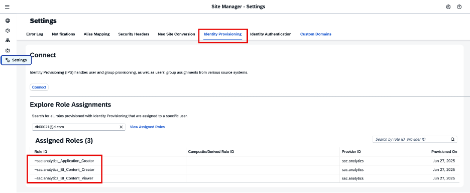

Once working, the result looks like a normal Joule conversation grounded in real SAC data:

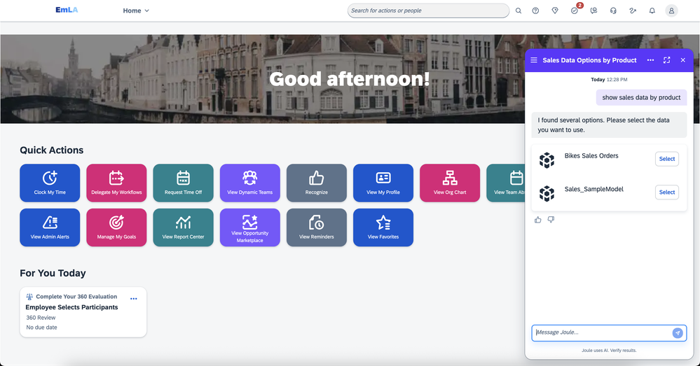

### 2.3 Troubleshooting

| Symptom | Cause | Fix |
|---|---|---|
| IPS job finishes with a 500 Internal Server Error on some users | Dummy **"API Access Users"** entries under SAC Teams named `RateRole_*` | Delete those dummy users, then re-run the Read Job |
| Multiple outdated SAML IdPs appear after migrating to Cloud Identity Services | Cosmetic leftover from migration, not functional | SAP Note 2761041 |
| Using a custom SAML attribute (not email) for SAC SSO | Default name-ID mapping doesn't fit | Reconfigure both `DYN_SAC_SSO` and `SAC_SWZ_RT` with `NameIdFormat: urn:oasis:names:tc:SAML:1.1:nameid-format:unspecified` and the matching `UserIdSource` mapping (attribute names are case-sensitive — force-uppercase with `:function[uppercase]` if needed); also define the same attribute on the Joule `das-ias` application. SAP Note 3656881 |
| Joule gives a generic answer instead of an analytical one | The Work Zone navigation entry for this integration is missing | Check the navigation API (`/navigation/api/v2/inbounds?pageSize=1000`) for a `"semanticObject": "SACJoule"` / `"semanticObjectAction": "read"` entry; if absent, check IPS for failed entities, or recreate the content channel and re-run IPS |

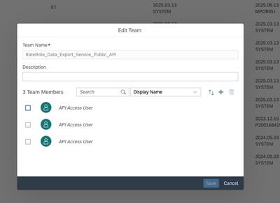
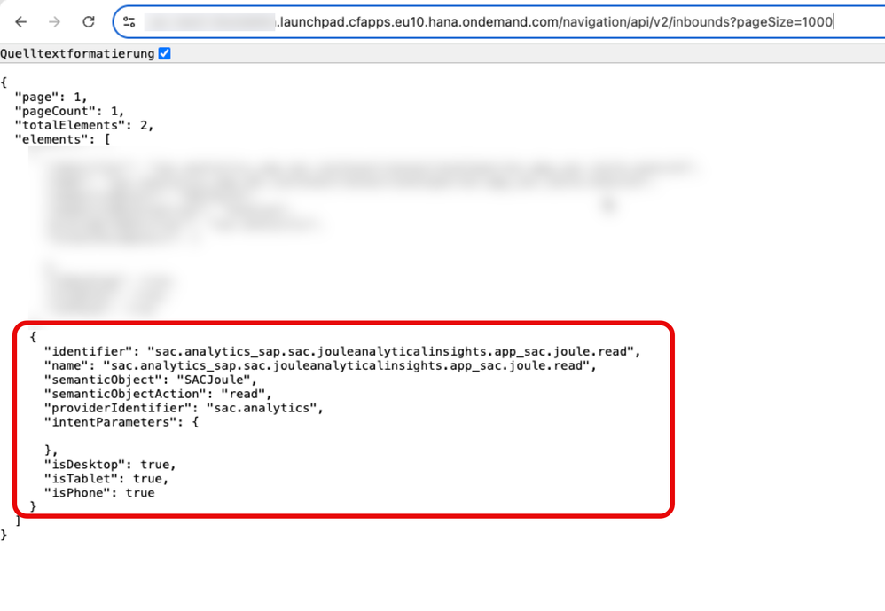

- **Reported, unresolved real-world issues worth knowing about:** one user got a flat "I cannot provide specific financial data" refusal for a direct commission question, with no resolution posted. Another, with no "real" SAC role, could only sync via IPS after being manually added to a SAC Team with an Admin role as a workaround — and even then didn't get the same answers as a properly-licensed colleague. A third asked whether the IPS provisioning step is still required when SAC and Work Zone are already centrally provisioned via a corporate IdP — unanswered, though the architecture described above strongly implies yes, since that step is specifically about SAC role/authorization sync, not general identity provisioning.

## 3. SAP Joule for Developers: design-time AI, not a runtime feature

SAP Joule for Developers is a set of **design-time** AI capabilities — meaning it helps you build, it isn't an end-user-facing runtime feature. It spans two surfaces:

- **SAP Build** — Build Code, Build Apps, Build Process Automation
- **ABAP Cloud development** — directly inside ABAP development tools (Eclipse/ADT), context-aware of the artifact's structure and language version

What it actually does:

| Capability | What it means |
|---|---|
| Code explanation and understanding | Reads existing code and explains it |
| Predictive code completion | Suggests code as you write |
| Unit test generation | Generates tests for application logic |
| Chat-style assistance | Conversational help inside supported dev tools |

- It's also available in **SAP S/4HANA Cloud Public Edition** for ABAP Cloud development, constrained to released APIs, extension points, and cloud-compliant practices — same capability, scoped to what the Public Edition's extension model actually allows.
- It operates **inside your existing environment** — there's no separate Joule-for-Developers workflow to learn, and you don't need to reinstall Eclipse to add it to an existing ADT setup.

> [!WARNING]
> **⚠️ Pitfall: it's a promo SKU, so it won't show up where you'd look for it**
> SAP Joule for Developers is a promotional SKU until **September 2026** — which means it will **not appear in your BTP global account entitlements list**. If you go looking for it the way you'd check any other entitlement and find nothing, that's expected, not a sign it's unavailable. Check the setup guide directly rather than concluding from an empty entitlements page.

## 4. Added by Claude, not from the sources

- Tying Analytical Insights explicitly back to [How business users actually use Joule](05-how-business-users-use-joule.md)'s "Analytical" interaction pattern is this book's own cross-reference; the course describes the capability without naming that earlier pattern. (That chapter in turn follows this one in the book — the cross-reference points forward, not back.)
- Sections 2.1–2.3's split into "what it does / setup / troubleshooting" reorganizes three further sources' running content into this book's standard shape — the facts, field names, and fixes are the sources', the structure is this book's.
- Not run: this chapter is capability and configuration guidance, not code; nothing was independently executed. Chapters 2–4 already carry this book's "not run" / "verified" markers for actual generated code.

## 5. Interview corner

**What interviewers listen for:** you know grounding is retrieval not fine-tuning (a very common confusion), and you can name where SAP Joule for Developers actually runs rather than treating it as a vague "AI coding helper."

### 🟢 Basic

1. Does Document Grounding train the model on your documents?

- No — it retrieves relevant content at runtime from a grounding pipeline; documents are never used as training data

2. What does Document Grounding with Contextualization add?

- Metadata-based filtering, so retrieval is narrowed to documents matching the user's actual context (application, domain, etc.), improving precision at scale

### 🟡 Intermediate

3. What does Analytical Insights actually connect to, and what does it return?

- SAP Analytics Cloud; it returns structured results (charts, key figures) alongside free-form text, derived from governed analytical models rather than raw transactional data

3a. An IPS Read Job for Analytical Insights fails with a 500 Internal Server Error on some users. What's the first thing to check?

- Dummy "API Access Users" under SAC Teams named `RateRole_*` — delete them, then re-run the Read Job
- *Stronger answer:* this is a SAC-side data-hygiene issue, not a Joule or IPS configuration problem — don't start by re-checking destinations or OAuth clients

3b. Two OAuth clients are needed in SAC for this integration. What's the one detail easy to copy wrong between them?

- The Authorization Grant type — `sac-buildworkzone-dt` uses Client Credentials, `sac-buildworkzone-rt` uses SAML2.0 Bearer; configuring both identically breaks the runtime client specifically

4. Where does SAP Joule for Developers actually run?

- SAP Build (Build Code, Build Apps, Build Process Automation) and ABAP Cloud development tools (Eclipse/ADT), including within SAP S/4HANA Cloud Public Edition's ABAP Cloud extension model
- *Stronger answer:* it's design-time only — it accelerates how you build, it isn't a runtime AI feature end users interact with

### 🔴 Senior

5. A customer says "we checked our BTP entitlements and SAP Joule for Developers isn't there, so we assume it's not available to us." How do you respond?

- That's expected, not conclusive — it's a promo SKU through September 2026 and deliberately doesn't appear in the entitlements list
- *Stronger answer:* verify availability against the actual setup guide/current terms rather than the entitlements page, and flag that this status is time-bound — revisit it as the promo period approaches its end

> [!TIP]
> **🧩 Design question**
> *"Legal wants Joule to answer HR policy questions, but only from the current, approved policy documents — not from anything an employee might paste in a prior chat, and never from a draft policy that hasn't been published yet."* Talk about: Document Grounding (not fine-tuning) as the only architecture that keeps the model from "memorizing" stale or draft content, Contextualization to scope retrieval to the approved-policy document set specifically, and how existing authorizations already prevent grounding from becoming an access-control bypass.

## Cheat sheet

| Capability | Backend | Key distinction |
|---|---|---|
| Document Grounding | Retrieval pipeline | Retrieval at runtime, not training |
| + Contextualization | Metadata filtering | Narrows *which* documents, not *who* can access them |
| Analytical Insights | SAP Analytics Cloud | Governed models, structured + text output; 5 destinations, 2 OAuth clients, `sac.api.version=2` required |
| SAP Joule for Developers | SAP Build / ABAP Cloud (Eclipse/ADT) | Design-time only; promo SKU, invisible in entitlements until Sep 2026 |

## Recap

- Document Grounding retrieves from customer documents at runtime — never trains on them — and respects existing authorizations
- Contextualization adds metadata-based filtering to scope retrieval, improving precision as the document set grows
- Analytical Insights turns natural-language questions into queries against SAP Analytics Cloud's governed models, returning structured results
- As of Joule 2506, SAP Build Work Zone is a mandatory part of the Analytical Insights integration, not optional — pre-2506 setups without it need to be rebuilt
- The most common Analytical Insights failure (a 500 error on the IPS Read Job) traces to dummy `RateRole_*` API-access users in SAC Teams, not to Joule configuration itself
- SAP Joule for Developers is design-time AI (code explanation, predictive completion, unit test generation, chat assistance) inside SAP Build and ABAP Cloud tooling — and it's a promo SKU that won't show up in your entitlements list through September 2026

## Practice

1. Explain out loud, in one sentence, why "Document Grounding" and "fine-tuning" are not the same thing
2. Sketch where SAP Joule for Developers would show up in your own IDE if you work in ABAP Cloud or SAP Build
3. Without looking back, name the one gotcha that makes SAP Joule for Developers easy to wrongly conclude is unavailable

## How this chapter was checked

- All 3 lessons of Unit 4 ("Setting Up Joule for Document Grounding," "Setting Up Joule for Analytical Insights," "Setting Up SAP Joule for Developers") and the unit quiz, from "Setting Up Joule Across your Organizational System Landscapes," were read in full, 10 Nov 2026.
- No images appeared in any of these 3 lessons — none were skipped.
- Section 2 was substantially expanded 13 Nov 2026 from 4 further sources, discovered via a partner resource hub and read in full: the SAP Community blogs "Introducing Analytical Insights in Joule" (intro/conceptual) and "Analytical Insights in Joule – Setup Guide" (the dense, hands-on procedural guide — the single densest source behind this section), plus two official SAP Help docs ("Analytical Insights with SAP Analytics Cloud" and "Integration with SAP Analytics Cloud"). Comment threads were checked on both Community posts.
- Across these 4 sources, 50 images were found (2 + 46 + 1 + 0) and all downloaded; 19 are embedded above. Every embedded image was opened and visually verified against its caption before being written — the setup guide's images initially came back from a background read as generically-named, unverified files, so each one used here was individually confirmed against the actual screen it shows, not assumed from filename or DOM order. 1 of the 46 was a decorative icon (excluded); the remaining ~25 not embedded are additional sequential screenshots of the same multi-step wizard flows already illustrated (e.g. further Content Channel/role-assignment confirmation screens), kept in `images/` (`sj140-*`) without individual captions.
- Nothing in this chapter is code; nothing was run.

## Sources and further reading

- SAP Learning, *Setting Up Joule Across your Organizational System Landscapes* — https://learning.sap.com/courses/setting-up-joule-across-your-organizational-system-landscapes, Unit 4 (read in full 10 Nov 2026)
- SAP Community, *Introducing Analytical Insights in Joule: Empowering Smarter Decisions* — https://community.sap.com/t5/technology-blog-posts-by-sap/introducing-analytical-insights-in-joule-empowering-smarter-decisions/ba-p/14083673 (read in full 13 Nov 2026)
- SAP Community, *Analytical Insights in Joule – Setup Guide* — https://community.sap.com/t5/technology-blog-posts-by-sap/analytical-insights-in-joule-setup-guide/ba-p/14096274 (article and comment thread, read in full 13 Nov 2026)
- SAP Help Portal, *Analytical Insights with SAP Analytics Cloud* — https://help.sap.com/docs/joule/capabilities-guide/analytical-insights-with-sap-analytics-cloud (read in full 13 Nov 2026)
- SAP Help Portal, *Integration with SAP Analytics Cloud* — https://help.sap.com/docs/joule/integrating-joule-with-sap/integration-with-sap-analytics-cloud (read in full 13 Nov 2026)

Previous: [Joule Studio and the agent development lifecycle](02-joule-studio-lifecycle.md) · Next: [How business users actually use Joule](05-how-business-users-use-joule.md)
