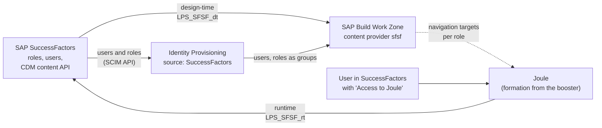

# Joule with SAP SuccessFactors: the integration steps

*How an administrator switches Joule on in SAP SuccessFactors: register the system, run the booster, bring SuccessFactors roles into SAP Build Work Zone, sync users with IPS, and grant the permission.*

> [!NOTE]
> **📍 At a glance**
> - **Sources:** SAP's guide *Integrating Joule with SAP Solutions* (PUBLIC, 15 Nov 2024, course Drive), checked against SAP Help (read 21 Nov 2026). Where they differ, SAP Help's current version is used.
> - **You will set up:** Joule for SuccessFactors users, customer-managed: system registration, booster, content provider `sfsf`, Identity Provisioning (IPS), and the *Access to Joule* permission
> - **You need:** BTP global account admin, a SuccessFactors company integrated with Identity Authentication (IAS), SAP Build Work Zone with an instance and service key, and IPS admin rights
> - **Level:** advanced (administrator)
> - **Concepts:** [The Joule family](joule-family.md), [Customer- vs SAP-managed Joule](joule-studio-intent-based.md), [Tutorial 13](tutorial-joule-sac-analytical-insights.md) for the same Work Zone and IPS pattern
> - **Quick reference:** [Joule setup building blocks](reference-joule-setup-building-blocks.md) (destinations, booster, Work Zone, IPS, AI units)
> - **Last checked:** 21 Nov 2026

**After this chapter you can:**

- Choose between SAP-managed and customer-managed provisioning
- Register a SuccessFactors system and run the Joule booster for it
- Configure the content provider and IPS so Joule knows each user's SuccessFactors roles
- Grant the Joule permission and know how long changes take

## 15.1 What you set up



- **Two ways to provision Joule** (SAP Help):
  - **SAP-managed:** SAP does the technical setup and integrations for you.
  - **Customer-managed:** you set Joule up yourself in SAP BTP, with full control over subaccounts, entitlements and system integrations. The steps below are for this way.
- **Why Work Zone:** its navigation service resolves the apps a user may open. It needs the SuccessFactors roles (content provider) and the users with their roles (IPS).

## 15.2 Steps (customer-managed)

*SAP's guide and SAP Help, in our own words. No screenshots: SAP's guide is copyrighted, so tables replace them.*

### Step 1: Check the prerequisites

- SuccessFactors is integrated with **Identity Authentication**: Joule signs users in through the product's IAS setup.
- A **SAP Build Work Zone, standard edition** subscription, an instance and a **service key** exist (foundation plan; an existing standard-plan setup can be reused).
  - Steps as in [tutorial 13, step 2](tutorial-joule-sac-analytical-insights.md).
- Your user has the **Manage Identity Provisioning** role in Cloud Identity Services.

### Step 2: Register the SuccessFactors system in the global account

1. In the BTP cockpit, open the **global account → System Landscape → Systems → Add System**.
2. **Type:** *SAP SuccessFactors*. **Name:** printable ASCII only; SAP suggests showing the type, for example `<mysystem>-SuccessFactors`. Choose **Add**.
3. Choose **Get Token** and copy it.
   - The token is valid for **7 days** and can register **one** system only.
4. In **SuccessFactors Admin Center → Extension Center → Extensions on SAP BTP**, paste the token under **Add Integration with SAP BTP** and choose **Add**. Wait until the integration status is finished.
   - The SuccessFactors user needs *Admin Access to MDF OData API* and *Create Integration with SAP BTP*.
5. Back in the cockpit, the system's status changes to **Registered**.
   - A registered system cannot move to another global account; it must be registered again there.

### Step 3: Run the Joule booster

- Run the Joule booster and select **SAP SuccessFactors** under *Select Integrations*. You can add other products if you have their licences and entitlements.

> [!NOTE]
> **2024 guide and SAP Help differ: who creates the destinations**
> - **2024 guide:** after the booster you create the design-time destination `LPS_SFSF_dt` and check the runtime destination `LPS_SFSF_rt` by hand (step 4).
> - **SAP Help (Nov 2026):** after the booster, `LPS_SFSF_rt`, `LPS_SFSF_dt` and `SFSF_SSO` are managed in the backend and do not appear under *Connectivity → Destinations*.
> - Setups made before **13 Oct 2026** keep their manually created destinations; maintain those as in step 4.

### Step 4: Content from SuccessFactors (older setups with manual destinations)

1. **Design-time destination** (reads the role content through SuccessFactors' CDM API):

    | Field | Value |
    |---|---|
    | Name | `LPS_SFSF_dt` |
    | Type / Proxy Type | HTTP / Internet |
    | URL | `https://<tenant API URL>/rest/servicesfoundation/sfcdmcontentservice/v1/SFCDMContent` |
    | Authentication | Basic Authentication with a SuccessFactors user that has OData API access, as `username@COMPANY` |
    | Additional properties | *Use default JDK trust store* on; `HTML5.DynamicDestination` = `true` |

   - SAP notes that Basic Authentication for SuccessFactors APIs is **deprecated**; certificate-based destinations are the way forward.
2. **Runtime destination** `LPS_SFSF_rt` (created by the booster): HTTP, Internet, *NoAuthentication*, URL = your SuccessFactors tenant, property `sfsf.companyID` = your company. Change it only when:
   - you use the Work Zone **foundation** plan: add `sap-start` = `true` (type it; it is not in the list)
   - your tenant moved to the **cloud.sap** domain: update the URL, for example `https://sfsf.cloud.sap`
3. **Content provider:** Work Zone → **Site Manager → Channel Manager → + New → Content Provider**:

    | Field | Value |
    |---|---|
    | Title / ID | `sfsf` (recommended) |
    | Design-Time / Runtime Destination | `LPS_SFSF_dt` / `LPS_SFSF_rt` |
    | Runtime Destination for Dynamic Data | Use default runtime destination |
    | Automatically add all content items to subaccount | true |
    | Use the Identity Provisioning service to provision user authorizations | true |

### Step 5: Sync users and roles with IPS

IPS copies **users** (email, global user ID, group memberships) and **roles as groups**, with the role ID as external ID, from SuccessFactors to Work Zone.

1. In the IAS admin console, open **Identity Provisioning → Source Systems** and select the SuccessFactors source.
   - It must use the **SCIM API**. Older setups on the OData connector have to switch first.
2. **Transformations → group entity:** `Ignore` = `false`, with the mapping `$.id` → `$.externalId`.
3. **Properties:** check that `sf.user.filter` selects all the users who need Joule.
4. **Optional:** if groups should not go to IAS, set the group entity of the *IAS target system* to `Ignore` = `true`.
5. **New target system:** type *SAP Build Work Zone, standard edition*, any name (for example `Work Zone-Target`), source = the SuccessFactors system.
   - In its transformations, add the group mapping `$.externalId` → `$.externalId`.
6. **Target properties** come from the Work Zone service key. This snippet builds them from a key (placeholder values) and ran as shown:

    ```python
    import json

    # A Work Zone service key, shortened; all values are made-up placeholders.
    service_key = json.loads("""{
      "endpoints": {"portal-service": "https://portal-service.cfapps.eu10.hana.ondemand.com"},
      "uaa": {"clientid": "sb-example-client", "clientsecret": "<secret>",
              "url": "https://mysubaccount.authentication.eu10.hana.ondemand.com"}
    }""")

    def ips_target_properties(key, provider_id):
        """Properties of the IPS target system 'SAP Build Work Zone, standard edition'."""
        return {
            "Type": "HTTP",
            "ProxyType": "Internet",
            "Authentication": "BasicAuthentication",
            "URL": key["endpoints"]["portal-service"],
            "User": key["uaa"]["clientid"],
            "Password": key["uaa"]["clientsecret"],
            "OAuth2TokenServiceURL": key["uaa"]["url"] + "/oauth/token",
            "cflp.providerId": provider_id,          # the content provider ID in Channel Manager
            "ips.trace.failed.entity.content": "false",
        }

    props = ips_target_properties(service_key, provider_id="sfsf")
    for name, value in props.items():
        print(f"{name:32} {'***' if name == 'Password' else value}")
    ```

    ```text
    Type                             HTTP
    ProxyType                        Internet
    Authentication                   BasicAuthentication
    URL                              https://portal-service.cfapps.eu10.hana.ondemand.com
    User                             sb-example-client
    Password                         ***
    OAuth2TokenServiceURL            https://mysubaccount.authentication.eu10.hana.ondemand.com/oauth/token
    cflp.providerId                  sfsf
    ips.trace.failed.entity.content  false
    ```

   - Also keep the defaults SAP lists for `cflp.user.unique.attribute`, `cflp.group.unique.attribute` and `cflp.support.bulk.operation` = `false`.
   - Many users? Set `cflp.support.bulk.operation` = `true` and `cflp.bulk.operations.max.count` = `100`.
7. On the source system's **Jobs** tab, run a **Read** or **Resync** job.
8. **Schedule** the job at least every 24 hours, so it overlaps with SuccessFactors' *Refresh Synthetic Group Data* job.
   - Roles can take **24 to 48 hours** to reach the navigation service. Run both jobs by hand when you need it sooner.

### Step 6: Grant users the Joule permission

1. In **Admin Center**, give the users, through a permission role, the role-based permission **User Permissions → General User Permission → Access to Joule**.
   - SAP Help: Joule acts with the permissions of the user operating it, so audit a user's permissions before giving access.
   - 2024 guide: put Joule users in a permission group, grant the role to that group, and also give **User Search** for the use cases.
2. **Employee Central customers:** SAP recommends enabling **Employee Central Quick Actions** and configuring their templates.
3. **Timing (2024 guide):** permission changes should apply within 10 minutes; otherwise refresh role-based permissions. Navigation links can take **1 to 2 days**.

## 15.3 Why it works

- **Registration** pairs the SuccessFactors company with the global account. The booster can then put it in a Joule formation.
- **The content provider** tells Work Zone which apps belong to which SuccessFactors role. **IPS** tells it which users hold which roles. Together they decide what Joule may open for a user.
- **The permission** is the on-off switch per user. Joule then acts with that user's own SuccessFactors permissions.

## 15.4 Things to watch

| What you see | Why | Fix |
|---|---|---|
| The registration token no longer works | Older than 7 days, or already used | Choose *Get Token* again |
| No `LPS_SFSF_*` destinations in the cockpit | New setups have them managed in the backend | Nothing to do; only older setups maintain them |
| Users see Joule but no navigation links | Roles not yet synced, or still propagating | Run IPS Read and *Refresh Synthetic Group Data*; allow 1 to 2 days |
| IPS job ignores roles | Group entity set to `Ignore` = `true` on the source | Set it to `false`, with the `$.id` → `externalId` mapping |
| Destination stops working after a domain change | Tenant moved to cloud.sap | Update the runtime destination URL |

> [!IMPORTANT]
> **🏭 In production**
> - Start with a small permission group of pilot users. Because Joule uses each user's own permissions, a wide rollout makes every over-broad role visible.
> - Plan the 24 to 48 hour role delay into go-live and into user onboarding; tell users that navigation links appear later.
> - Move the design-time destination off Basic Authentication to certificates before SAP removes it.
>
> *Added by Claude*

## 🧪 Try it hands-on

*Added by Claude: SAP's own tutorials in this book that let you try what this chapter teaches.*

- **An agent on SuccessFactors data:** [Build a performance and goals recommendations agent](notes-performance-goals-recommendations-agent.md)

## Check yourself

<details class="qa"><summary>Why do SuccessFactors roles have to reach SAP Build Work Zone?</summary>

- Work Zone's navigation service resolves which apps a user may open
- It needs the roles (content provider) and the users with their roles (IPS)

</details>

<details class="qa"><summary>A user got the Joule permission an hour ago but sees no navigation links. Why?</summary>

- Role sync to the navigation service can take 24 to 48 hours (IPS and *Refresh Synthetic Group Data*)
- Run both jobs by hand, or wait

</details>

## How this chapter was checked

- **SAP's guide read in full on 21 Nov 2026:** *Integrating Joule with SAP Solutions*, 64 pages, 2024-11-15; chapter 3 is the SuccessFactors part.
- **SAP Help read on 21 Nov 2026:**
  - *Integration with SAP SuccessFactors* and *Consume Content from SAP SuccessFactors*
  - *Configure Identity Provisioning Service* and *Grant Permission to Users*
  - BTP's *Register an SAP SuccessFactors System in a Global Account*
  - Differences are shown in the notes in steps 3 and 6.
- **The IPS snippet ran** with placeholder values; output as shown.
- Not run against a tenant: there is no SuccessFactors or BTP access in this workspace.

## Sources

- SAP, *Integrating Joule with SAP Solutions*, Integration Guide, PUBLIC, 2024-11-15 (course Drive, BT056)
- SAP Help, *Integration with SAP SuccessFactors*: https://help.sap.com/docs/joule/integrating-joule-with-sap/integration-with-sap-successfactors
- SAP Help, *Consume Content from SAP SuccessFactors*: https://help.sap.com/docs/joule/integrating-joule-with-sap/access-cdm-content-from-sap-successfactors
- SAP Help, *Configure Identity Provisioning Service* (SuccessFactors): https://help.sap.com/docs/joule/integrating-joule-with-sap/configure-identity-provisioning-service
- SAP Help, *Grant Permission to Users*: https://help.sap.com/docs/joule/integrating-joule-with-sap/setting-up-joule-in-sap-successfactors
- SAP Help, *Register an SAP SuccessFactors System in a Global Account in SAP BTP*: https://help.sap.com/docs/btp/sap-business-technology-platform/register-sap-successfactors-system-in-global-account-in-sap-btp

Previous: [Tutorial: Build a full-stack CAP app with AI Chat (Joule) in Business Application Studio](tutorial-joule-bas-full-stack-cap.md) · Next: [Joule with other SAP solutions: S/4HANA, planning and documents](joule-integration-other-sap-solutions.md)
