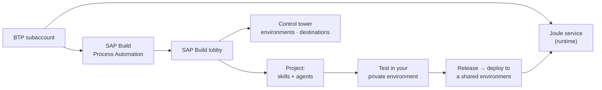
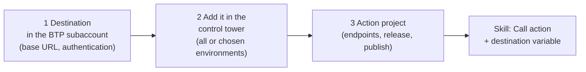
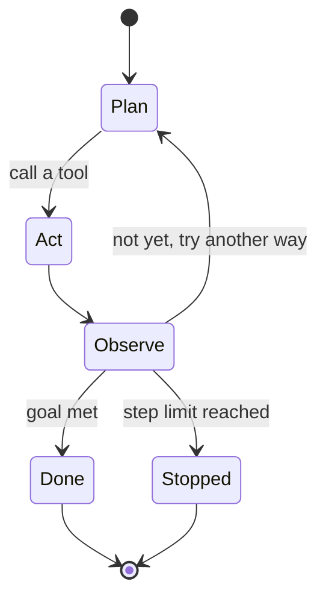

# Joule Studio Classic: setup, skills, agents, testing and deployment

*How to build your own Joule skills and agents in the low-code Joule Studio inside SAP Build, test them safely and release them to your company's Joule.*

> [!NOTE]
> **📍 At a glance**
> - **You will learn:**
>   - how Joule Studio Classic differs from the new Joule Studio
>   - what a subaccount needs before you can build, and where the tool opens
>   - the control tower: environments, destinations and deployed capabilities
>   - every setting of a Joule skill and a Joule agent, and what it changes
>   - how destinations and action projects connect a skill to a real system
>   - how to test with the timeline, avoid ambiguous routing, and deploy to production
> - **You will build:** a small simulation of a skill and an agent calling the same API, where only the agent recovers from a failure
> - **Level:** beginner to intermediate · **Time:** about 45 minutes
> - **Builds on:** [The Joule family](joule-family.md) and [Inside a subaccount](../sap-btp/btp-subaccount-walkthrough.md)
> - **Quick reference:** [Joule setup building blocks](reference-joule-setup-building-blocks.md) (destinations, booster, Work Zone, IPS, AI units)
> - **Last checked:** 21 Nov 2026

**After this chapter you can:**

- List the subscriptions and licences Joule Studio Classic needs
- Use the control tower to manage environments and destinations
- Build a skill that sends a message or calls an API through a destination variable
- Configure an agent: expertise, instructions, models, step limit, tools and output
- Read the test timeline, remove ambiguous routing, and deploy a project to a shared environment

## 3.1 Classic and new Joule Studio

| | Joule Studio Classic | New Joule Studio |
|---|---|---|
| **Where** | Inside SAP Build Process Automation, opened from the SAP Build lobby | The *Develop* area of Joule Work |
| **How you build** | Low-code: you configure flows, prompts and settings by hand | Intent-based: describe the goal; it writes requirements, code and tests, then shows a preview |
| **Code** | None you can see or change | Generated code you can read and edit; switch between design and code |
| **AI help** | An AI assistant was added later ("vibe coding"); SAP is removing it | Built around AI from the start |

- SAP Help: generative AI features in Joule Studio are deprecated and **will no longer be available from January 2027**.
- In the course, SAP had announced no end date for the classic edition itself. Both editions exist side by side for now.
- **Why it sits inside Process Automation:** that product already had a graph editor, destinations, environments and access control. Joule Studio reused them.
- There is no Joule Studio in the BTP trial. SAP's Architecture Center lists an enterprise account (CPEA, BTPEA or subscription) as the first prerequisite.

## 3.2 Setting it up

**What SAP Help requires (customers)**
- SAP Build with the **build-default** service plan, in any of four commercial models: subscription, BTPEA, PAYG or CPEA.
- An **active user (developer) licence** for SAP Build, to build, test and deploy.
- A Joule licence: **Joule Base** (SKU 8019544) or **Joule Premium** (SKU 8019164, includes AI units).
- **Google Chrome or Microsoft Edge.** Other browsers are not supported.
- Joule for Consultants and Joule for Developers licences are separate. They do not activate Joule Studio.
- Partners use test, demo and development (TDD) licences instead, including a TDD Joule Base licence (SKU 8020592).

**In the subaccount**
- At least two things: the **Joule** service (the runtime, chapter 2) and **SAP Build Process Automation**.
- The agent builder runs in these data centers: US30, US21, US10, JP10, EU30, EU20, EU12, EU10, AP11 and AP10.



**Opening it**
1. In the BTP cockpit, open *Instances and Subscriptions* and launch SAP Build Process Automation. You land in the **SAP Build lobby**.
2. Choose **Create**. The options depend on what the subaccount has; Joule Studio appears as *Joule agent and skill*.
3. Name the project. Joule Studio opens in a new tab, with *Create Joule Skill* and *Create Joule Agent*.

## 3.2a Who builds, who uses, and two switches

**Role collections (SAP Help, classic edition)**

| Subaccount | Role collection | Lets the user |
|---|---|---|
| Where **Joule** is subscribed | `extensibility_developer` | Build, compile and deploy custom skills and agents; deploying a project requires it |
| Where **Joule** is subscribed | `end_user` | Use Joule, including the skills and agents you deploy |
| Where **SAP Build Process Automation** is subscribed | `ProcessAutomationAdmin` | Manage settings, permissions and authorizations |
| Same | `ProcessAutomationDeveloper` | Create, edit and publish processes and automations |
| Same | `ProcessAutomationParticipant` | Run processes, automations and actions (no debugging, no environments) |

> [!NOTE]
> **Course guide vs SAP Help**
> - The course's *Joule Studio How-To Guide* names the builder collection `joule_extensibility`.
> - SAP Help's *Authorizations* page names it `extensibility_developer`. This book follows SAP Help.

**Two switches in the control tower (SAP Help)**
- **AI Agent Builder Activation** tile: switch it on before you deploy a project that contains a Joule agent.
- **Generative AI** tile: switch it on to get vibe coding (building an agent by describing it to the Joule assistant).
  - It turns on generative AI for the tenant and accepts the related terms.
  - These features are deprecated from January 2027 (3.1).

**The new Joule Studio works differently** ([chapter 4](joule-studio-intent-based.md)):
- No BTP role collections. Access comes from two groups in SAP Cloud Identity Services, `JouleStudioDeveloper` and `JouleStudioAdministrator`.
- Assign them separately in the non-productive and the productive tenant.
- Developers see only their own solutions; administrators see and deploy everything.

## 3.3 The control tower

The lobby's **control tower** holds the admin settings Joule Studio uses.

**Environments: where projects run**

| Environment | Who sees it | Use it for |
|---|---|---|
| **Private** (the Architecture Center calls it standalone) | Created for each user; only that user unless they add others | Your sandbox: develop and test without affecting anyone |
| **Shared** | Created by a `ProcessAutomationAdmin`; shared with `ProcessAutomationDeveloper` users | Line-of-business test or production; each can have its own destinations and permissions |
| **Public** | Every user of the tenant | Older model. SAP Help still lists it; the course tenant warned that it is being deprecated |

- An environment can be shared with at most **10 user groups** (execute or admin rights) or **5 users**, not a mix.
- If you change permissions in a shared environment, undeploy and redeploy its projects.

**Destinations: how skills reach systems**
- You create destinations in the **BTP subaccount** (SAP BTP chapter 8). In the control tower you only **add** them, so Joule Studio can use them.
- A skill never names a real destination. It uses a **destination variable**, and you pick the real destination when you test or deploy.
- So the same project can point at a test system in one environment and production in another.

**Three steps before a skill can reach a system**



1. **Destination in the subaccount:** where the system is and how to log on. For use in action projects, SAP's tutorial adds three properties:

| Property | Value |
|---|---|
| `sap.processautomation.enabled` | `true` |
| `sap.applicationdevelopment.actions.enabled` | `true` |
| `sap.build.usage` | `odata_gen` |

2. **Add it in the control tower** (admins only), for all environments or for chosen ones.
3. **Create an action project** for the endpoints you need (3.4a).

- Steps 1 and 2 are usually the admin team's job; the AI developer starts at step 3.
- A system on premise also needs SAP Cloud Connector between BTP and the system (SAP BTP chapter 8).
- A destination imported from a ready-made project does not need the three properties, because no actions are generated from it (tutorial 10).

**Deployed capabilities**
- Under *Joule → Joule Assistants*, the **Joule Shared Capabilities** tab lists deployed custom skills and agents.
  - It shows each one's type, environment, version and last update, and lets an admin stop it.
- The course tenant showed a quota of **100 deployed capabilities**, across all environments. SAP Help does not state this number, so check your own tenant.

**Other settings**
- **Generative AI:** the consent switch for the AI-assisted builder. It is being removed (3.1).
- **Document grounding and orchestration** are set up in SAP AI Core's generative AI hub, then used here. Masking and filtering are covered in SAP AI chapter 6.

## 3.4 Building a skill

**Name and description**
- Joule uses the **description** to decide when to run the skill. Write it in English, even for users in other languages; Joule translates in the background.
- Be precise and include the key words. SAP's example: *Get today's local weather forecast.*

**The editor:** a flow from a **trigger** to an **end** node, with steps in between, like a Process Automation process.

| Setting | Default | What it does |
|---|---|---|
| **Allow skill to be started directly by a user** | On | Off: only another skill or an agent can start it |
| **Allow Joule to generate a response** | On | Off: you must add a *Send Message* step yourself |
| **Inputs** | — | Name, description, *Required* (Joule asks the user if missing). User-started skills accept only string inputs |
| **Outputs** | — | Mandatory when another skill calls this one; also needed when Joule generates the response |

**Steps you will use first**
- **Send message:** a card with a title, text and variables, for example *Hello, {first name}. How are you?*
- **Call action:** calls an API from an **action project**, which wraps an OData or REST API. The course used the public Northwind OData service.
  - The action asks for a destination variable. Set the skill's output type to the API's response schema, and map the results into it.
  - The action has success and failure branches. Inside an agent you rarely need them, because the agent reads errors and reacts.
- The **design console** lists errors before you can test, for example "generate response is on, so define a skill output".

**Inputs, outputs and data types**
- **Skill inputs are always text**, because they come from a chat. If an action field needs a number, use *Apply formula* and convert, for example with the string-to-number function.
- Mark an input **Required** and Joule asks the user for it when it is missing. In the course, "Get customer details" without an ID made Joule ask for the customer ID first.
- Joule fills inputs from the conversation in a step the timeline calls **resolving input slots**. The input's name and description are what it matches against, so write them like a prompt, with an example.
- **Optional inputs** can drive OData query options. For example, a "number of orders to return" input mapped to `$top` turns "show me the top five orders" into `$top=5`.
- **Outputs:** set the output's type to the action's success schema (the one ending in `200`), then bind the action's result to it in the End step.
  - If *result* cannot be selected, the two types do not match. Usually the wrong action's schema was picked.
- Add each call to the **success path** (the 2XX branch) of the previous call. The error branch (4XX) carries only the error payload.

**Limits for action tasks (SAP Help, Quotas)**

| Limit | Value |
|---|---|
| Connection timeout | 1 minute |
| Socket timeout (between two data packets) | 3 minutes |
| Total execution time | 4 minutes |
| Request body size | 512 KB |
| Response content size | 100 KB |

- A large unfiltered result can hit these limits. Filter at the API, for example with `$top` and `$filter` on OData.

> [!IMPORTANT]
> **🏭 In production (SAP Architecture Center)**
> - Add a **confirmation step** before any create, update or delete, so the user sees and approves the change.
> - Use **asynchronous calls** for long-running backend work, to avoid timeouts.
> - Turn API errors into clear messages; never show raw technical errors to users.
> - Use **scenario dependencies** for simple skill chaining, and a custom agent when the task needs reasoning or state.

## 3.4a Action projects: the API layer

An **action** is SAP Build's name for one API call; an **action project** groups the actions for one destination. The name comes from SAP's process automation tools.

- **Create:** Lobby → Connectors → Actions → *Create* → choose the API source:
  - an **OData destination**, to generate actions from the service
  - SAP Business Accelerator Hub, for SAP's standard APIs (for example SuccessFactors or S/4HANA)
  - others, such as CAP, ABAP, BAPI, Integration Suite, an uploaded specification, or from scratch
- **Pick the operations.** From an OData destination the generator proposes every get, create, update and delete for every entity.
  - It does not check what the service supports, so keep only what works.
  - Read-only services, such as the course's Northwind and SAP's mock S/4HANA, support only GET.
- **Adjust** inputs and outputs: remove fields you do not need, and change types where needed, for example a badge ID to number.
- **Test** each action against a real destination on the *Test* tab.
- **Release, then publish.** The status moves from *editable* to *released* to *published*. Only published actions appear in Joule Studio's *Browse All Actions*.
- One action project uses **one destination**. It can hold many actions for that system: business partners, invoices and sales orders can share one S/4HANA project.
- Prefix action projects with your name when many people share a tenant, so you find your own in the filter.

**What an action call sends, in miniature**

```python
# What an action call really sends: destination base URL + action endpoint + OData query options
from urllib.parse import urlencode, quote

destination = "https://services.odata.org/V4/Northwind/Northwind.svc"  # set in the BTP destination
actions = {
    "Get entities from customers": "/Customers",
    "Get entity from customers by key": "/Customers('{CustomerID}')",
}

def call_url(action, params=None, query=None):
    path = actions[action].format(**(params or {}))
    url = destination + quote(path, safe="/()'")
    return url + ("?" + urlencode(query, safe="$',", quote_via=quote) if query else "")

print(call_url("Get entities from customers", query={"$top": 5}))
print(call_url("Get entities from customers", query={"$filter": "Country eq 'Germany'", "$select": "CompanyName,City"}))
print(call_url("Get entity from customers by key", params={"CustomerID": "ANTON"}))
```

Output:

```text
https://services.odata.org/V4/Northwind/Northwind.svc/Customers?$top=5
https://services.odata.org/V4/Northwind/Northwind.svc/Customers?$filter=Country%20eq%20'Germany'&$select=CompanyName,City
https://services.odata.org/V4/Northwind/Northwind.svc/Customers('ANTON')
```

✅ *Verified: run with Python 3.12 (details at the end).*

- The destination supplies the first half, the action the second, and the query options narrow the result. That is why the same action works against any system you plug in as the destination.
- OData query options: `$top` (how many), `$skip` (start later), `$filter` (condition), `$select` (fields), `$orderby` (sort), `$count` (total only).

## 3.5 Building an agent

An agent is not a flow. It is a set of prompts, models and tools.

| Field | What to put there |
|---|---|
| **Name, description** | What the agent does, with key words. Joule uses this to pick the agent, so avoid technical IDs |
| **Expertise** | One or two sentences of role: *You are an agent that gets order details from Northwind and greets users* |
| **Instructions** | What it must always do, with examples. Name tools in double quotes: *When asked for orders, use "Get Order Details"*. SAP: leave empty for a purely conversational agent |
| **Additional context** | Tone, company policies, abbreviations. Each block starts with `##`, for example `## Recommended tools` |
| **Model settings** | Provider, a **Base model** that writes the response, an **Advanced model** that plans and picks tools, and an optional **backup LLM** |
| **Agent execution steps** | Maximum number of thinking steps; pre-processing (decomposition, planning) and post-processing (refinement) switches |
| **Tools and MCP servers** | Joule skills, document grounding, a calculator, other agents; MCP servers |
| **Output** | Text, Markdown, JSON or a Data Type; and whether Joule may rephrase it (Text and Markdown only) |

**Choosing the models**
- The course tenant offered OpenAI, Anthropic and Google models. They come from SAP's central service; you deploy nothing in your own AI Core.
- **Advanced model:** the bigger, smarter one, because planning and tool choice decide whether the task succeeds.
- **Base model:** a smaller, cheaper one is usually enough to word the reply.
- Name endings show reasoning effort: `-minimal` (almost none), `-low` (basic), `-auto` (the model decides).
- When a model is due for retirement, the project shows a warning. Change the model yourself rather than rely on an automatic fallback.

**Choosing the step limit**
- Each plan, tool call and check is a step. When the limit is hit, the agent stops without an answer.
- The course tenant's default was **25**. Too low (5 or 10) fails requests with two or three tasks in them.
- Too high lets a failing agent retry many times, and every step costs AI units. The course suggests 25 to 50 for most agents.
- SAP Help's tip: a clearer prompt beats a higher step limit.

**Output**
- **For people:** Text, with *Allow Joule to interpret* on, so the reply reads naturally.
- **For another agent:** JSON, Markdown or a Data Type, with interpretation off, so the structure survives.
- SAP Help: build **small agents for specific tasks**; they perform better than one large agent.

**Writing instructions that work**
- Write instructions like a program in plain English: what to do first, what next, and what the answer should look like.
- Start each case with **"When the user asks…"**, so several cases read like a case statement:

```text
When the user asks for order information:
1. Use "Get Orders" to get the orders.
2. For each order, use "Get Customer by Key" with its customer ID.
3. Answer with a table: order ID, company name, city. Do not show the customer ID.
```

- Name tools in double quotes exactly as they appear in the Tools list.
- If writing is hard, describe the task to an AI assistant and ask it for a concise prompt (*meta-prompting*), then review it.
- Try two or three real requests with each model provider before choosing one; results differ.

**Tools you can attach (SAP Help, *Add a Tool*)**
- **Calculator**, **Documents** (document grounding; needs a resource group from SAP AI Core), **Joule skill**, and **Joule agent** (a subagent).
- Only skills and agents in the **same project** can be attached; every project deploys as one unit. Classic has no extension of SAP's own agents (chapter 4 has).
- **Require user confirmation before running:** a setting on an attached skill.
  - The agent shows what it is about to do and waits for *Yes, proceed* or *No, cancel*.
  - Use it on every skill that creates, changes or deletes data. A *Prompt for Generated Response* sets what the confirmation shows.
- A skill's own **Send Message** cards do not run when the skill is an agent's tool. The agent reads only the skill's outputs.
- An agent can call a subagent, but not the other way round: SAP does not allow cycles.

## 3.6 Skill or agent? Loops, tools and MCP

- **A skill** runs its flow once, from trigger to end. If the API call fails, it fails.
- **An agent** runs a loop: plan, act, look at the result, and plan again until the goal is met or the step limit is reached.



- In the course demo, a skill asked Northwind for all orders and timed out. Inside an agent, the model saw the failure and retried with a smaller query.
- That recovery depended on the model: with a weaker model it kept failing, and a stronger one solved it.

**A skill and an agent call the same API, in miniature**

```python
# Skill vs agent: a skill runs once; an agent plans, observes the result and tries again
ORDERS = [{"id": 10248 + i, "customer": f"C{i % 7}"} for i in range(830)]

def get_order_details(top=None):
    """The skill: one API call. Without a limit the answer is too big for the card."""
    rows = ORDERS if top is None else ORDERS[:top]
    if len(rows) > 100:
        return {"error": "timeout: response too large"}
    return {"rows": rows}

def run_skill():
    return get_order_details()            # point A to point B, no second chance

def run_agent(max_steps=25):
    top = None
    for step in range(1, max_steps + 1):
        result = get_order_details(top)   # act
        if "rows" in result:              # observe: goal reached?
            return f"step {step}: {len(result['rows'])} orders, first {result['rows'][0]['id']}"
        top = 20                          # plan again: ask for less data
    return "stopped: maximum number of thinking steps reached"

print("skill:", run_skill())
print("agent:", run_agent())
print("agent, 1 step:", run_agent(max_steps=1))
```

Output:

```text
skill: {'error': 'timeout: response too large'}
agent: step 2: 20 orders, first 10248
agent, 1 step: stopped: maximum number of thinking steps reached
```

✅ *Verified: run with Python 3.12 (details at the end).*

**Orchestration lives in the instructions**
- Classic is no-code, so the instructions are your program. Write the order in plain words: *Always call "Greet User" before "Get Order Details"*.
- **Agent to agent:** attach the other agent as a tool, and say in the instructions what it returns and what to do with it.
- A well-named skill is often found even without instructions, especially by a strong model. Instructions make it predictable.

**Many skills or one MCP server?**
- Five related actions (get one order, get all, create, update, delete) can be five skills attached to one agent.
- Or one **MCP server** exposing the same five as tools, attached once. SAP Help covers *Add MCP Servers to Your Joule Agent*.
- Both work. The course recommends MCP as the better practice for related API sets; skills came first in Joule Studio, MCP support later.

## 3.7 Testing

- **Test** asks for an environment (normally your private one) and a real destination for each destination variable.
- It deploys a test package to that environment only. Your company's main Joule does not see it.

**The timeline**
- Shows each stage: intent resolution, **scenario selection** (the chosen task and the reasoning), the agent's plan, every tool call and its raw response.
- It used to be called *debug*. There is no code to step through: you read the reasoning, then change descriptions, instructions or models.
- Users have the same view as **request logs**, which they can send to the developer.

**Common results and fixes**

| What you see | Why | Fix |
|---|---|---|
| Joule asks which capability you mean (**scenario disambiguation**) | A user-startable skill and an agent both match | Turn off *Allow skill to be started directly by a user* on skills that only the agent uses |
| The agent replies without the skill's nice message | A *Send Message* card shows only when a user starts the skill; an agent sees only the skill **output** | Return the message text in the skill output |
| Scenario selection returns nothing | No capability matches, for example a news question | Expected; add a skill only if the use case needs it |
| Only about 5 rows in the card, up to about 20 when expanded | Classic chat cards are small (course observation) | Ask narrower questions; agents can still pass large data to each other |
| "Not subscribed" or "access denied" when creating a project, though your roles are right | Stale browser cache (seen several times in the course) | Try a private window first; if it works there, clear the cache |

## 3.8 Release and deploy

1. **Release** a version of the project. Check first: a project without triggerable skills, or with blank input or output names, can be released but fails at deployment.
2. **Deploy** it to an environment and pick the real destinations.
   - **Private or standalone:** only you test it; not connected to production Joule.
   - **Shared:** per SAP's Architecture Center, deploys to the unified Joule across SAP apps such as SAP Build Work Zone, S/4HANA and SuccessFactors. It appears next to SAP's own capabilities.
3. Allow time: deploying to a shared environment in a production tenant can take **up to 30 minutes**.
4. Monitor or stop it under **Joule Shared Capabilities**.

- **Two separate locks.** The environment decides who may use the agent. The backend roles decide what data it can read or change, because it acts as the user (SAP AI chapter 1, 1.6).

> [!CAUTION]
> **🔒 An agent is only as safe as its user's roles**
> - A user without permission to create sales orders cannot create them through Joule either, even if your skill can.
> - So review backend roles before go-live, and test with real business users, not an administrator.

**Moving projects and reusing processes**
- **Export and import:** a project can be exported as an `.mtar` file and imported in another lobby with *Import* (SAP's agent tutorial ships its skills this way).
  - If someone in the same tenant already imported it, rename your copy (for example with your name as a prefix) to avoid a name clash.
- **Publish to Library** is separate from deploy. A Process Automation process must be released, deployed and then published to the library before a Joule skill can run it (tutorial 9).

## 3.9 Added by Claude, not from the sources

- **Set the step limit from data.** Log the steps per task in testing, and set the limit at about twice the highest normal value. That stops runaway retries without cutting off real work.
- **Validate agent-to-agent JSON.** Define a Data Type for the handover and check required fields in the receiving agent's instructions before it acts.
- **Keep your requirements outside the tool.** Classic projects may need rebuilding in the new Joule Studio. Your descriptions, instructions and test prompts in a document make that rebuild quick.

## 3.10 Interview corner

**What interviewers listen for:** knowing where Classic lives and what it needs, clear reasons for each agent setting, and a safe path from test to production.

### 🟢 Basic

<details class="qa"><summary>1. Where is Joule Studio Classic, and what do you need to use it?</summary>

- Inside SAP Build Process Automation, opened from the SAP Build lobby
- Build-default plan, an active SAP Build developer licence, Joule Base or Premium, Chrome or Edge
- *Stronger answer:* add the Joule service as the runtime, and that it is not in the BTP trial

</details>

<details class="qa"><summary>2. What is the difference between a Joule skill and a Joule agent?</summary>

- A skill is a fixed flow from trigger to end, often one API call
- An agent has a model, instructions and tools, and loops until the goal or the step limit
- *Stronger answer:* give an example where the agent recovers from an error the skill cannot

</details>

<details class="qa"><summary>3. What are environments in the control tower?</summary>

- Private: each developer's sandbox for testing
- Shared: created by admins for a line of business, test or production, with their own destinations and permissions
- *Stronger answer:* mention that public environments are an older model being phased out, and that permission changes need a redeploy

</details>

### 🟡 Intermediate

<details class="qa"><summary>4. Joule keeps asking users which capability they mean. Why, and how do you fix it?</summary>

- Several capabilities match the request, for example user-startable skills and an agent that uses them
- Turn off *Allow skill to be started directly by a user* on skills meant only for the agent
- *Stronger answer:* also sharpen the descriptions, and check the scenario selection in the timeline

</details>

<details class="qa"><summary>5. How do you choose the models and the step limit for an agent?</summary>

- Advanced (planning) model: a strong one; base (response) model: a cheaper one
- Step limit around 25 to 50; too low fails multi-part requests, too high wastes AI units on retries
- *Stronger answer:* add a backup LLM, and react to model deprecation warnings before the date

</details>

<details class="qa"><summary>6. Five skills or one MCP server for sales orders?</summary>

- Both work: five skills attached as tools, or one MCP server exposing five tools
- MCP groups related API operations and can be reused outside Joule
- *Stronger answer:* name what decides it: who maintains the API, whether other agents need it, and governance of the tool list

</details>

### 🔴 Senior

<details class="qa"><summary>7. A skill that reads open items times out. What are your options?</summary>

- Filter at the source (`$top`, `$filter`) through skill inputs; respect the 100 KB response and 4-minute limits
- Use an agent so it can retry with a narrower query, or an asynchronous call for long jobs
- *Stronger answer:* for bulk work such as clearing, pass data agent to agent or use a workflow, and show the user only a summary

</details>

<details class="qa"><summary>8. Design the path from development to production for a custom agent.</summary>

- Develop and test in private environments with test destinations
- Release a version, deploy to a shared test environment, then to a shared production environment with production destinations
- *Stronger answer:* control access per environment, rely on backend roles for data, add confirmation steps for changes, and monitor in Joule Shared Capabilities

</details>

> [!TIP]
> **🧩 Design question: a sales-order agent**
> - Which skills or MCP tools does it need, and which change data and need confirmation?
> - Write its expertise, instructions and output format for both a user and a downstream agent.
> - Which environments, destinations and user groups do you set up, and how do you test routing before go-live?

## Cheat sheet

| Topic | Key points |
|---|---|
| Where | SAP Build lobby → Create → Joule agent and skill (inside Process Automation) |
| Needs | build-default plan · developer licence · Joule Base 8019544 or Premium 8019164 · Chrome/Edge · Joule service |
| Environments | Private (sandbox) · shared (LoB, production) · public (being phased out); max 10 groups or 5 users |
| Destinations | Created in the subaccount, added in the control tower; skills use destination variables |
| Skill switches | Started directly by a user · Joule generates the response |
| Action limits | 1 min connect · 3 min socket · 4 min total · 512 KB request · 100 KB response |
| Agent | Expertise · instructions · `##` context · advanced + base model · backup LLM · step limit · tools/MCP · output |
| Test | Private environment; timeline; fix disambiguation by hiding helper skills |
| Deploy | Release → shared environment → up to 30 min in production; stop in Joule Shared Capabilities |

## Recap

- Joule Studio Classic is the low-code builder inside SAP Build Process Automation; the new Joule Studio lives in Joule Work
- You need the build-default plan, a developer licence, a Joule licence and the Joule runtime
- The control tower manages environments, destinations and deployed capabilities
- Skills are flows with triggers, steps and outputs; agents are prompts, models, tools and a step limit
- Agents recover from errors by looping; skills do not
- Test in your private environment, read the timeline, then release and deploy to a shared environment

## Practice

1. List the subscriptions and licences your company would need for Joule Studio Classic, using 19.2.
2. Write a description, expertise and instructions for an agent that answers "where is my purchase order?" with two skills.
3. Change the snippet so the agent first tries `top=200`, then halves the size each time. How many steps does it take?
4. Sketch the environments and destinations for a project that runs against a test S/4HANA and a production S/4HANA.

## How this chapter was checked

- **Lecture 9 recording:** captions 1:03 to 3:21 (the subaccount, the SAP Build lobby, the control tower, the skill and agent demos, testing and questions) read in full.
- **Lecture 11 (Part A, 4 h; Part B, 7 min) and Lecture 12 (3 h 11) recordings:** read in full (Lecture 11–12 batch). Sources of the connection steps, 3.4a, inputs and outputs, instructions, tools and export.
- **Read in full on 21 Nov 2026:** SAP Help, *Add a Tool*; SAP's six Joule Studio Classic tutorials (each has its own page, chapters 5 to 10).
- **Read in full (SAP Help, Joule Studio, classic edition), on 20 Nov 2026:**
  - *What is Joule Studio, classic edition?*, *Initial Setup and Prerequisites*, *Create a Joule Skill*, *Create a Joule Agent*
  - *Quotas*, *Known Limitations*, *Manage Joule Skills and Agents Across Environments*
- **Read in part:** *Creating Agents with Vibe Coding* (the deprecation note), and SAP Build Process Automation's *Environments* (the environment types).
- **Read in full on 20 Nov 2026:** SAP Architecture Center, *Joule Skills with Joule Studio*.
- **Run with Python 3.12, standard library only:** the skill-and-agent snippet and the action-URL snippet print the output shown.
- **Not checked:**
  - the quota of 100 deployed capabilities (seen only in the course tenant)
  - the card row limits (course observation)
  - the new Joule Studio itself, which the course could not access
- **Added 21 Nov 2026 (3.2a):**
  - Read on SAP Help, for the role collections and the two control-tower switches: *Authorizations*, *Deploy a Project* and *Create a Joule Agent with Vibe Coding* (classic edition), and *Role Management for Joule Studio*.
  - The course's *Joule Studio How-To Guide* (BT074) prompted the section. Where its role name differs, SAP Help is followed.

## Sources and further reading

- Mentors Pool course, Lecture 9 recording (BT020)
- SAP Help, *What is Joule Studio, classic edition?*: https://help.sap.com/docs/joule-studio-classic/joule-studio-classic-edition/what-is-joule-studio-classic-edition
- SAP Help, *Initial Setup and Prerequisites*: https://help.sap.com/docs/joule-studio-classic/joule-studio-classic-edition/initial-setup-and-prerequisites
- SAP Help, *Create a Joule Skill*: https://help.sap.com/docs/joule-studio-classic/joule-studio-classic-edition/create-joule-skill
- SAP Help, *Create a Joule Agent*: https://help.sap.com/docs/joule-studio-classic/joule-studio-classic-edition/create-joule-agent
- SAP Help, *Quotas*: https://help.sap.com/docs/joule-studio-classic/joule-studio-classic-edition/quotas
- SAP Help, *Known Limitations*: https://help.sap.com/docs/joule-studio-classic/joule-studio-classic-edition/known-limitations
- SAP Help, *Creating Agents with Vibe Coding: Capabilities and Limitations*: https://help.sap.com/docs/joule-studio-classic/joule-studio-classic-edition/creating-agents-with-vibe-coding-capabilities-and-limitations
- SAP Help, *Manage Joule Skills and Agents Across Environments*: https://help.sap.com/docs/joule-studio-classic/joule-studio-classic-edition/manage-joule-skills-and-agents-across-environments
- SAP Help, *Add a Tool*: https://help.sap.com/docs/joule-studio-classic/joule-studio-classic-edition/add-tool
- Mentors Pool course, Lecture 11 Part A and Part B (BT023, BT024) and Lecture 12 (BT025) recordings
- SAP Developer Center, *Build Your First Joule Skill in Joule Studio, Classic Edition* (tutorial group): https://developers.sap.com/group.joule-studio-first-skill.html
- SAP Help, SAP Build Process Automation, *Environments*: https://help.sap.com/docs/build-process-automation/sap-build-process-automation/environments
- SAP Architecture Center, *Joule Skills with Joule Studio*: https://architecture.learning.sap.com/docs/golden-path/ai-golden-path/build-and-deliver/joule-skills
- Northwind OData service (public sample data): https://services.odata.org/V4/Northwind/Northwind.svc/
- SAP Help, *Authorizations* (Joule Studio, classic edition): https://help.sap.com/docs/joule-studio-classic/joule-studio-classic-edition/authorizations
- SAP Help, *Deploy a Project* (classic edition): https://help.sap.com/docs/joule-studio-classic/joule-studio-classic-edition/deploy-project
- SAP Help, *Role Management for Joule Studio*: https://help.sap.com/docs/joule-studio/joule-studio/role-management-for-joule-studio
- Mentors Pool course Drive: *Joule-Studio-How-To-Guide.pdf* (BT074)

Previous: [The Joule family: Joule Work, embedded Joule, assistants, agents and skills](joule-family.md) · Next: [The new Joule Studio: intent-based development, agents and extensions](joule-studio-intent-based.md)
