# Joule Studio tutorial 1: environment and connectivity setup

*Everything after this tutorial assumes a Control Tower environment and two working destinations already exist — this is where they come from.*

> [!NOTE]
> **📍 At a glance**
> - **You will learn:** how to create a Control Tower environment for Joule Studio, build two destinations from scratch with the exact properties Joule Studio needs, and associate each destination with both your own environment and the shared Public environment
> - **You will build:** a test environment named `tutorial`, plus `tutorial_S4HANA_MOCK` and `tutorial_Badge_Service` destinations, ready for the Action Projects built in the next tutorial
> - **Level:** intermediate · **Time:** about 10 minutes
> - **Builds on:** [Joule Studio and the agent development lifecycle](02-joule-studio-lifecycle.md). **Leads to:** [Joule Studio tutorial 2: Action Projects](joule-studio-tutorial-2-action-projects.md)

**After this tutorial you can:**

- Create a Control Tower environment and confirm the Joule Digital Assistant tab actually appears inside it
- Build a destination from scratch with the 3 additional properties Joule Studio specifically requires
- Explain why a destination has to be associated with the Public environment, not just your own

## 1. Create the environment

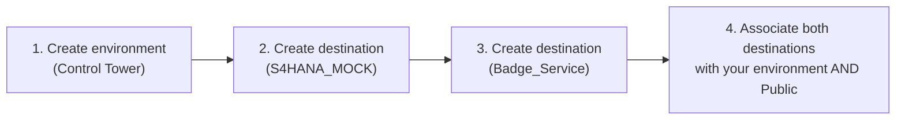

Everything in Joule Studio runs inside a **Control Tower environment**.

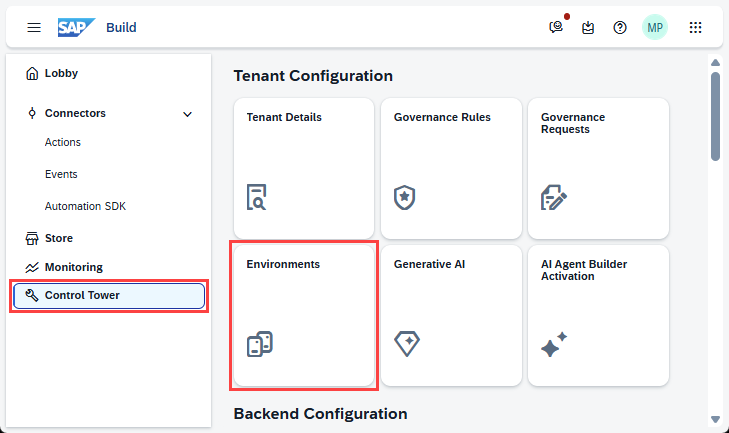

Open **Environments** and create a new one:

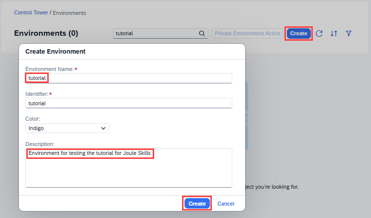

Confirm the **Joule** tab now appears inside the environment — this is where the Joule Digital Assistant for this environment will live once a Skill is deployed to it:

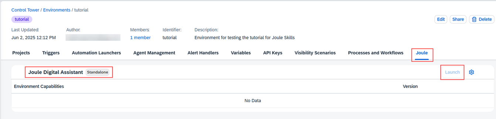

## 2. Create the first destination: a mock S/4HANA OData service

Destinations are created in BTP's **Connectivity** area, not inside Joule Studio itself — reached from Control Tower via **Create Destination → From Scratch**:

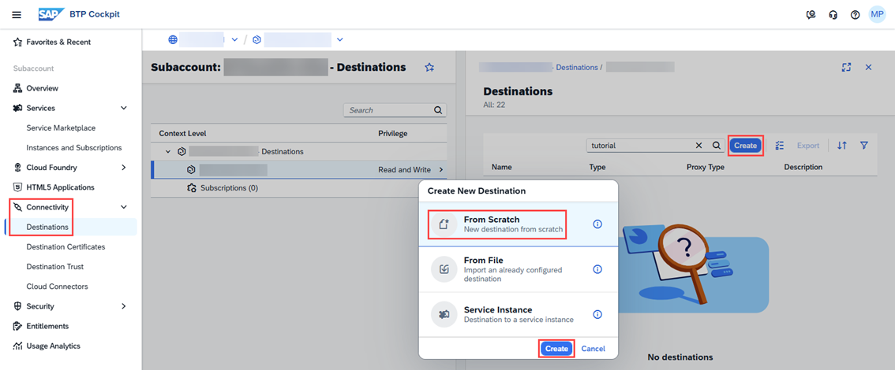

| Field | Value |
|---|---|
| Name | `tutorial_S4HANA_MOCK` |
| Type | HTTP |
| Proxy Type | Internet |
| URL | the mock S/4HANA OData service URL |
| Authentication | NoAuthentication |

Three **Additional Properties** are required — this is the detail easiest to miss, since the destination will otherwise look complete without them:

| Key | Value |
|---|---|
| `sap.processautomation.enabled` | `true` |
| `sap.applicationdevelopment.actions.enabled` | `true` |
| `sap.build.usage` | `odata_gen` |

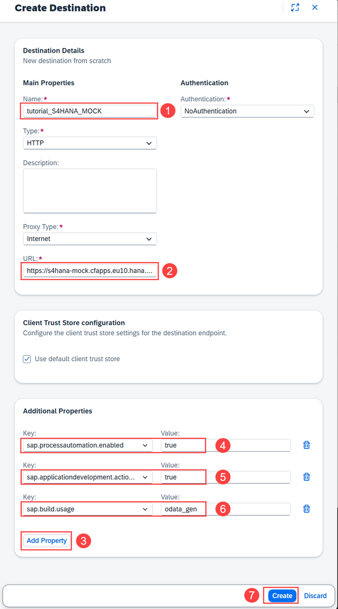

Check the connection before moving on:

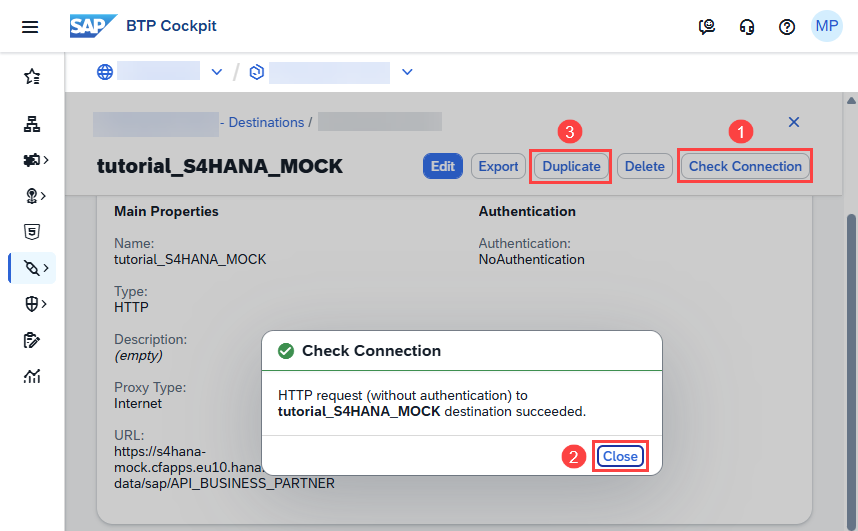

## 3. Create the second destination: the badge service

A second destination, same shape, pointing at a third-party badge-issuing service used later in Tutorial 3:

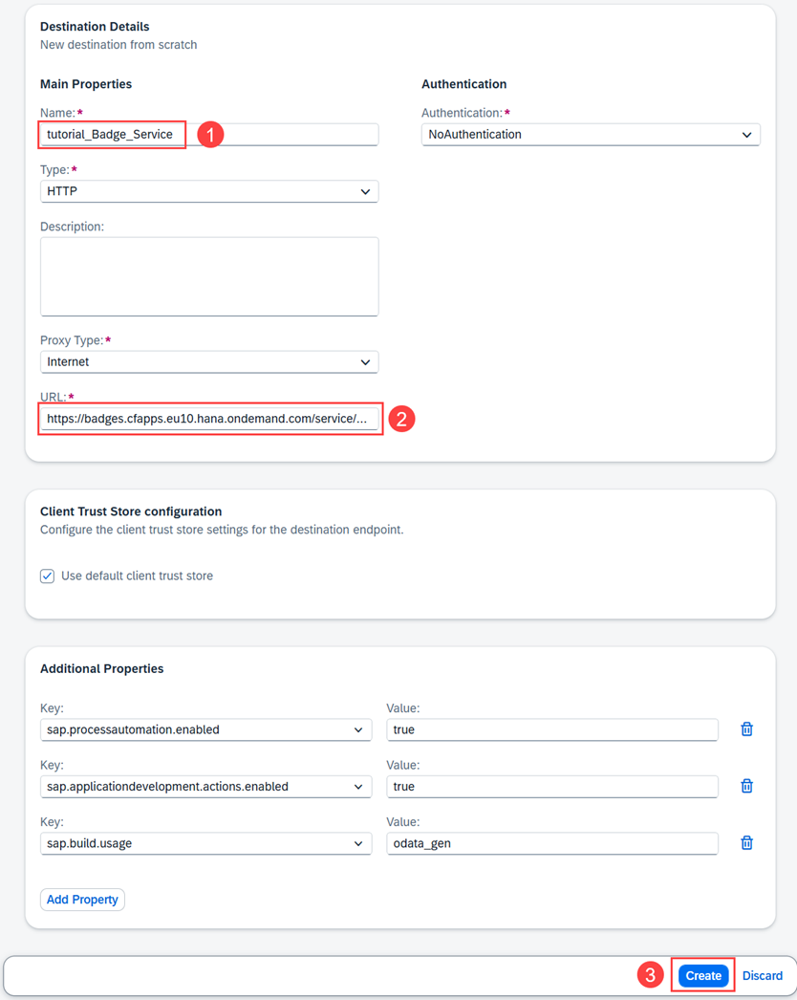

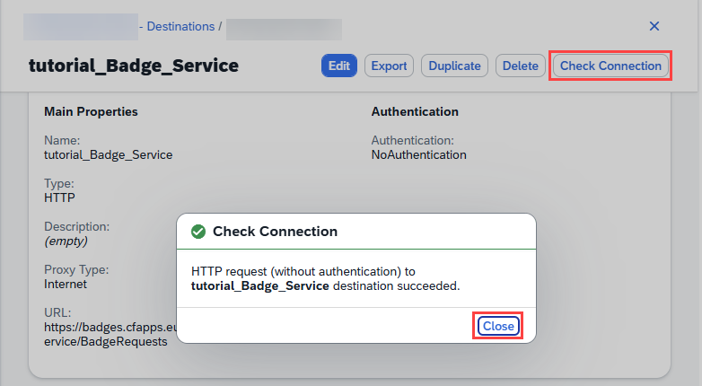

## 4. Associate both destinations with the right environments

Before either destination is usable, both the destinations list and Control Tower itself need to show them:

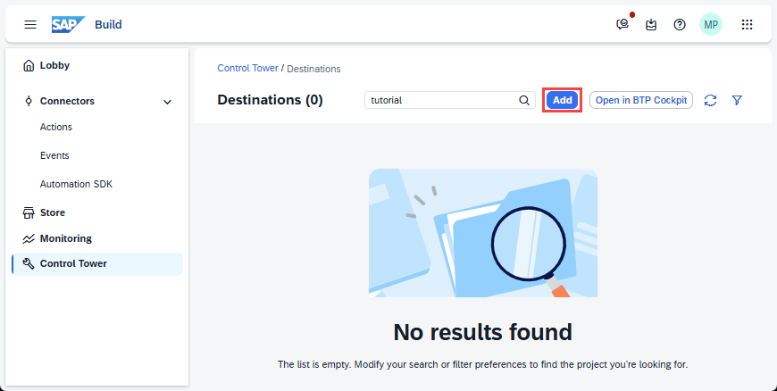

Use **Add Destination** from Control Tower. Step 1 picks which destination:

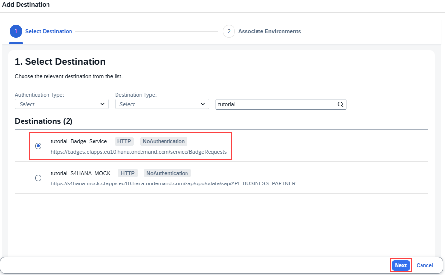

Step 2 associates it with an environment — here, the `tutorial` environment:

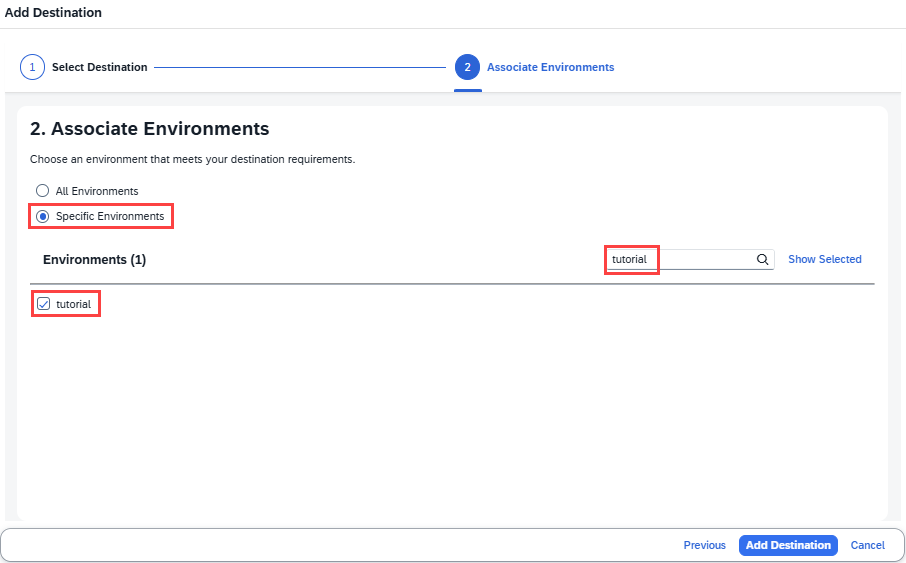

> [!CAUTION]
> **🔒 A destination also has to be associated with the Public environment, not just your own**
> Repeat the association step a second time, this time checking **Public** instead of (or in addition to) your own environment. Skipping this is a real, easy-to-miss way to end up with a destination that looks fully configured but doesn't actually work once an Action Project or Skill tries to use it.

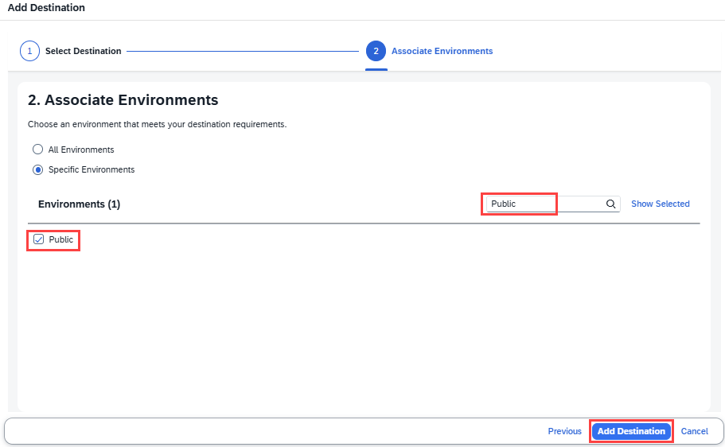

Confirm both destinations now show up, each associated with 2 environments:

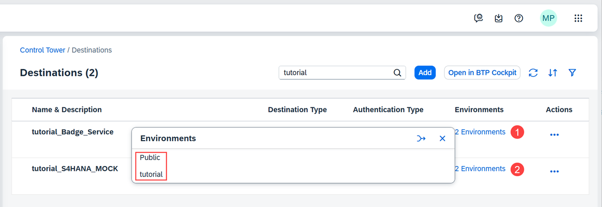

## 5. Added by Claude, not from the sources

- The explicit "don't skip the Public environment" framing in section 4 is this book's own emphasis, written because the tutorial's own flow repeats this step without calling out why it matters — the underlying requirement is the source's.
- Not run: this chapter documents the tutorial author's own setup; nothing was independently executed for this book.

## 6. Interview corner

**What interviewers listen for:** you know a destination needs two separate environment associations (your own + Public), not just one, and you can name the three additional properties a Joule Studio destination specifically needs.

1. What three additional properties does a destination need for Joule Studio to use it?

- `sap.processautomation.enabled=true`, `sap.applicationdevelopment.actions.enabled=true`, `sap.build.usage=odata_gen`

2. A destination checks connection successfully but an Action Project built from it still can't find it. What's the likely cause?

- It wasn't associated with the Public environment — only associating it with your own environment isn't enough
- *Stronger answer:* re-run the Add Destination flow a second time, this time selecting Public under Specific Environments

## Cheat sheet

| Step | Detail |
|---|---|
| Create environment | Control Tower → Environments → Create |
| Required destination properties | `sap.processautomation.enabled`, `sap.applicationdevelopment.actions.enabled`, `sap.build.usage=odata_gen` |
| Environment associations needed | Your own environment **and** Public — both, not either |

## Recap

- A Control Tower environment is the prerequisite container everything else in Joule Studio runs inside
- A destination built for Joule Studio needs 3 specific additional properties, not just a URL and authentication type
- Every destination needs to be associated with both your own environment and the Public environment — missing the second one is a common, hard-to-diagnose gap

## Practice

1. Without looking back, name the three additional properties a Joule Studio destination needs
2. Explain in one sentence why a destination needs to be associated with the Public environment specifically

## How this chapter was checked

- All 13 images for this tutorial were downloaded and individually opened and visually verified against their captions before being written into this chapter — not captioned from filename or DOM order alone.
- This is part 1 of 5 of the SAP Developers tutorial series "Build Your First Joule Skill in Joule Studio, Classic Edition." Nothing in this chapter is code; nothing was independently executed — the environment and destinations described are the tutorial author's own.

## Sources and further reading

- SAP Developers, *Build Your First Joule Skill in Joule Studio, Classic Edition* — https://developers.sap.com/group.joule-studio-first-skill.html, Tutorial 1 of 5 (read in full 13 Nov 2026)

Previous: [n8n workflows in Joule Studio](04-n8n-workflows.md) · Next: [Joule Studio tutorial 2: Action Projects](joule-studio-tutorial-2-action-projects.md)
