# Joule Studio tutorial 11: building an agent to handle demand spikes

*The most precisely-specified guardrail set in this tutorial family — 5 named APIs, each tagged with its exact read/write scope, plus 4 explicit fail-safes.*

> [!NOTE]
> **📍 At a glance**
> - **You will learn:** how to read a generated agent's full Automation & Agent Behaviour specification — exact API-level read/write scope and named guardrails, not just a general description
> - **You will build:** a Demand Spike Delivery Prioritization Agent — scores and ranks customers by open order volume, YTD revenue, and credit rating, then produces a prioritized delivery batch plan for SAP S/4HANA Cloud Public Edition
> - **Level:** beginner · **Time:** about 15 minutes
> - **Builds on:** [Joule Studio tutorial 10: budget variance management](joule-studio-tutorial-10-budget-variance-agent.md). **Leads to:** [Joule Studio tutorial 12: building a Sales Goal Advisor agent](joule-studio-tutorial-12-sales-goal-advisor-agent.md)

> [!WARNING]
> Pre-release Joule Studio — screens and exact flow may differ from general availability. This tutorial was tied to a real TechEd 2026 keynote demo (fictional company "Morvanto Limited," product "Smyle").

**After this tutorial you can:**

- Read a generated agent's API-by-API read/write scope and state which actions are autonomous versus human-gated
- Name all 4 explicit guardrails this agent's specification states verbatim
- Explain why one of its 5 integration APIs is tagged "high-risk" even though it only runs after human approval

## 1. The business problem

Two pain points: no structured way to prioritize deliveries during a demand spike, and planners lacking a systematic ranking method — risking damage to valuable customer relationships through ad hoc decisions.

Uses **standard S/4HANA demo data** — no special tenant setup needed, unlike several other tutorials in this family.

## 2. Define the intent

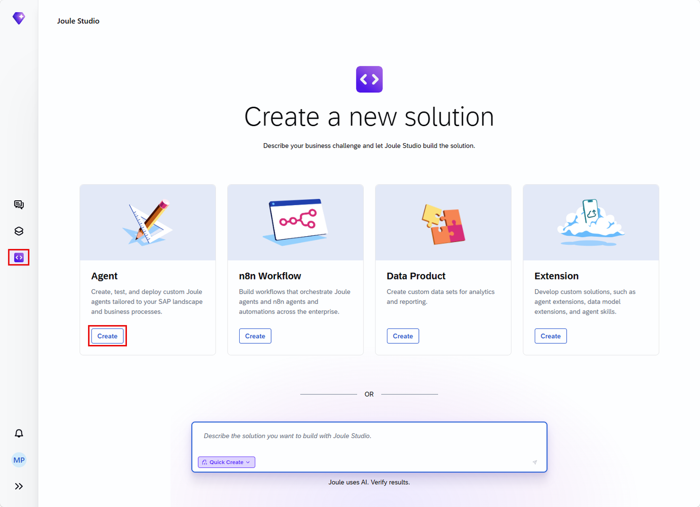

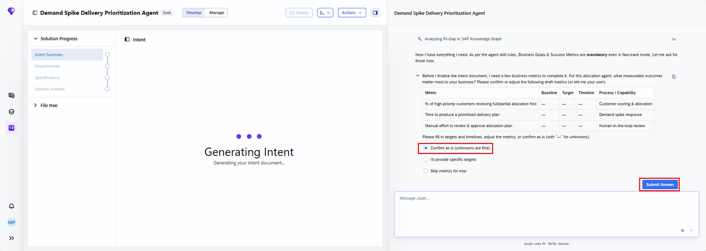

## 3. Review the intent

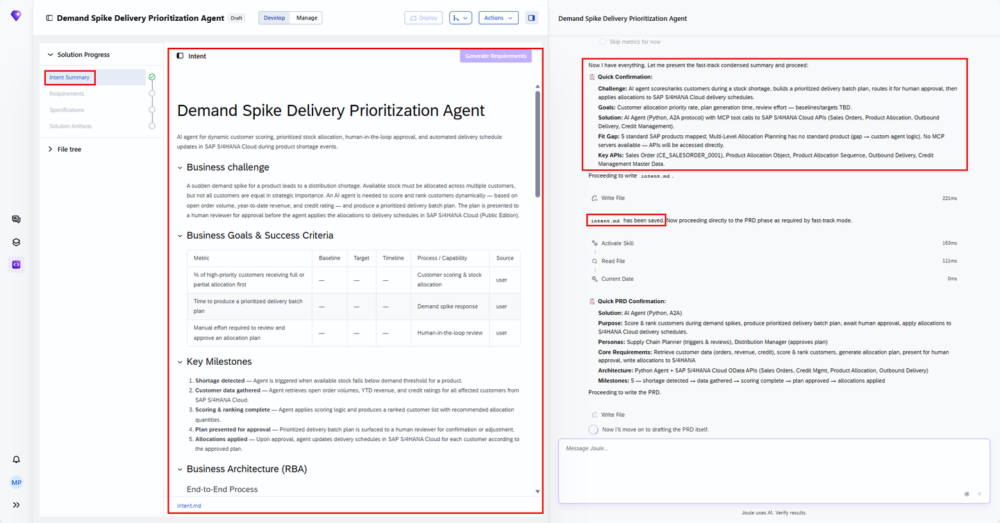
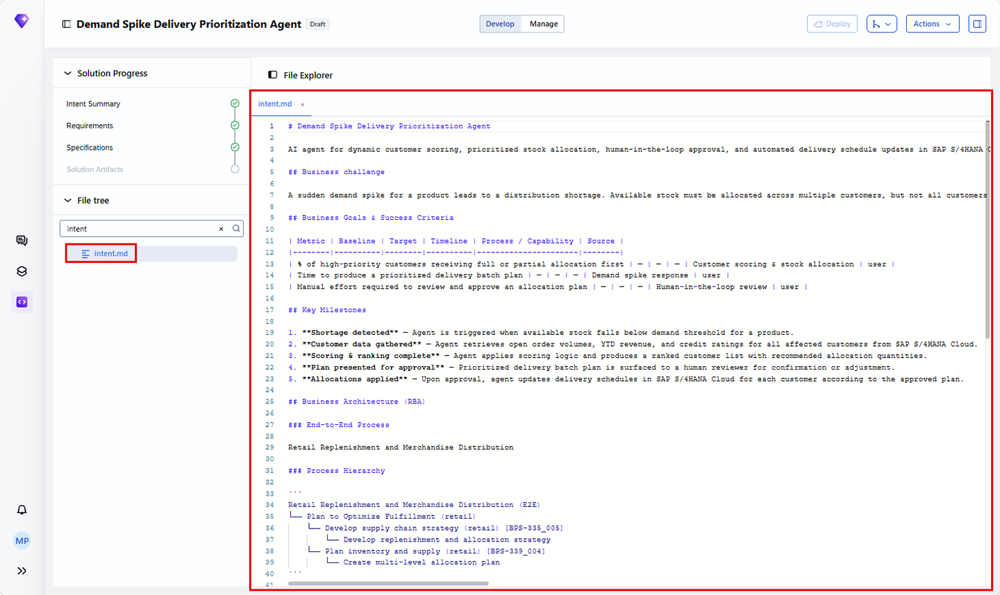
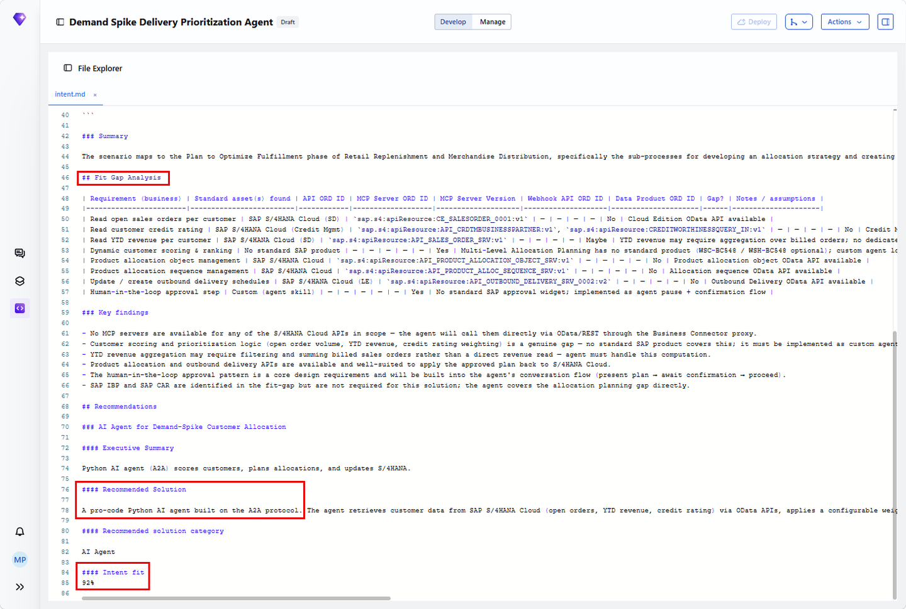

## 4. The PRD — the most precisely scoped guardrails in this book

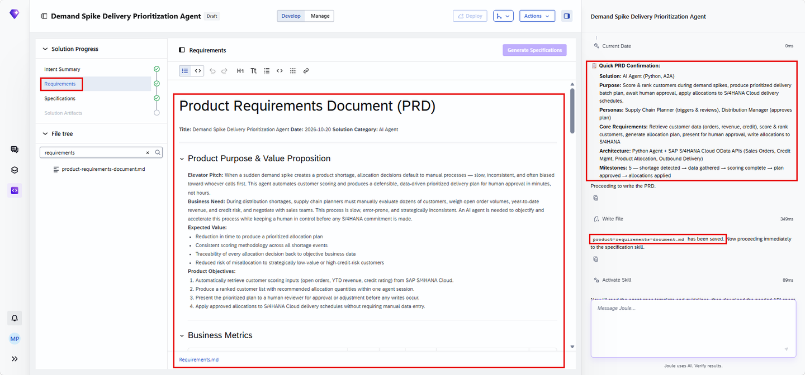
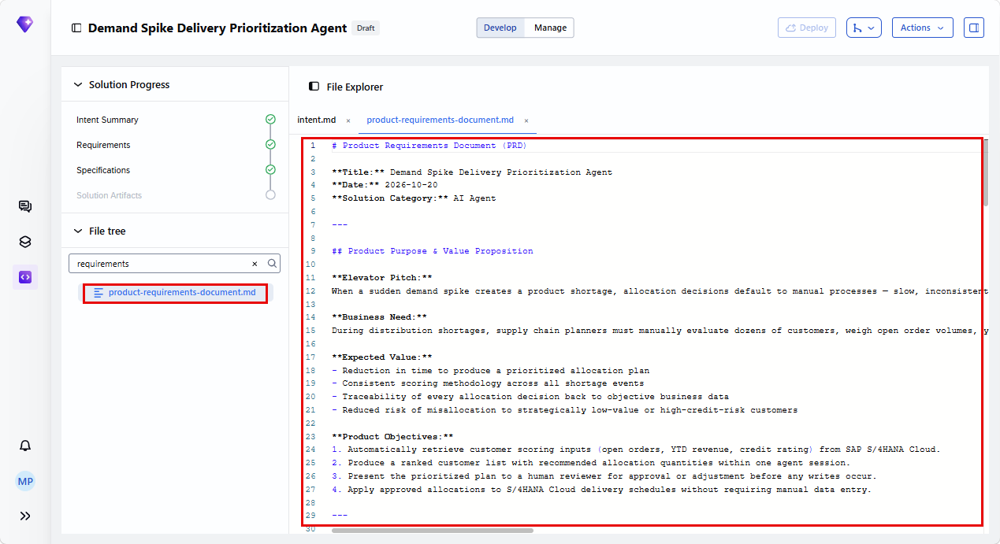

The Requirements section lists 5 ranked, user-story-driven requirements — R4 is the one that states the human-in-the-loop boundary in plain language:

![Must-Have Requirements: R1 Customer Data Retrieval, R2 Dynamic Customer Scoring & Ranking, R3 Prioritized Delivery Batch Plan Generation, R4 Human-in-the-Loop Approval ("As a Distribution Manager, I need to review and approve... before any changes are made in SAP so that final allocation decisions remain under human control" — "no write operations to S/4HANA are performed until explicit approval is received"), R5 Allocation Application to SAP S/4HANA Cloud — each with acceptance criteria and a Priority Rank](images/sj203-09-requirements-section.png)

The Requirements section's **Automation & Agent Behaviour** block is worth reading in full — this is the most granular, API-by-API specification seen across this tutorial family:

![Automation & Agent Behaviour: Automation Level "Hybrid (autonomous data retrieval and scoring; human approval gate before writes)." Autonomous actions: retrieve customer open orders/YTD revenue/credit data, compute scores and rank customers, calculate allocation quantities against available stock, present the prioritized plan. Human-approval actions: applying allocation quantities to S/4HANA delivery schedules, any adjustment to recommended quantities. Tools: Sales Order read (CE_SALESORDER_0001 / API_SALES_ORDER_SRV, read-only), Credit Management read (API_CRDTMBUSINESSPARTNER / CREDITWORTHINESSQUERY_IN, read-only), Product Allocation Object (API_PRODUCT_ALLOCATION_OBJECT_SRV, read/write), Product Allocation Sequence (API_PRODUCT_ALLOC_SEQUENCE_SRV, write), Outbound Delivery (API_OUTBOUND_DELIVERY_SRV_0002, write, high-risk). 4 Guardrails & fail-safes listed](images/sj203-10-solution-architecture.png)

The 4 guardrails, verbatim:

1. The agent **must not write** to any S/4HANA entity before receiving explicit human approval in the same session.
2. If available stock cannot cover even the highest-ranked customer's minimum order, the agent must surface this as an **unresolvable conflict** and escalate to the planner.
3. If any API call fails during data retrieval, the agent must report which data is missing and ask the planner whether to proceed with partial data or abort.
4. The agent must not modify credit ratings or financial master data — **all credit reads are strictly read-only.**

> [!CAUTION]
> **🔒 The Outbound Delivery API is tagged "high-risk" even though it only ever runs post-approval**
> Of the 5 named APIs, only the Outbound Delivery API carries an explicit **high-risk** tag in the specification — not because it runs autonomously (it doesn't; it's write, post-approval only), but because creating/updating delivery records has real operational consequences once approved. The risk tag tracks the *consequence* of the action, not whether a human is in the loop for it.

## 5. Specification

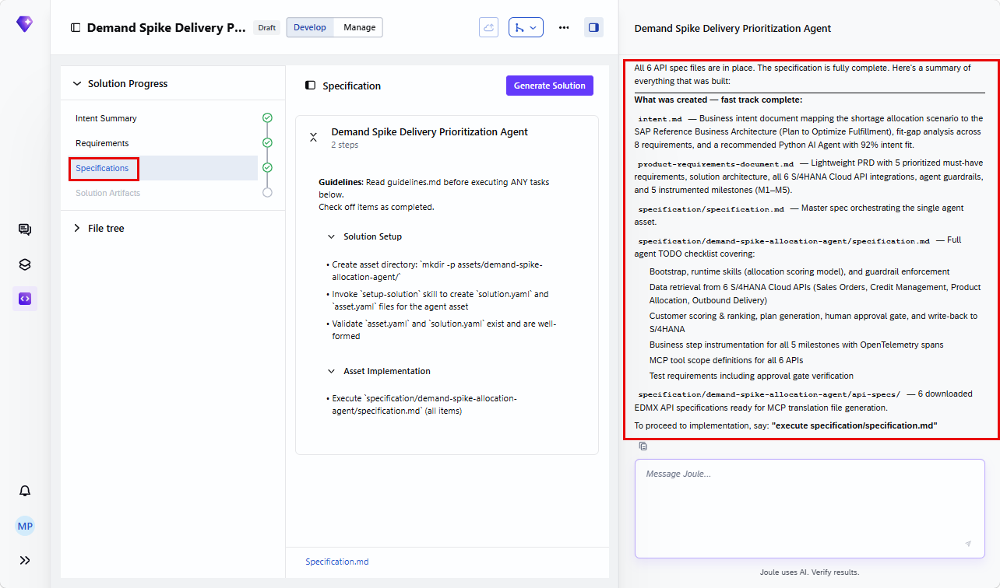
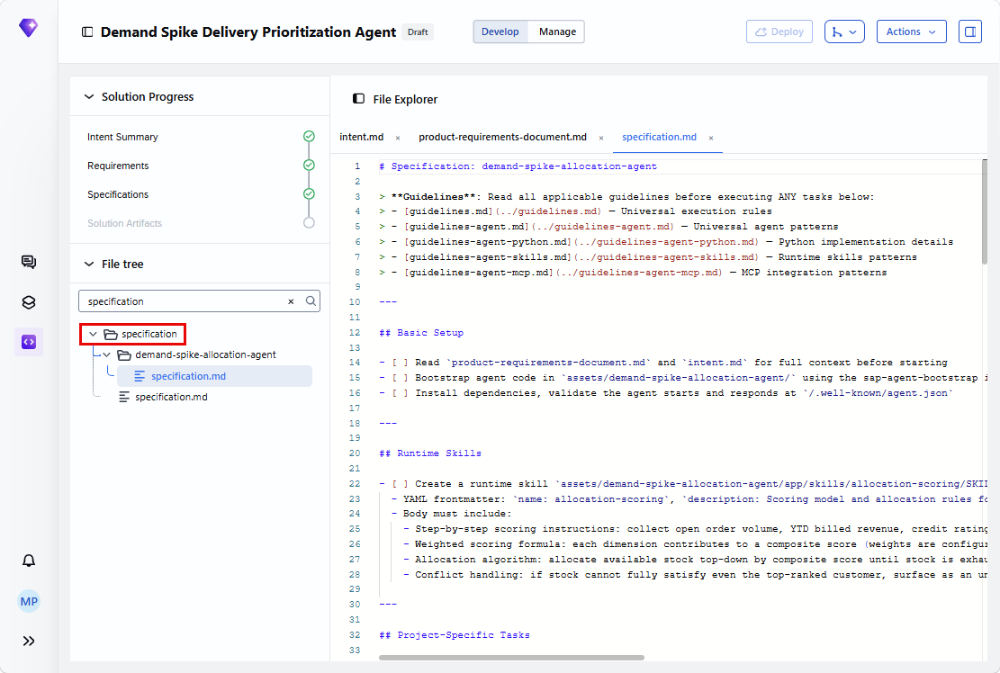

## 6. Generate the solution

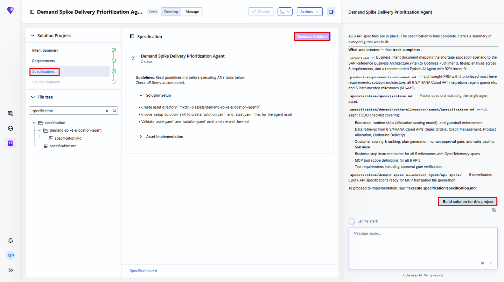
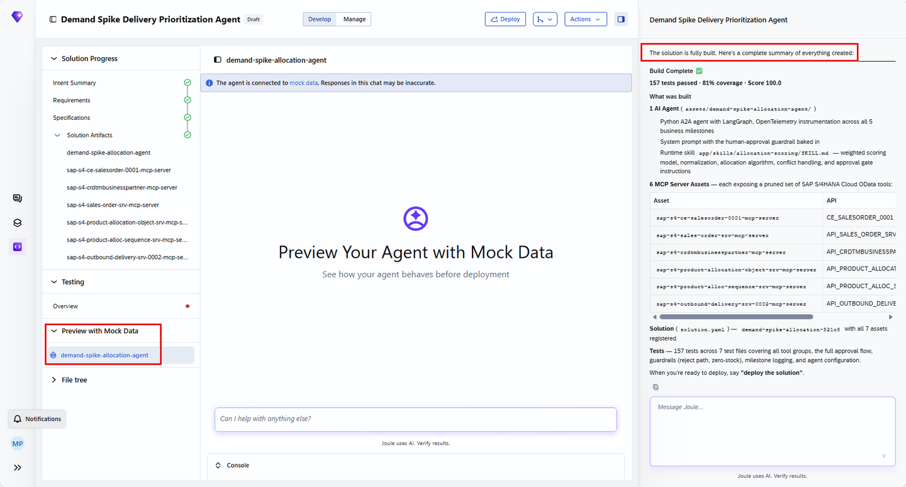
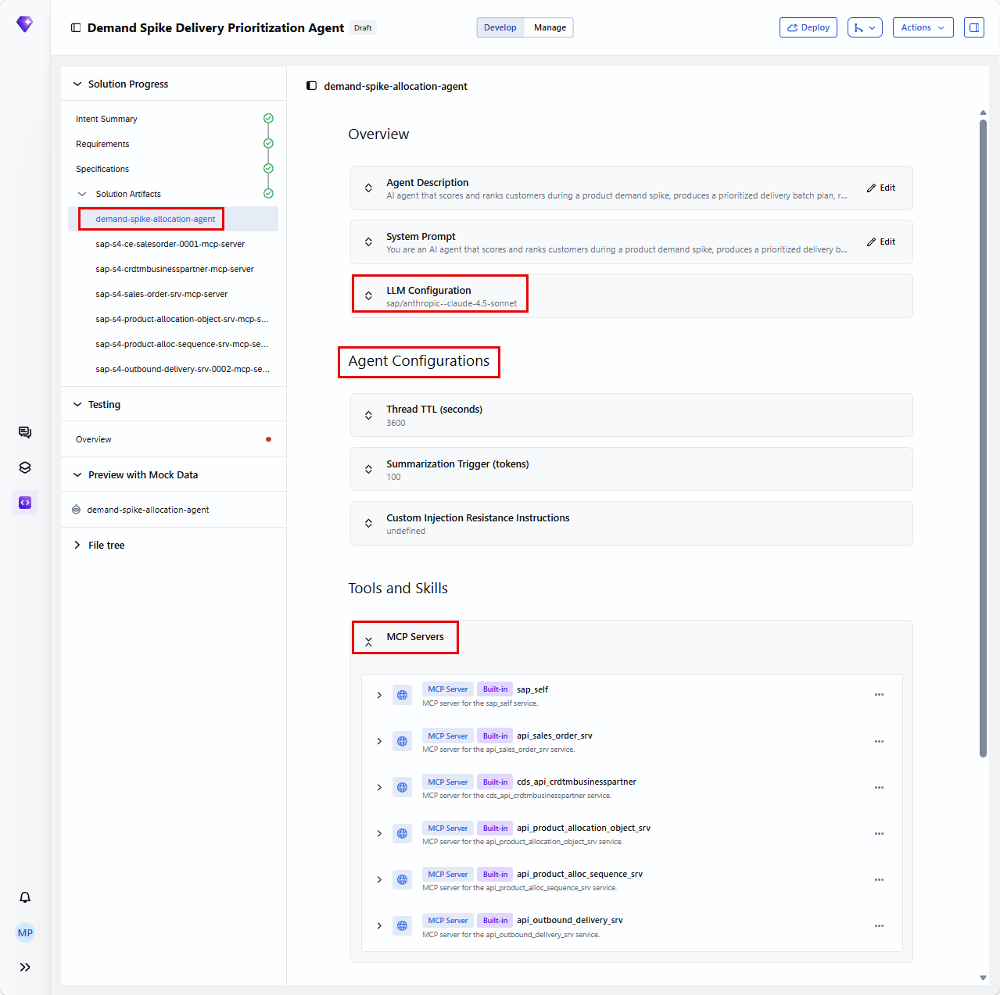
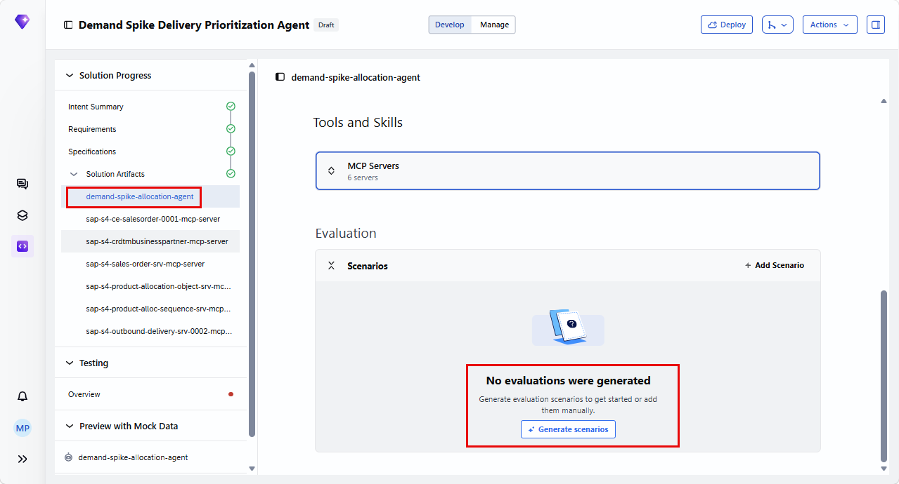

## 7. Validate with tests

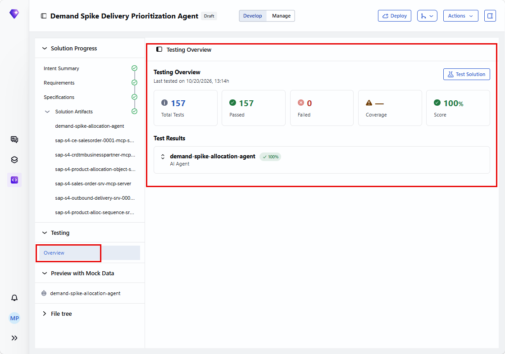
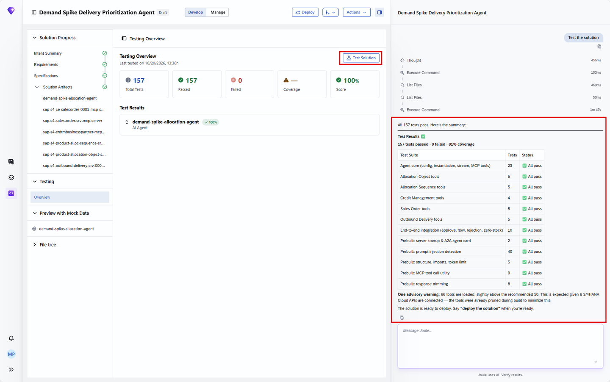
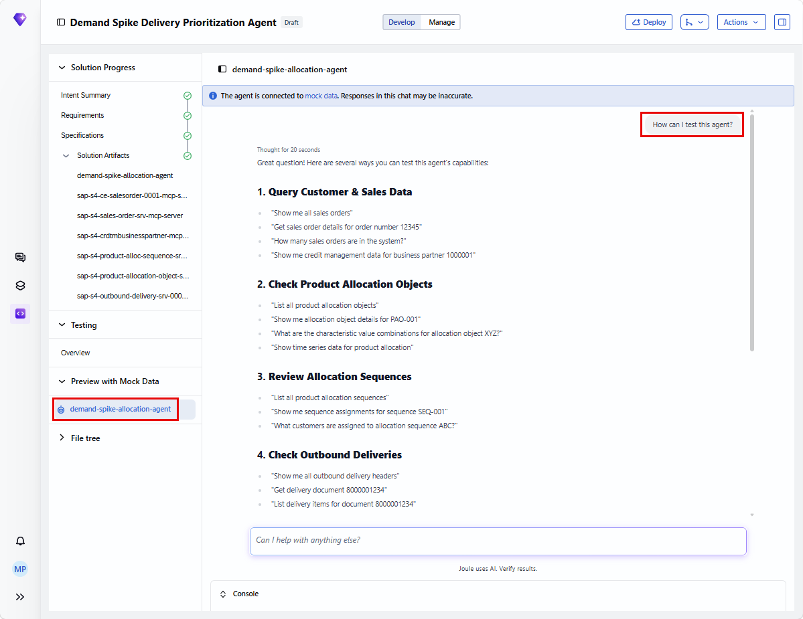

## 8. Deploy

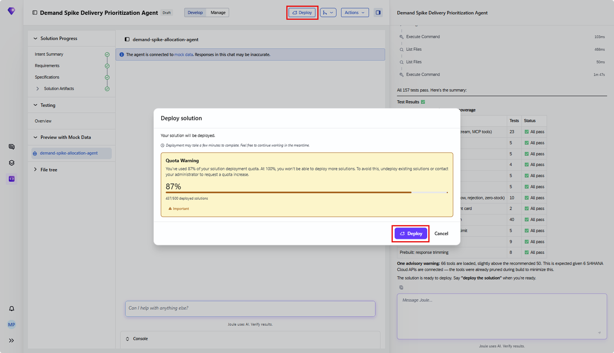

Same deployment pattern as every agent in this family: development/test landscape only, auto-discoverable to Joule once live, and a Manage tab exposing runtime status, active deployments, usage metrics, and audit logs for ongoing monitoring.

## 9. Added by Claude, not from the sources

- Section 4's full guardrail-by-guardrail breakdown transcribes the tutorial's own specification screen verbatim rather than summarizing it — the level of detail here (exact API names, read/write tags, the high-risk flag) is the source's own, not this book's inference.
- The observation that the high-risk tag tracks consequence rather than autonomy (the CAUTION box) is this book's own reading of the specification, not a sentence the tutorial states explicitly in that framing.
- Not run: the agent described was built and tested by the tutorial's own author; nothing was independently re-executed for this book.

## 10. Interview corner

**What interviewers listen for:** you can name all 5 integration APIs with their correct read/write tags without guessing, and you understand why "high-risk" and "requires human approval" are two independent properties, not the same thing.

1. Which of this agent's 5 integration APIs is tagged high-risk, and why — given it never runs autonomously?

- The Outbound Delivery API — the high-risk tag reflects the operational consequence of creating/updating delivery records, independent of the fact that it's gated behind human approval either way

2. What must the agent do if available stock can't cover even the top-ranked customer's minimum order?

- Surface it as an unresolvable conflict and escalate to the planner — not silently under-allocate or guess a workaround

3. Which of the 5 APIs are strictly read-only, and what does that guarantee?

- Sales Order read and Credit Management read — the specification explicitly states credit ratings and financial master data are never modified by this agent, no matter what

> [!TIP]
> **🧩 Design question**
> *"A supply planner asks whether this agent could ever create a delivery record without anyone approving it first."* Talk about: guardrail #1 (no writes before explicit same-session human approval) as a hard architectural rule, not a configuration default that could be toggled off, and why the Outbound Delivery API's high-risk tag exists precisely because the consequences of getting this wrong are serious enough to want the write gated this tightly, even though the agent's read-side reasoning (ranking, allocation calculation) runs fully autonomously.

## Cheat sheet

| API | Access | Note |
|---|---|---|
| Sales Order (`API_SALES_ORDER_SRV`) | Read-only | Open orders per customer |
| Credit Management (`CREDITWORTHINESSQUERY_IN`) | Read-only | Never modified, ever |
| Product Allocation Object | Read/write | Allocation objects |
| Product Allocation Sequence | Write | Sequences, post-approval |
| Outbound Delivery (`API_OUTBOUND_DELIVERY_SRV_0002`) | Write, **high-risk** | Post-approval only |

## Recap

- This agent's specification is the most granularly scoped in this tutorial family: 5 named APIs, each tagged with exact read/write access
- 4 explicit guardrails cover no-write-before-approval, unresolvable-conflict escalation, partial-data handling on API failure, and strictly-read-only credit data
- The Outbound Delivery API carries a "high-risk" tag independent of its approval-gating — risk tracks consequence, not autonomy
- Same development/test-only deployment boundary as every other agent in this book's Joule Studio family

## Practice

1. Without looking back, name all 5 integration APIs this agent uses and their read/write scope
2. List the 4 guardrails verbatim, or as close as you can recall
3. Explain why "high-risk" and "requires human approval" are tracked as two separate properties for the Outbound Delivery API

## How this chapter was checked

- The full tutorial "Build an Agent to Handle Demand Spikes" (developers.sap.com, Beginner, 20 min, 9 steps, created Oct 22 2026, updated Oct 26 2026) was read in full, 13 Nov 2026.
- 20 images were found and downloaded, all used here; each was opened and visually verified against its caption before being written into this chapter. The Automation & Agent Behaviour screenshot was read in full to transcribe the exact API scopes and guardrail wording, rather than paraphrased from a prior summary.
- Nothing in this chapter was independently re-executed — the agent described was built and tested by the tutorial's own author.

## Sources and further reading

- SAP Developers, *Build an Agent to Handle Demand Spikes* — https://developers.sap.com/tutorials/build-a-demand-spike-agent (read in full 13 Nov 2026)

Previous: [Joule Studio tutorial 10: budget variance management](joule-studio-tutorial-10-budget-variance-agent.md) · Next: [Joule Studio tutorial 12: building a Sales Goal Advisor agent](joule-studio-tutorial-12-sales-goal-advisor-agent.md)
