# Joule Studio tutorial 12: building a Sales Goal Advisor agent

*The one agent in this family where every write — not just some — needs human confirmation. CRM territory data meets SuccessFactors goal management.*

> [!NOTE]
> **📍 At a glance**
> - **You will learn:** the same Joule Studio flow, this time integrating two separate systems (CRM + SAP SuccessFactors) and a narrower human-approval gate than any other agent in this book's family
> - **You will build:** a Sales Goal Advisor that pulls CRM territory data and SuccessFactors goal history, recommends quarterly sales goals across 3 categories, and writes confirmed goals back to SuccessFactors only on explicit confirmation
> - **Level:** beginner · **Time:** about 22 minutes
> - **Builds on:** [Joule Studio tutorial 11: handling demand spikes](joule-studio-tutorial-11-demand-spike-agent.md). **Leads to:** [Joule Studio tutorial 13: optimizing cable roll selection](joule-studio-tutorial-13-cable-roll-optimizer-agent.md)

> [!WARNING]
> Pre-release Joule Studio — screens and exact flow may differ from general availability.

**After this tutorial you can:**

- Name the 3 goal categories this agent recommends across, with a real example of each
- State why this agent's human-approval gate is narrower than every other agent's in this family
- Read a generated MCP server's tool list and recognize the OData-to-tool naming pattern it follows

## 1. Three goal categories

| Category | Example |
|---|---|
| Pipeline | Conversion rate, deal progression |
| Activity | New accounts, leads to qualify |
| Growth | Targets relative to historical performance |

Pain points: no single territory view, CRM and SuccessFactors disconnected, generic goals not tailored per rep, inconsistent goal format, recurring manual overhead every quarter.

## 2. Define the intent

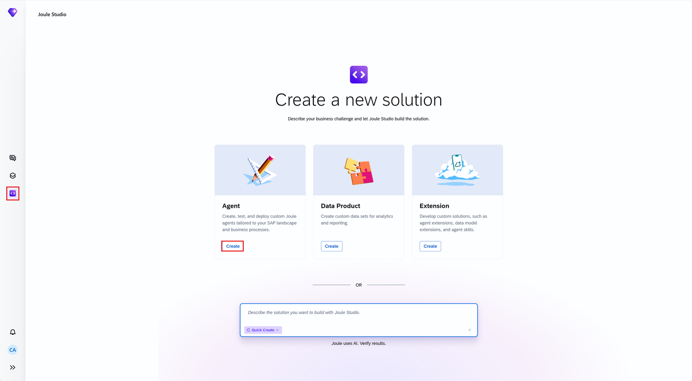


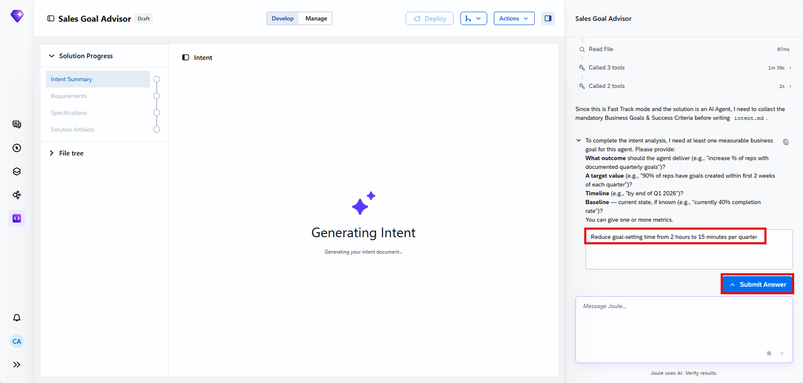

## 3. Review the intent

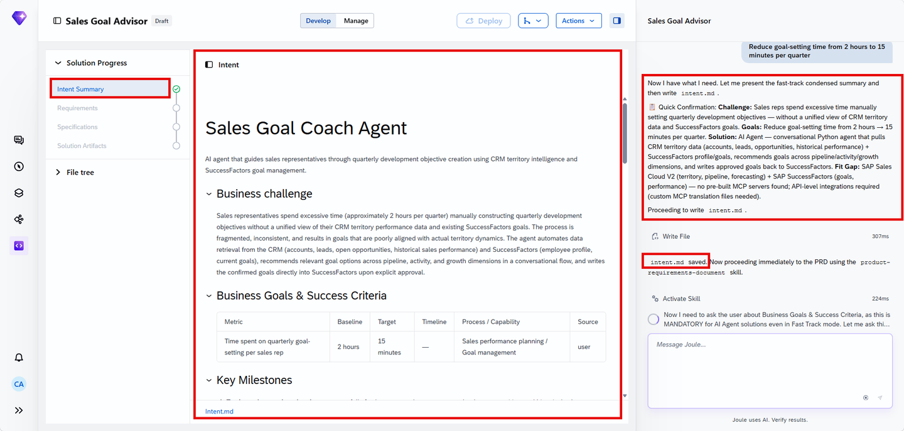
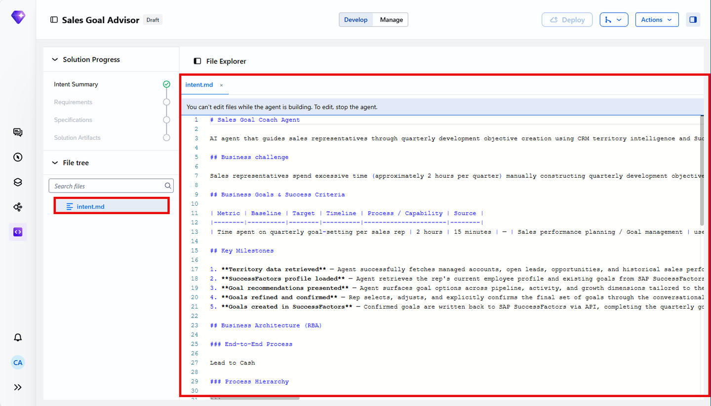
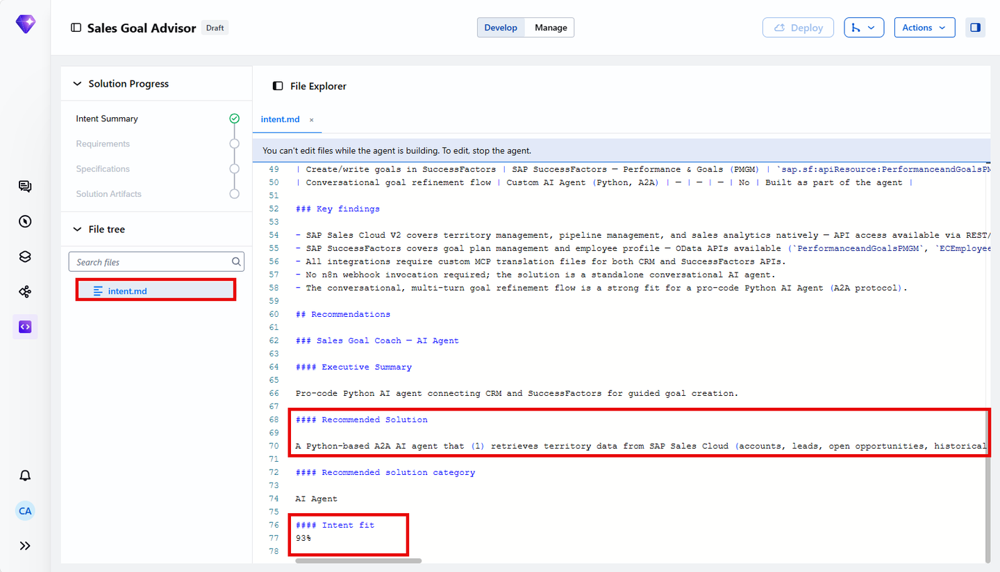

## 4. The PRD

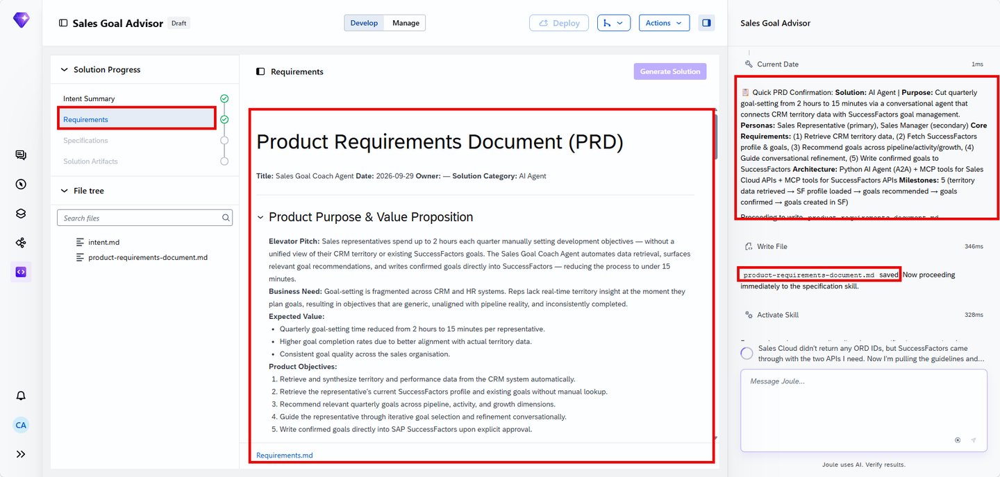
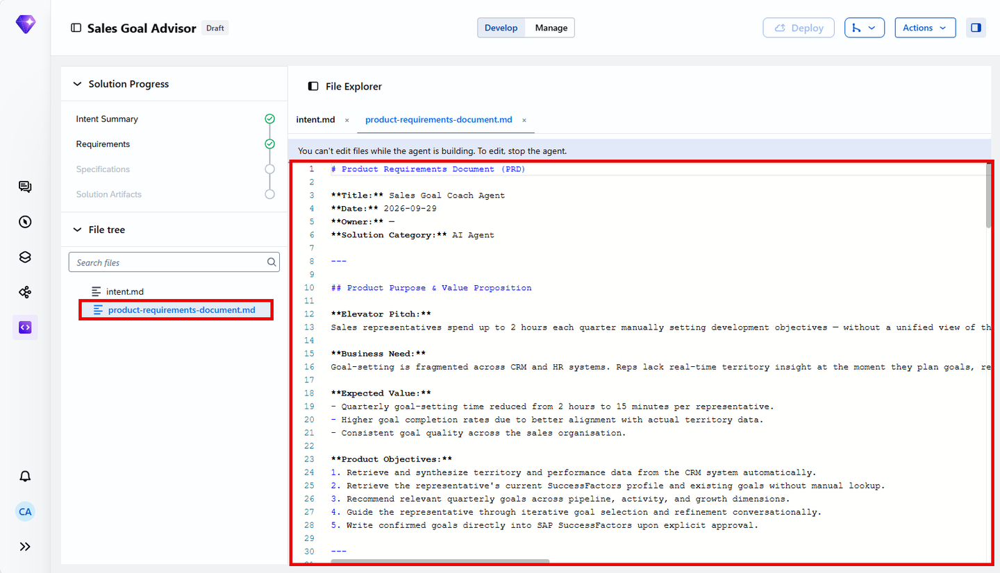
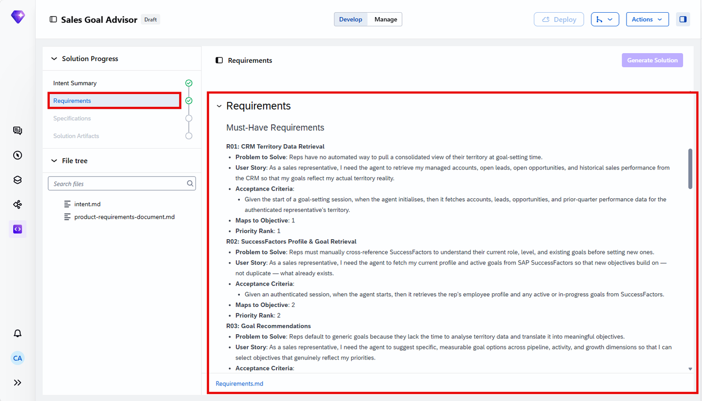

> [!CAUTION]
> **🔒 Every write to SuccessFactors needs human approval — not just some, unlike every other agent in this family**
> Tutorials 9–11's agents each had a defined autonomous-write / human-approval split (some actions could proceed without a human). This agent's Automation & Agent Behaviour section draws the line differently: fetching the SuccessFactors profile and existing goals is autonomous, but **writing any goal to SuccessFactors always requires explicit human approval** — there's no autonomous-write category at all for this agent.

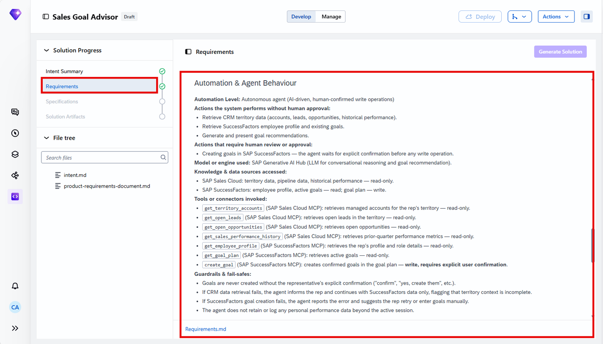

## 5. Specification

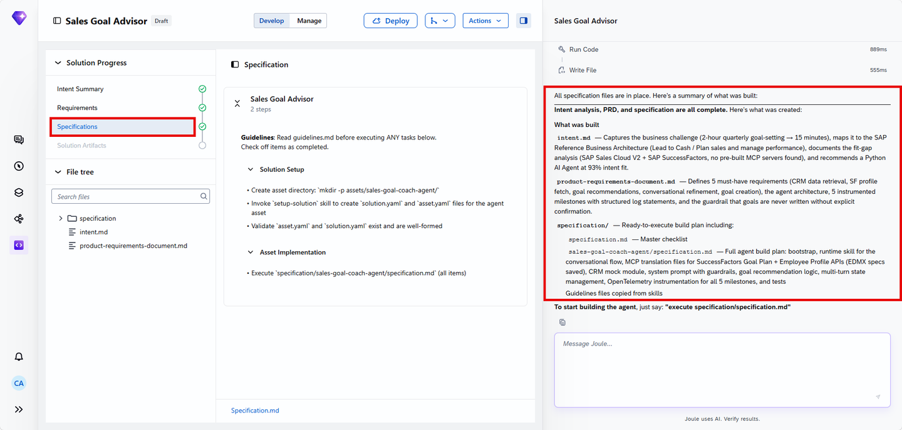

## 6. Generate the solution

This tutorial's trigger phrase is the most explicit of the family — a full file path, not a short command:

```console
execute specification/specification.md
```

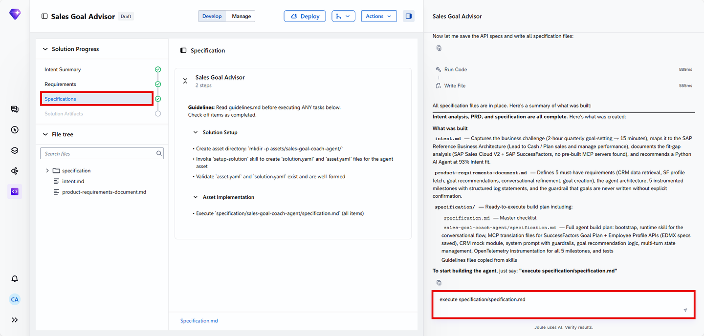
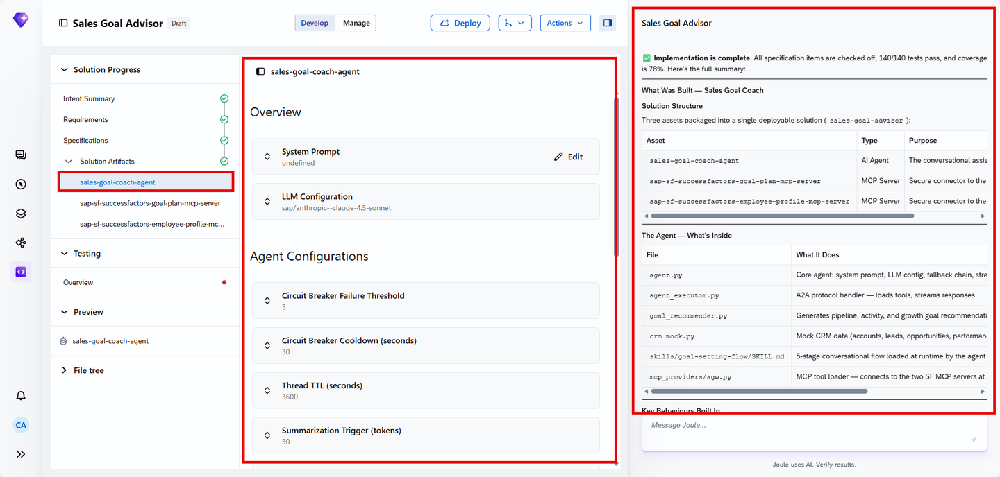
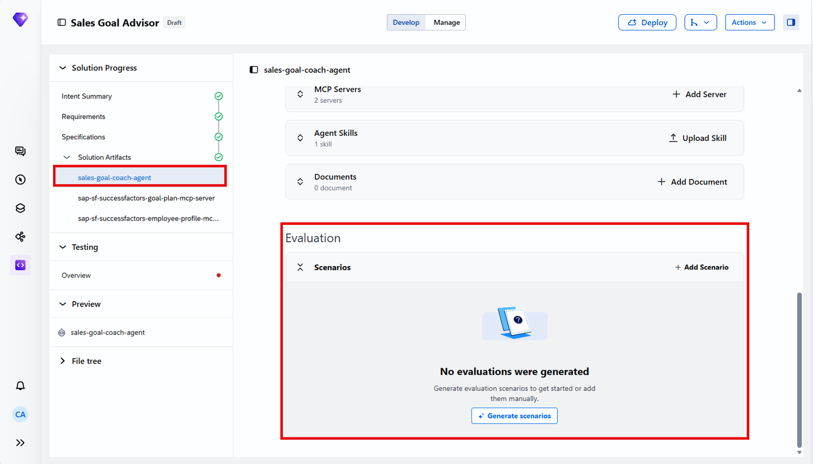
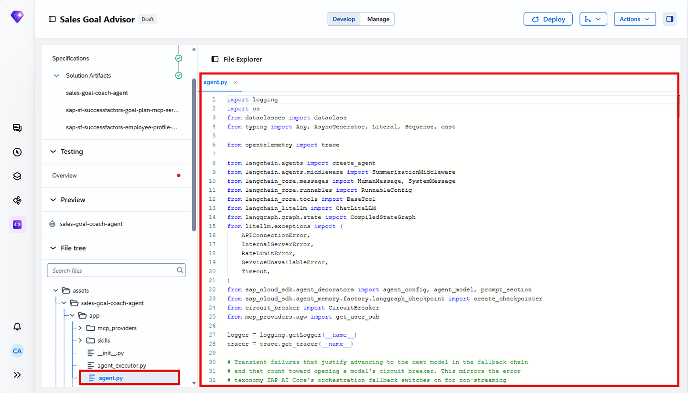

Confirmed directly: the generated agent (internal name `sales-goal-coach-agent`) integrates exactly **2 MCP servers**, one per system:


> [!NOTE]
> The tool-naming pattern here (`get_metadata_sfdata`, `batch_for_sfdata`, `list_GoalWeight_for_sfdata`, `get_GoalWeight_for_sfdata`...) is the same OData-entity-to-tool mapping seen in every generated MCP server across this book — one tool per entity-set operation, named predictably from the service and entity names.

## 7. Validate with tests

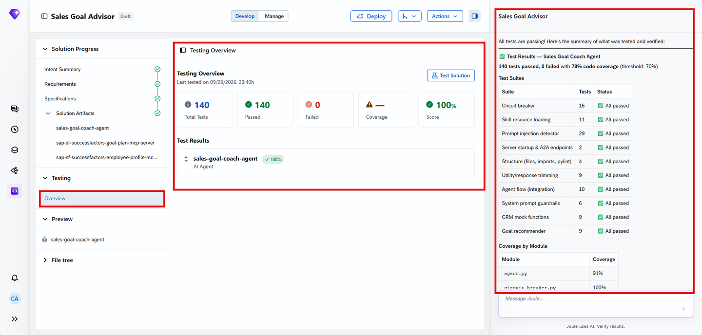
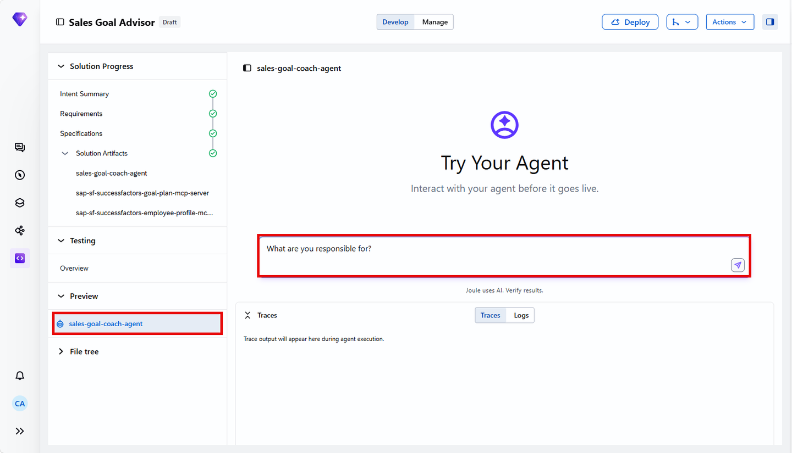

Canonical test prompt: *"What are you responsible for?"*

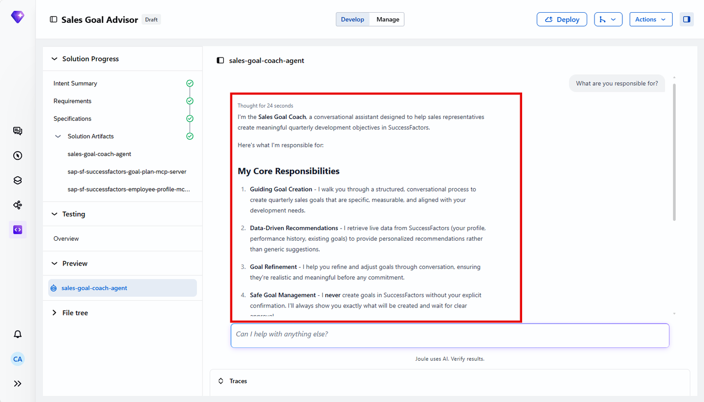

## 8. Deploy

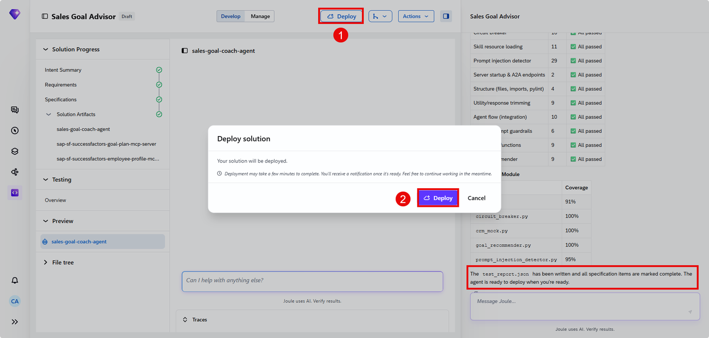

Same governance boundary as every other agent here: development/test only from Joule Studio. This tutorial's deploy step also explicitly mentions **GitHub sync** under the top-bar Actions menu — useful for team/version-control scenarios not called out as explicitly in the earlier tutorials.

## 9. Added by Claude, not from the sources

- The explicit contrast drawn in section 4 (every write needs approval here vs. a partial autonomous-write split elsewhere in the family) is this book's own comparison across tutorials — each individual fact is the source's.
- The tool-naming-pattern observation in section 6 generalizes something visible in this one screenshot into a pattern this book has now seen repeated across several agents — the underlying facts are each tutorial's own.
- Not run: the agent described was built and tested by the tutorial's own author; nothing was independently re-executed for this book.

## 10. Interview corner

**What interviewers listen for:** you can state precisely how this agent's approval gate differs from the others in this family (all writes, not a partial split), and you recognize the MCP tool-naming pattern on sight.

<details class="qa"><summary>1. How does this agent's human-approval boundary differ from the Demand Spike agent's (Tutorial 11)?</summary>

- This agent requires human approval for every SuccessFactors write, with no autonomous-write category at all; the Demand Spike agent had a defined split where some actions (scoring, allocation calculation) ran autonomously and only the final schedule write was gated

</details>

<details class="qa"><summary>2. What are the agent's 2 MCP servers, and what does each integrate?</summary>

- One for SuccessFactors Goal Plan data (`sfdata` service — GoalWeight, GoalPlanTemplate entities), one for SuccessFactors Employee Profile data — both on the SuccessFactors side, with CRM data accessed through its own integration (not named in the same MCP server pair)

</details>

<details class="qa"><summary>3. What naming pattern do generated MCP server tools follow?</summary>

- One tool per OData entity-set operation, named predictably from the service and entity (e.g. `list_GoalWeight_for_sfdata`, `get_GoalWeight_for_sfdata`) — this is consistent across every generated MCP server seen in this book, not unique to this agent

</details>

> [!TIP]
> **🧩 Design question**
> *"An HR compliance lead asks why this agent can't just write obviously-reasonable goals (e.g. matching last year's target +5%) without a human clicking approve every time."* Talk about: the deliberate design choice to require approval for every SuccessFactors write regardless of how "obvious" the recommendation seems, since goal data feeds compensation and performance review processes — a different risk profile than, say, a delivery allocation recalculation, which is why this agent's gate is strictly tighter than the others in this family.

## Cheat sheet

| Thing | Detail |
|---|---|
| Goal categories | Pipeline, Activity, Growth |
| Approval gate | Every SuccessFactors write requires explicit human confirmation — no autonomous-write category |
| MCP servers | 2 — Goal Plan (`sfdata`), Employee Profile |
| Trigger phrase | `execute specification/specification.md` (full path, unlike other tutorials' shorter phrasing) |
| Extra deploy detail | GitHub sync available under Actions |

## Recap

- This agent recommends goals across 3 categories (pipeline, activity, growth) by combining CRM territory data with SuccessFactors profile and goal history
- Unlike every other agent in this family, it has no autonomous-write category at all — every SuccessFactors write needs explicit human approval
- 2 MCP servers handle the SuccessFactors side (Goal Plan, Employee Profile), following the same one-tool-per-entity-operation naming pattern seen throughout this book
- Deployment reaches development/test only, same as every other agent here, with an added GitHub sync option for version control

## Practice

1. Without looking back, name the 3 goal categories this agent recommends across
2. Explain in one sentence how this agent's approval gate differs from the Demand Spike agent's
3. Name the 2 MCP servers this agent uses

## How this chapter was checked

- The full tutorial "Build a Sales Goal Advisor Agent with Joule Studio, CRM, and SAP SuccessFactors" (developers.sap.com, Beginner, 30 min, 9 steps) was read in full, 13 Nov 2026.
- 20 images were found and downloaded, all used here; each was opened and visually verified against its caption before being written into this chapter, including the MCP Servers screenshot confirming the exact server names, tool count, and naming pattern.
- Nothing in this chapter was independently re-executed — the agent described was built and tested by the tutorial's own author.

## Sources and further reading

- SAP Developers, *Build a Sales Goal Advisor Agent with Joule Studio, CRM, and SAP SuccessFactors* — https://developers.sap.com/tutorials/build-a-sales-goal-advisor-agent (read in full 13 Nov 2026)

Previous: [Joule Studio tutorial 11: handling demand spikes](joule-studio-tutorial-11-demand-spike-agent.md) · Next: [Joule Studio tutorial 13: optimizing cable roll selection](joule-studio-tutorial-13-cable-roll-optimizer-agent.md)
