# Joule Studio tutorial 14: extending a standard Journal Entry Agent

*Not building an agent from scratch — extending a pre-delivered one, twice, at two different depths: a zero-code instruction-only tweak, then a full approval-gate-plus-validation extension with its own MCP servers and n8n hooks.*

> [!NOTE]
> **📍 At a glance**
> - **You will learn:** the **Agent Extension** flow — adding capability to a pre-delivered standard agent instead of building one from scratch, across its 4 extension points (pre-hooks, post-hooks, MCP servers, instruction)
> - **You will build:** two extensions of the standard **Journal Entry Agent** — a simple instruction-only AI-disclaimer extension, then a richer €45 approval-gate-plus-historical-validation extension with its own MCP servers and n8n hook workflows
> - **Level:** beginner · **Time:** about 25 minutes
> - **Builds on:** [Joule Studio tutorial 13: building a Cable Roll Optimizer agent](joule-studio-tutorial-13-cable-roll-optimizer-agent.md). **Leads to:** [Joule Studio tutorial 15: an n8n workflow for invoice exceptions](joule-studio-tutorial-15-invoice-exception-n8n-workflow.md)

> [!WARNING]
> Pre-release Joule Studio — screens and exact flow may differ from general availability.

**After this tutorial you can:**

- Name the 4 extension points a standard agent exposes, and explain the difference between an instruction-only extension and one with its own tools and hooks
- Read a BEFORE/AFTER hook pair and explain what `canShortCircuit` and `onFailure` actually control
- Explain why the richer extension's validation logic queries the Universal Journal specifically, rather than any other S/4HANA data source

## 1. The standard agent, unextended

Before touching extensions, the tutorial shows the pre-delivered **Journal Entry Agent** working as-is: it automates journal entry lifecycle operations in SAP S/4HANA — creation, validation, simulation, and posting.

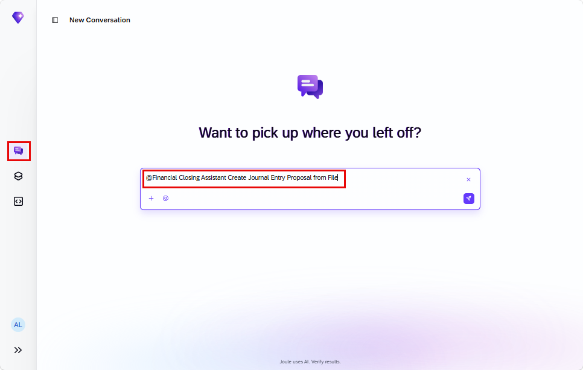

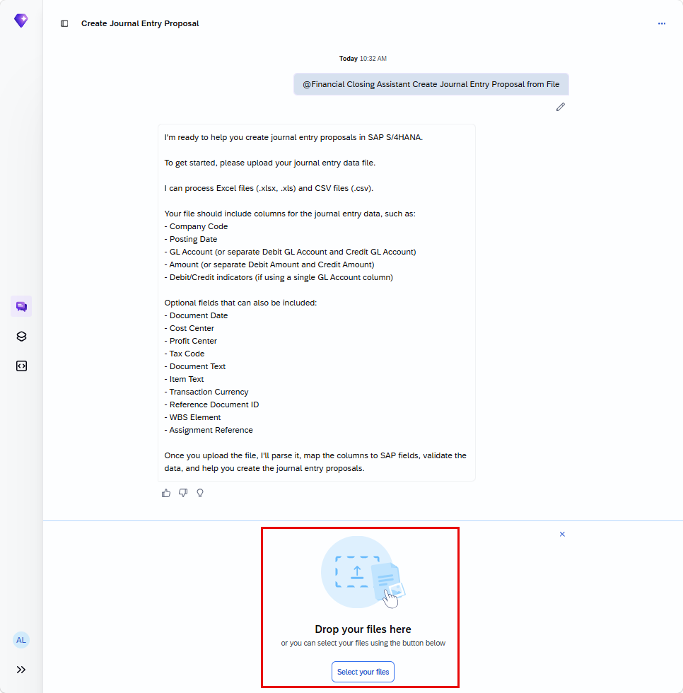

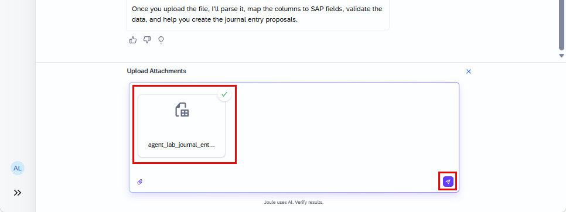

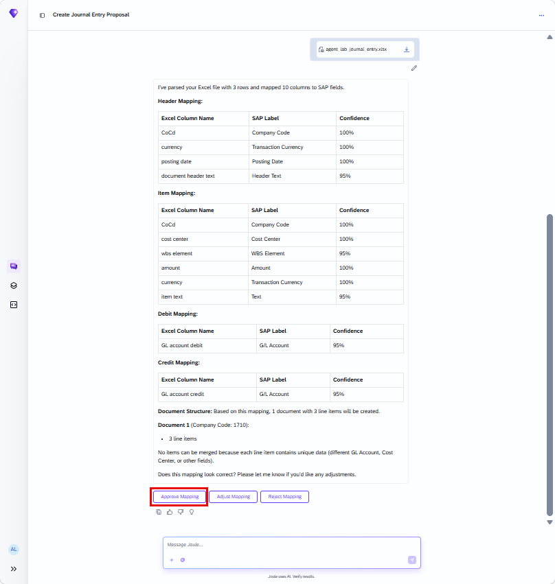

The base agent creates a proposal and runs its own validation checks before anything is posted:

> [!NOTE]
> That last "Not Available — no policy defined for company code 1710" line is exactly the gap the second extension below fills: the base agent has nowhere to check postings against historical patterns, so this tutorial builds that capability in as an extension rather than modifying the standard agent itself.

## 2. The 4 extension points

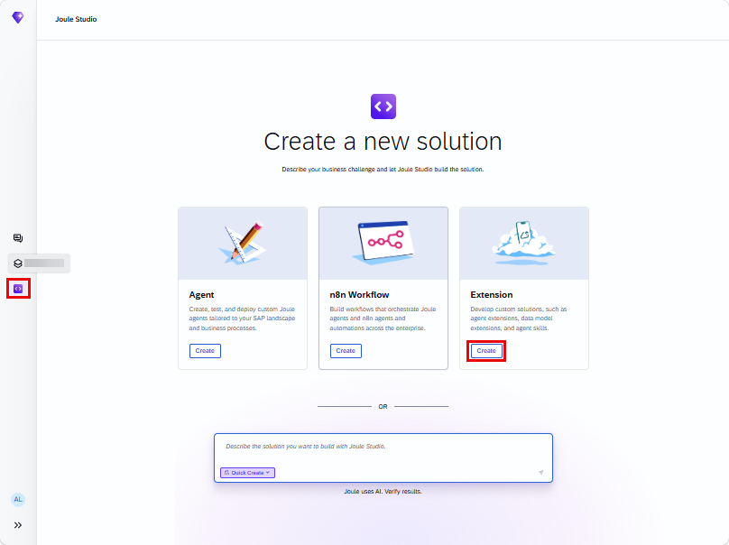

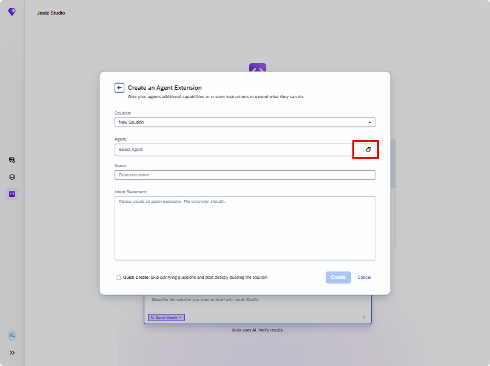

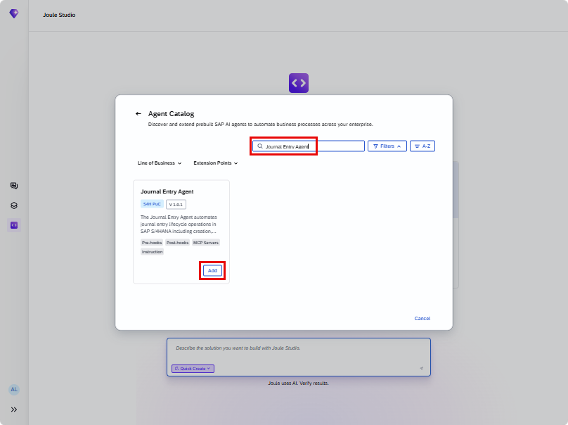

Selecting the agent shows its description and, explicitly, its 4 available extension points:

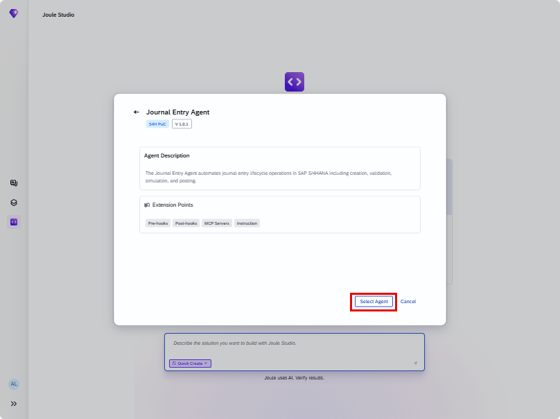

| Extension point | What it adds |
|---|---|
| Instruction | Custom instructions layered onto the agent's existing behavior |
| MCP Servers | New tool integrations the agent can call |
| Pre-hooks | Logic that runs **before** the agent's normal processing, can short-circuit it |
| Post-hooks | Logic that runs **after** the agent's normal processing |

## 3. First extension: instruction-only, zero tools, zero hooks

The simplest possible extension — add one mandatory instruction, nothing else:

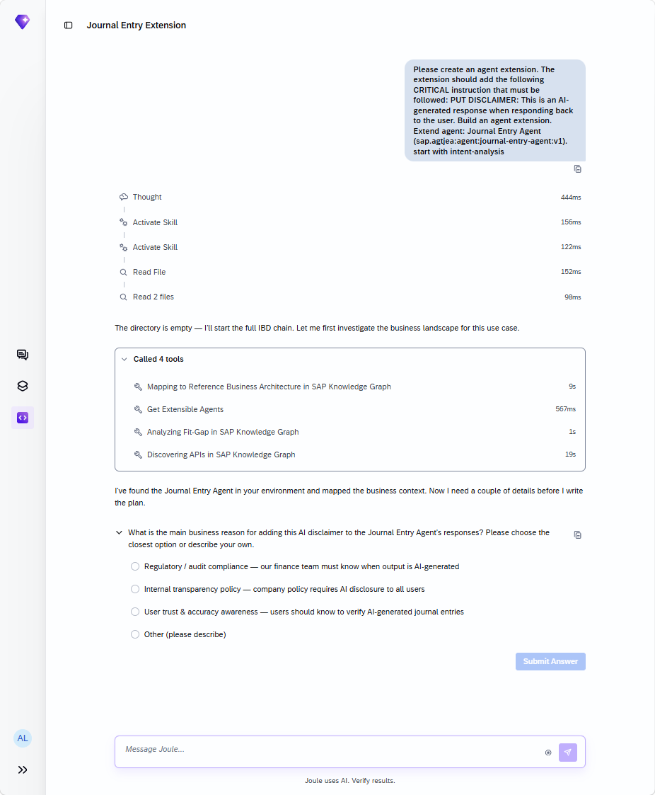
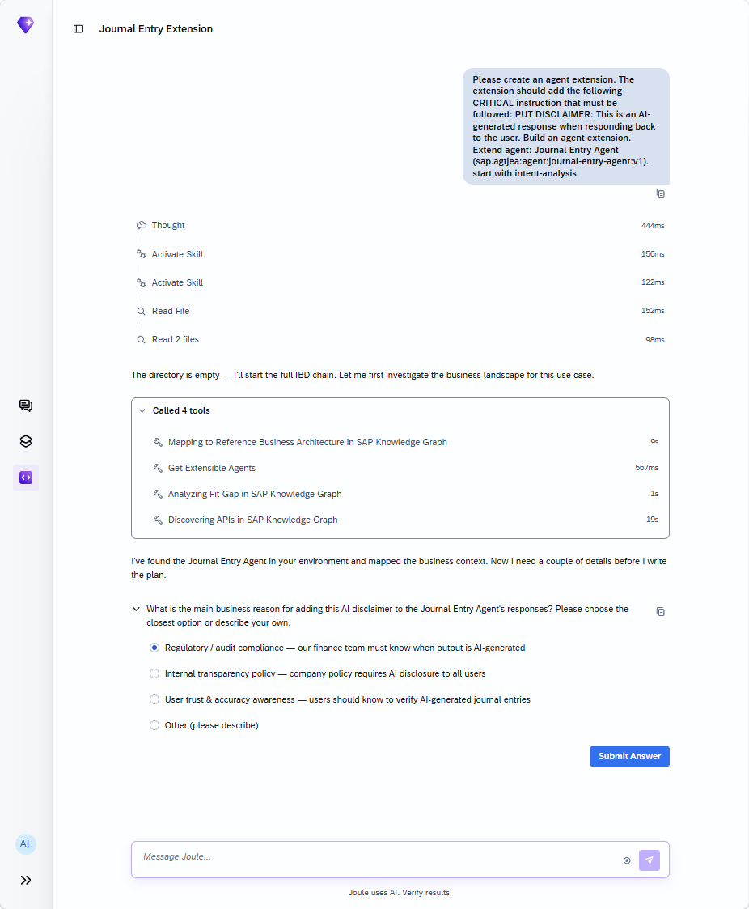
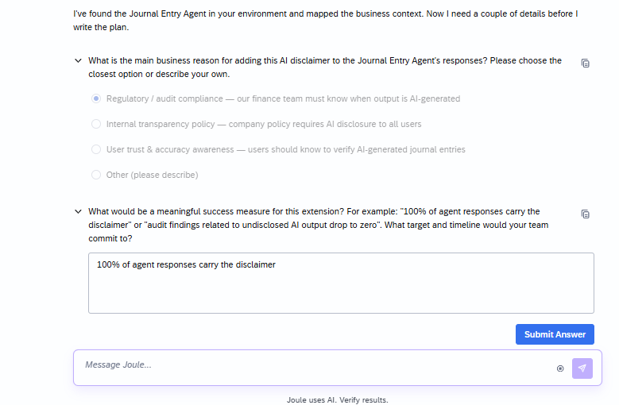
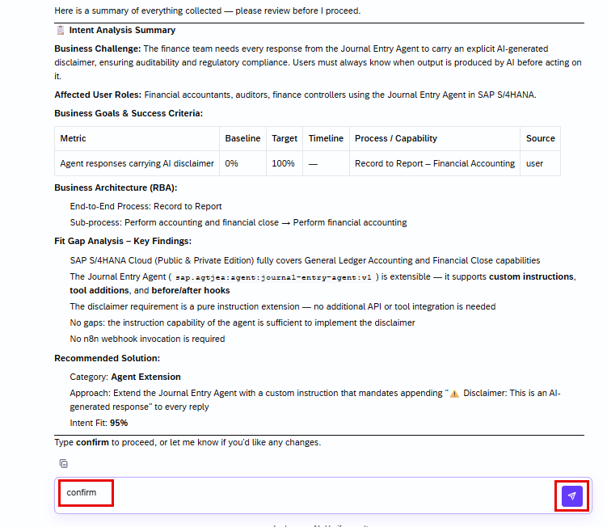

The generated PRD confirms just how minimal this extension is — and this is the generated solution shown directly, not summarized:

![PRD: Journal Entry Agent AI Disclaimer Extension, Solution Category "Agent Extension." Key Requirements: agent must append a disclaimer to every response regardless of query type; disclaimer text must read exactly "⚠️ Disclaimer: This is an AI-generated response"; existing agent behavior must not be altered, only augmented; extension target sap.agt.jea:agent:journal-entry-agent:v1. Solution Architecture: Agent Extension (instruction-only) — no additional APIs, tools, or workflows required. Key Milestones: M1 Disclaimer instruction registered, M2 Disclaimer present in response — disclaimer appears in every agent reply. Agent Extension Specifics: Extensibility Points: yes (instruction extension); Instrumentation: yes (M1, M2 milestones with log statements); Tools: 0 (none required); Hooks: none. Scope Boundaries — In Scope: custom instruction extension, disclaimer on all agent responses; Out of Scope: modifying base agent source code, adding tools or hooks, changing journal entry posting logic](images/sj209-16-generated-prd.png)

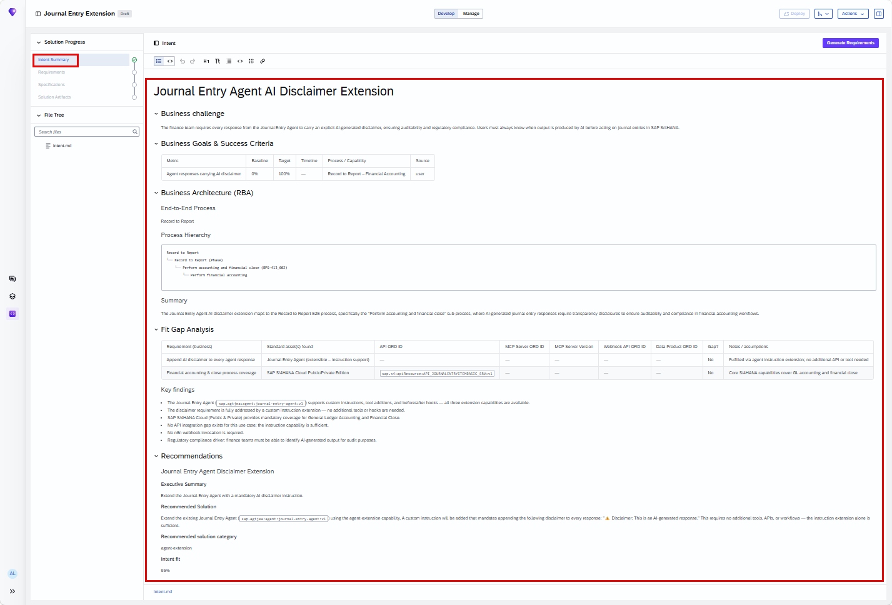

> [!TIP]
> This is the cleanest possible illustration of "instruction extension": **0 tools, no hooks, 2 milestones** — the entire deliverable is one registered instruction and a guarantee it's honored on every reply. Not every agent extension needs new integrations.

## 4. Second extension: approval gate + historical validation

A second, deliberately richer extension on the same base agent, started as a second solution in the same session:

![Create an Agent Extension, second intent: "Before processing any journal entry, check if any line item amount exceeds €45. If it does, pause and ask the user for explicit approval before continuing. Once approved, validate the uploaded journal entry proposal against historical journal entry posting patterns in SAP S/4HANA Cloud Public Edition. To do this, query the Universal Journal — the single source of truth for all financial postings in S/4HANA Cloud — through the MCP tool to retrieve historical posting data. For each line item, compare the combination of Company Code, G/L Account, Cost Center, Profit Center, and Segment with previously posted journal entries. Tag each line as..."](images/sj209-19-create-new-extension-second-intent.png)

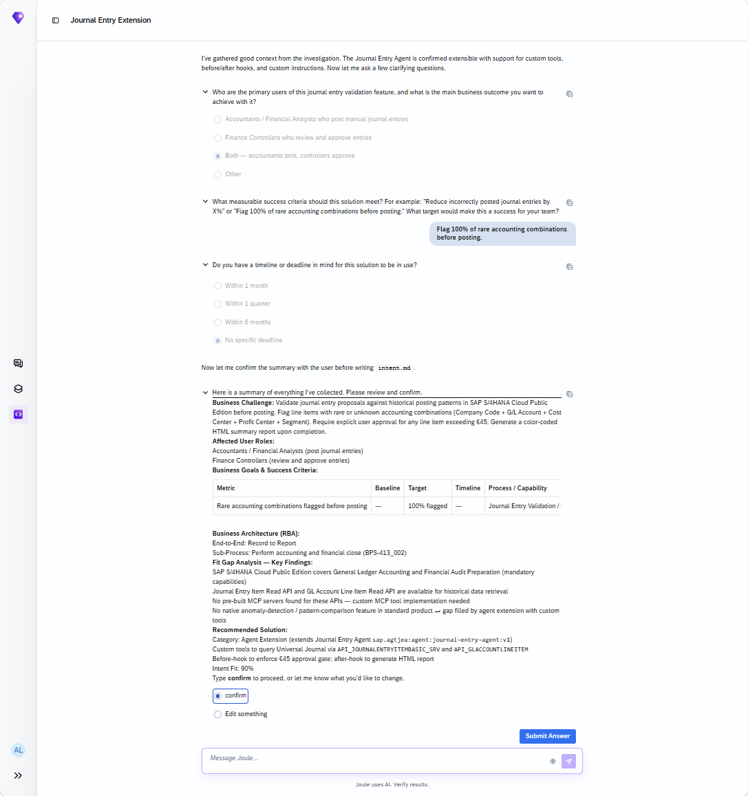

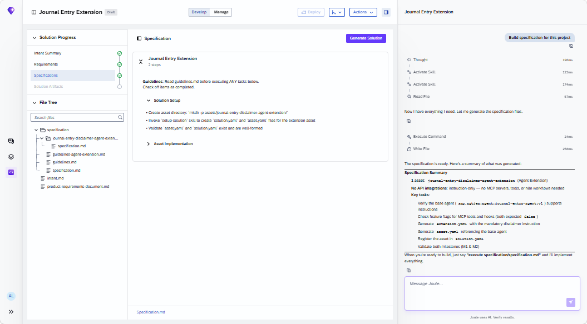
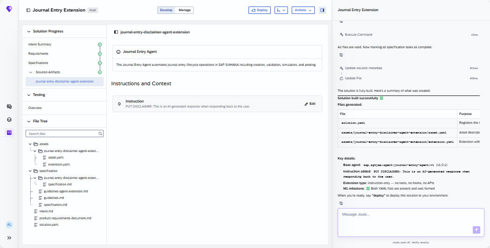

> [!NOTE]
> Why the **Universal Journal** specifically: it's named in the intent statement itself as "the single source of truth for all financial postings in S/4HANA Cloud" — meaning any historical-pattern comparison that skipped it could miss postings recorded through other entry points, undermining the whole validation.

The finished extension, confirmed directly in the Solution Artifacts panel:

![Solution Artifacts, four extension layers: journal-entry-approval-gate, journal-entry-validation-report, journal-entry-validation-agent-extension, sap-s4-journalentryitembasic-srv-mcp-server, sap-s4-glaccountlineitem-mcp-server. Chat summary: Implementation Complete. 2 MCP Servers (Journal Entry Item — Read, 9 read-only tools: list/get/count/navigate/aggregate; GL Account Line Items — Read, 6 tools: list/get/aggregate/metadata/batch). 2 n8n Workflows (hook implementations): journal-entry-approval-gate (BEFORE hook — checks every line item for amounts over €45, short-circuits execution with an approval request), journal-entry-validation-report (AFTER hook — parses tagged results, generates a color-coded green/yellow/red HTML report). 1 Agent Extension extending Journal Entry Agent v1.0.1: custom instructions (6-step validation ruleset — approval gate, query Universal Journal, tag lines, auto-accept or flag, structure result, trigger report), 15 MCP tools wired from both MCP servers, 2 hooks (BEFORE: canShortCircuit true, onFailure FAIL; AFTER: onFailure CONTINUE, timeout 60s)](images/sj209-21-solution-artifacts-four-extension-layers.png)

This is the richest Agent Extension seen in this book: **2 MCP servers, 2 n8n hook workflows, 15 wired tools, and a 6-step custom-instruction ruleset**, all layered onto the same standard agent that, unextended, could only say "Not Available" for guideline-consistency checks.

## 5. Added by Claude, not from the sources

- The cheat-sheet table in section 2 restates the 4 extension points named directly on the Journal Entry Agent's own selection screen, formatted as a table rather than tags for readability.
- The closing NOTE in section 4 (why the Universal Journal specifically) draws directly on language in the tutorial's own intent statement, quoted verbatim, not inferred.
- The framing "richest Agent Extension seen in this book" is this book's own comparison across tutorials, not a claim the source makes.
- Not run: both extensions described were built and tested by the tutorial's own author; nothing was independently re-executed for this book.

## 6. Interview corner

**What interviewers listen for:** you can name all 4 extension points without hesitating, and you can explain precisely what a BEFORE hook's `canShortCircuit: true` means operationally (it can stop the base agent's processing before it runs).

1. What are the 4 extension points a standard Joule Studio agent exposes?

- Pre-hooks, Post-hooks, MCP Servers, Instruction

2. The first extension in this tutorial used 0 tools and no hooks. What did it actually deliver?

- A single registered custom instruction (append a mandatory AI-disclaimer to every response) plus 2 milestones confirming the instruction is registered and honored on every reply — no new integrations needed

3. What does the BEFORE hook's `canShortCircuit: true` setting mean, concretely, in the second extension?

- The approval-gate hook can stop the base agent's normal processing entirely before it runs, pausing for explicit user approval whenever a line item exceeds €45 — it's not just a logging step, it can block execution

> [!TIP]
> **🧩 Design question**
> *"A finance-compliance reviewer asks why the disclaimer extension and the validation extension are built as two separate extensions rather than one combined one."* Talk about: the disclaimer extension (instruction-only, 0 tools, 2 milestones) solving a narrow, universal concern that applies to every response regardless of content, versus the validation extension (2 MCP servers, 2 hooks, 15 tools) solving a specific, heavier workflow concern (approval gating plus historical-pattern validation) — bundling them would couple a trivial, always-on behavior to a much larger piece of infrastructure that not every deployment might need.

## Cheat sheet

| Thing | Detail |
|---|---|
| 4 extension points | Pre-hooks, Post-hooks, MCP Servers, Instruction |
| Extension 1 | Instruction-only — mandatory AI disclaimer, 0 tools, no hooks, 2 milestones |
| Extension 2 | Approval gate (€45 threshold) + historical validation via Universal Journal |
| Extension 2 MCP servers | Journal Entry Item (Read, 9 tools), GL Account Line Items (Read, 6 tools) — 15 tools wired total |
| Extension 2 hooks | BEFORE (`canShortCircuit: true`, `onFailure: FAIL`), AFTER (`onFailure: CONTINUE`, `timeout: 60s`) |
| Validation source | Universal Journal — single source of truth for S/4HANA Cloud financial postings |

## Recap

- A standard, pre-delivered agent (here, the Journal Entry Agent) can be extended rather than rebuilt, across 4 extension points: pre-hooks, post-hooks, MCP servers, instruction
- The simplest extension needs none of the heavier points — a pure instruction addition with 0 tools and no hooks is a complete, valid extension
- A richer extension can add its own MCP servers and BEFORE/AFTER hook workflows (implemented here as n8n workflows), wiring in 15 tools across 2 servers
- `canShortCircuit` on a BEFORE hook determines whether it can block the base agent's processing; `onFailure` determines what happens if the hook itself errors
- The validation extension specifically targets the Universal Journal because it's the single source of truth for financial postings — any other source risks an incomplete comparison

## Practice

1. Without looking back, name all 4 extension points
2. Explain what made the first extension in this tutorial the simplest possible kind
3. State what `canShortCircuit: true` and `onFailure: FAIL` each control on the approval-gate BEFORE hook

## How this chapter was checked

- The full tutorial "Extend the Journal Entry Agent" (developers.sap.com, Beginner, 25 min) was read in full, 13 Nov 2026.
- 21 images were found and downloaded, all used here; each was opened and visually verified against its caption before being written into this chapter, including both the simple PRD (confirming 0 tools/no hooks) and the final Solution Artifacts panel (confirming the exact MCP server tool counts and hook configuration) for the two extensions.
- Nothing in this chapter was independently re-executed — both extensions described were built and tested by the tutorial's own author.

## Sources and further reading

- SAP Developers, *Extend the Journal Entry Agent* — https://developers.sap.com/tutorials/journal-entry-agent-extension (read in full 13 Nov 2026)

Previous: [Joule Studio tutorial 13: building a Cable Roll Optimizer agent](joule-studio-tutorial-13-cable-roll-optimizer-agent.md) · Next: [Joule Studio tutorial 15: an n8n workflow for invoice exceptions](joule-studio-tutorial-15-invoice-exception-n8n-workflow.md)
