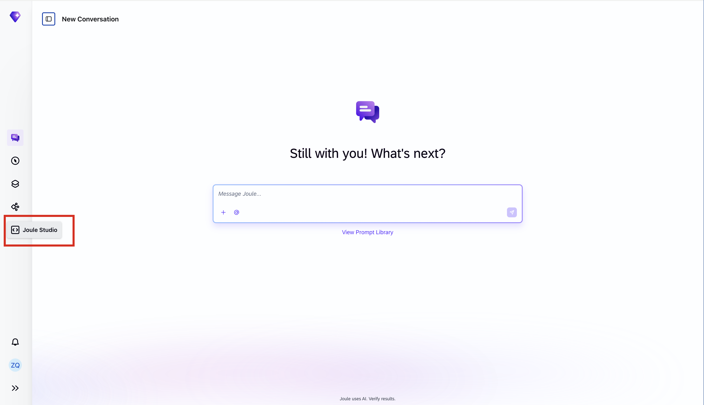
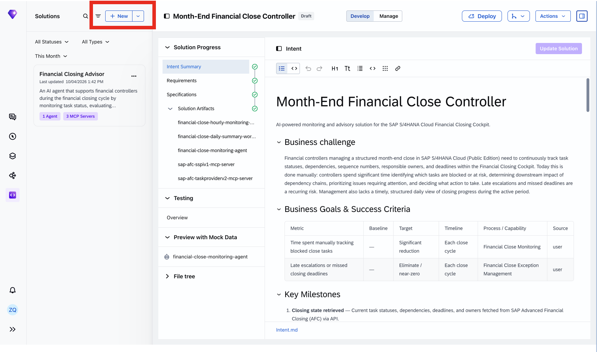
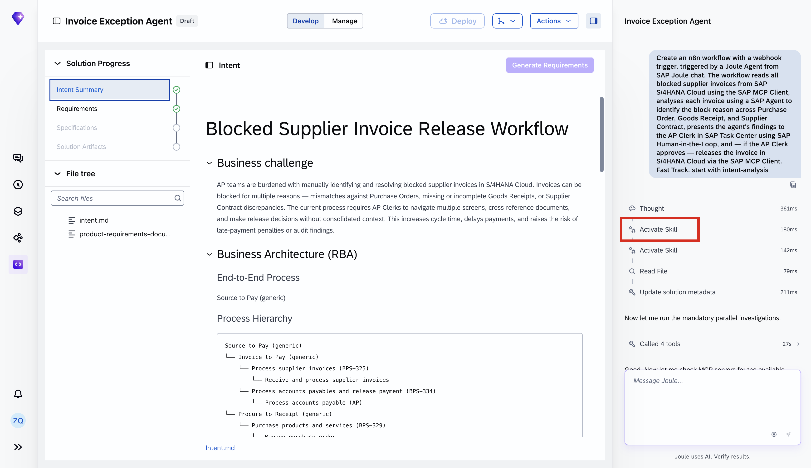
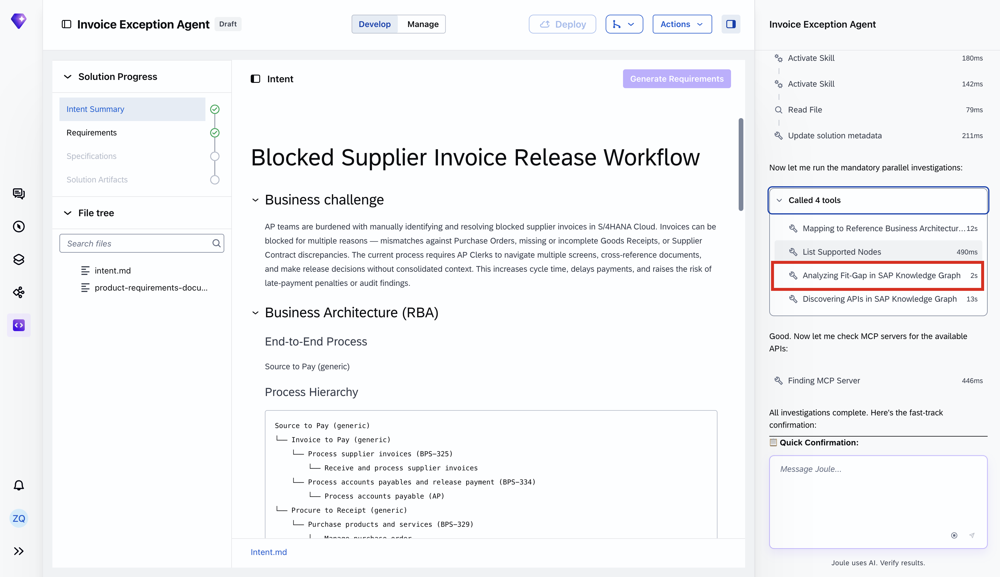
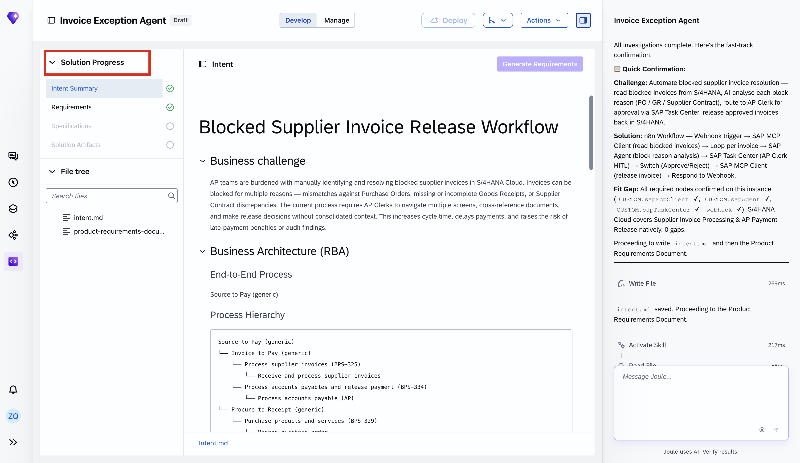
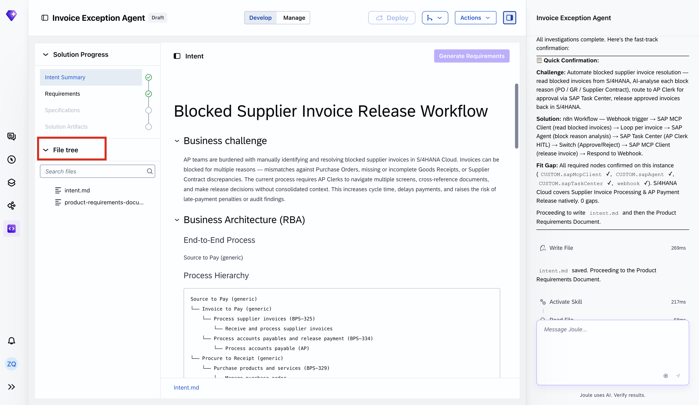
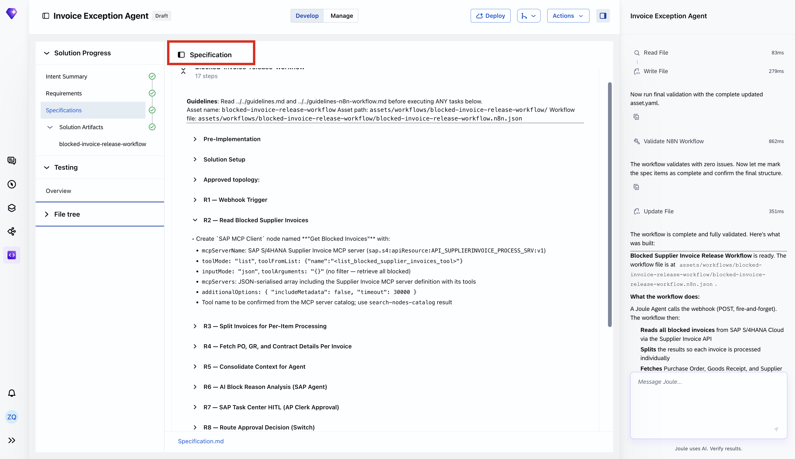
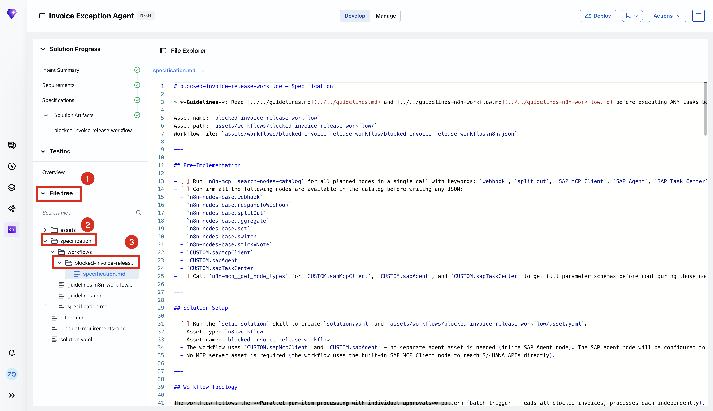

# Joule Studio tutorial 15: an n8n workflow for blocked invoice release

*The first n8n Workflow solution type in this book — a sibling to Agent, not a variant of it — plus a first look at Joule Studio tracing a business intent through SAP's own Reference Business Architecture graph.*

> [!NOTE]
> **📍 At a glance**
> - **You will learn:** the **n8n Workflow** solution type (a Limited Preview capability, sibling to Agent/Data Product/Agent Extension), and how Joule Studio maps an intent onto SAP's Reference Business Architecture before generating anything
> - **You will build:** a Blocked Supplier Invoice Release Workflow — reads blocked invoices from SAP S/4HANA Cloud, investigates the block reason via an AI analysis step, routes a consolidated finding to an AP Clerk for approval, and releases or logs the decision
> - **Level:** beginner · **Time:** about 20 minutes
> - **Builds on:** [Joule Studio tutorial 14: extending a standard agent](joule-studio-tutorial-14-journal-entry-agent-extension.md). **Leads to:** [Joule Studio tutorial 16: Joule Work Intent](joule-studio-tutorial-16-joule-work-intent.md)

> [!WARNING]
> Pre-release Joule Studio — screens and exact flow may differ from general availability. n8n for Joule Studio is explicitly labeled **Limited Preview**: "the current version establishes a foundational set of capabilities; additional features and enhancements are planned for future releases."

**After this tutorial you can:**

- Name the solution type used for this tutorial and explain how it differs from Agent, Data Product, and Agent Extension
- Explain what "Mapping to Reference Business Architecture" and "Analyzing Fit-Gap in SAP Knowledge Graph" actually do before any code is generated
- Read a generated n8n canvas node-by-node and explain why the webhook responds before the human approval step completes

## 1. The business problem

AP teams manually investigate why supplier invoices are blocked in S/4HANA Cloud — cross-referencing Purchase Orders, Goods Receipts, and Supplier Contracts across multiple screens before deciding whether to release each one. Root cause is always one of three mismatches: PO price/quantity discrepancy, missing or incomplete Goods Receipt, or Supplier Contract deviation.

## 2. Create an n8n Workflow solution

![Create n8n Workflow dialog: "n8n — Limited Preview" banner, Name "Invoice Exception Agent," Intent Statement — "Create an n8n workflow with a webhook trigger, triggered by a Joule Agent from SAP Joule chat. The workflow reads all blocked supplier invoices from SAP S/4HANA Cloud using the SAP MCP Client, analyses each invoice using a SAP Agent to identify the block reason across Purchase Order, Goods Receipt, and Supplier Contract, presents the agent's findings to the AP Clerk in SAP Task Center using SAP Human-in-the-Loop, and — if the AP Clerk approves — releases the invoice in S/4HANA Cloud via the SAP MCP Client," Quick Create checked](images/sj210-03-create-n8n-workflow-intent-fields.png)

## 3. Intent analysis: mapping to SAP's own Reference Business Architecture

Before writing anything, Joule Studio traces the intent through SAP's Knowledge Graph — a step not seen in the earlier Agent-type tutorials:

The resulting Intent Summary includes a literal **Business Architecture (RBA)** section, traversing SAP's own process hierarchy down to specific Business Process Standard (BPS) IDs:

![Intent Summary: "Blocked Supplier Invoice Release Workflow." Business challenge paragraph. Business Architecture (RBA): End-to-End Process "Source to Pay (generic)," Process Hierarchy tree — Source to Pay (generic) > Invoice to Pay (generic) > Process supplier invoices (BPS-325) > Receive and process supplier invoices, and > Process accounts payables and release payment (BPS-334) > Process accounts payable (AP); Procure to Receipt (generic) > Purchase products and services (BPS-329) > Manage purchase order](images/sj210-06-intent-summary-exploration.png)

> [!NOTE]
> **"Mapping to Reference Business Architecture" and "Analyzing Fit-Gap in SAP Knowledge Graph"** are doing something distinct from API discovery: they're locating the intent within SAP's own standard process taxonomy (named BPS process IDs like `BPS-325`, `BPS-334`, `BPS-329`) *before* any API or MCP server is chosen. Only after that mapping does Joule Studio move on to "Discovering APIs" and "Finding MCP Server" for the actual integration.

## 4. The PRD, and a genuine clarifying question despite Quick Create

![PRD: Title "Blocked Supplier Invoice Release Workflow," Solution Category "n8n Workflow." Elevator Pitch — automates the investigation and routes a consolidated AI analysis to the AP Clerk for a single approve-or-reject decision. Business Need: root cause always one of 3 mismatches. Product Objectives: reduce time-to-decision, ensure AP Clerks receive consolidated contextualized analysis, guarantee no invoice is released without explicit AP Clerk approval. Requirements: R1 Webhook Trigger from Joule Agent — "As a Joule Agent orchestrator, I need to trigger the blocked invoice resolution workflow via a webhook so that the AP process can be initiated from a conversational interface"](images/sj210-09-prd-product-purpose-value.png)

Even with Quick Create checked, Joule Studio stops and asks for one piece of information it genuinely cannot generate or guess:

> [!TIP]
> This is a useful, concrete answer to "what does Quick Create actually skip?" — it skips the staged confirmation steps (Business Goals, intent-fit review), not genuinely-required information Joule Studio has no way to infer. An approver's email address is exactly that kind of value: no amount of pattern-matching against the codebase or SAP APIs can produce it.

## 5. Specification and generation

The generated n8n canvas, confirmed directly — 9 nodes, with a 3-way branch at the end:

What the workflow does, confirmed directly from the generation summary:

1. A Joule Agent calls the webhook (POST, fire-and-forget)
2. Reads all blocked invoices from SAP S/4HANA Cloud via the Supplier Invoice API
3. Splits the results so each invoice is processed individually
4. Fetches Purchase Order, Goods Receipt, and Supplier Contract data per invoice from S/4HANA
5. Consolidates all data for the AI analysis step
6. Invokes a SAP Agent with a structured prompt to identify the root cause (PO price discrepancy, missing GR quantity, or contract deviation) and recommend an action
7. Creates an approval task in SAP Task Center for the AP Clerk, including invoice number, supplier, block reason code, and the AI-generated analysis as custom attributes
8. Routes on the decision: approved → releases the invoice block in S/4HANA; rejected → logs the rejection
9. Runs **fully asynchronously** — the webhook responds immediately so the Joule Agent does not time out waiting for a human decision

> [!CAUTION]
> **🔒 One manual step is required before this workflow can deploy**
> Joule Studio flags it explicitly: open the workflow in the n8n editor and select the target agent in the **"Analyse Block Reason"** node (a sticky note in the canvas guides you), then update the `ordId` and `name` placeholder values in `asset.yaml` under `requires` to match your actual tenant. This is the one piece of the generated solution that isn't fully wired automatically — unlike the Agent-type tutorials, where the generated solution deploys as-is.

## 6. Added by Claude, not from the sources

- The NOTE in section 3 drawing a distinction between "mapping to the process taxonomy" and "discovering APIs/MCP servers" as two separate stages is this book's own reading of the 4-tool sequence shown in the screenshot — the tool names and order are the source's own.
- The TIP in section 4 (what Quick Create actually skips) is this book's own synthesis, developed by contrasting this tutorial's clarifying question against every earlier tutorial's Quick-Create behavior — not a statement the tutorial makes explicitly.
- Not run: the workflow described was built and tested by the tutorial's own author; nothing was independently re-executed for this book.

## 7. Interview corner

**What interviewers listen for:** you can name the solution type correctly (n8n Workflow, not Agent), and you understand that Quick Create skips *confirmation steps*, not *required unknowns* — it will still stop and ask when it truly cannot guess.

1. What solution type is used in this tutorial, and how does it differ from the Agent type seen in Tutorials 6–14?

- n8n Workflow — a sibling top-level solution type (alongside Agent, Data Product, Agent Extension) that generates an orchestration workflow (here, on the n8n platform) rather than a conversational agent with its own LLM reasoning loop

2. Even with Quick Create checked, this tutorial still got a clarifying question. What was it, and why wasn't it skipped?

- Who should receive the invoice approval task in SAP Task Center (an email or group ID) — Quick Create skips staged confirmation steps, not information Joule Studio genuinely has no way to infer or generate on its own

3. Why does the webhook respond immediately instead of waiting for the AP Clerk's approval decision?

- The workflow runs fully asynchronously — if the webhook blocked until a human approved or rejected, the calling Joule Agent could time out waiting for what might be a slow human decision; responding immediately and routing the decision later keeps the conversational interface responsive

> [!TIP]
> **🧩 Design question**
> *"An AP manager asks why this workflow bothers with an AI analysis step at all, instead of just routing every blocked invoice straight to the AP Clerk."* Talk about: the AI analysis step existing specifically to save the clerk from the multi-screen manual investigation (PO, Goods Receipt, Supplier Contract) described as the business problem — the clerk still makes the actual approve/reject call, but with a consolidated, contextualized finding in front of them instead of starting from zero, consistent with the "guarantee no invoice is released without explicit AP Clerk approval" objective in the PRD.

## Cheat sheet

| Thing | Detail |
|---|---|
| Solution type | n8n Workflow (Limited Preview) |
| RBA mapping | Intent is traced against SAP's Reference Business Architecture (named BPS process IDs) before API discovery |
| Clarifying question despite Quick Create | AP Clerk's email or group ID — genuinely unguessable information |
| Workflow nodes | 9 — invoice/PO/GR/contract reads → context → AI analysis → approval task → rules-based routing |
| Manual pre-deploy step | Select target agent in "Analyse Block Reason" node; update `ordId`/`name` in `asset.yaml` |
| Execution model | Fully asynchronous — webhook responds before the human approval step resolves |

## Recap

- This tutorial uses the n8n Workflow solution type, a sibling to Agent rather than a variant of it
- Before generating anything, Joule Studio maps the intent onto SAP's own Reference Business Architecture and runs a Fit-Gap analysis against the SAP Knowledge Graph
- Quick Create skips staged confirmation steps but still asks when it hits information it genuinely cannot generate — here, the AP Clerk's contact details
- The generated workflow is 9 nodes long, ending in a rules-based 3-way route (approved/rejected/fallback), and runs asynchronously so the triggering Joule Agent never blocks on a human decision
- One manual step (selecting the target agent, updating placeholder IDs) is required before this particular solution type can deploy — unlike the Agent-type tutorials in this book

## Practice

1. Without looking back, name this tutorial's solution type and list the other solution types it's a sibling to
2. Explain what Quick Create skips, and what it does not skip, using this tutorial's clarifying question as the example
3. Walk through the 9 workflow nodes in order from memory

## How this chapter was checked

- The full tutorial "Build an n8n Workflow to Resolve Blocked Supplier Invoices" (developers.sap.com, Beginner, 20 min) was read in full, 13 Nov 2026.
- 13 images were found and downloaded, all used here; each was opened and visually verified against its caption before being written into this chapter, including the SAP Knowledge Graph traversal screenshot and the final n8n canvas, both transcribed directly rather than paraphrased.
- Nothing in this chapter was independently re-executed — the workflow described was built and tested by the tutorial's own author.

## Sources and further reading

- SAP Developers, *Build an n8n Workflow to Resolve Blocked Supplier Invoices* — https://developers.sap.com/tutorials/invoice-exception-n8n-workflow (read in full 13 Nov 2026)

Previous: [Joule Studio tutorial 14: extending a standard agent](joule-studio-tutorial-14-journal-entry-agent-extension.md) · Next: [Joule Studio tutorial 16: Joule Work Intent](joule-studio-tutorial-16-joule-work-intent.md)
