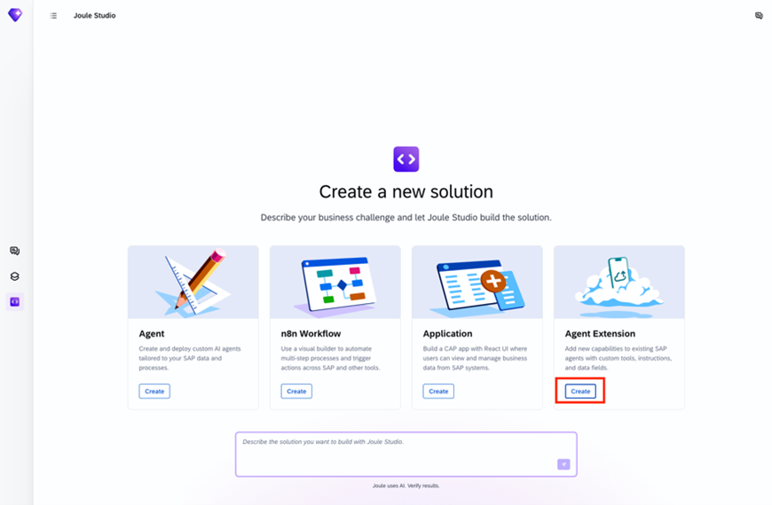
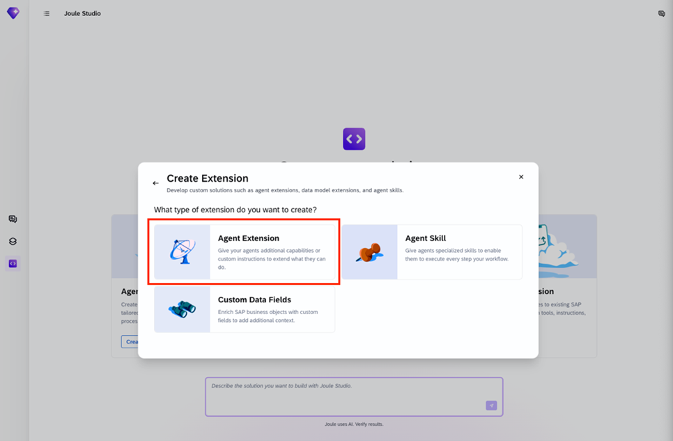
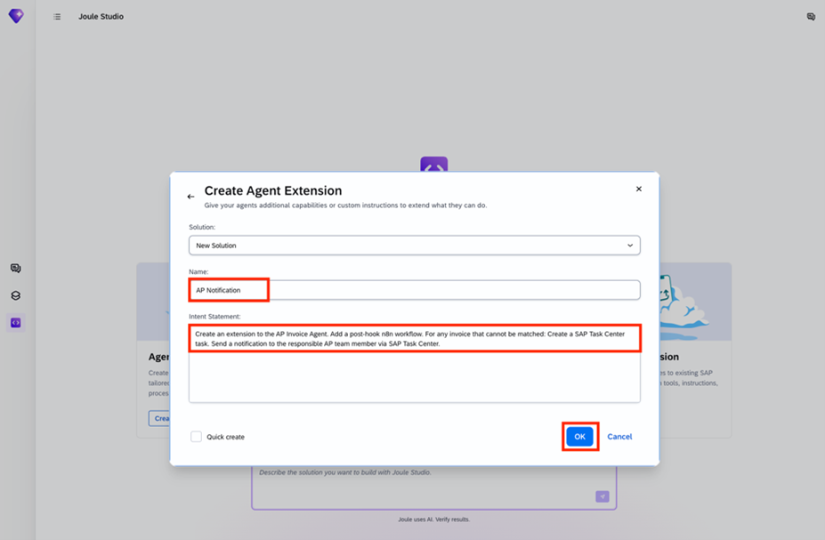
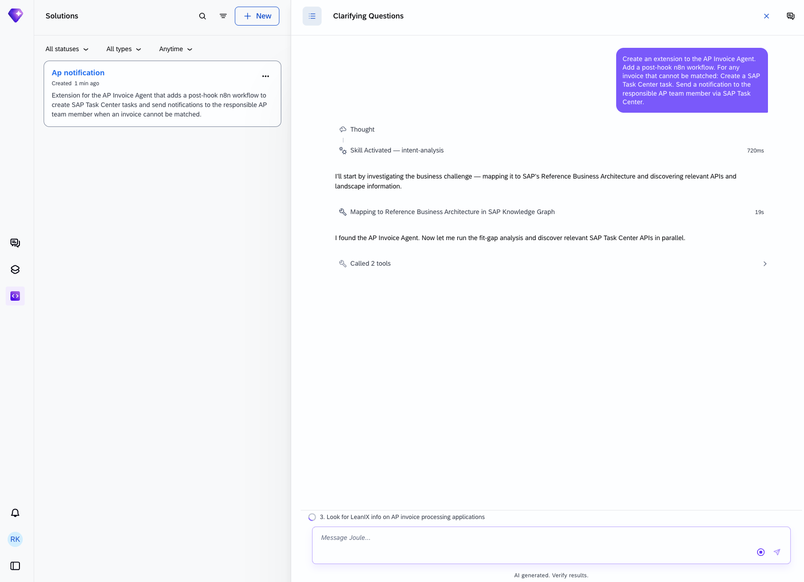
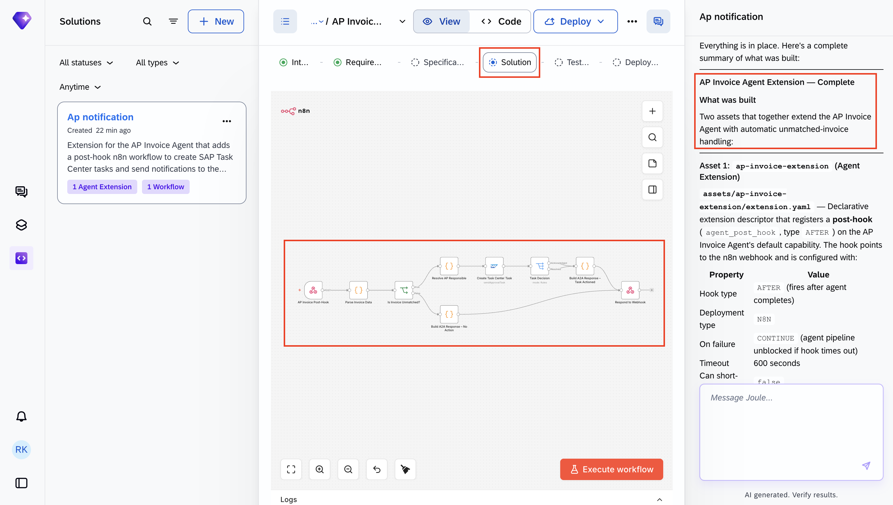
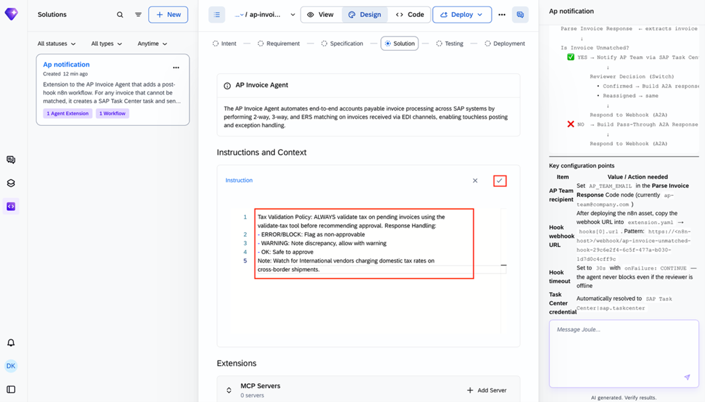
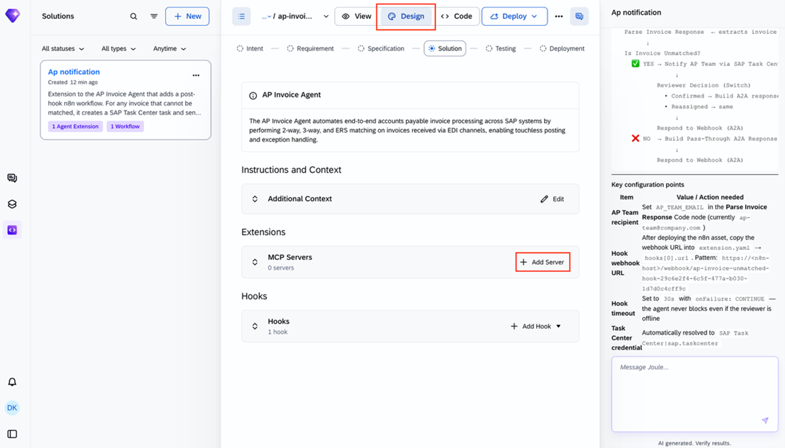
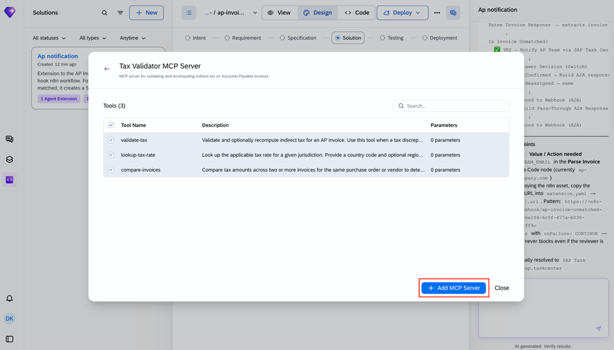
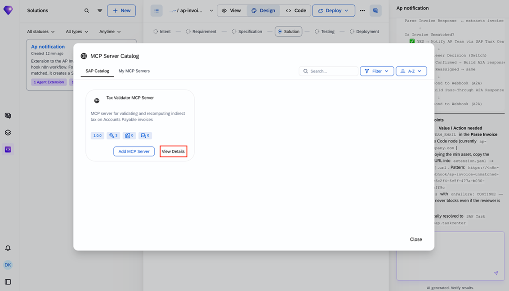
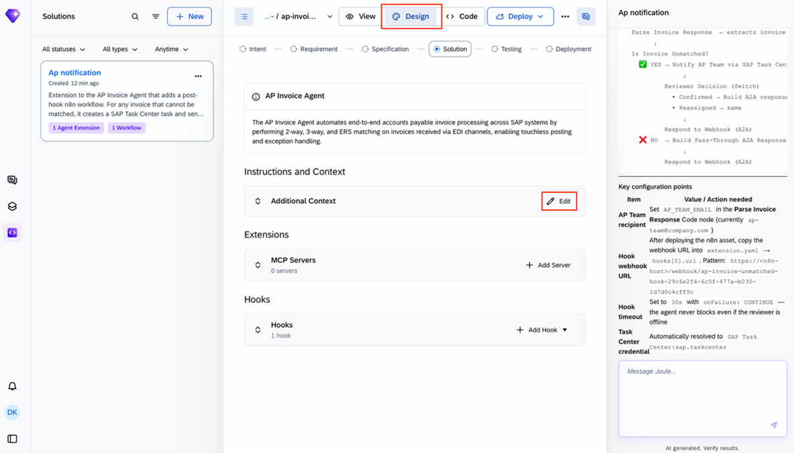

# Joule Studio tutorial 18: extending the AP Invoice Agent for unmatched invoices

*A post-hook extension built through Joule Studio's newer Idea Board flow — Intent → Requirement → Specification → Solution → Testing → Deployment — with a clarifying question that shapes exactly how the generated n8n workflow routes its notification.*

> [!NOTE]
> **📍 At a glance**
> - **You will learn:** the **Idea Board** flow for building an Agent Extension (a slightly different UI path from Tutorial 14's), and how a clarifying question's answer shapes the generated n8n hook workflow's routing logic
> - **You will build:** a post-hook extension on the standard **AP Invoice Agent** — when an invoice can't be matched, it creates a SAP Task Center task and notifies the responsible AP team member, routed by company code
> - **Level:** beginner · **Time:** about 18 minutes
> - **Builds on:** [Joule Studio tutorial 17: building a Financial Closing Advisor agent](joule-studio-tutorial-17-financial-closing-advisor-agent.md). **Leads to:** [Joule Studio tutorial 19: a Billing Completeness Data Product](joule-studio-tutorial-19-billing-completeness-data-product.md)

> [!WARNING]
> Pre-release Joule Studio — screens and exact flow may differ from general availability.

**After this tutorial you can:**

- Name the 6-stage Idea Board pipeline (Intent → Requirement → Specification → Solution → Testing → Deployment) and where a clarifying question fits into it
- Read a post-hook's `AFTER` / `CONTINUE` / timeout configuration and explain what each setting guarantees
- Explain why this extension's n8n workflow has a pass-through branch for the case where the invoice *does* match

## 1. The standard agent, and the gap this extension fills

The pre-delivered **AP Invoice Agent** "automates end-to-end accounts payable invoice processing across SAP systems by performing 2-way, 3-way, and ERS matching on invoices received via EDI channels, enabling touchless posting and exception handling." The gap: when matching fails, no structured exception task is created and no AP team member is notified — exceptions rely on manual monitoring, risking delayed payment processing, late-payment penalties, and supplier relationship friction.

## 2. Create the extension, and a clarifying question that shapes the routing





The intent statement, taken directly as the build prompt:


Joule Studio has enough context to identify the extension point (`agent_post_hook`) and the relevant Task Center API, but stops to ask one genuinely necessary question:

> "How should the responsible AP team member be identified when an invoice cannot be matched — so the Task Center task is routed to the right person?"

Four options are offered — **By company code** (each company code has a designated AP responsible), By vendor/supplier, By cost center or purchasing org, From a static configuration — and the tutorial picks **by company code**.



> [!NOTE]
> This single answer determines the generated workflow's lookup logic later in section 4 — a different answer (say, "by vendor/supplier") would have produced a workflow keyed on supplier ID instead of company code. The clarifying question isn't cosmetic; it's choosing which field drives routing.

## 3. The Idea Board and PRD


![PRD: Title "AP Invoice Agent Extension — Unmatched Invoice Task Center Notification," Solution Category "Agent Extension, n8n Workflow." Elevator Pitch — automatically creates a SAP Task Center task and notifies the responsible AP team member the moment an unmatched invoice is detected, ensuring zero missed exceptions and faster resolution. Business Need: exceptions today rely on manual monitoring. Expected Value: reduce unmatched invoice dwell time, ensure every unmatched invoice produces a traceable auditable Task Center task, improve AP team responsiveness without changing their existing task inbox](images/sj213-03-prd-requirement-view.png)




## 4. Generate the solution: 2 assets, 1 workflow



The generated n8n workflow logic, confirmed directly from the right-panel summary:

```
AP Invoice Agent runs → [POST-HOOK fires]
Webhook receives A2A message with agent response
Parse Invoice Response → extracts invoice #, vendor, detected...
Is Invoice Unmatched?
  YES → Notify AP Team via SAP Task Center (HIGH priority)
          Reviewer Decision (Switch): Confirmed → Build A2A response (task created...) | Reassigned → same
          → Respond to Webhook (A2A)
  NO  → Build Pass-Through A2A Response (empty parts, no...)
          → Respond to Webhook (A2A)
```





> [!TIP]
> The **pass-through branch** (invoice matched fine → build an empty-parts A2A response, respond to the webhook, do nothing else) is why this is a clean post-hook design: the hook fires on *every* agent run, matched or not, but only does real work — creating a task, sending a notification — when the exception condition is actually true. A post-hook that only had the "unmatched" branch would have no defined behavior for the common case.

Key configuration points, confirmed directly:

| Item | Value / action needed |
|---|---|
| AP Team recipient | Set `AP_TEAM_EMAIL` in the Parse Invoice Response Code node (currently `ap-team@company.com`) |
| Hook webhook URL | After deploying the n8n asset, copy the webhook URL into `extension.yaml` → `hooks[0].url` |
| Hook timeout | 600 seconds, `onFailure: CONTINUE` — the agent pipeline is never blocked even if the reviewer is offline |
| Task Center credential | Automatically resolved to `SAP Task Center \| sap.taskcenter` |

The build summary confirms the final asset structure directly:

- **Asset 1: `ap-invoice-extension`** (Agent Extension) — `extension.yaml` is a declarative extension descriptor registering a post-hook (`agent_post_hook`, type `AFTER`) on the AP Invoice Agent's default capability, pointing to the n8n webhook
- **Asset 2:** the n8n workflow itself, under `ap-invoice-n8n-workflow/workflows/`


## 5. Refining the extension directly in Design view

Past the generated solution, the Design screen is editable on its own — Joule Studio doesn't require another intent-chat round for a small addition. Using the **Edit** control on Additional Context and **Add Server** on MCP Servers directly, a Tax Validation Policy instruction and a Tax Validator MCP Server get attached to the same agent:

![Final Design view: AP Invoice Agent, Additional Context — "Tax Validation Policy: ALWAYS validate tax on pending invoices using the validate-tax tool before recommending approval. Response Handling: ERROR/BLOCK — flag as non-approvable; WARNING — note discrepancy, allow with warning; OK — safe to approve; Note: watch for International vendors charging domestic rates on cross-border shipments." MCP Servers: 1 server — Tax Validator MCP Server (MCP server for validating and recomputing indirect tax on Accounts Payable invoices, 3 tools). Hooks: 1 hook](images/sj213-04-mcp-server-tools-detail.png)

> [!NOTE]
> This is a genuinely different editing path from every other extension in this book: instead of describing a new capability in an intent statement and letting Joule Studio generate it, the instruction text and the MCP server were added directly through the Design screen's own **Edit** and **Add Server** controls. Both routes produce the same kind of artifact (an instruction layer, an MCP server registration) — this just shows the manual alternative exists alongside the conversational one.

## 6. Added by Claude, not from the sources

- The TIP in section 4 explaining why the pass-through branch matters is this book's own reasoning about post-hook design, built from the workflow logic transcribed directly from the screenshot.
- The NOTE in section 5 drawing a contrast between the conversational (intent-chat) and manual (Design-screen) ways to extend an agent is this book's own framing — the underlying screens (0 servers → Edit/Add Server → 1 server plus instruction) are transcribed directly from the source's own sequence.
- Not run: the extension described was built and tested by the tutorial's own author; nothing was independently re-executed for this book.

## 7. Interview corner

**What interviewers listen for:** you can explain precisely what changes if the clarifying question's answer had been different, and you know what `AFTER` + `CONTINUE` + a timeout guarantees operationally for a post-hook.

<details class="qa"><summary>1. What clarifying question did Joule Studio ask before building this extension, and which answer was chosen?</summary>

- How the responsible AP team member should be identified when an invoice can't be matched — the tutorial chose "by company code" (each company code has a designated AP responsible)

</details>

<details class="qa"><summary>2. What does this post-hook's `AFTER` / `onFailure: CONTINUE` / 600-second timeout configuration guarantee?</summary>

- The hook fires after the AP Invoice Agent's normal processing completes (not before), and if the hook itself fails or times out after 600 seconds, the agent's own pipeline still completes unblocked — a slow or offline reviewer never stalls invoice processing

</details>

<details class="qa"><summary>3. Why does the generated n8n workflow have a pass-through branch for matched invoices, when the whole point of this extension is handling unmatched ones?</summary>

- The post-hook fires on every agent run regardless of outcome, so it needs defined behavior for the common case (invoice matched fine) too — the pass-through branch returns an empty-parts A2A response and does nothing further, rather than leaving that case unhandled

</details>

<details class="qa"><summary>4. After the post-hook extension was generated, a Tax Validator MCP server and a tax validation instruction were added to the same agent. Through what route?</summary>

- Directly through the Design screen's own controls — **Edit** on Additional Context, **Add Server** on MCP Servers — not by writing a new intent statement and letting Joule Studio regenerate anything

</details>

> [!TIP]
> **🧩 Design question**
> *"An AP operations lead asks what happens if two unmatched invoices for the same company code arrive within seconds of each other."* Talk about: each post-hook invocation running independently per invoice (the base agent processes invoices individually), so each would create its own separate Task Center task routed to the same company-code-designated AP responsible — the extension doesn't batch or deduplicate, it reacts per-invoice, which is consistent with the stated goal of "zero missed exceptions."

## Cheat sheet

| Thing | Detail |
|---|---|
| Base agent | AP Invoice Agent — 2-way/3-way/ERS matching, touchless posting |
| Extension type | Post-hook (`agent_post_hook`, type `AFTER`), deployed as n8n |
| Routing key | Company code (each has a designated AP responsible) |
| Hook config | `onFailure: CONTINUE`, 600s timeout, `canShortCircuit: false` |
| Workflow branches | Unmatched → notify + create Task Center task; matched → pass-through, no-op |
| Idea Board stages | Intent → Requirement → Specification → Solution → Testing → Deployment |
| Manual refinement | Tax Validator MCP server + tax validation instruction added via Design screen's Edit/Add Server controls, no new intent round |

## Recap

- This extension adds a single post-hook to the standard AP Invoice Agent, firing after every run to check whether the invoice matched
- A clarifying question (how to identify the responsible AP team member) directly shapes the generated workflow's routing logic — this tutorial chose company code
- The hook's `AFTER`/`CONTINUE`/timeout configuration guarantees the base agent's processing is never blocked by a slow or offline human reviewer
- The generated n8n workflow has both an action branch (unmatched → notify, create task) and a pass-through branch (matched → no-op), since the hook fires unconditionally
- This tutorial was built through Joule Studio's Idea Board UI, a 6-stage pipeline (Intent → Requirement → Specification → Solution → Testing → Deployment)

## Practice

1. Without looking back, name the clarifying question asked in this tutorial and the answer chosen
2. Explain what `onFailure: CONTINUE` guarantees for this post-hook
3. Explain why the generated workflow needs a pass-through branch at all

## How this chapter was checked

- The full tutorial "Extend the AP Invoice Agent for Unmatched Invoice Notifications" (developers.sap.com, Beginner, 18 min) was read in full, 13 Nov 2026.
- 15 images were found and downloaded, all used here; each was opened and visually verified against its caption before being written into this chapter, including the generated n8n workflow logic and the final Design view, both transcribed directly.
- Nothing in this chapter was independently re-executed — the extension described was built and tested by the tutorial's own author.

## Sources and further reading

- SAP Developers, *Extend the AP Invoice Agent for Unmatched Invoice Notifications* — https://developers.sap.com/tutorials/ap-invoice-agent-extension (read in full 13 Nov 2026)

Previous: [Joule Studio tutorial 17: building a Financial Closing Advisor agent](joule-studio-tutorial-17-financial-closing-advisor-agent.md) · Next: [Joule Studio tutorial 19: a Billing Completeness Data Product](joule-studio-tutorial-19-billing-completeness-data-product.md)
