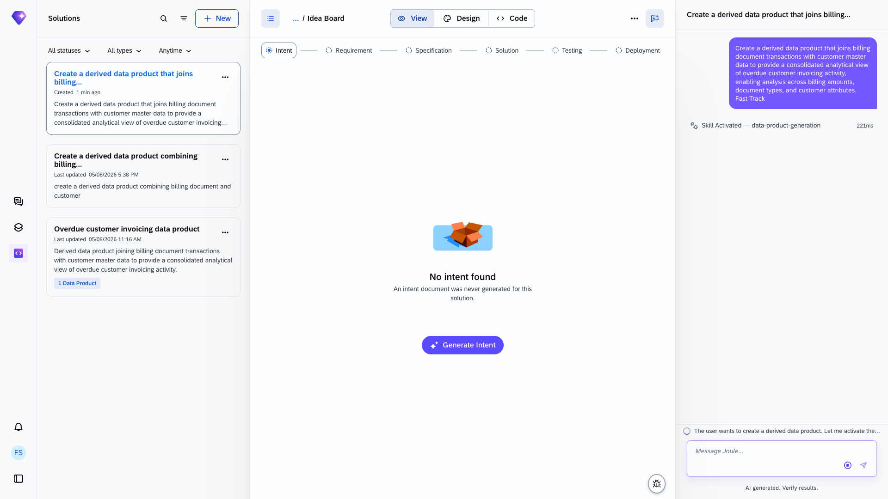
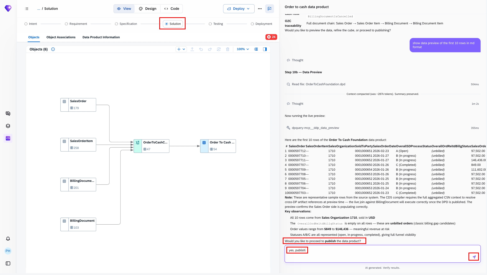
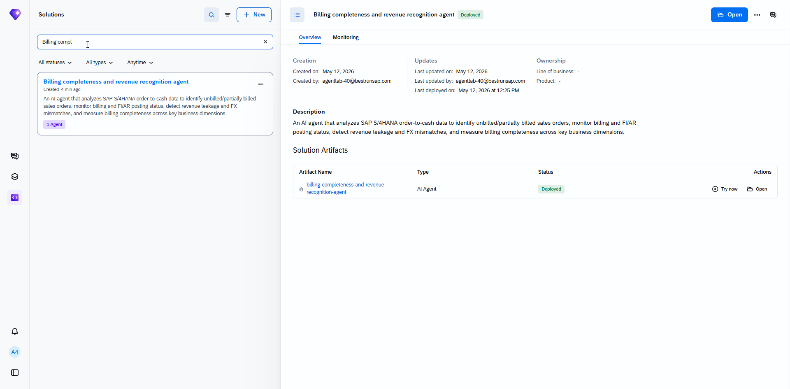
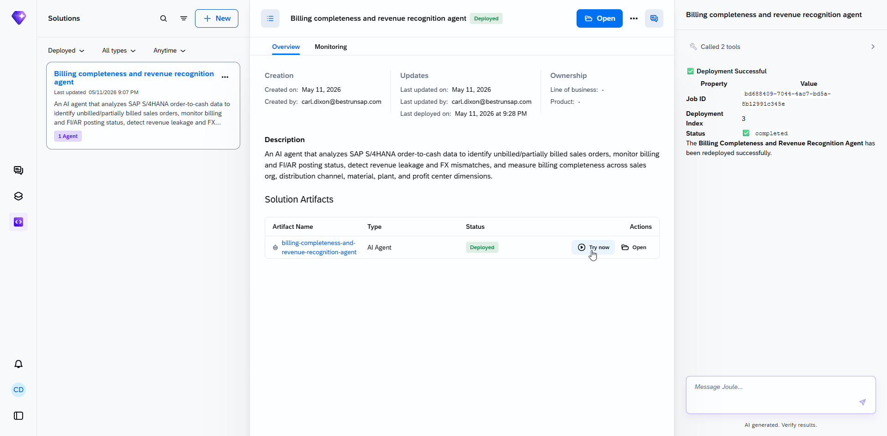
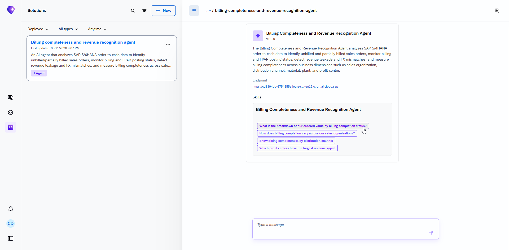
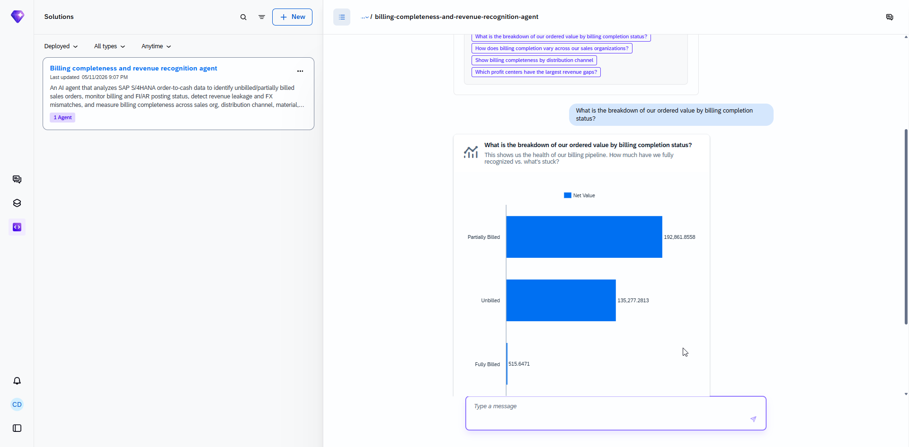

# Joule Studio tutorial 19: a Billing Completeness Data Product, then an agent on top of it

*The first Data Product solution type in this book — sourced from SAP Business Data Cloud, not live OData APIs — plus a self-correcting agent that catches and repairs its own filesystem/tracking mismatch mid-build.*

> [!NOTE]
> **📍 At a glance**
> - **You will learn:** the **Data Product** build flow, sourced from SAP Business Data Cloud (BDC) data products rather than OData APIs, and how "Fast Track" mode changes what gets auto-selected versus asked
> - **You will build:** an `OrderToCashFoundation` data product joining Sales Order and Billing Document data, then a conversational **Billing completeness and revenue recognition agent** on top of it, tested live with a real chart
> - **Level:** beginner · **Time:** about 20 minutes
> - **Builds on:** [Joule Studio tutorial 18: extending the AP Invoice Agent](joule-studio-tutorial-18-ap-invoice-agent-extension.md). **Leads to:** [Joule Studio tutorial 20: a CX Sales Representatives Assistant](joule-studio-tutorial-20-cx-sales-reps-assistant-agent.md)

> [!WARNING]
> Pre-release Joule Studio — screens and exact flow may differ from general availability.

**After this tutorial you can:**

- Explain where a Data Product's underlying tables come from (SAP Business Data Cloud) versus where an Agent's MCP tools come from (OData APIs)
- Read a "Fast Track" build log and explain what auto-selecting a formation and auto-selecting data products actually skips
- Name the 2 halves of an analytical cube (dimensions vs. measures) using this tutorial's own `OrderToCashFoundationCube` as the example

## 1. Create the data product, Fast Track

Unlike the Agent/n8n Workflow/Application/Extension tiles seen in earlier tutorials, a **Data Product** build starts from a free-form prompt typed directly into the create dialog, with **Quick Create** checked:

> [!NOTE]
> Notice the 4 visible tiles are Agent, n8n Workflow, Application, and Extension — **Data Product isn't one of the named tiles**. Typing a data-product-shaped request directly into the free-form prompt box is what routes the build to the `data-product-generation` skill instead.

## 2. Fast Track: what gets auto-selected, what gets asked

![Idea Board, Intent stage — left panel: "No intent found: an intent document was never generated for this solution" (a Generate Intent button sits unused, since the chat-driven build bypassed it). Right panel, the actual build log: Skill Activated — data-product-generation; session folder created; "One formation found: BDC Joule Staging — auto-selected"; both source data products found and auto-selected (sap.s4com:dataProduct:SalesOrder:v1, sap.s4com:dataProduct:BillingDocument:v1); Proposed Properties table — Technical Name OrderToCashFoundation, Business Name "Order To Cash Foundation," Short Description, full Description; "Do you approve these properties, or would you like any changes?" — user replies "yes, approved"](images/sj214-03-step2-intent-clarifying-questions.png)

The build log, read directly, shows a 4-step automated sequence:

1. **Skill Activated — `data-product-generation`.** Session folder created.
2. **Step 2 — select the formation.** "One formation found: **BDC Joule Staging** — auto-selected." (A *formation* is an SAP Business Data Cloud staging environment; there was only one available, so no question was asked.)
3. **Step 3 — search for source data products.** Both found and, "since 'Fast Track' was requested and the user explicitly named the inputs," auto-selected: `sap.s4com:dataProduct:SalesOrder:v1` and `sap.s4com:dataProduct:BillingDocument:v1`.
4. **Step 4 — propose data product properties**, then stop and ask for approval — which the tutorial grants ("yes, approved").

> [!TIP]
> "Fast Track" here means something specific and narrower than Quick Create elsewhere in this book: it doesn't skip the approval step entirely — it skips *individual* clarifying questions by auto-selecting whenever there's only one reasonable option (one formation) or the user already named the inputs explicitly (Sales Order, Billing Document). The properties themselves still get a single confirm-or-change checkpoint before anything is built.

## 3. The built data product: a self-correction worth reading closely

Before reaching that clean final state, the build log shows Joule Studio catching and fixing its own tracking error:

> "The folder is already gone from the filesystem — it only exists in solution tracking. Purging by creating and deleting a placeholder... Ghost entry removed. Final solution structure: [self-check table, all ✅] — `solution.yaml` created, `assets/` folder created, `assets/order-to-cash-foundation-data-product/` in assets, `asset.yaml` present, `OrderToCashFoundation.dpd` present, `aggregated_cds_for_transforms.cds` present, `aggregated_csn.json` present, Ghost folder removed."

> [!NOTE]
> This is a genuine example of the generation process self-auditing mid-build rather than just reporting success — it noticed a mismatch between what its own solution tracking claimed existed and what was actually on disk, repaired it, then ran a 7-item checklist to confirm the final structure before presenting the result.

The finished cube, `OrderToCashFoundationCube`, confirmed directly:

| Dimensions | Fields |
|---|---|
| Sales Order header | `SalesOrder`, `SalesOrderDate`, `SalesOrderType`, `SalesOrganization`, `DistributionChannel`, `SoldToParty`, fiscal year/period, all status attributes |
| Sales Order item | `Product`, `MaterialGroup`, `Plant`, `SalesDistrict`, `ProfitCenter`, delivery/billing-block statuses, requested & committed delivery dates |
| Billing Document header | `BillingDocument`, billing date & type, overall billing status, `AccountingPostingStatus`, `AccountingTransferStatus`, `InvoiceClearingStatus`, payment terms |
| Billing Document item | `BillingDocumentItem`, item billing date, type, status |

| Measures | Fields |
|---|---|
| Sales side | `OrderQuantity`, `SalesOrderItemNetAmount`, `SalesOrderItemCostAmount`, `SalesOrderItemTaxAmount` |
| Billing side | `BillingQuantity`, `BillingItemNetAmount`, `BillingItemGrossAmount`, `BillingItemTaxAmount`, `BillingItemCostAmount` |

## 4. An agent built on top of the data product

This agent's own description, confirmed directly: *"An AI agent that analyzes SAP S/4HANA order-to-cash data to identify unbilled/partially billed sales orders, monitor billing and FI/AR posting status, detect revenue leakage and FX mismatches, and measure billing completeness across sales org, distribution channel, material..."* — built on the `OrderToCashFoundationCube` from section 3, deployed, tagged **1 Agent**.

Asking the suggested question produces a live chart, confirmed directly — and the real numbers tell their own story:

> [!TIP]
> Read those 3 numbers literally: in this demo dataset, almost none of the ordered value (515.65 out of roughly 328,000 total) is **Fully Billed** — the overwhelming majority sits in Partially Billed or Unbilled. That's exactly the kind of billing-completeness gap this agent exists to surface, and it's a useful sanity check that the generated cube and agent are reasoning over real, meaningfully distributed demo data rather than a toy dataset where every number looks clean.

## 5. Added by Claude, not from the sources

- The NOTE in section 1 (Data Product isn't a named tile) and the TIP in section 2 (what "Fast Track" specifically skips vs. what Quick Create means elsewhere) are this book's own observations, built by contrasting this tutorial's screens against every earlier one in this book.
- The NOTE in section 3 framing the ghost-folder cleanup as "genuine self-auditing" is this book's own characterization — the underlying log text is transcribed directly from the screenshot.
- The TIP in section 4 reading the 3 billing-status numbers as a realistic data signal is this book's own interpretation of the chart; the chart and its values are the source's own.
- Not run: the data product and agent described were built and tested by the tutorial's own author; nothing was independently re-executed for this book.

## 6. Interview corner

**What interviewers listen for:** you can state precisely where a Data Product's source tables come from (SAP BDC data products, not OData/MCP), and you can explain the ghost-folder self-correction without overstating what happened.

1. Where do a Data Product's source tables come from, and how does that differ from an Agent's integrations?

- From SAP Business Data Cloud (BDC) data products, searched and selected from a "formation" (a BDC staging environment) — a different source than the live OData APIs an Agent typically wraps via MCP servers

2. In this tutorial's "Fast Track" build, what specifically got auto-selected without a question being asked?

- The formation (only one existed: "BDC Joule Staging"), and the 2 source data products (Sales Order, Billing Document) — auto-selected because the user had already named them explicitly in the free-form prompt

3. What did the build log's "ghost folder" message actually describe?

- A mismatch between solution tracking (which still referenced a folder) and the actual filesystem (where that folder no longer existed) — the process detected it, purged the stale entry, and re-ran a self-check before presenting the finished data product

> [!TIP]
> **🧩 Design question**
> *"A finance stakeholder asks why the billing-completeness agent needed a custom data product at all, instead of just querying Sales Order and Billing Document data directly."* Talk about: the data product doing the joining, dimensional modeling, and measure definition work once (Sales Order + Billing Document → one `OrderToCashFoundationCube` with clear dimensions and measures), so the agent's own reasoning can stay focused on interpretation (unbilled/partially billed detection, revenue leakage, FX mismatches) rather than re-deriving the join logic on every query — the same separation-of-concerns pattern seen with deterministic engines elsewhere in this book, here applied to data modeling instead of business logic.

## Cheat sheet

| Thing | Detail |
|---|---|
| Solution type | Data Product (reached via free-form prompt, not a named tile) |
| Source | SAP Business Data Cloud (BDC) — formation "BDC Joule Staging," 2 source data products |
| Built cube | `OrderToCashFoundationCube` — 4 dimension groups, 2 measure groups |
| Self-correction | Detected and purged a stale "ghost" folder reference before finalizing |
| Agent on top | Billing completeness and revenue recognition agent, tested via Conversational Analytics |
| Sample finding | Of ~328K ordered value, only 515.65 Fully Billed — most sits Partially Billed/Unbilled |

## Recap

- This tutorial introduces the Data Product solution type, sourced from SAP Business Data Cloud formations rather than live OData APIs
- "Fast Track" auto-selects whenever there's only one reasonable option or the user already named the inputs, but still pauses for a single properties-approval checkpoint
- The build process caught and repaired its own filesystem/tracking mismatch mid-build, then re-verified with a 7-item self-check
- The finished `OrderToCashFoundationCube` has 4 dimension groups (Sales Order header/item, Billing Document header/item) and 2 measure groups (sales side, billing side)
- An agent built on top of that cube was tested live via Conversational Analytics, surfacing a real billing-completeness gap in the demo data

## Practice

1. Without looking back, explain where a Data Product's source tables come from
2. Describe what "Fast Track" auto-selected in this build and why
3. Name the 4 dimension groups and 2 measure groups in the finished `OrderToCashFoundationCube`

## How this chapter was checked

- The full tutorial "Build a Billing Completeness Data Product and Agent" (developers.sap.com, Beginner, 20 min) was read in full, 13 Nov 2026.
- 9 images were found and downloaded, all used here; each was opened and visually verified against its caption before being written into this chapter, including the full build log (ghost-folder correction, self-check table) and the final chart, both transcribed directly.
- Nothing in this chapter was independently re-executed — the data product and agent described were built and tested by the tutorial's own author.

## Sources and further reading

- SAP Developers, *Build a Billing Completeness Data Product and Agent* — https://developers.sap.com/tutorials/billing-completeness-data-product (read in full 13 Nov 2026)

Previous: [Joule Studio tutorial 18: extending the AP Invoice Agent](joule-studio-tutorial-18-ap-invoice-agent-extension.md) · Next: [Joule Studio tutorial 20: a CX Sales Representatives Assistant](joule-studio-tutorial-20-cx-sales-reps-assistant-agent.md)
