# Joule Studio tutorial 2: creating Action Projects

*An Action Project is the reusable wrapper around one backend operation — build it once here, call it from any Skill later.*

> [!NOTE]
> **📍 At a glance**
> - **You will learn:** how to build an Action Project from an OData destination, trim its inputs/outputs to just what's needed, test it with real values, and the three-stage Save→Release→Publish sequence every Action Project needs before a Skill can use it
> - **You will build:** two Action Projects — `tutorial_API_BUSINESS_PARTNER` (two business-partner lookup actions) and `tutorial_BadgeRequestsService` (a badge-creation action) — both consumed by the Skill built in Tutorial 3
> - **Level:** intermediate · **Time:** about 15 minutes
> - **Builds on:** [Joule Studio tutorial 1: environment and connectivity setup](joule-studio-tutorial-1-environment-setup.md). **Leads to:** [Joule Studio tutorial 3: building and deploying a Joule Skill](joule-studio-tutorial-3-create-deploy-skill.md)

**After this tutorial you can:**

- Build an Action Project from an OData destination, selecting only the operations a Skill actually needs
- Trim an action's input/output fields down to a minimal, Skill-ready shape
- Test an action with real values before wiring it into anything
- Explain why Save alone doesn't make an Action Project usable elsewhere

## 1. The Action Project lifecycle

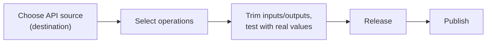

> [!WARNING]
> **⚠️ Pitfall: Save isn't enough — an Action Project needs Save → Release → Publish**
> An Action Project only becomes visible to a Joule Skill once it's gone through all three stages. Saving alone leaves it invisible in "Browse All Actions" later.

## 2. Build the first Action Project: business partner lookups

Start from the **Actions** area and create a new project:

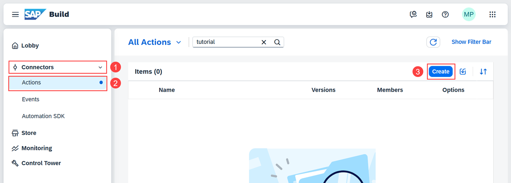

Choose an API source — **OData Destinations**, pointing at a destination created in Tutorial 1:

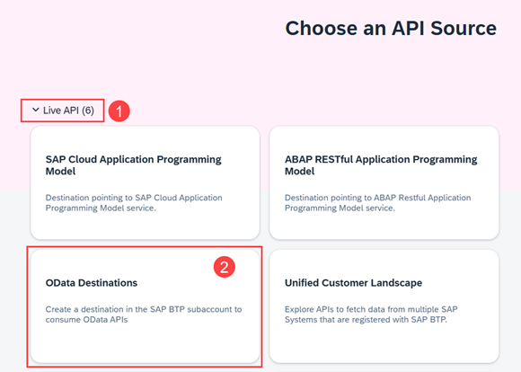

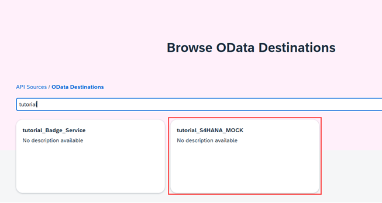

Browse the destination's available entities and operations before continuing:

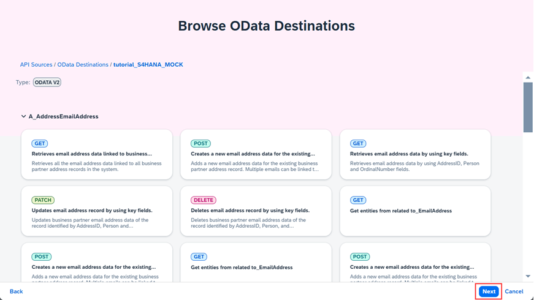

Name the project:

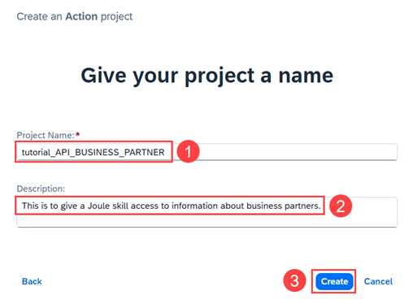

Select the two operations this project needs — up to 20 actions can be selected per project, but only what's actually needed should be:

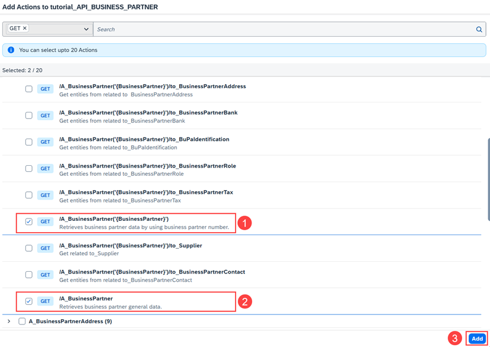

### 2.1 Configure and test the first operation

Open the first action ("Retrieves business partner data by using business partner number") and check its default **Input**:

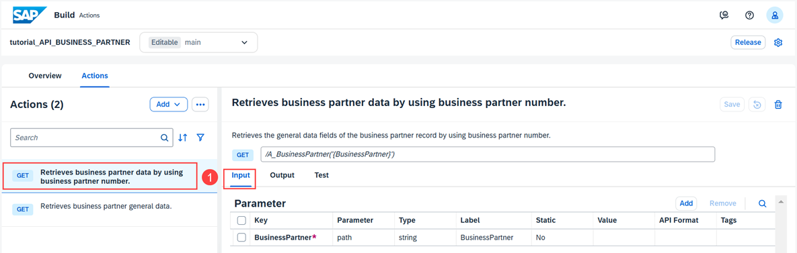

Check and trim the **Output** fields — removing anything the Skill won't actually need keeps the data flowing through the Skill minimal:

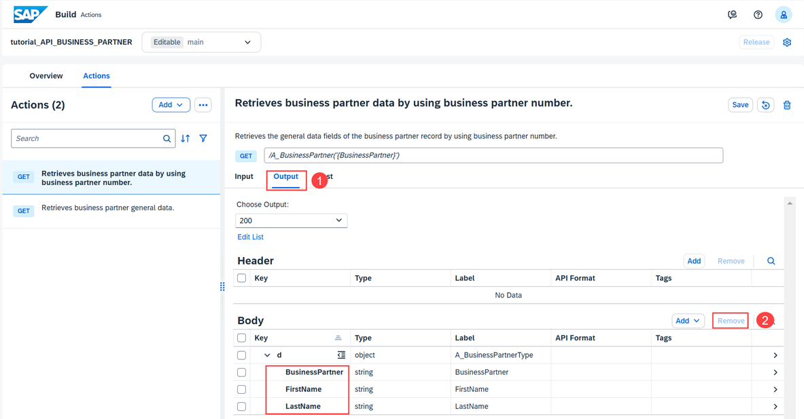

Test with a real value:

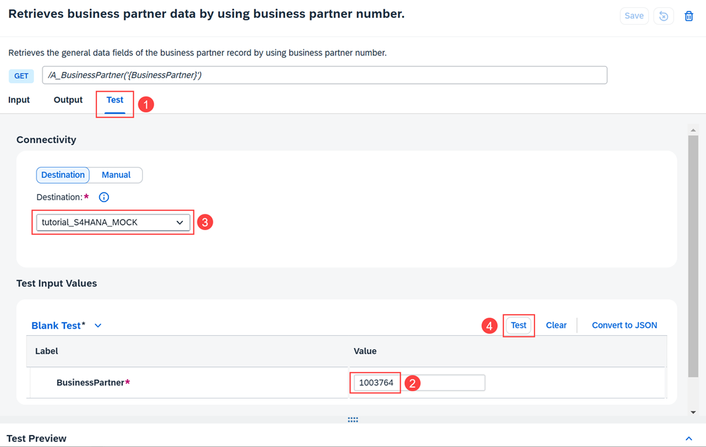

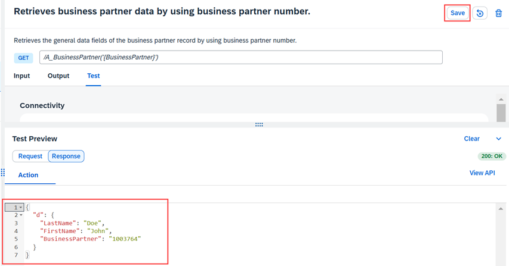

### 2.2 Configure and test the second operation

The second action ("Retrieves business partner general data") returns a **collection** rather than a single record — its Output shows a `results` array:

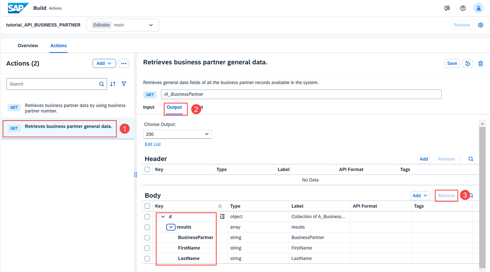

Test it with query parameters `$top` and `$skip` rather than a single ID — the response comes back as a real array of 3 business partners (Doe/John, Roe/Jane, Smith/John):

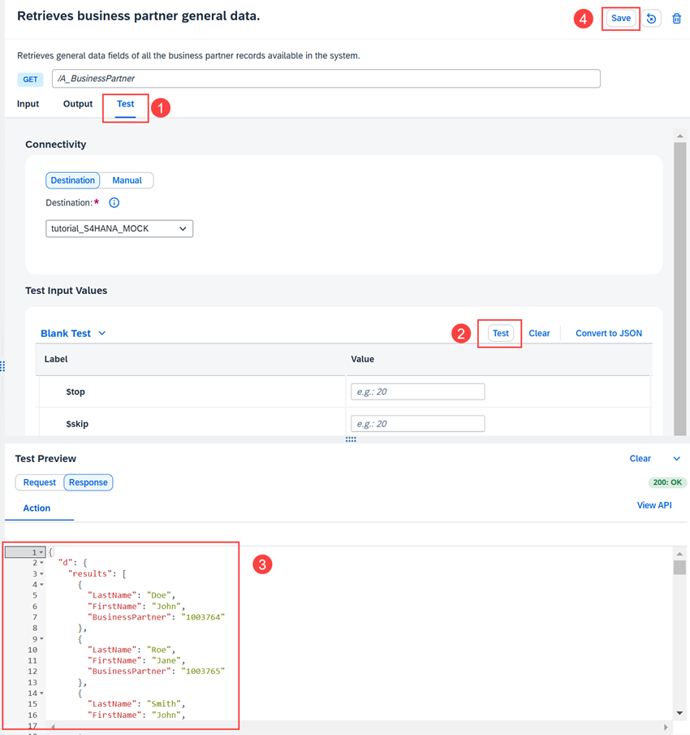

### 2.3 Release and publish

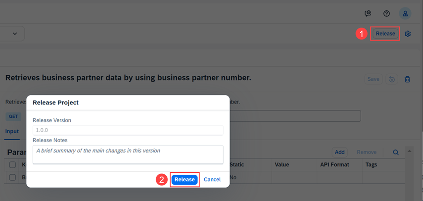
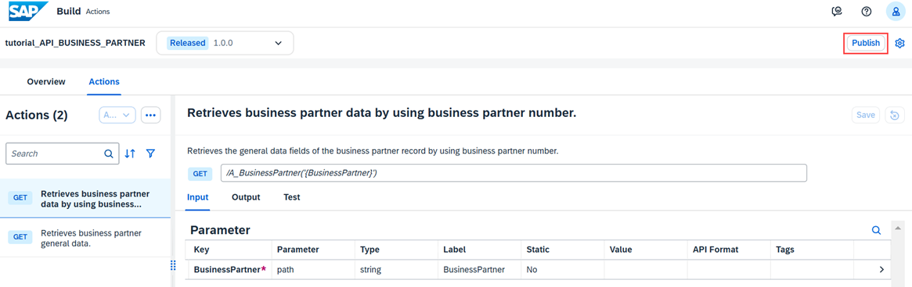

## 3. Build the second Action Project: the badge service

A second, separate project, pointed at the `tutorial_Badge_Service` destination created in Tutorial 1:

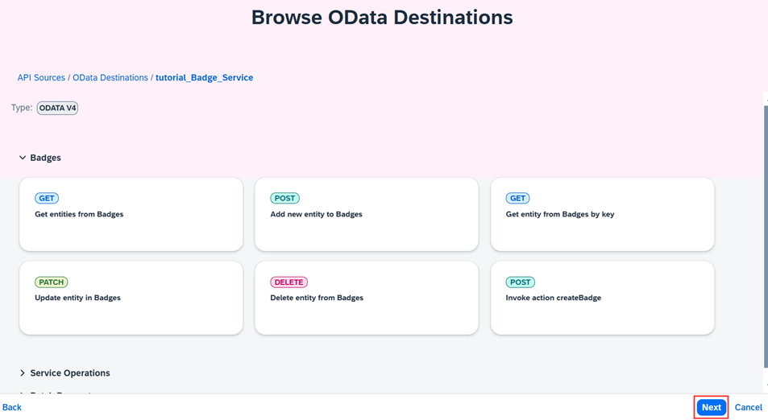

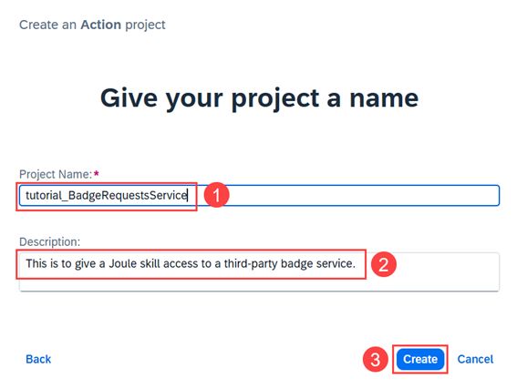

Select 5 of the 7 available operations:

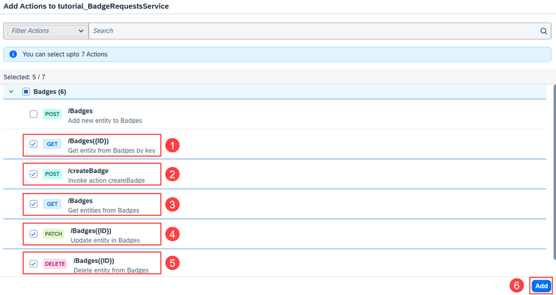

### 3.1 Configure the createBadge action

The `createBadge` action needs one output trimmed in particular — **`badgeId`** is the field the Skill will need back:

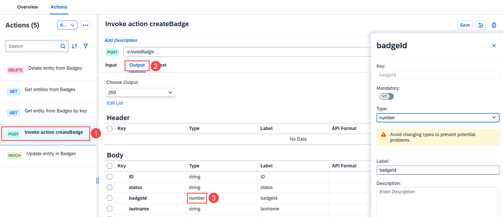

Trim the Input fields to just what's needed: status, lastname, firstname, communityId, processInstanceId:

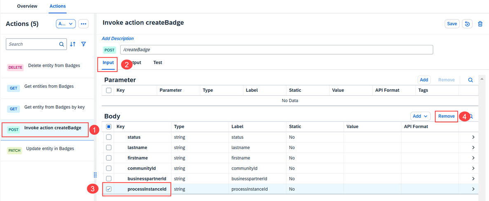

### 3.2 Test and publish

Test with real values before publishing:

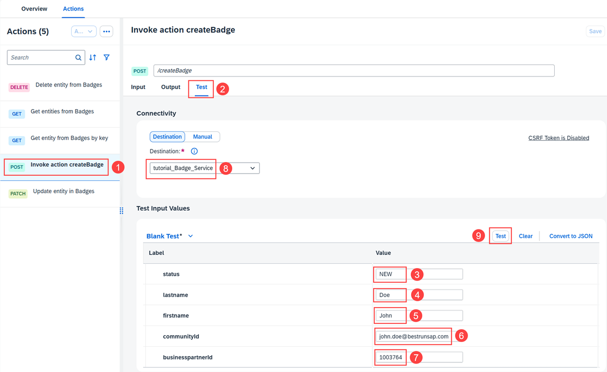

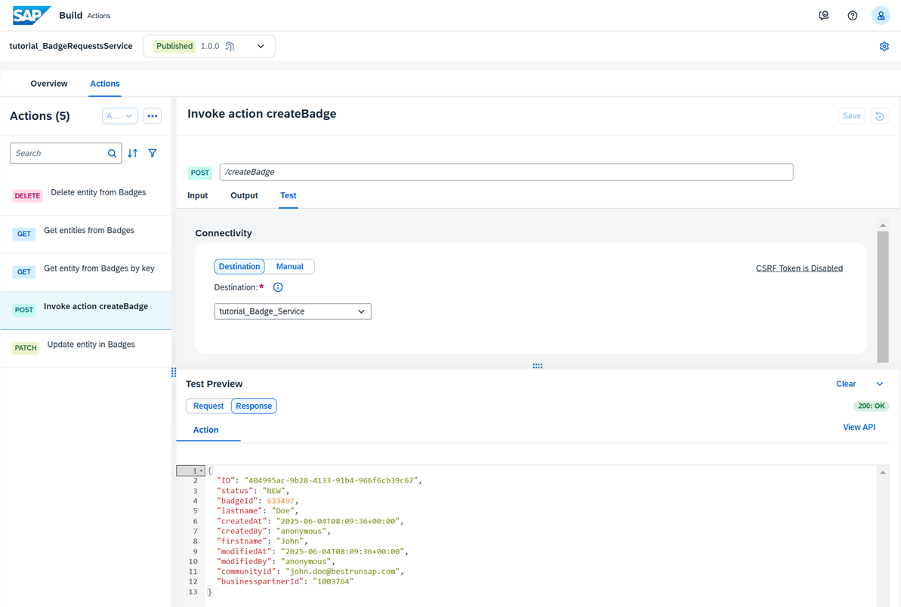

Release and publish this project the same way as the first — Save → Release → Publish — before moving on to Tutorial 3, where both of these Action Projects get wired into an actual Skill.

## 4. Added by Claude, not from the sources

- The "Action Project lifecycle" Mermaid diagram in section 1 is this book's visual summary of the Choose source → Select operations → Trim/test → Release → Publish sequence shown across the tutorial's own screenshots.
- Not run: the Action Projects described were built and tested by the tutorial's own author; nothing was independently re-executed for this book.

## 5. Interview corner

**What interviewers listen for:** you know trimming inputs/outputs isn't optional cleanup — it's what keeps a Skill's data flow minimal and testable — and you can state the three-stage publish requirement without hesitating.

1. An Action Project has been saved but doesn't show up when browsing actions from inside a Skill. Why?

- It hasn't been Released and Published — Save alone doesn't make it visible elsewhere

2. Why trim an action's output fields down to just `badgeId` instead of leaving the full response schema?

- A Skill only needs what it's actually going to use downstream (e.g. to confirm a badge was created or to show its ID) — leaving the full schema adds noise to the Skill's data-mapping surface without adding value

3. One action returns a single business partner record, another returns a collection. What's the practical difference when testing them?

- The single-record action is tested with a specific ID value (e.g. BusinessPartner = 1003764); the collection action is tested with pagination-style parameters like `$top` and `$skip` instead of a single key

## Cheat sheet

| Step | Detail |
|---|---|
| API source | OData Destinations, pointing at a destination from Tutorial 1 |
| Max operations per Action Project | 20 |
| Required sequence | Save → Release → Publish |
| Trim inputs/outputs | Keep only what the Skill will actually use |
| Test before publish | Always, with real values |

## Recap

- An Action Project wraps one or more backend operations from an OData destination into a reusable, testable unit
- Operations can be trimmed to minimal input/output fields before a Skill ever touches them
- Save → Release → Publish is the required sequence; skipping Release or Publish leaves the project invisible to Skills
- This tutorial builds two Action Projects — business partner lookups and badge creation — both consumed by the Skill in Tutorial 3

## Practice

1. Without looking back, name the three stages an Action Project needs to go through before a Skill can use it
2. Explain why `badgeId` is the one output field kept from the createBadge action's full response

## How this chapter was checked

- All 21 images for this tutorial were downloaded and individually opened and visually verified against their captions before being written into this chapter.
- This is part 2 of 5 of the SAP Developers tutorial series "Build Your First Joule Skill in Joule Studio, Classic Edition." Nothing in this chapter is code; nothing was independently executed — the Action Projects described are the tutorial author's own.

## Sources and further reading

- SAP Developers, *Build Your First Joule Skill in Joule Studio, Classic Edition* — https://developers.sap.com/group.joule-studio-first-skill.html, Tutorial 2 of 5 (read in full 13 Nov 2026)

Previous: [Joule Studio tutorial 1: environment and connectivity setup](joule-studio-tutorial-1-environment-setup.md) · Next: [Joule Studio tutorial 3: building and deploying a Joule Skill](joule-studio-tutorial-3-create-deploy-skill.md)
