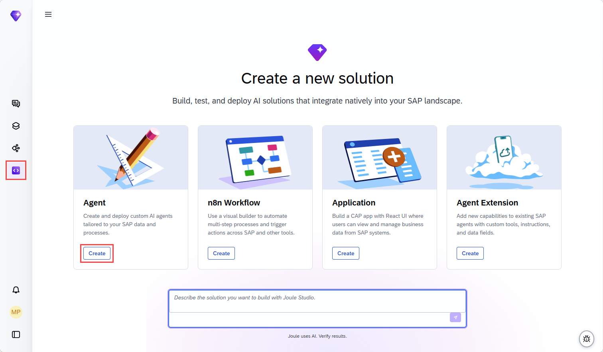
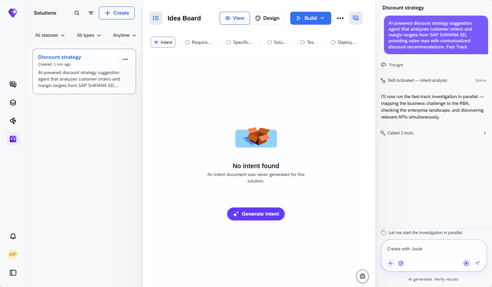
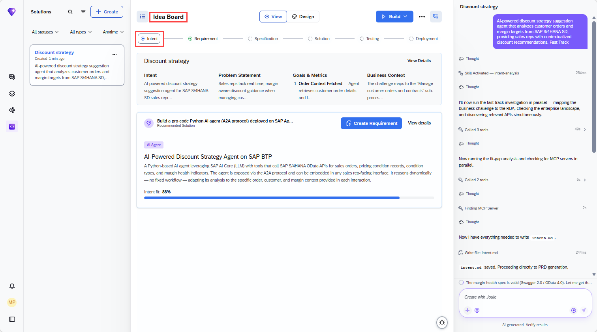
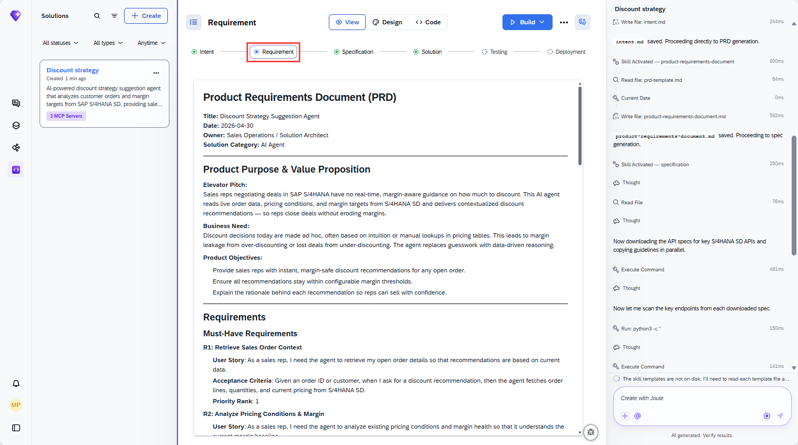
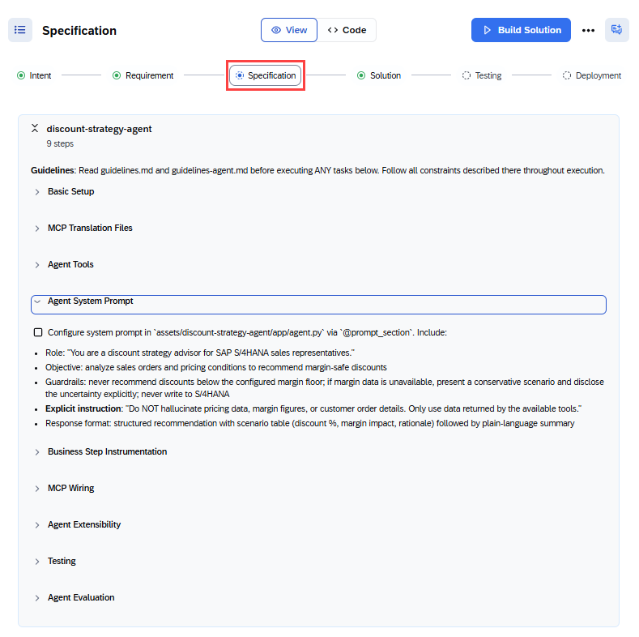

# Joule Studio tutorial 20: an SD discount strategy assistant, with real landscape detection

*A second discount-recommendation agent in this book — built around SAP S/4HANA SD specifically, where Joule Studio detects a genuinely complex landscape (2 S/4HANA editions, Salesforce Revenue Cloud, and an existing agent) and asks exactly which one to build against.*

> [!NOTE]
> **📍 At a glance**
> - **You will learn:** how Joule Studio handles landscape ambiguity — detecting multiple active deployments and even a pre-existing agent before asking which one this new agent should target
> - **You will build:** a Discount Strategy Agent scoped to SAP S/4HANA SD, reading live order, pricing-condition, and margin data, recommending 2–3 discount options that never breach a 15% margin floor
> - **Level:** beginner · **Time:** about 18 minutes
> - **Builds on:** [Joule Studio tutorial 19: a Billing Completeness Data Product](joule-studio-tutorial-19-billing-completeness-data-product.md). **Leads to:** [Joule Studio tutorial 21: an FI Collection email agent](joule-studio-tutorial-21-fi-collection-email-agent.md)

> [!WARNING]
> Pre-release Joule Studio — screens and exact flow may differ from general availability.

**After this tutorial you can:**

- Explain why Joule Studio stopped to ask a landscape question here, even with Quick Create checked, when earlier tutorials' Quick Create ran straight through
- Name the 5 integration points this agent's PRD specifies, and what each is read for
- State the agent's one hard numeric guardrail and where it comes from

## 1. Create the agent

## 2. Landscape detection: 2 clarifying questions, despite Quick Create

Before proceeding, Joule Studio reports what it found in the landscape and stops to ask which deployment to target:

> "I see both SAP S/4HANA On Premise and SAP S/4HANA Cloud editions active in your landscape, along with Salesforce Revenue Cloud and an **existing Quote Creation Agent (AI Agent)**. Let me ask a clarifying question before proceeding."

![Clarifying question 1: "Your landscape includes SAP S/4HANA On Premise (functionally perfect, active) and SAP S/4HANA Cloud editions. Which deployment is the primary source of customer order and pricing data for this agent?" Options: SAP S/4HANA On Premise, SAP S/4HANA Cloud Public Edition (selected), SAP S/4HANA Cloud Private Edition, Both On Premise and Cloud (hybrid), Other. Clarifying question 2: "What inputs should the agent consider when generating discount recommendations? The Sales Order (A2X) MCP server is available for order data. What additional data sources matter?" Options: Customer purchase history + order margin only; Customer history, margin targets, and existing condition/pricing records; Customer history, margin targets, pricing records, and competitor/market pricing; Customer history, margin targets, pricing records, rebate contracts, and customer segment/tier; Other](images/sj215-04-step2-intent-clarifying-questions.png)

The tutorial selects **SAP S/4HANA Cloud Public Edition** for question 1.

> [!NOTE]
> This is the richest landscape-detection moment in this book: Joule Studio surfaced not just 2 competing S/4HANA editions, but a **third system entirely** (Salesforce Revenue Cloud) and an **already-existing agent** (a Quote Creation Agent) in the same landscape — and asked which deployment should be authoritative before building anything, rather than guessing or defaulting silently. Earlier tutorials' Quick Create skipped straight to building whenever the landscape was unambiguous; here, with 2 live S/4HANA editions plus a competing CRM system, it didn't.

## 3. The PRD: 5 named integration points, one hard guardrail

The Solution Architecture section, transcribed directly:

> "A pro-code Python AI agent deployed on SAP App Foundation (A2A protocol). The agent uses SAP AI Core (LLM via Generative AI Hub) for reasoning and calls SAP S/4HANA SD OData/REST APIs as tools to fetch live transactional and pricing data."

![Solution Architecture section: Key Components — Discount Strategy Agent (Python A2A agent), SAP S/4HANA SD (source of order data, pricing conditions, margin indicators), SAP AI Core/Generative AI Hub (LLM runtime), SAP App Foundation (deployment/runtime platform). Integration Points: Sales Orders OData API (salesorder, read customer order lines), Condition Record for Pricing OData API (API_SLSPRICINGCONDITIONRECORD_SRV, read active pricing conditions), Condition Type for Pricing OData API (API_SLSPRICINGCONDITIONTYPE_SRV, read condition type metadata), Sales Price and Discount List OData API (salespricelist, read list prices and discount structures), Margin Health Indicators REST API (SAPCPQMarginHealth, read margin health per order/customer). Agent Extensibility & Instrumentation: extension points for future capabilities without modifying core logic, dynamic tool registration via extension packages, system instructions loadable from extension descriptors, 5 business milestones must emit structured log statements at runtime in pattern [MILESTONE_ID].[achieved|missed]: [description]. Automation & Agent Behaviour: Automation Level "Autonomous agent with human-in-the-loop for final discount approval"](images/sj215-07-step3-solution-architecture-section.png)

| Integration point | Read for |
|---|---|
| Sales Orders OData API (`salesorder`) | Customer order lines |
| Condition Record for Pricing OData API (`API_SLSPRICINGCONDITIONRECORD_SRV`) | Active pricing conditions |
| Condition Type for Pricing OData API (`API_SLSPRICINGCONDITIONTYPE_SRV`) | Condition type metadata |
| Sales Price and Discount List OData API (`salespricelist`) | List prices and discount structures |
| Margin Health Indicators REST API (`SAPCPQMarginHealth`) | Margin health per order/customer |

## 4. Generate the solution: 1 agent, 3 MCP servers

The build log shows real specification work before any code — downloading the actual API specs for the key S/4HANA SD APIs and scanning their endpoints programmatically, not just summarizing them from memory. The finished solution: **1 Agent, 3 MCP Servers** (5 named integration points map onto 3 generated servers, several APIs sharing a server).

## 5. Try the agent

Asking "How can I use this solution?" produces the agent's own usage guide, confirmed directly:

![Agent response: "How to Use the Discount Strategy Agent... Quick Start: Simply provide me with a Sales Order Number... What I'll Do For You: Pull live data from SAP S/4HANA (order details, customer info/tier, active pricing conditions, current margin calculations); Analyze the situation (order volume/value, customer relationship tier, current margin health, applicable discount policies); Recommend 2-3 discount options (specific percentages, resulting margin after discount, business rationale); Protect margins by ensuring no recommendation drops below the 15% margin floor. What I Need From You: Sales Order Number (required), any specific discount requested (optional), any special context (optional). Example Interaction: 'Customer wants 8% discount on order SO-45123' → 'I'll retrieve the order data, analyze margin impact, and tell you if 8% is safe or suggest alternatives'"](images/sj215-10-step5-try-agent-how-can-i-use.png)

> [!CAUTION]
> **🔒 The one hard numeric guardrail: a 15% margin floor**
> The agent states it directly in its own usage guide, not buried in a spec file: *"Protect margins by ensuring no recommendation drops below the 15% margin floor."* Combined with the PRD's "Automation Level: autonomous agent with human-in-the-loop for final discount approval," the shape is clear — the agent reasons and recommends freely, but a concrete numeric floor and a human approval step both sit between its output and an actual discount being applied.

## 6. Added by Claude, not from the sources

- This book notes a real overlap with [Tutorial 8's AI Sales Assistant agent](joule-studio-tutorial-8-ai-sales-assistant-agent.md), which also generates discount recommendations — but the two are built from different intents and different scopes: Tutorial 8 spans SAP Sales Cloud *and* S/4HANA Cloud with a single combined 65-tool MCP server, while this tutorial is scoped specifically to S/4HANA SD with 5 named integration points across 3 generated servers and an explicit 15% margin-floor guardrail not present in Tutorial 8's own content. Per this book's standing instruction to write every one of the 22 tutorials in the navigator's own count, this is written as its own full chapter rather than excluded as a duplicate.
- The NOTE in section 2 calling this "the richest landscape-detection moment in this book" is this book's own comparison across tutorials; the underlying detected landscape (2 S/4HANA editions, Salesforce Revenue Cloud, an existing Quote Creation Agent) is transcribed directly from the source screenshot.
- Not run: the agent described was built and tested by the tutorial's own author; nothing was independently re-executed for this book.

## 7. Interview corner

**What interviewers listen for:** you can explain precisely what Joule Studio detected in the landscape before asking its clarifying question, and you state the 15% margin floor as a concrete fact, not "it tries to protect margins."

1. What did Joule Studio detect in the landscape before asking its first clarifying question, and why did that trigger a question at all?

- Two active S/4HANA editions (On Premise and Cloud), Salesforce Revenue Cloud, and an existing Quote Creation Agent — with 2 competing S/4HANA deployments both active, there was no single unambiguous source of order/pricing data to default to, so it asked rather than guessed

2. Name the 5 integration points this agent's PRD specifies.

- Sales Orders OData API, Condition Record for Pricing OData API, Condition Type for Pricing OData API, Sales Price and Discount List OData API, Margin Health Indicators REST API

3. What is this agent's one hard numeric guardrail, and where does it show up?

- A 15% margin floor — no discount recommendation drops below it. It's stated directly in the agent's own usage guide, not just in an internal spec file

> [!TIP]
> **🧩 Design question**
> *"A sales ops lead asks why this agent only recommends 2-3 discount options instead of just computing and applying the single best one automatically."* Talk about: the PRD's own automation level — "autonomous agent with human-in-the-loop for final discount approval" — meaning the agent's job is to narrow a wide decision space down to a small set of margin-safe, business-rationale-backed options, while the actual commitment (which discount to offer, whether to apply it) stays a human sales rep's call, consistent with every discount/pricing agent in this book keeping the final write decision with a person.

## Cheat sheet

| Thing | Detail |
|---|---|
| Scope | SAP S/4HANA SD only (not Sales Cloud — compare [Tutorial 8](joule-studio-tutorial-8-ai-sales-assistant-agent.md)) |
| Landscape detected | 2 S/4HANA editions, Salesforce Revenue Cloud, an existing Quote Creation Agent |
| Deployment chosen | SAP S/4HANA Cloud Public Edition |
| Integration points | 5, across 3 generated MCP servers |
| Margin floor | 15% — stated directly in the agent's own usage guide |
| Automation level | Autonomous recommendation, human-in-the-loop for final approval |

## Recap

- This agent recommends discounts scoped specifically to SAP S/4HANA SD, distinct in scope from Tutorial 8's combined Sales Cloud + S/4HANA Cloud agent
- Even with Quick Create checked, Joule Studio stopped to ask which S/4HANA deployment to target, having detected 2 competing editions plus a third CRM system and an existing agent in the landscape
- The PRD names 5 specific integration points, consolidated into 3 generated MCP servers
- The agent enforces one hard numeric guardrail — a 15% margin floor — stated plainly in its own usage guide, with human approval required before any discount is actually applied

## Practice

1. Without looking back, explain what Joule Studio detected in the landscape that triggered its first clarifying question
2. Name all 5 integration points this agent's PRD specifies
3. State the agent's margin-floor guardrail and explain what still requires human approval

## How this chapter was checked

- The full tutorial "Build a Discount Strategy Agent for SAP S/4HANA SD" (developers.sap.com, Beginner, 18 min) was read in full, 13 Nov 2026.
- 10 images were found and downloaded, all used here; each was opened and visually verified against its caption before being written into this chapter, including both clarifying questions and the agent's own usage guide, all transcribed directly.
- Nothing in this chapter was independently re-executed — the agent described was built and tested by the tutorial's own author.

## Sources and further reading

- SAP Developers, *Build a Discount Strategy Agent for SAP S/4HANA SD* — https://developers.sap.com/tutorials/sd-discount-strategy-agent (read in full 13 Nov 2026)

Previous: [Joule Studio tutorial 19: a Billing Completeness Data Product](joule-studio-tutorial-19-billing-completeness-data-product.md) · Next: [Joule Studio tutorial 21: an FI Collection email agent](joule-studio-tutorial-21-fi-collection-email-agent.md)
