# Joule Studio tutorial 21: an AR collection email drafting agent

*A direct statement from Joule Studio itself about one Quick Create exception: business goals are required for AI Agent solutions "even in fast-track mode" — plus a Preview-with-Mock-Data testing mode not seen elsewhere in this book.*

> [!NOTE]
> **📍 At a glance**
> - **You will learn:** that Business Goals confirmation is a hard requirement for the Agent solution type, stated directly by Joule Studio as not skippable even under Quick Create — and how Preview with Mock Data differs from the live-system Try Agent flow
> - **You will build:** an AR Collection Email agent that classifies a customer's payment behavior and drafts a personalized, tone-matched collection email — reviewed by an AR specialist, never sent autonomously
> - **Level:** beginner · **Time:** about 15 minutes
> - **Builds on:** [Joule Studio tutorial 20: an SD discount strategy assistant](joule-studio-tutorial-20-cx-sales-reps-assistant-agent.md). **Leads to:** [Joule Studio tutorial 22: an FI Collection Workbench agent](joule-studio-tutorial-22-fi-collection-workbench-agent.md)

> [!WARNING]
> Pre-release Joule Studio — screens and exact flow may differ from general availability.

**After this tutorial you can:**

- State, in Joule Studio's own words, which single confirmation step is never skipped for an Agent solution even with Quick Create checked
- Name the 3 payment-behavior categories this agent classifies customers into
- Explain the difference between "Preview with Mock Data" and a live Try Agent session

## 1. Create the agent

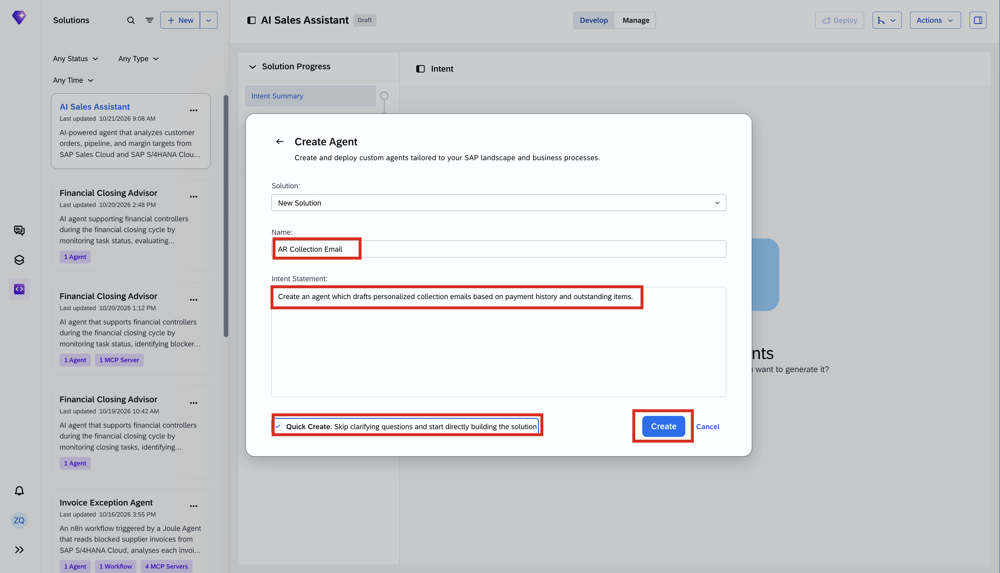

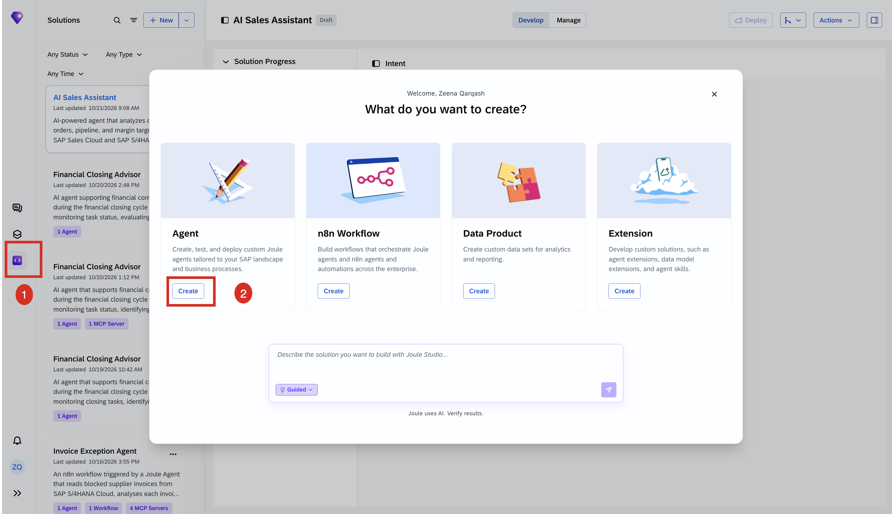
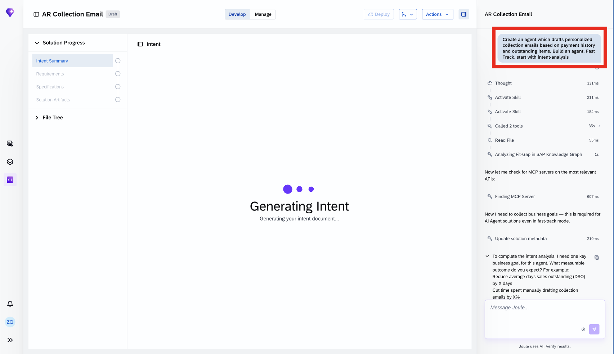
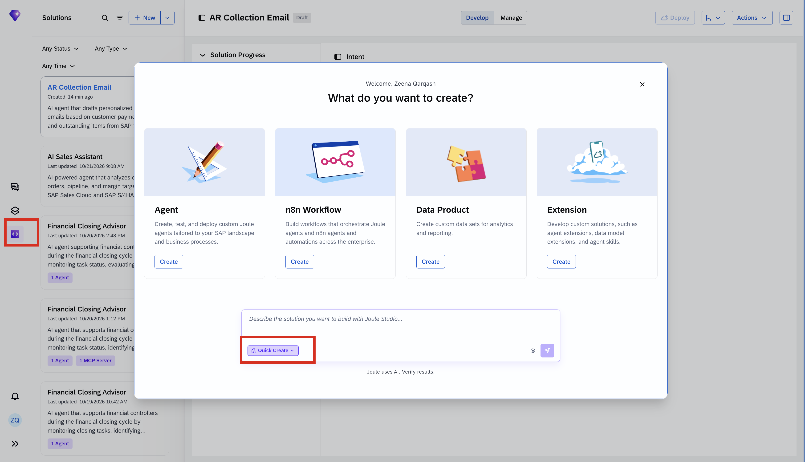
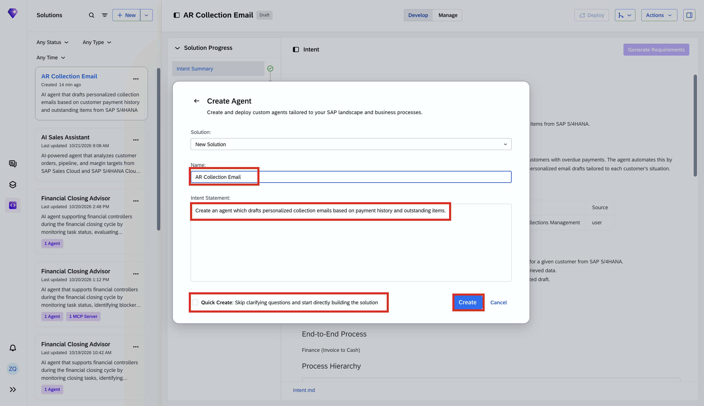
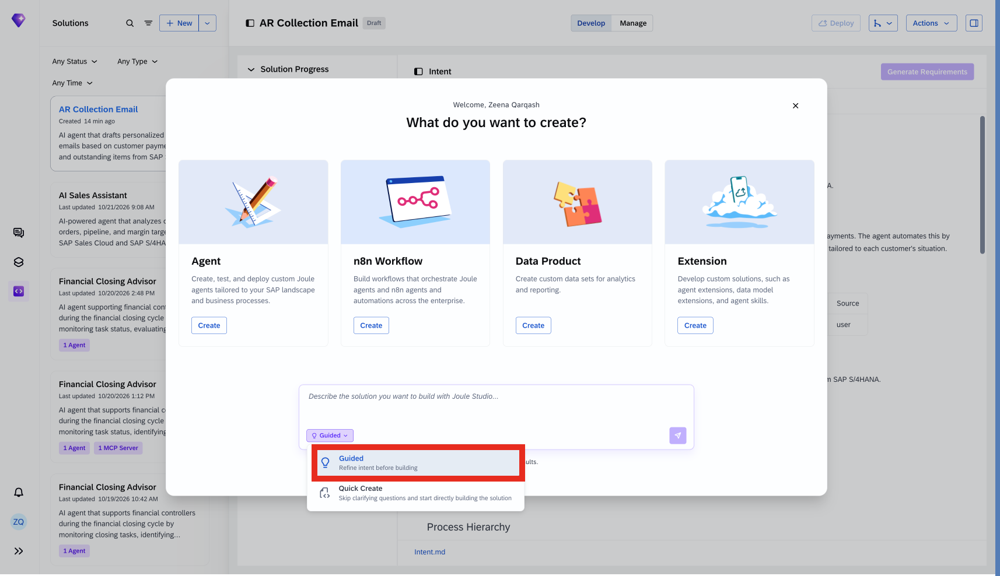

## 2. The one Quick Create exception, stated directly

The build log explains exactly why it stops here, in its own words:

> "Now I need to collect business goals — **this is required for AI Agent solutions even in fast-track mode.**"

![Clarifying question: "To complete the intent analysis, I need one key business goal for this agent. What measurable outcome do you expect? For example: Reduce average days sales outstanding (DSO) by X days; Cut time spent manually drafting collection emails by X%; Increase collection rate on overdue invoices to X%. Please share your target metric, and if known, the current baseline and a timeline." Options: Reduce DSO (Days Sales Outstanding) — selected; Reduce manual email drafting time; Increase collection rate on overdue invoices; Other](images/sj216-07-step2-joule-clarifying-questions.png)

The tutorial selects **Reduce DSO (Days Sales Outstanding)**.

> [!NOTE]
> This is the clearest, most direct statement in this book of a Quick Create boundary: not "it happened to still ask" (as in [Tutorial 15](joule-studio-tutorial-15-invoice-exception-n8n-workflow.md) and [Tutorial 20](joule-studio-tutorial-20-cx-sales-reps-assistant-agent.md)), but Joule Studio explicitly naming the rule — business goals confirmation is required for **AI Agent** solutions specifically, regardless of Quick Create. Whether the same hard rule applies to every solution type isn't stated here; this tutorial only confirms it for Agent.

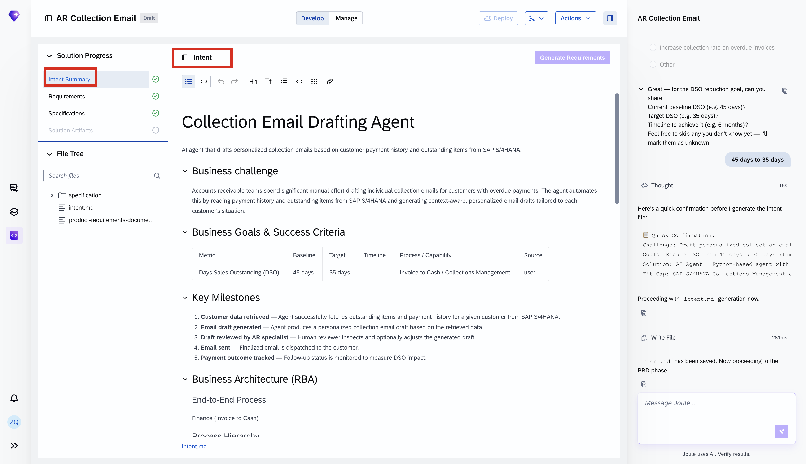

## 3. The PRD and Solution Architecture

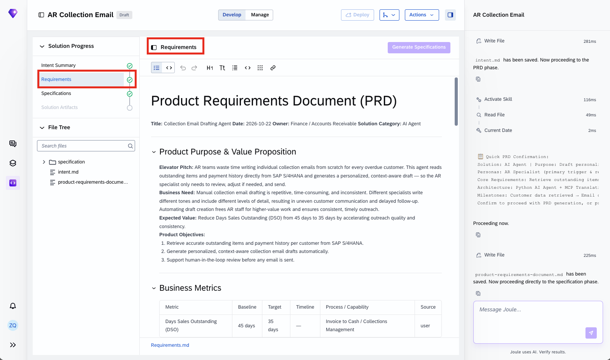

The Solution Architecture, transcribed directly:

> "A Python-based AI agent (A2A protocol) connects to SAP S/4HANA via available OData APIs. MCP translation files wrap the Dunning and Payment Advice APIs. The agent retrieves relevant data, passes it to an LLM (via SAP Generative AI Hub), and returns a structured email draft. The AR Specialist reviews and acts on the draft through the agent's conversational interface."

![Solution Architecture section: Key Components — Collection Email Drafting Agent (Python AI agent, core orchestration and LLM reasoning), MCP Tool: Dunning Data (wraps sap.s4:apiResource:CADUNNING_0001:v1, retrieve dunning/outstanding items), MCP Tool: Payment Advice (wraps sap.s4:apiResource:CE_PAYMENTADVICE_0001:v1, retrieve payment history), SAP Generative AI Hub (LLM runtime for email draft generation). Integration Points: SAP S/4HANA (read-only, OData, on-demand per agent trigger), SAP Generative AI Hub (LLM inference for draft generation). Agent Extensibility & Instrumentation: extension points for additional MCP tools (credit management, customer master data) in future releases; email templates and tone guidelines configurable via the agent's skill resources without code changes; all key business steps emit structured log statements [MILESTONE_ID].[achieved|missed]: [description]. Acceptance Criteria: each agent run logs customer ID, timestamp, data retrieved, draft generated, and reviewer action. Priority Rank: 5](images/sj216-10-step3-solution-architecture-section.png)

## 4. Generate the solution: 3 assets, 23 MCP tools pruned to read-only

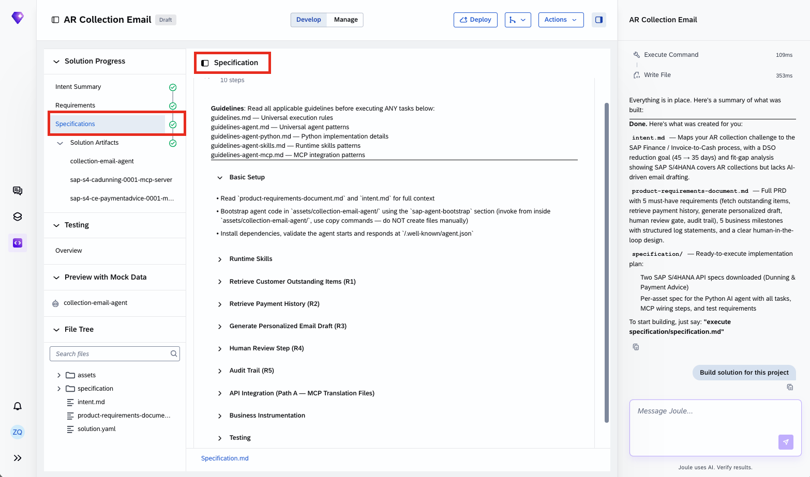

The build summary, confirmed directly — **3 assets** in solution `ar-collection-email-f5fae`:

| Asset | Type |
|---|---|
| `collection-email-agent` | AI Agent |
| `sap-s4-cadunning-0001-mcp-server` | MCP Server |
| `sap-s4-ce-paymentadvice-0001-mcp-server` | MCP Server |

What the agent does, verbatim from the summary:

- Takes a customer ID as input
- Retrieves outstanding overdue invoices from the S/4HANA Dunning API
- Retrieves the last 12 months of payment history from the Payment Advice API
- **Classifies payment behavior** (first-time late / occasional / chronic)
- Generates a personalized email draft with the right tone
- Presents the draft to the AR specialist — **never sends autonomously**

Quality, confirmed directly: **125 tests passed, 81% code coverage**; all 5 business milestones (M1–M5) instrumented with structured logs and OpenTelemetry spans; **23 MCP tools across 2 servers, pruned to read-only operations**; human-in-the-loop design enforced in both the system prompt and skill instructions.

> [!TIP]
> "23 MCP tools... pruned to read-only operations" is worth reading literally: the underlying Dunning and Payment Advice OData services likely expose far more than 23 operations in total (create/update/delete included), and the generation process deliberately narrowed what's wired into this agent down to reads only — the same "offered surface vs. used subset" pattern seen in [Tutorial 8](joule-studio-tutorial-8-ai-sales-assistant-agent.md), but here applied as a safety constraint (no write tools at all) rather than just relevance pruning.

## 5. Testing: Preview with Mock Data, distinct from a live Try Agent session

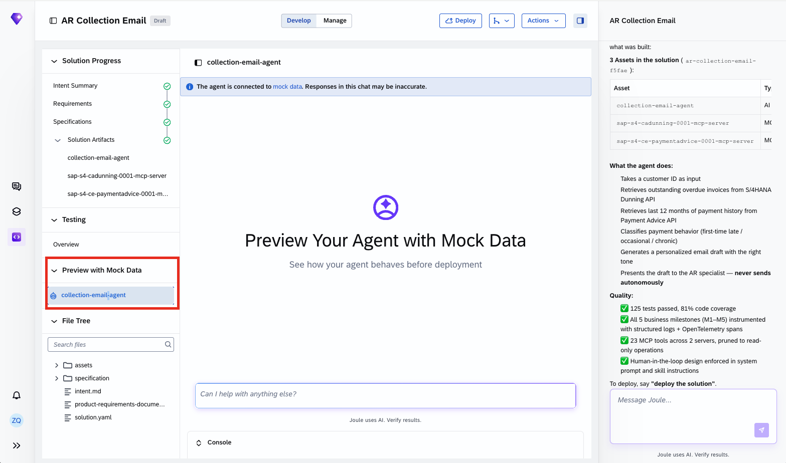

![Preview with Mock Data: banner reads "The agent is connected to mock data. Responses in this chat may be inaccurate." Agent intro: "I'm an AI agent specialized in drafting personalized collection emails for accounts receivable (AR) teams using live data from SAP S/4HANA. What I Can Do: 1. Retrieving customer data — fetch outstanding invoices, payment history, and dunning information; 2. Analyzing payment behavior — review the customer's payment patterns and overdue items; 3. Drafting personalized emails — generate tailored collection email drafts based on the specific situation. How to Use This Solution: 'Draft a collection email for customer C1001', 'Create a payment reminder for customer 12345', 'Generate a dunning notice for customer ABC123'"](images/sj216-13-step5-how-to-test-prompt.png)

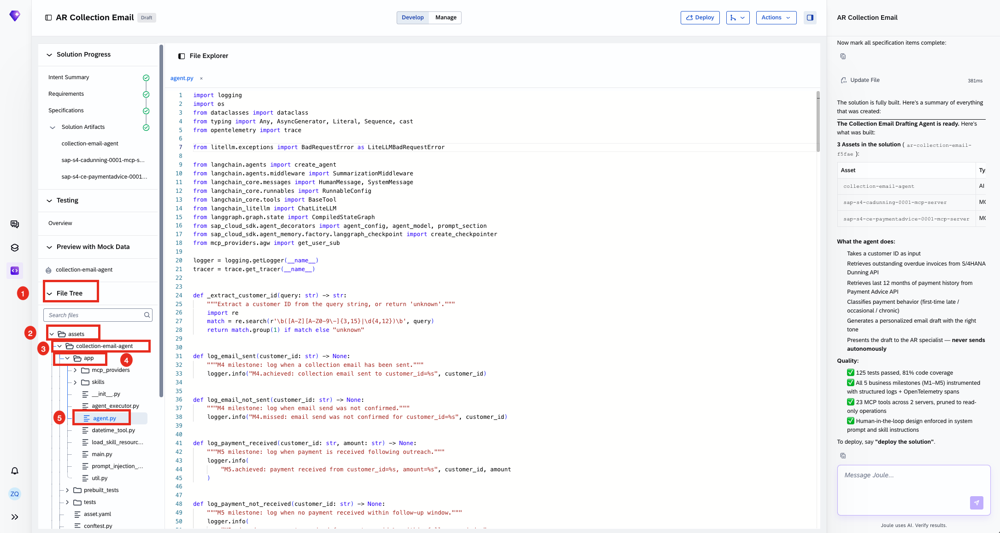

> [!NOTE]
> **Preview with Mock Data** is explicitly flagged in the UI itself — "Responses in this chat may be inaccurate" — because it runs the agent's full reasoning and drafting logic against synthetic data rather than a connected S/4HANA system. This is a distinct, named testing mode from the live "Try Agent" chat seen deploying other agents in this book, useful specifically for validating conversational behavior before any real tenant connection exists.

## 6. Added by Claude, not from the sources

- The TIP in section 4 drawing the "pruned to read-only" parallel to Tutorial 8's tool-surface narrowing is this book's own cross-reference — the "23 tools, pruned to read-only" fact is transcribed directly from the build summary.
- The NOTE in section 5 characterizing Preview with Mock Data as a distinct named testing mode is this book's own framing, built from the UI's own banner text, transcribed directly.
- Not run: the agent described was built and tested by the tutorial's own author; nothing was independently re-executed for this book.

## 7. Interview corner

**What interviewers listen for:** you can quote the exact Quick Create exception Joule Studio states for Agent solutions, and you know the difference between Preview with Mock Data and a connected Try Agent session.

1. In this tutorial's own words, what is never skipped for an AI Agent solution, even under Quick Create?

- Business goals confirmation — "this is required for AI Agent solutions even in fast-track mode," stated directly by Joule Studio before it would proceed

2. What are the 3 payment-behavior categories this agent classifies customers into?

- First-time late, occasional, chronic

3. What does "Preview with Mock Data" actually test, and how is it different from a live Try Agent session against a real tenant?

- It runs the agent's full reasoning and drafting logic against synthetic data instead of a connected S/4HANA system — useful for validating conversational behavior and structure before any real tenant connection exists; the UI explicitly warns responses "may be inaccurate" in this mode

> [!TIP]
> **🧩 Design question**
> *"A collections manager asks why this agent can draft an email but never send one."* Talk about: the build summary's own stated behavior ("presents the draft to the AR specialist — never sends autonomously") combined with the 23 MCP tools being pruned to read-only — there is no write/send capability wired into this agent at all, not just a policy choice layered on top, so a collection email always passes through a human before a customer ever sees it.

## Cheat sheet

| Thing | Detail |
|---|---|
| Hard Quick Create exception | Business goals confirmation, required for all AI Agent solutions |
| Business goal chosen | Reduce DSO (Days Sales Outstanding) |
| Assets | 3 — agent, Dunning MCP server, Payment Advice MCP server |
| Payment classification | First-time late / occasional / chronic |
| MCP tools | 23 across 2 servers, pruned to read-only |
| Tests | 125 passed, 81% code coverage |
| Send capability | None — draft only, reviewed by AR specialist, never sent autonomously |

## Recap

- Joule Studio states directly that business goals confirmation can't be skipped for Agent solutions, even under Quick Create — the clearest statement of this rule anywhere in this book
- The agent classifies customers into 3 payment-behavior tiers using 12 months of payment history plus current outstanding invoices
- Its 2 MCP servers expose 23 tools total, all pruned to read-only — there is no write/send capability built into this agent at all
- Preview with Mock Data is a distinct, explicitly-labeled testing mode that runs the agent's logic against synthetic rather than live data
- 125 tests passed at 81% coverage, with human-in-the-loop review enforced in both the system prompt and skill instructions

## Practice

1. Without looking back, quote (approximately) the rule Joule Studio stated about business goals and Quick Create
2. Name the 3 payment-behavior categories this agent classifies customers into
3. Explain why this agent can never send a collection email on its own, structurally, not just by policy

## How this chapter was checked

- The full tutorial "Build an AR Collection Email Agent" (developers.sap.com, Beginner, 15 min) was read in full, 13 Nov 2026.
- 14 images were found and downloaded, all used here; each was opened and visually verified against its caption before being written into this chapter, including the full Solution Architecture section and the build summary's quality/asset details, both transcribed directly.
- Nothing in this chapter was independently re-executed — the agent described was built and tested by the tutorial's own author.

## Sources and further reading

- SAP Developers, *Build an AR Collection Email Agent* — https://developers.sap.com/tutorials/ar-collection-email-agent (read in full 13 Nov 2026)

Previous: [Joule Studio tutorial 20: an SD discount strategy assistant](joule-studio-tutorial-20-cx-sales-reps-assistant-agent.md) · Next: [Joule Studio tutorial 22: an FI Collection Workbench agent](joule-studio-tutorial-22-fi-collection-workbench-agent.md)
