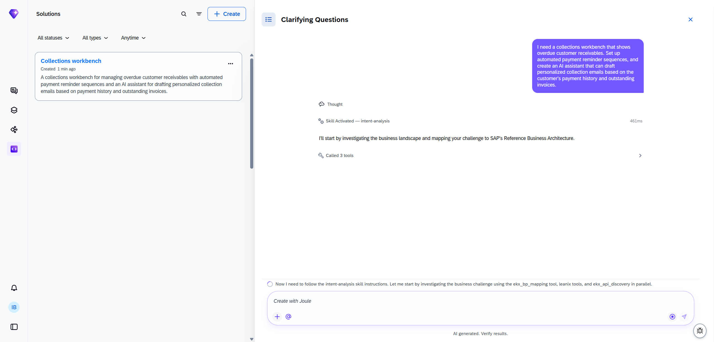
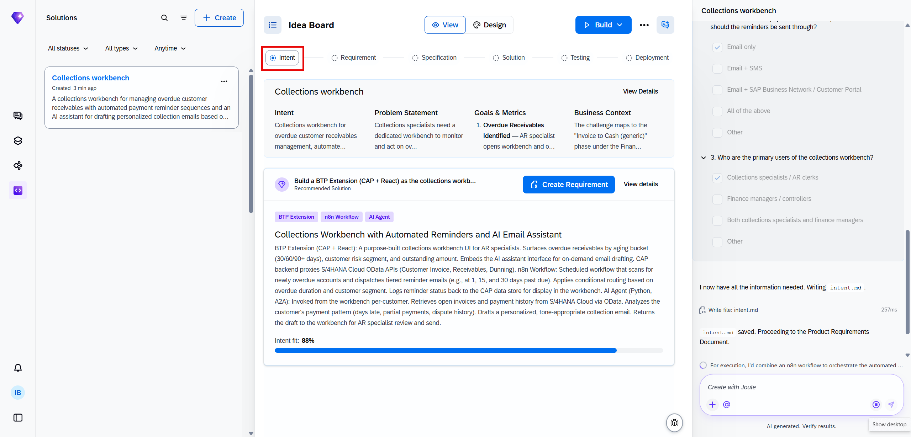
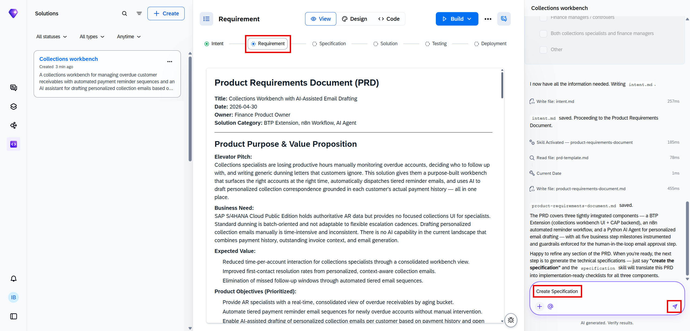
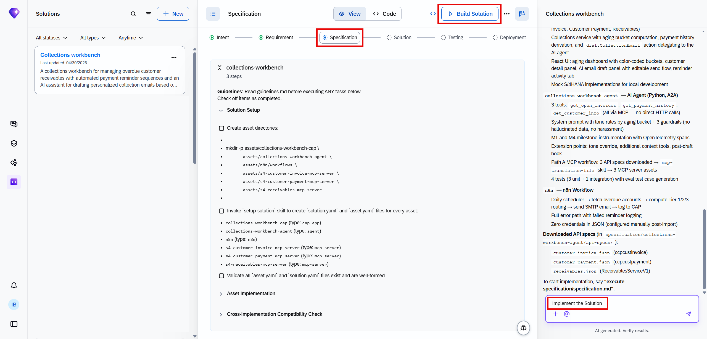
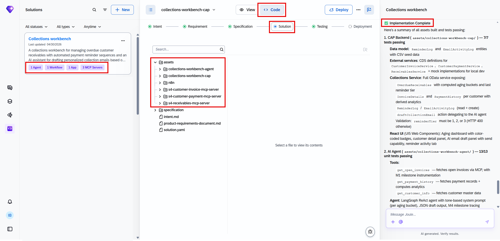
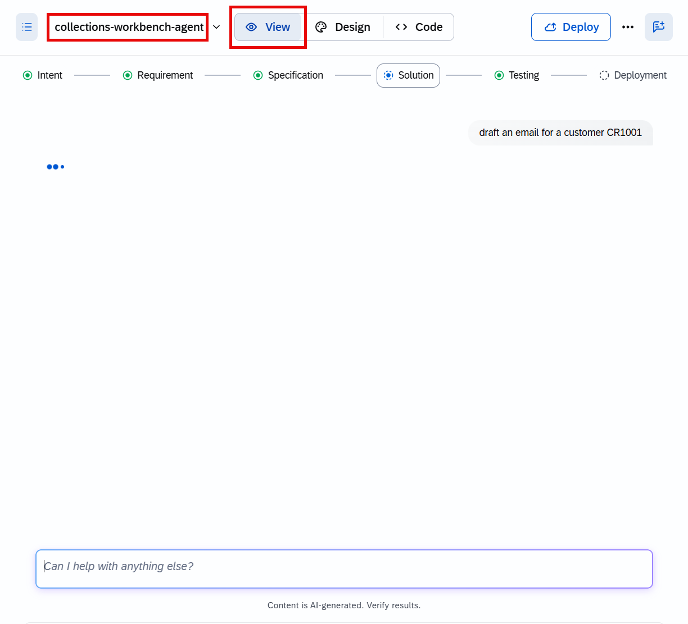

# Joule Studio tutorial 22: a full Collections Workbench — Application, n8n Workflow, and Agent together

*The most complex solution in this book: one free-form prompt generates three coordinated components — a CAP backend with a React/UI5 frontend, a scheduled n8n reminder workflow, and an AI drafting agent — sharing a single integration layer.*

> [!NOTE]
> **📍 At a glance**
> - **You will learn:** how a single intent can span 3 solution types at once (Application, n8n Workflow, Agent) with one shared CAP backend as the integration layer for all of them, and the broadest multi-vendor landscape detection in this book (SAP and Oracle both present)
> - **You will build:** a Collections Workbench — a React/UI5 aging dashboard backed by a CAP (Node.js) service, a daily n8n workflow that sends tiered payment reminders, and an AI agent that drafts personalized collection emails on demand
> - **Level:** beginner · **Time:** about 25 minutes
> - **Builds on:** [Joule Studio tutorial 21: an AR Collection Email agent](joule-studio-tutorial-21-fi-collection-email-agent.md). **Leads to:** [Joule Studio tutorial 23: an HR Onboarding Assistant](joule-studio-tutorial-23-hr-onboarding-assistant-agent.md)

> [!WARNING]
> Pre-release Joule Studio — screens and exact flow may differ from general availability.

**After this tutorial you can:**

- Explain why this solution needs 3 different component types (Application, n8n Workflow, Agent) rather than being built as a single agent
- Read the tiered reminder routing (Day 1/15/30) and trace it through both the n8n workflow and the CAP backend
- Name the multi-vendor landscape this tutorial detected, broader than any other clarifying question in this book

## 1. One free-form prompt, 3 component types

Like the Data Product in [Tutorial 19](joule-studio-tutorial-19-billing-completeness-data-product.md), this build starts from a free-form prompt rather than picking a single tile:

## 2. The broadest landscape detection in this book

Before building anything, Joule Studio reports what it found across the landscape — and this time it spans two ERP vendors, not just SAP:

> "I can see SAP S/4HANA (On Premise, Cloud, and extended edition) in your landscape alongside some Oracle applications. Let me ask the key question to shape the solution."

The tutorial selects **SAP S/4HANA Cloud (Public Edition)** as the primary source, confirmed by the Solution Architecture in section 4.

> [!NOTE]
> Every earlier landscape-detection question in this book stayed within SAP's own product family (competing S/4HANA editions, Sales Cloud vs. S/4HANA). This is the first time a clarifying question names a **competing ERP vendor outright** (Oracle Fusion Cloud ERP, Oracle e-Business Suite) as a real option Joule Studio considered before asking which system should be authoritative.

## 3. Why 3 component types, not 1 agent

The Solution Architecture spells out the division of labor directly:

> "Three components deployed on SAP BTP work in concert: a CAP (Node.js) backend that proxies S/4HANA Cloud Public Edition OData APIs, a React frontend (UI5 Web Components) that is the collections workbench, and an n8n workflow for the automated reminder sequence. A Python AI agent, deployed on BTP App Foundation runtime, handles email drafting when invoked from the workbench. **The CAP backend serves as the single integration layer for both the UI and the AI agent.**"

![Solution Architecture section: Key Components — CAP Backend (Node.js): proxies S/4HANA Cloud Public APIs (Customer Invoice, Receivables, Customer Payment), exposes OData/REST endpoints to the React UI, persists reminder log/email activity/agent invocation history. React Frontend (UI5 Web Components): collections workbench UI — aging dashboard, customer detail panel, AI email draft panel. n8n Workflow: scheduled trigger scans for overdue invoices via CAP API, applies tiered routing (Day 1/15/30), sends reminder emails, writes dispatch log back to CAP. AI Agent (Python, A2A): invoked per customer from the React UI via CAP, fetches open invoices and payment history, drafts personalized email using SAP Generative AI Hub (GPT-4o), returns structured draft to the UI. Integration Points: SAP S/4HANA Cloud Public Edition OData APIs — Customer Invoice (ccpcustinvoice), Receivables (ReceivablesServiceV1), Customer Payment (ccpcustpayment), Contract Accounting Dunning Read (CADUNNING_0001), read-only, via BTP destination with OAuth; SAP Generative AI Hub — write-once per invocation, no persistent external state; Email (SMTP/BTP Mail) — n8n workflow and specialist-triggered sends. Deployment Environments: Dev — isolated BTP subaccount, mocked S/4HANA responses where needed; Prod — BTP subaccount connected to S/4HANA Cloud Public tenant via BTP Destination Service](images/sj217-06-solution-architecture-section.png)

| Component | Role |
|---|---|
| CAP Backend (Node.js) | Single integration layer — proxies S/4HANA APIs, serves both the UI and the agent, persists activity history |
| React Frontend (UI5 Web Components) | The workbench itself — aging dashboard, customer detail panel, AI email draft panel |
| n8n Workflow | Scheduled, automated tiered reminders (Day 1/15/30), independent of any human triggering it |
| AI Agent (Python, A2A) | On-demand, per-customer email drafting, invoked from the UI through the CAP layer |

> [!TIP]
> This is the clearest architectural answer in this book to "why not just build one big agent": a **scheduled, unattended** job (the reminder sequence) and an **on-demand, human-invoked** drafting task (the AI agent) have genuinely different runtime shapes, and the **persistent UI state** (the workbench itself) is neither — each got the component type suited to it, with the CAP backend unifying how all three reach SAP data.

## 4. Specification and generation

Confirmed directly from the build summary:

- `collections-workbench-agent` — AI Agent (Python, A2A), **3 tools**: `get_open_invoices`, `get_payment_history`, `get_customer_info` (all via MCP — no direct HTTP calls). System prompt with tone rules by aging bucket, plus 3 guardrails (no hallucinated data, no harassment, [a third not fully captured]). M1 and M4 milestones instrumented with OpenTelemetry spans. Extension points: tone override, additional context tools, post-draft hook.
- Path A MCP workflow: 3 API specs downloaded (`customer-invoice.json`, `customer-payment.json`, `receivables.json`) → `mcp-translation-file` skill → 3 MCP server assets.
- 4 tests (3 unit + 1 integration) with eval test case generation.
- n8n: Daily scheduler → fetch overdue accounts → compute Tier 1/2/3 routing → send SMTP email → log to CAP. Full error path with failed-reminder logging. Zero credentials in the exported JSON (configured manually post-import).

## 5. The generated n8n workflow, read node by node

> [!NOTE]
> The tiered routing (Day 1 / 15 / 30) decided in the PRD shows up as a literal 3-way switch node in the generated workflow — each tier gets its own templated email built independently before a shared **Send Reminder Email** node dispatches it, and either the dispatch succeeds (logged to CAP) or fails (logged separately as a failed reminder) — there's no silent-failure path.

## 6. The finished workbench, live

The deployed CAP application's Reminder Activity tab, confirmed directly, showing real dispatched reminders from the n8n workflow:

This is a concrete, end-to-end confirmation that the architecture in section 3 actually works as designed: the n8n workflow ran its schedule, picked tiered reminders, sent them, and logged them back through the CAP backend — which the React workbench then displays in its own Reminder Activity tab.

## 7. Added by Claude, not from the sources

- The TIP in section 3 (scheduled/unattended vs. on-demand/human-invoked vs. persistent UI state as the reason for 3 separate component types) is this book's own architectural reasoning, built from the component descriptions transcribed directly from the source.
- The NOTE in section 2 flagging this as the first cross-vendor (SAP vs. Oracle) landscape question in this book is this book's own comparison across tutorials; the question text itself is transcribed directly.
- The 3rd guardrail in section 4 is noted as "not fully captured" because the source screenshot's panel was cut off at that point — this book doesn't guess at its content.
- Not run: the solution described was built and tested by the tutorial's own author; nothing was independently re-executed for this book.

## 8. Interview corner

**What interviewers listen for:** you can explain the architectural reasoning for 3 separate components instead of one, and you correctly identify this as the first tutorial with a genuine cross-vendor (not just cross-edition) landscape question.

1. Why does this solution use 3 separate component types instead of one large agent?

- Each piece has a different runtime shape: the reminder sequence is scheduled and unattended (n8n), the email drafting is on-demand and human-invoked (Agent), and the workbench itself is persistent UI state (Application/CAP+React) — one component type doesn't naturally fit all three

2. What role does the CAP backend play across all 3 components?

- It's the single integration layer — the only thing that talks directly to S/4HANA's OData APIs — serving both the React UI and the AI agent, and persisting reminder/email/invocation history for all of them

3. What competing systems did Joule Studio detect in the landscape before asking its clarifying question here, beyond SAP itself?

- Oracle Fusion Cloud ERP and Oracle e-Business Suite, alongside 3 SAP S/4HANA editions (Cloud Public, Cloud Private/Extended, On Premise) — the first cross-vendor landscape question in this book

> [!TIP]
> **🧩 Design question**
> *"A finance IT lead asks what happens if the n8n reminder workflow and a specialist both try to email the same customer about the same overdue invoice on the same day."* Talk about: the CAP backend's own persisted reminder/email activity log as the shared source of truth both paths write to — the architecture doesn't describe explicit duplicate-prevention logic, so this is a reasonable place to probe further in a real design review, using the Reminder Activity tab shown in section 6 as the audit trail you'd start from.

## Cheat sheet

| Thing | Detail |
|---|---|
| Components | CAP (Node.js) backend, React/UI5 frontend, n8n reminder workflow, Python AI agent |
| Shared integration layer | CAP backend — the only thing that talks to S/4HANA directly |
| Landscape detected | 3 S/4HANA editions + Oracle Fusion Cloud ERP + Oracle e-Business Suite |
| Source chosen | SAP S/4HANA Cloud (Public Edition) |
| Agent tools | 3 — `get_open_invoices`, `get_payment_history`, `get_customer_info`, all via MCP |
| Reminder tiers | Day 1 / 15 / 30, routed by a Rules-mode switch node in n8n |
| Failure handling | Failed sends logged separately — no silent-failure path |

## Recap

- This is the most architecturally complex solution in this book: one free-form prompt generated an Application, an n8n Workflow, and an Agent, unified through a single CAP backend
- Joule Studio detected the broadest multi-vendor landscape seen in this book (3 SAP S/4HANA editions plus 2 Oracle ERP systems) before asking which should be authoritative
- The n8n workflow implements the PRD's Day 1/15/30 tiered routing as a literal 3-way switch, with separate logging paths for successful and failed sends
- The finished workbench's Reminder Activity tab shows real, end-to-end confirmation that the n8n workflow, CAP backend, and React UI all work together as designed

## Practice

1. Without looking back, name the 3 component types this solution combines and explain why each needed to be a separate type
2. List the full landscape Joule Studio detected before asking its clarifying question
3. Walk through the n8n workflow's tiered routing from trigger to logged outcome

## How this chapter was checked

- The full tutorial "Build a Collections Workbench" (developers.sap.com, Beginner, 25 min) was read in full, 13 Nov 2026.
- 11 images were found and downloaded, all used here; each was opened and visually verified against its caption before being written into this chapter, including the full Solution Architecture section, the n8n workflow canvas, and the deployed Reminder Activity tab, all transcribed directly.
- Nothing in this chapter was independently re-executed — the solution described was built and tested by the tutorial's own author.

## Sources and further reading

- SAP Developers, *Build a Collections Workbench* — https://developers.sap.com/tutorials/collections-workbench (read in full 13 Nov 2026)

Previous: [Joule Studio tutorial 21: an AR Collection Email agent](joule-studio-tutorial-21-fi-collection-email-agent.md) · Next: [Joule Studio tutorial 23: an HR Onboarding Assistant](joule-studio-tutorial-23-hr-onboarding-assistant-agent.md)
