# Joule Studio tutorial 23: an HR Virtual Assistant, built on simulated data by design

*The only agent in this book with zero MCP servers and zero live SAP API integration — built deliberately against an embedded simulated HCM data layer, because the real target system isn't live yet.*

> [!NOTE]
> **📍 At a glance**
> - **You will learn:** why a generated agent sometimes has no MCP servers at all, and how "simulated data" shows up as an explicit, deliberate architectural choice rather than a fallback
> - **You will build:** an HR Virtual Assistant that answers HR policy questions, looks up employee profiles, scores attrition risk, and generates development recommendations — all from data embedded directly in the agent's own code
> - **Level:** beginner · **Time:** about 18 minutes
> - **Builds on:** [Joule Studio tutorial 22: a full Collections Workbench](joule-studio-tutorial-22-fi-collection-workbench-agent.md). **Leads to:** [Joule Studio tutorial 24: an IT Incident Triage n8n workflow](joule-studio-tutorial-24-it-incident-triage-n8n-workflow.md)

> [!WARNING]
> Pre-release Joule Studio — screens and exact flow may differ from general availability.

**After this tutorial you can:**

- Explain exactly why this agent has no MCP servers, in the PRD's own stated business reason
- Name all 6 tools this agent exposes and what each reads from the embedded data layer
- Distinguish what "I always retrieve live data from the system" means here versus in every other agent in this book

## 1. Why simulated data, stated directly in the PRD

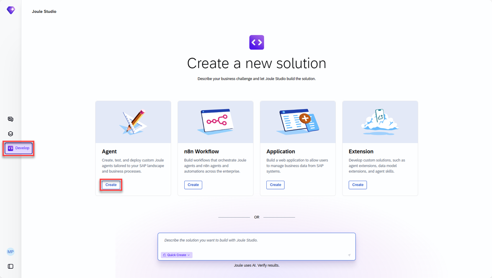

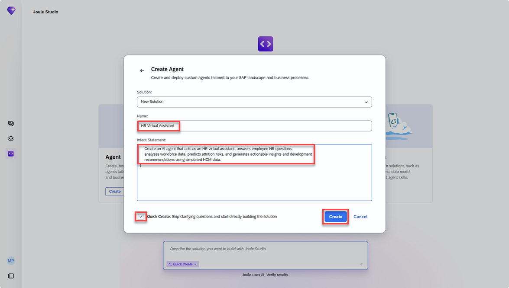
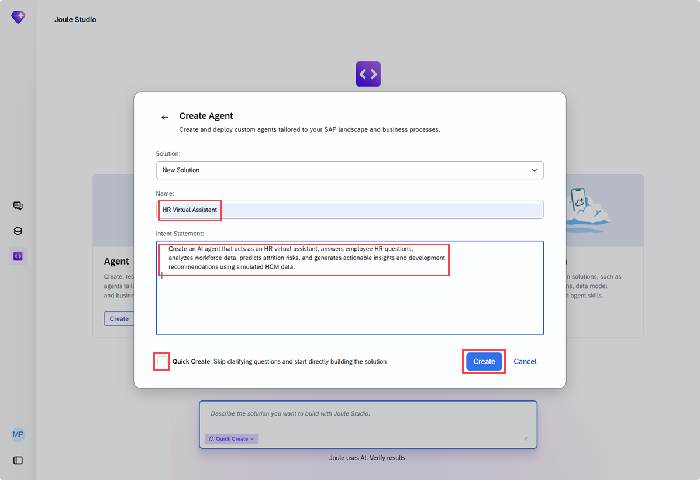
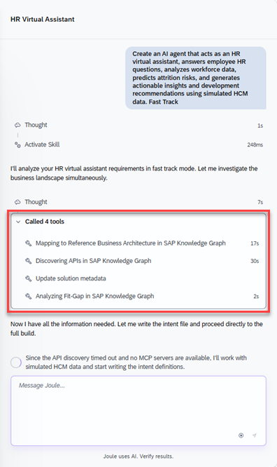
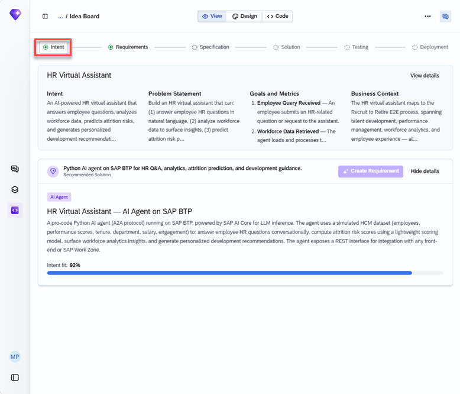

The intent itself: *"Create an AI agent that acts as an HR virtual assistant, answers employee HR questions, analyzes workforce data, predicts attrition risks, and generates actionable insights and development recommendations using simulated HCM data."*

The PRD's Business Need explains the "simulated" part directly, rather than leaving it unexplained:

> "The current HR application landscape is fragmented (HR Admin, EmpApprise, several tools in phaseOut/endOfLife) and **SAP SuccessFactors HXM Suite is planned but not yet live.** No existing system provides conversational HR self-service, predictive attrition scoring, or AI-driven development recommendations."

![PRD: Title "HR Virtual Assistant Agent," Date 2026-04-30, Owner "HR Digital Transformation Team," Solution Category "AI Agent." Elevator Pitch — a unified conversational HR assistant answering policy questions, delivering workforce analytics, predicting attrition risks, generating development recommendations, "all from a unified simulated HCM data layer." Product Objectives: instant HR Q&A via natural language; workforce analytics and attrition risk scoring at department/individual level; actionable personalized development recommendations based on skills/performance/career goals. Requirements: R1 Conversational HR Q&A — user story and acceptance criteria (answer grounded in the embedded HR policy knowledge base within 5 seconds), Priority Rank 1; R2 Employee Profile Lookup](images/sj218-08-prd-ready-technical-overview.png)

> [!NOTE]
> This is the only agent in this book whose own PRD explains *why* it isn't integrating with a live SAP system: the real target (SAP SuccessFactors HXM Suite) is **planned but not yet live**. Building against a simulated data layer isn't a shortcut or a testing convenience here — it's the deliberate, stated architecture for a system that genuinely doesn't exist yet in this landscape.

## 2. The one clarifying question

![Build log: Thought — "I'll start by analyzing your intent and mapping it to the right SAP business architecture. Let me investigate first." Called 3 tools: Mapping to Reference Business Architecture in SAP Knowledge Graph, Discovering APIs in SAP Knowledge Graph, Analyzing Fit-Gap in SAP Knowledge Graph. "Good, I have solid findings from SAP's reference architecture. Let me ask a few focused questions before writing your plan." Clarifying question: "Who are the primary users of this HR virtual assistant?" Options: Employees (self-service — policies, benefits, payroll questions), HR Managers (workforce insights, team analytics), Both employees and HR managers, Other](images/sj218-04-clarifying-questions-iap.png)

The tutorial selects **Both employees and HR managers** — which is why the agent ends up with both Q&A tools (employee-facing) and analytics tools (manager-facing) in section 4.

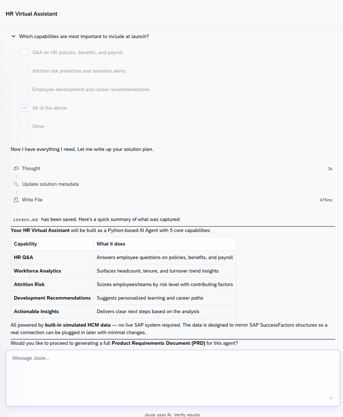
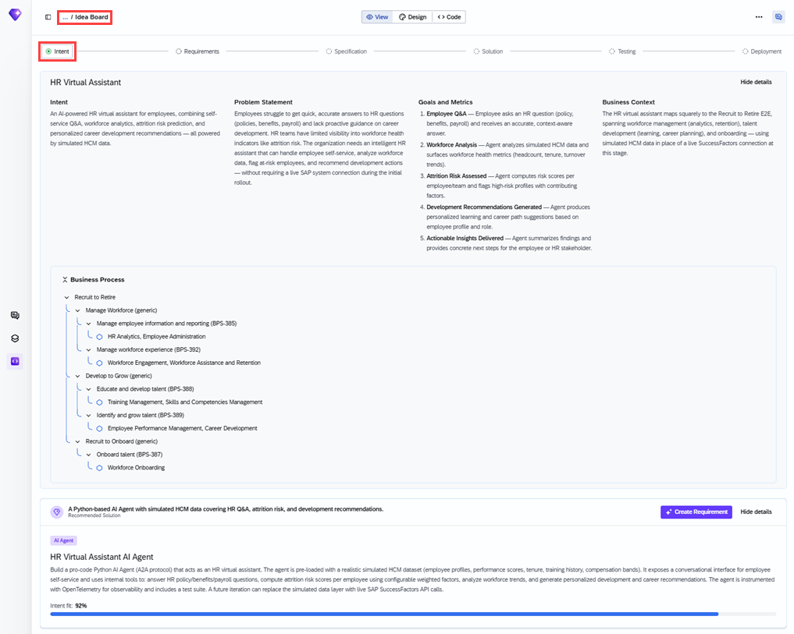
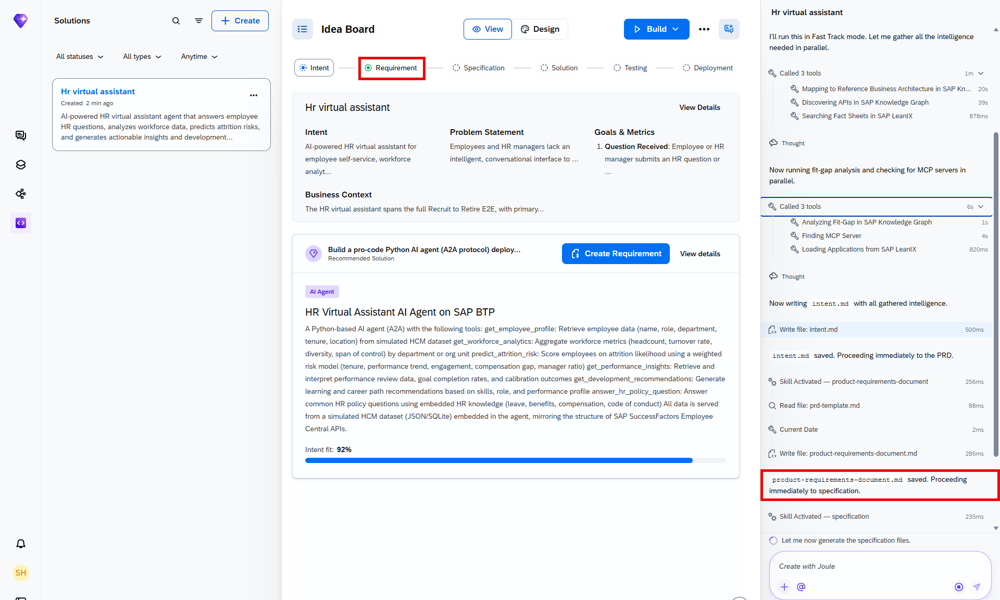
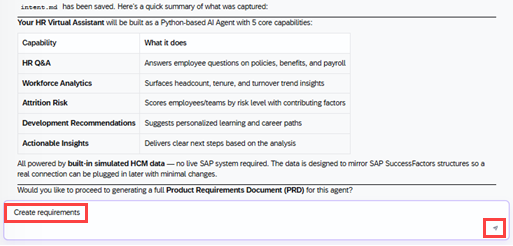

## 3. Specification: no MCP server discovery needed

The build log states the consequence of the simulated-data decision plainly:

> "Now generating all specification files. **No MCP server discovery needed since the agent uses a simulated HCM data layer.**"

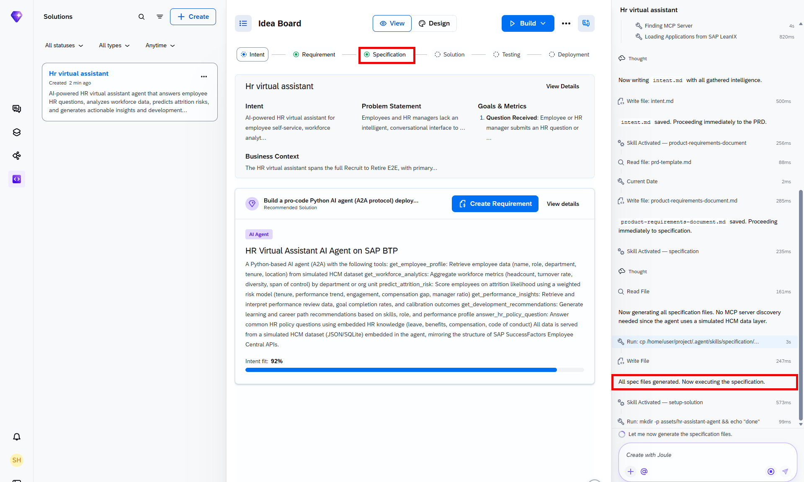
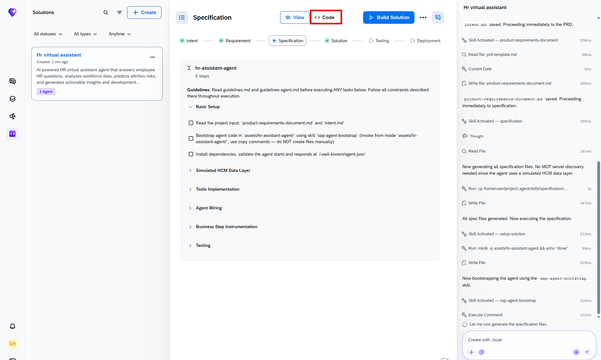
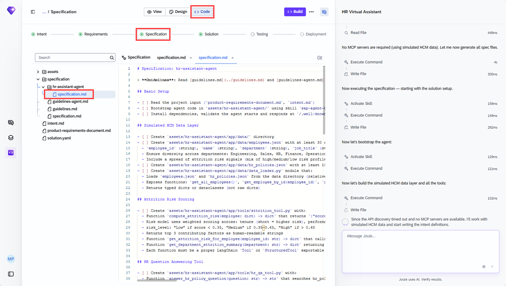
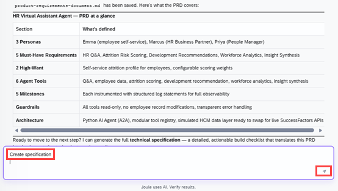
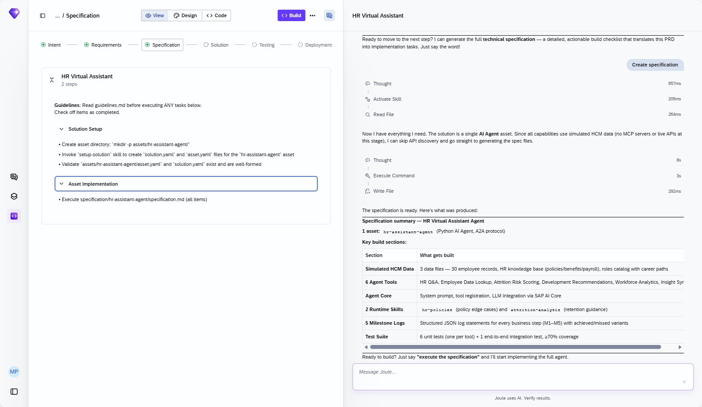
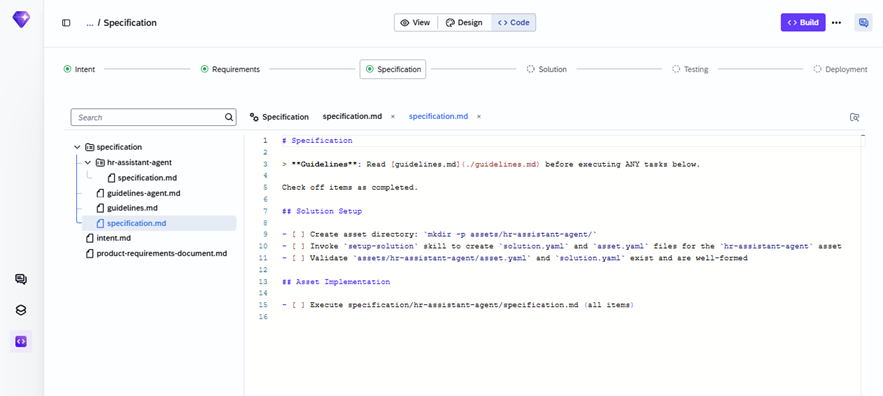

Every other agent in this book's specification phase includes an MCP server discovery step (downloading API specs, generating translation files). This one skips it entirely — there's no external API to discover against.

## 4. Generated solution: 6 tools over embedded data, zero MCP servers

![Solution ready: "HR Virtual Assistant Agent — Complete." What Was Built: "A fully functional Python AI agent (A2A protocol) deployed on SAP App Foundation, acting as an intelligent HR virtual assistant." Architecture file tree: assets/hr-assistant-agent/app/agent.py (LangGraph agent), data/hcm_data.py (Simulated HCM, 30 employees), data/hr_policies.py (17 HR policy Q&A entries), tools/get_employee_profile, get_workforce_analytics, predict_attrition_risk, get_performance_insights, get_development_recommendations, answer_hr_policy_question. Key Capabilities table mapping each to its tool and guardrail](images/sj218-16-solution-ready.png)

| Tool | Reads | Guardrail |
|---|---|---|
| `answer_hr_policy_question` | 17 embedded HR policy Q&A entries | Falls back to pointing the user to contact HR if unanswerable |
| `get_employee_profile` | 30 simulated employee records | No cross-employee salary disclosure |
| `get_workforce_analytics` | Simulated HCM data (headcount, etc.) | Read-only |
| `predict_attrition_risk` | Simulated HCM data | Scored 0–100 with contributing factors named |
| `get_performance_insights` | Simulated HCM data | Trend analysis, top/underperformer identification |
| `get_development_recommendations` | Simulated HCM data | 3–5 actionable, employee-specific suggestions |

> [!TIP]
> **Zero MCP servers, 2 embedded data files, 6 tools** — this is a genuinely different generated-solution shape from every other agent in this book. The simulated data (`hcm_data.py`, `hr_policies.py`) lives directly inside the agent's own codebase rather than being fetched live, which is exactly what you'd expect for a system meant to be swapped onto real SuccessFactors APIs once that suite goes live, without changing the agent's tool interface.

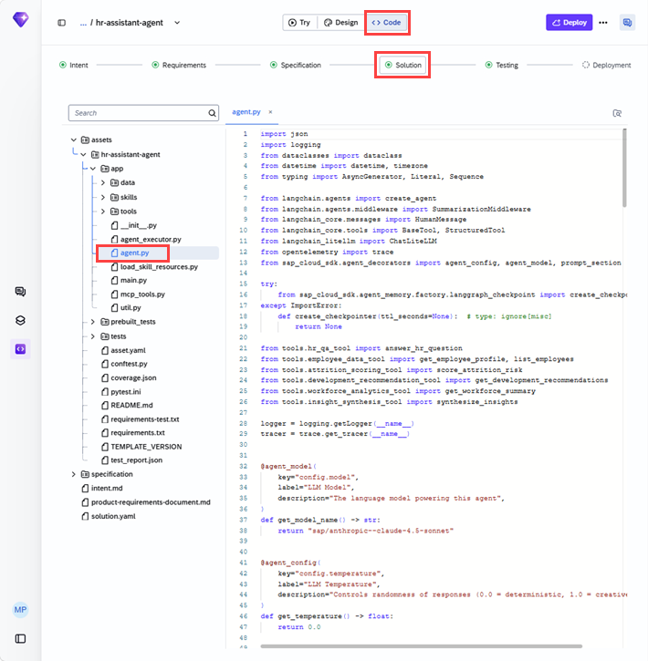
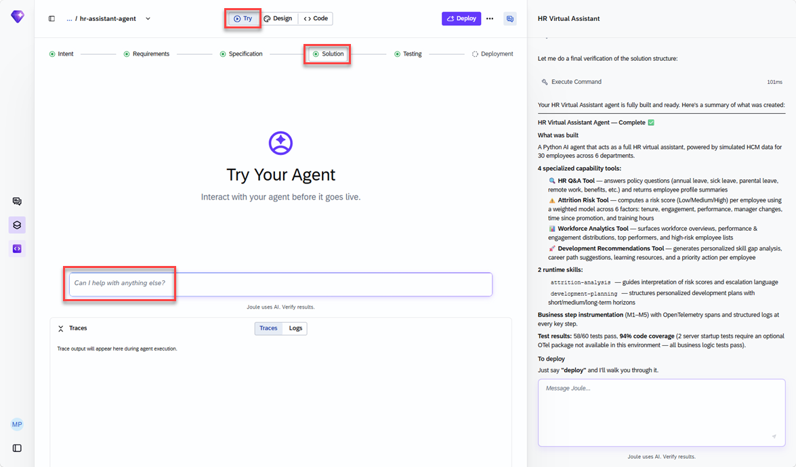
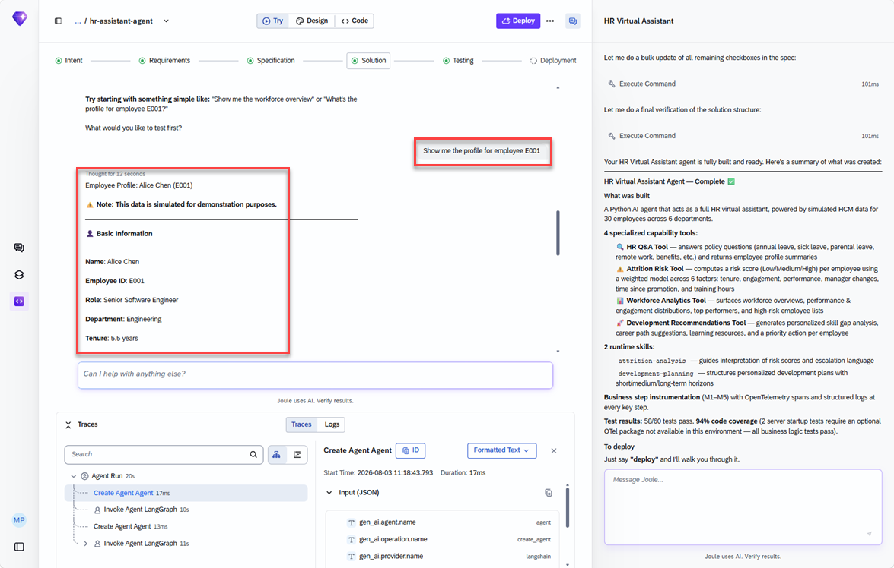
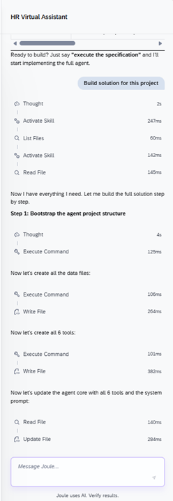

## 5. Trying the agent: "live" means "not hallucinated," not "from a real system"

![Try Your Agent: "Try asking me any of these questions, and I'll use the appropriate tools to get you real data! I'll never make up information — I always retrieve live data from the system." Suggested prompts: "Generate a comprehensive HR report for Engineering," "Synthesize insights for employee EMP007," "Give me a full analysis of the organization." User: "How many vacation days do I get?" Agent: "You are entitled to 25 days of annual leave per calendar year (pro-rated if you work part-time). Key details: leave accrues from your first day of employment; you must request approval from your line manager at least 2 weeks in advance; you can carry over up to 5 unused days to the following year." Traces panel: Agent Run (9s) → Create Agent Agent → Invoke Agent LangGraph (9s) → Create Agent Agent](images/sj218-21-try-your-agent-iap.png)

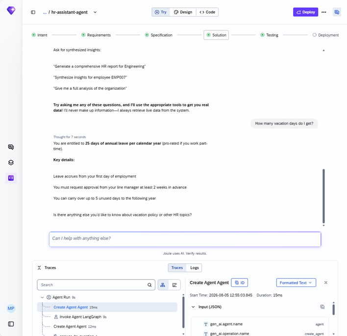

> [!CAUTION]
> **🔒 Read "I always retrieve live data from the system" carefully here**
> In every other agent in this book, that sentence would mean a real OData call against a live SAP tenant. Here, "the system" is the agent's own embedded simulated data layer (`hcm_data.py`, `hr_policies.py`) — the claim is accurate and meaningful (the agent genuinely doesn't hallucinate; it looks values up from real, if synthetic, structured data), but it's a different guarantee than "live" means for the MCP-backed agents elsewhere in this book. Worth noticing precisely because the wording is identical.

## 6. Testing and deployment

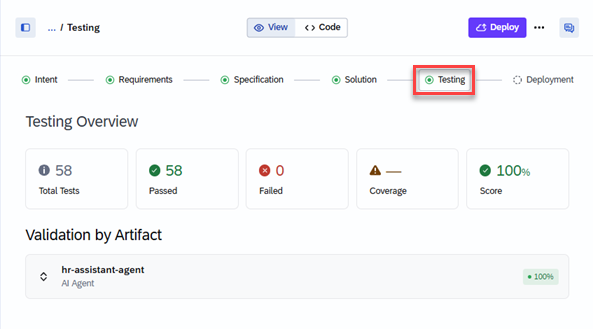
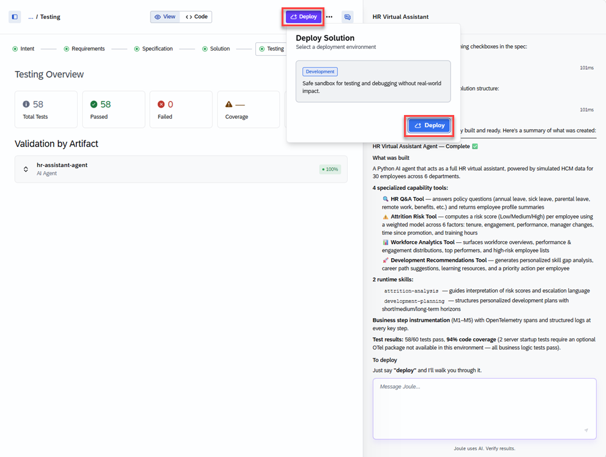
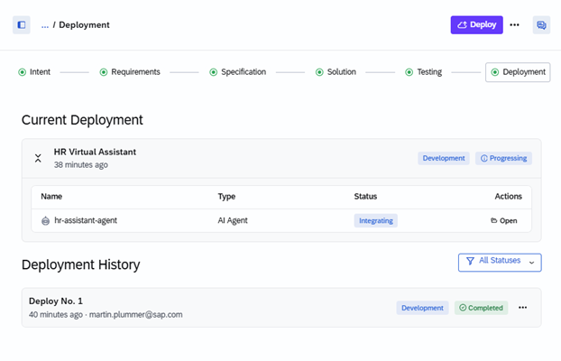
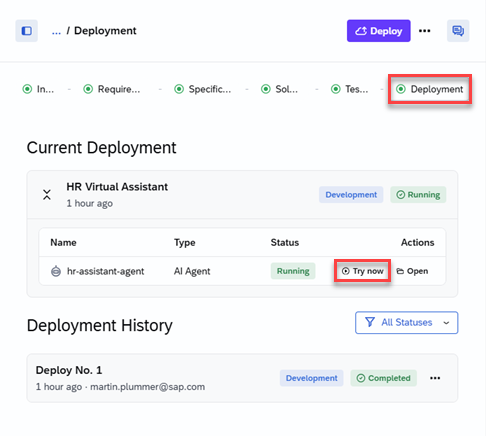
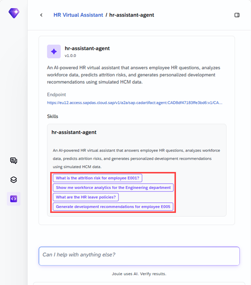

Same governance boundary as every other agent in this family: development/test deployment from Joule Studio.

## 7. Added by Claude, not from the sources

- The comparison in section 3 ("every other agent in this book's specification phase includes MCP server discovery") is this book's own cross-reference across every prior tutorial; this tutorial's own build log is transcribed directly.
- The CAUTION in section 5 unpacking what "live data" means for a simulated-data agent is this book's own close reading, contrasting this tutorial's wording against every MCP-backed agent elsewhere in this book.
- The sj218 image set (29 files on disk, all uniquely named including `02b`/`03b`/`-iap` variants) was fully re-verified against the book's running image count before this chapter was written; no files were missing or duplicated once checked directly, resolving an earlier research-pass discrepancy noted during this batch's planning.
- Not run: the agent described was built and tested by the tutorial's own author; nothing was independently re-executed for this book.

## 8. Interview corner

**What interviewers listen for:** you can state the exact PRD reason this agent has no live integration (SuccessFactors HXM Suite not yet live), and you don't conflate "simulated" with "fake" or "untested" — the data is structured and the agent's claim of never hallucinating is accurate within that scope.

1. Why does this agent have zero MCP servers, when every other agent in this book has at least one?

- Its real target system, SAP SuccessFactors HXM Suite, is "planned but not yet live" in the landscape — there's no live API to integrate with yet, so the agent is built against an embedded simulated HCM data layer instead, by deliberate design stated in the PRD

2. Name the agent's 6 tools and what each reads.

- `answer_hr_policy_question` (17 embedded policy Q&A entries), `get_employee_profile` (30 simulated employee records), `get_workforce_analytics`, `predict_attrition_risk`, `get_performance_insights`, `get_development_recommendations` (all reading simulated HCM data)

3. When this agent says "I always retrieve live data from the system," what does "the system" actually refer to?

- Its own embedded simulated data layer (`hcm_data.py`, `hr_policies.py`), not a connected SAP tenant — the claim is still meaningful (no hallucination, real lookups against real structured data) but is a different guarantee than "live" means for every MCP-backed agent elsewhere in this book

> [!TIP]
> **🧩 Design question**
> *"An HR digital transformation lead asks what has to change in this agent once SAP SuccessFactors HXM Suite actually goes live."* Talk about: the 6 tools (`get_employee_profile`, `get_workforce_analytics`, etc.) forming a stable interface that the agent's reasoning and conversation logic already depend on — swapping the implementation of each tool from reading `hcm_data.py`/`hr_policies.py` to calling real SuccessFactors OData APIs through an MCP server shouldn't require touching the agent's prompt or orchestration logic at all, which is exactly the kind of forward-compatible design a "simulated now, real later" architecture is meant to buy.

## Cheat sheet

| Thing | Detail |
|---|---|
| Why simulated data | SAP SuccessFactors HXM Suite is planned but not yet live in this landscape |
| MCP servers | 0 — none needed |
| Embedded data | `hcm_data.py` (30 simulated employees), `hr_policies.py` (17 HR policy Q&A entries) |
| Tools | 6 — policy Q&A, profile lookup, workforce analytics, attrition prediction, performance insights, development recommendations |
| Users | Both employees and HR managers (chosen in the clarifying question) |
| "Live data" claim | Means "not hallucinated, from the embedded data layer" — not "from a connected SAP tenant" |

## Recap

- This is the only agent in this book built with zero MCP servers and zero live SAP API integration, by deliberate design stated directly in its own PRD
- The reason is explicit: SAP SuccessFactors HXM Suite, the real target system, is planned but not yet live in this landscape
- The agent's 6 tools read from 2 embedded Python data files (30 simulated employees, 17 HR policy entries) rather than any external service
- Its "I always retrieve live data from the system" claim is accurate but means something different here than for every MCP-backed agent elsewhere in this book
- The stable 6-tool interface is designed so the underlying data source can be swapped to real SuccessFactors APIs later without changing the agent's reasoning logic

## Practice

1. Without looking back, explain why this agent has no MCP servers, in the PRD's own terms
2. Name all 6 tools and what each reads
3. Explain the difference between what "live data" means for this agent versus for an MCP-backed agent elsewhere in this book

## How this chapter was checked

- The full tutorial "Build an HR Virtual Assistant Agent" (developers.sap.com, Beginner, 18 min) was read in full, 13 Nov 2026.
- 29 images were found and downloaded (a prior research pass had reported a possible discrepancy between files found and downloaded; a direct filesystem check before writing this chapter confirmed all 29 are present and uniquely named, resolving that discrepancy), all used here; each was opened and visually verified against its caption before being written into this chapter, including the full PRD, the generated solution architecture, and the live test interaction, all transcribed directly.
- Nothing in this chapter was independently re-executed — the agent described was built and tested by the tutorial's own author.

## Sources and further reading

- SAP Developers, *Build an HR Virtual Assistant Agent* — https://developers.sap.com/tutorials/hr-virtual-assistant-agent (read in full 13 Nov 2026)

Previous: [Joule Studio tutorial 22: a full Collections Workbench](joule-studio-tutorial-22-fi-collection-workbench-agent.md) · Next: [Joule Studio tutorial 24: an IT Incident Triage n8n workflow](joule-studio-tutorial-24-it-incident-triage-n8n-workflow.md)
