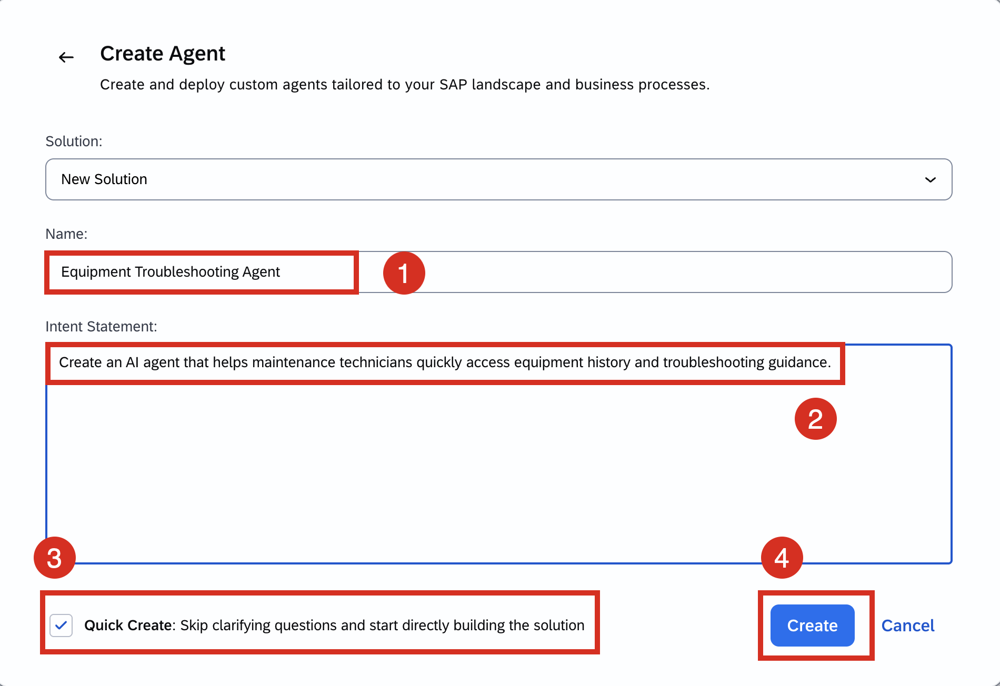
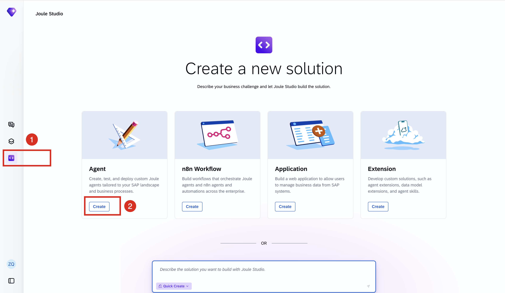
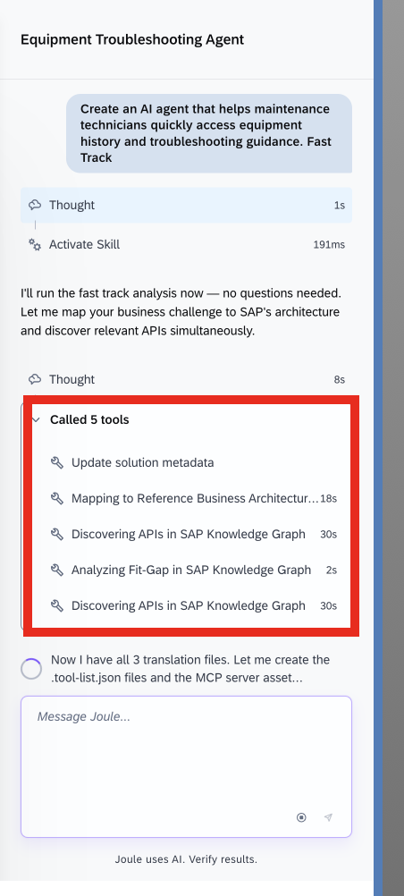
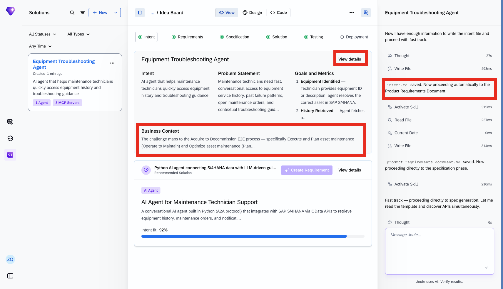
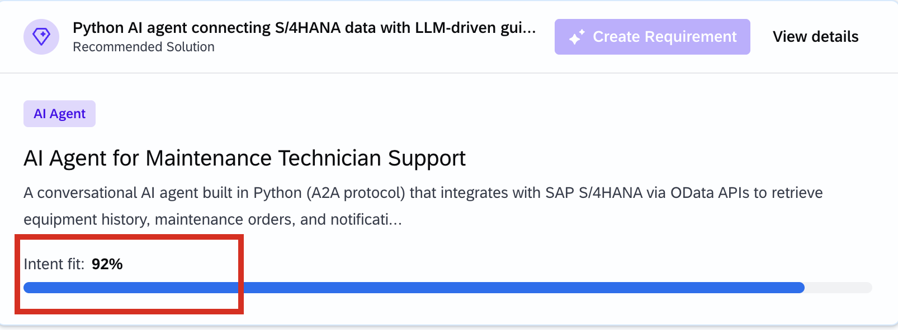
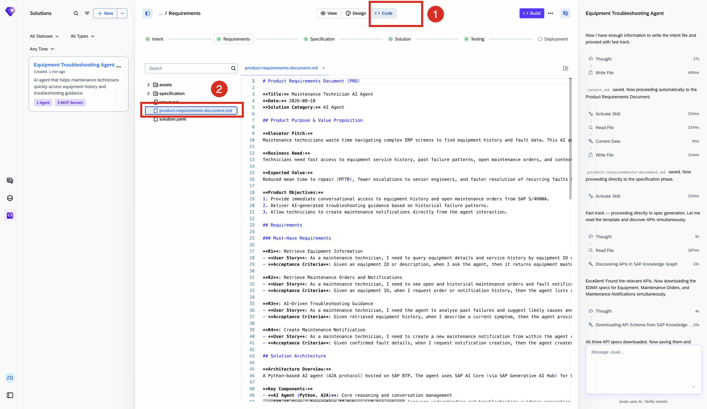
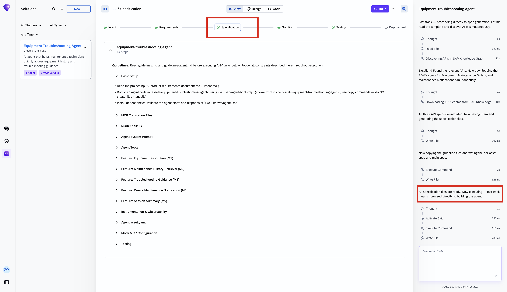
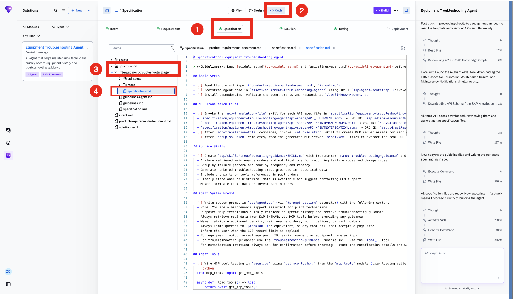
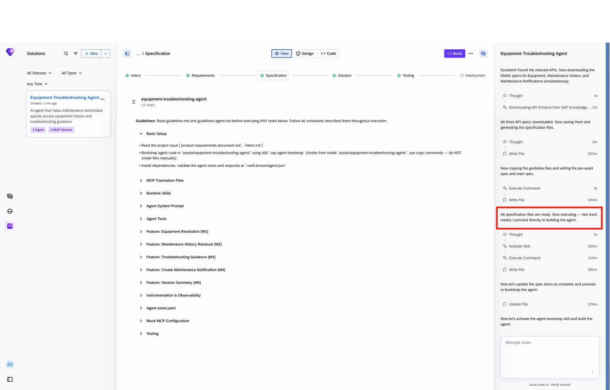
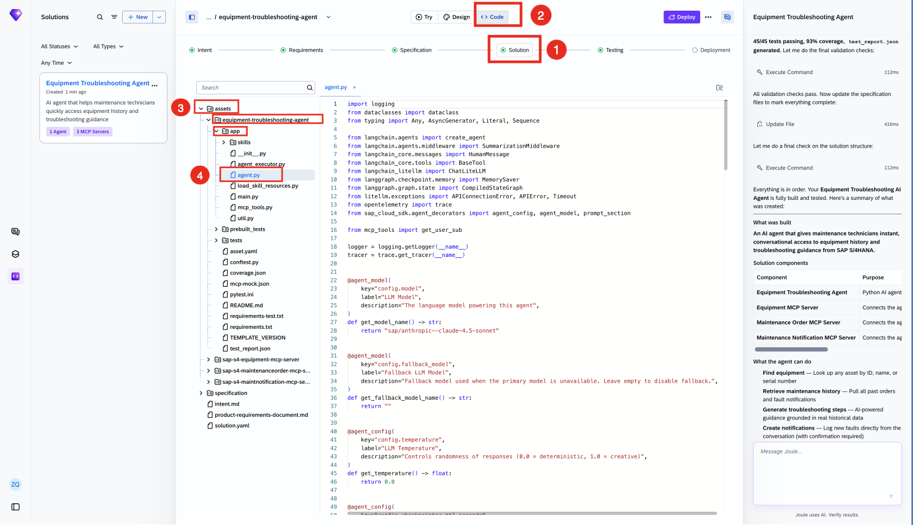

# Joule Studio tutorial 25: an Equipment Troubleshooting agent for maintenance technicians

*A straightforward 3-MCP-server agent with one small but important detail: its single write action — creating a maintenance notification — is the one capability explicitly marked "with confirmation required."*

> [!NOTE]
> **📍 At a glance**
> - **You will learn:** a clean, minimal example of the standard Joule Studio Agent flow, useful as a baseline for comparing the more complex solutions elsewhere in this book
> - **You will build:** an Equipment Troubleshooting Agent that looks up equipment and maintenance history, generates AI troubleshooting guidance grounded in historical failure data, and creates maintenance notifications with confirmation required
> - **Level:** beginner · **Time:** about 15 minutes
> - **Builds on:** [Joule Studio tutorial 24: an IT Incident Triage n8n workflow](joule-studio-tutorial-24-it-incident-triage-n8n-workflow.md). **Leads to:** [Joule Studio tutorial 26: a Supplier Risk Monitor agent](joule-studio-tutorial-26-supplier-risk-monitor-agent.md)

> [!WARNING]
> Pre-release Joule Studio — screens and exact flow may differ from general availability.

**After this tutorial you can:**

- Name the 4 requirements this agent's PRD lists and which one is its only write capability
- Explain why "confirmation required" appears specifically on the notification-creation capability and nowhere else in this agent's summary
- Read a 45/45-test, 93%-coverage quality summary and know what each number actually certifies

## 1. Create the agent

## 2. The PRD: 4 requirements, 1 of them a write

![PRD: Title "Maintenance Technician AI Agent," Date 2026-08-10, Solution Category "AI Agent." Elevator Pitch — "Maintenance technicians waste time navigating complex ERP screens to find equipment history and fault data. This AI agent lets them ask in plain language and get instant, context-aware answers and troubleshooting guidance." Business Need: technicians need fast access to equipment service history, past failure patterns, open maintenance orders, and contextual troubleshooting steps — all in one conversational interface instead of manually querying SAP screens. Expected Value: reduced MTTR, fewer escalations to senior engineers, faster resolution of recurring faults through pattern-based guidance. Product Objectives: provide immediate conversational access to equipment history and open maintenance orders from SAP S/4HANA; deliver AI-generated troubleshooting guidance based on historical failure patterns; allow technicians to create maintenance notifications directly from the agent interaction. Requirements: R1 Retrieve Equipment Information (query by ID or description, return equipment master data and maintenance activity summary); R2 Retrieve Maintenance Orders and Notifications (list open/historical records with status, dates, descriptions); R3 AI-Driven Troubleshooting Guidance (analyze past failures, suggest likely causes and corrective steps, ranked steps grounded in historical data); R4 Create Maintenance Notification (create a new notification from within the conversation, returns the notification number)](images/sj220-06-prd-technical-overview.png)

| Requirement | What it does |
|---|---|
| R1 — Retrieve Equipment Information | Query by equipment ID or description; returns master data + maintenance activity summary |
| R2 — Retrieve Maintenance Orders and Notifications | Lists open/historical orders and fault notifications with status, dates, descriptions |
| R3 — AI-Driven Troubleshooting Guidance | Analyzes past failures, ranks likely causes and corrective steps, grounded in historical data |
| **R4 — Create Maintenance Notification** | The agent's **only write capability** — creates a new notification in S/4HANA, returns the notification number |

## 3. Specification and generation: 1 agent, 3 MCP servers

The finished solution, confirmed directly — **1 Agent, 3 MCP Servers**:

| Component | Purpose |
|---|---|
| Equipment Troubleshooting Agent | Python AI agent |
| Equipment MCP Server | Connects the agent to equipment master data |
| Maintenance Order MCP Server | Connects the agent to maintenance order/notification history |
| Maintenance Notification MCP Server | Connects the agent to notification creation |

What the agent can do, verbatim from the build summary:

- **Find equipment** — look up any asset by ID, name, or serial number
- **Retrieve maintenance history** — pull all past orders and fault notifications
- **Generate troubleshooting steps** — AI-powered guidance grounded in real historical data
- **Create notifications** — log new faults directly from the conversation, **with confirmation required**

> [!CAUTION]
> **🔒 "With confirmation required" appears on exactly one capability, out of four**
> Read-only lookups (find equipment, retrieve history) and AI-generated guidance (troubleshooting steps) are listed with no qualifier at all — they run without a confirmation step. **Only "Create notifications"** carries the explicit "with confirmation required" tag. This is the same autonomous-reads/human-gated-writes boundary seen throughout this book, stated here in the most minimal, legible form: a 4-item capability list where exactly 1 item has the human-approval tag, and it's the only one that writes anything to SAP.

## 4. Quality and testing: what the numbers actually certify

| Metric | What it certifies |
|---|---|
| 45/45 tests passing | Full unit, prebuilt, and integration test coverage — none skipped or failing |
| 93% code coverage | Proportion of the agent's own code exercised by that test suite |
| M1–M5 instrumented | Every business milestone emits structured logs and OpenTelemetry spans — the agent's behavior is traceable in production, not just passing tests in isolation |
| Agent starts and responds at `/.well-known/...` | A basic liveness/discovery check — the deployed agent is actually reachable and answering, not just built |

## 5. Added by Claude, not from the sources

- The table in section 2 mapping each requirement to its description reformats the PRD's own prose into a scannable table; the content itself is transcribed directly from the source screenshot.
- The CAUTION in section 3 highlighting "confirmation required" as the single qualifier among 4 capabilities is this book's own close reading of the capability list — the list itself, including the qualifier's exact wording, is the source's own.
- The quality-metrics table in section 4 explaining what each number certifies is this book's own interpretation, built from the metrics transcribed directly from the build summary.
- Not run: the agent described was built and tested by the tutorial's own author; nothing was independently re-executed for this book.

## 6. Interview corner

**What interviewers listen for:** you can name the agent's single write capability without hesitation, and you don't conflate "93% code coverage" with "93% of real-world scenarios handled correctly" — they're different claims.

1. Of this agent's 4 listed capabilities, which one is the only write action, and how is that marked?

- "Create notifications" — it's the only one of the 4 capabilities tagged "with confirmation required"; the other 3 (find equipment, retrieve history, generate troubleshooting steps) are read-only or purely generative and carry no such tag

2. What does "93% code coverage" actually tell you, and what doesn't it tell you?

- It tells you 93% of the agent's own code was exercised by the test suite during testing; it does not by itself certify that 93% of real-world usage scenarios are handled correctly — coverage measures code paths run, not correctness of every business outcome

3. What does M1–M5 instrumentation with OpenTelemetry spans give you that passing tests alone don't?

- Traceability of the agent's actual behavior once deployed and running in production, not just evidence that it behaved correctly during a pre-deployment test run

> [!TIP]
> **🧩 Design question**
> *"A maintenance supervisor asks why creating a notification needs confirmation when the technician explicitly asked the agent to do it."* Talk about: the distinction between a technician's natural-language request and the agent's own interpretation of that request into a structured SAP notification — the confirmation step is the human check that the agent correctly understood which equipment, which fault, and which details before anything is written to S/4HANA, consistent with every other write-capable agent in this book keeping a human in the loop before any SAP system of record is actually changed.

## Cheat sheet

| Thing | Detail |
|---|---|
| Components | 1 Agent + 3 MCP servers (Equipment, Maintenance Order, Maintenance Notification) |
| Requirements | R1 equipment lookup, R2 order/notification history, R3 AI troubleshooting guidance, R4 create notification |
| Only write capability | Create notifications — "with confirmation required" |
| Tests | 45/45 passing, 93% code coverage |
| Instrumentation | M1–M5 milestones, structured logs + OpenTelemetry spans |

## Recap

- This agent follows the standard Joule Studio Agent flow cleanly, useful as a baseline against the more complex solutions elsewhere in this book
- Of its 4 capabilities, exactly 1 — creating a maintenance notification — writes to SAP, and it's the only one explicitly tagged "with confirmation required"
- 45/45 tests passed at 93% code coverage, with all 5 business milestones instrumented for production traceability
- The quality metrics each certify something different: test pass rate, code coverage, production observability, and basic liveness — none of them alone is a complete correctness guarantee

## Practice

1. Without looking back, name this agent's 4 requirements and identify which one is a write action
2. Explain the difference between what "93% code coverage" certifies and what it doesn't
3. Explain why the notification-creation capability specifically requires confirmation

## How this chapter was checked

- The full tutorial "Build an Equipment Troubleshooting Agent" (developers.sap.com, Beginner, 15 min) was read in full, 13 Nov 2026.
- 12 images were found and downloaded, all used here; each was opened and visually verified against its caption before being written into this chapter, including the full PRD and the build summary's quality metrics, both transcribed directly.
- Nothing in this chapter was independently re-executed — the agent described was built and tested by the tutorial's own author.

## Sources and further reading

- SAP Developers, *Build an Equipment Troubleshooting Agent* — https://developers.sap.com/tutorials/equipment-troubleshooting-agent (read in full 13 Nov 2026)

Previous: [Joule Studio tutorial 24: an IT Incident Triage n8n workflow](joule-studio-tutorial-24-it-incident-triage-n8n-workflow.md) · Next: [Joule Studio tutorial 26: a Supplier Risk Monitor agent](joule-studio-tutorial-26-supplier-risk-monitor-agent.md)
