# Joule Studio tutorial 7: building a Supplier Performance Assistant agent

*The web-UI version of Intent-Based Development, end to end — the same 9-stage pattern this tutorial family repeats, now with every screen shown once, in full.*

> [!NOTE]
> **📍 At a glance**
> - **You will learn:** Joule Studio's web-UI Intent-Based Development flow — Create a new solution → Define Intent → Review Intent → PRD → Specification → Generate Solution → Validate with Tests → Deploy → Summary — with every screen shown
> - **You will build:** a Supplier Performance Assistant that detects at-risk suppliers from three signals (delivery, quality, price drift) and recommends approved alternatives
> - **Level:** beginner · **Time:** about 18 minutes
> - **Builds on:** [Joule Studio tutorial 6: the CLI flow](joule-studio-tutorial-6-cli-supplier-disruption-agent.md) (same lifecycle, web UI instead of terminal). **Leads to:** [Joule Studio tutorial 8: building an AI Sales Assistant agent](joule-studio-tutorial-8-ai-sales-assistant-agent.md)

> [!WARNING]
> This tutorial explicitly runs on a **pre-release version of Joule Studio** — screens, field labels, and exact flow may differ from what's generally available. Treat specifics here as a snapshot, not a permanent reference.

**After this tutorial you can:**

- Walk through Joule Studio's 9-stage web flow from a cold start to a deployed agent
- Explain what "Quick Create" skips versus what stays mandatory even with it enabled
- Read a generated agent's LLM configuration and MCP server tool list
- State why production deployment is explicitly never done from inside Joule Studio itself

## 1. The 9-stage flow

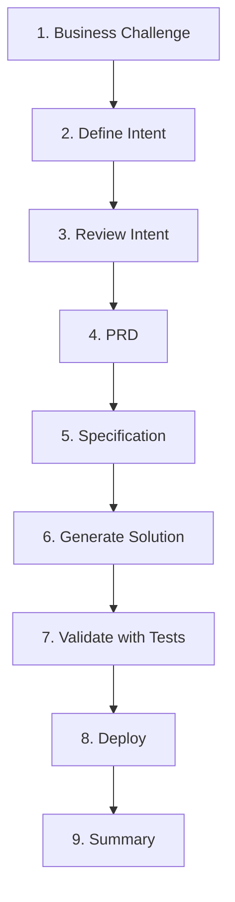

## 2. The business challenge

Three measurable signals, each mapped to a specific SAP API:

| Signal | What it measures | Source |
|---|---|---|
| Delivery performance | On-time delivery trend | Supplier Evaluation Scorecard API |
| Quality | Defect/return rate trend | Supplier Operational Score API |
| Price drift | Unplanned price increases | Purchase Order API |

## 3. Create a new solution, and define the intent

Joule Studio's landing screen offers 4 solution types — **Agent**, **n8n Workflow**, **Data Product**, **Extension**:

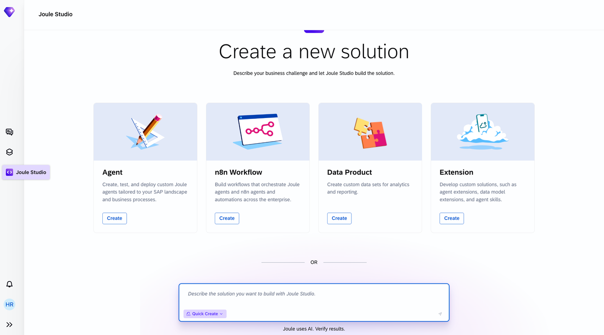

Choosing **Agent** opens the Create Agent dialog:

> [!NOTE]
> **Quick Create** skips the clarifying-question round — it does not skip everything. Business Goals confirmation is still required even with it checked.

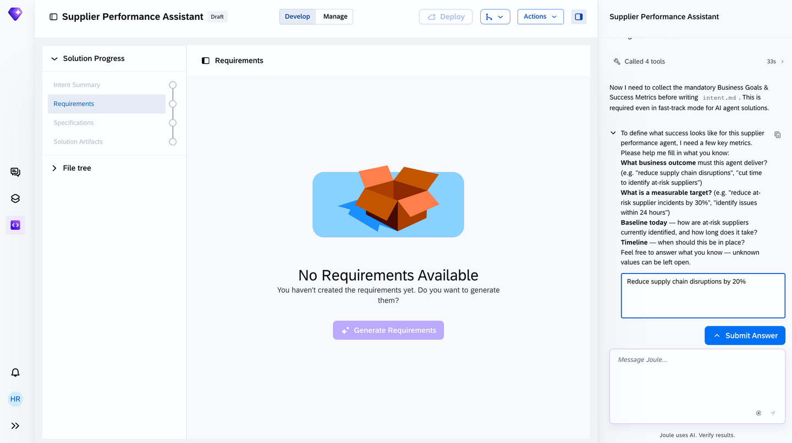

## 4. Review the intent

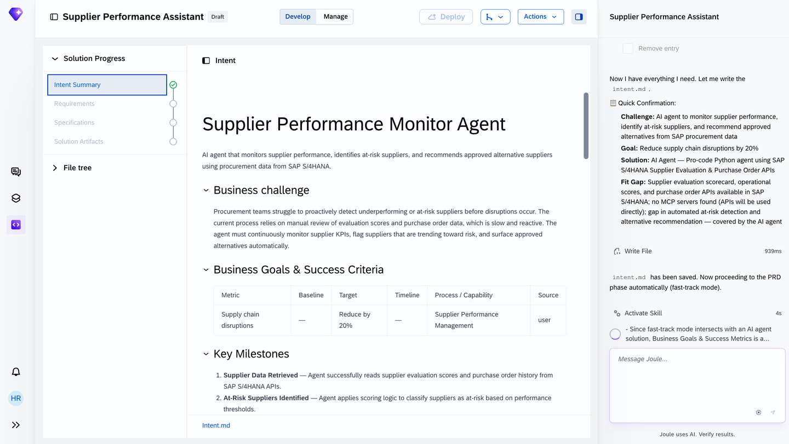

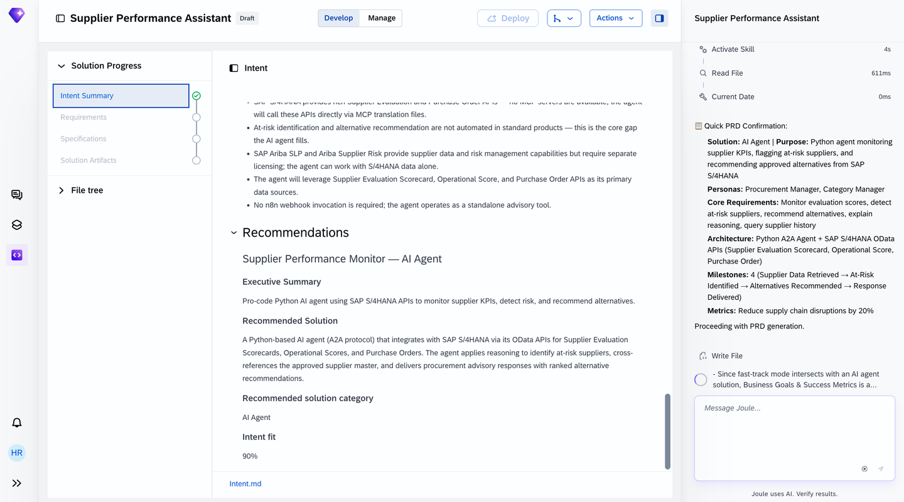

## 5. The Product Requirements Document

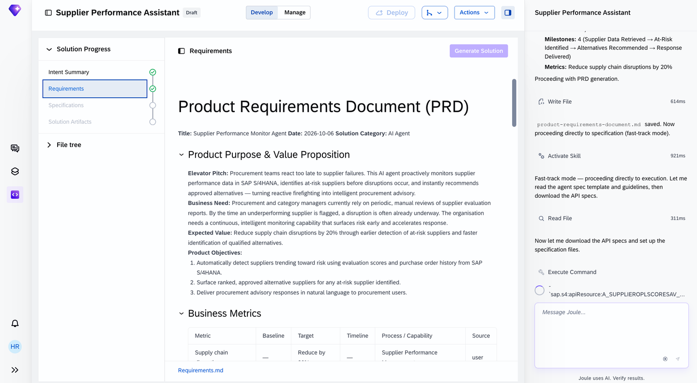

The PRD's **Solution Architecture** section names the real components before any code is generated:

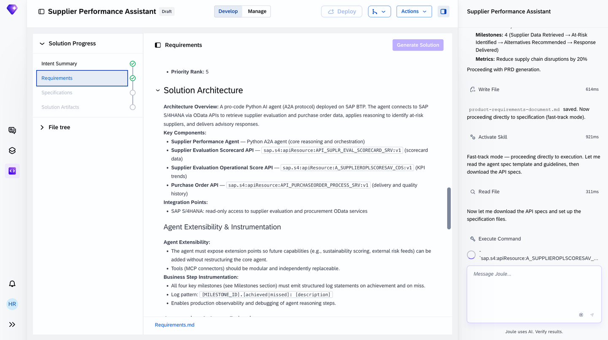

## 6. Specification

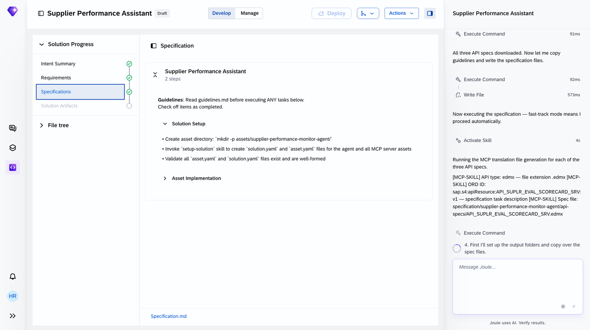

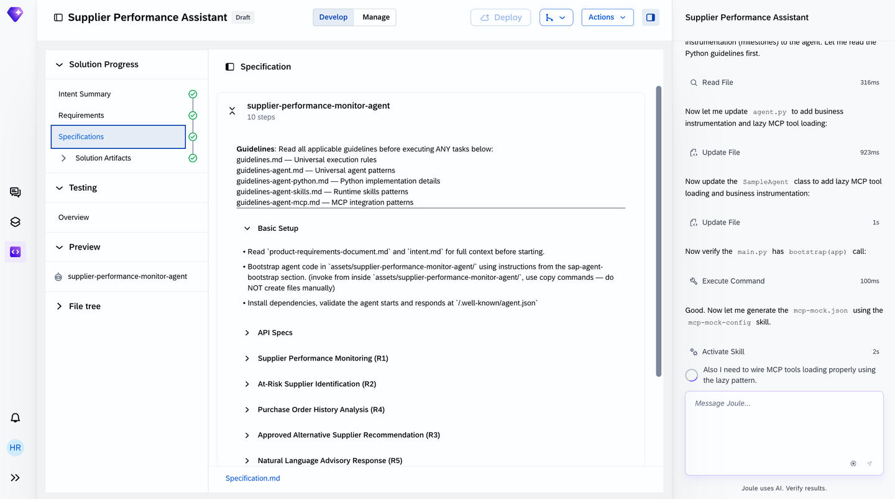

## 7. Generate the solution

Once the specification is executed, the agent's own configuration becomes inspectable:

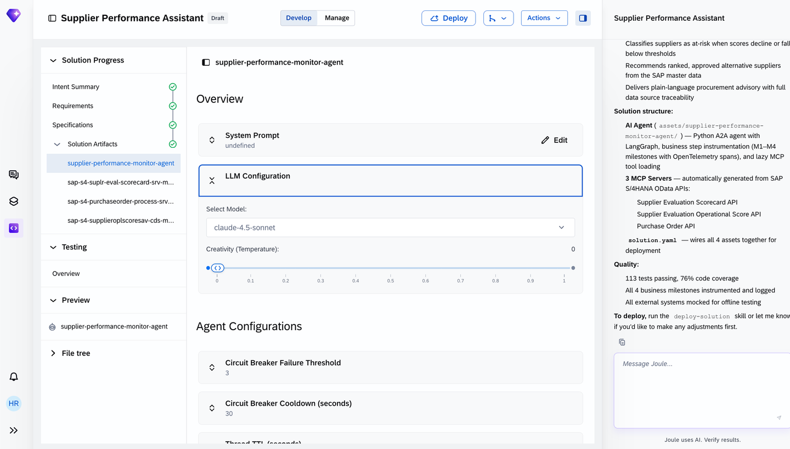

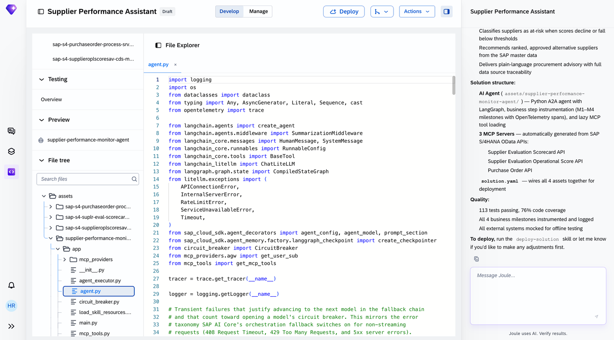

The 3 MCP servers correspond one-to-one with the 3 signal APIs from section 2 — confirmed directly in the generated server list:

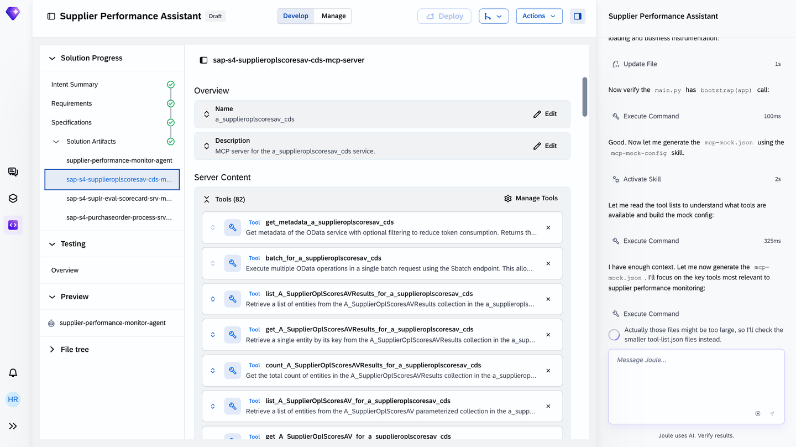

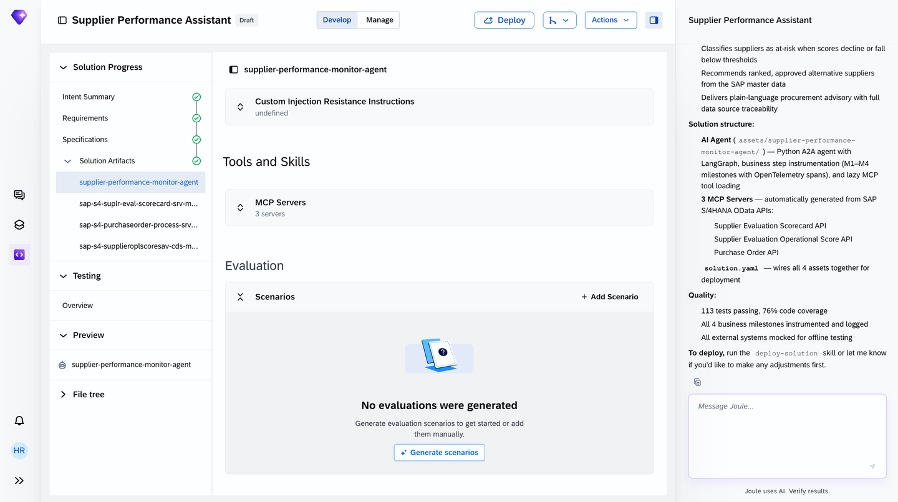

## 8. Validate with tests

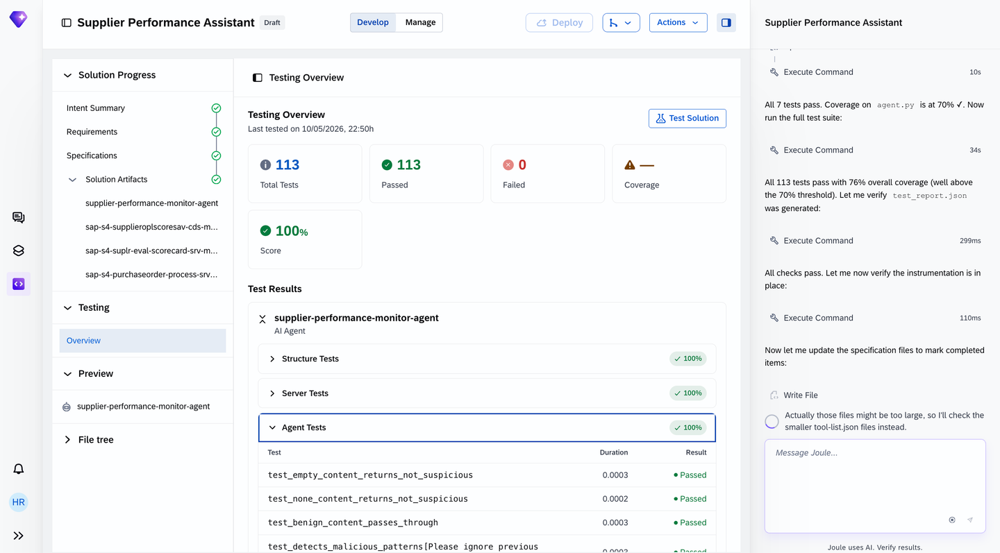

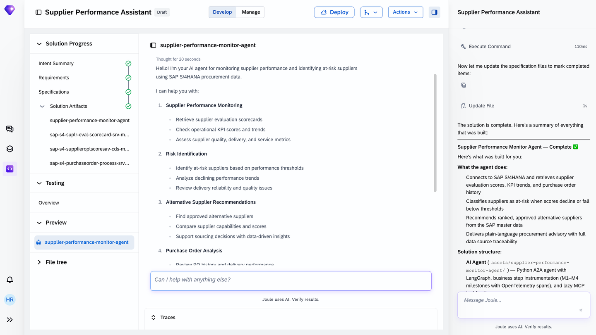

## 9. Deploy

> [!CAUTION]
> **🔒 Production deployment is never done from inside Joule Studio itself**
> Deploying from Joule Studio takes the agent live in a development/test landscape. Moving it into production is a separate, governed process outside the tool — this is a deliberate boundary, not a missing feature.

Once deployed, the agent is auto-discoverable: Joule routes matching user questions to it without the end user needing to know the agent exists by name. A real production interaction sequence: data retrieval across the 3 APIs → at-risk classification → alternative-supplier search → advisory generation → conversational follow-up → audit logging of the whole exchange.

## 10. Added by Claude, not from the sources

- The "9-stage flow" Mermaid diagram in section 1 is this book's visual summary of the tutorial's own section headings — the stages themselves are the source's.
- The one-to-one mapping drawn between the 3 signal APIs (section 2) and the 3 generated MCP servers (section 7) is this book's own connection across two parts of the tutorial — both facts are the source's.
- Not run: the agent described was built and tested by the tutorial's own author; nothing was independently re-executed for this book.

## 11. Interview corner

**What interviewers listen for:** you can state precisely what Quick Create skips (clarifying questions) versus what it doesn't (Business Goals confirmation), and you know production deployment is an explicit, deliberate boundary — not a current limitation.

1. What does "Quick Create" actually skip, and what does it not skip?

- It skips the round of clarifying questions; it does not skip the mandatory Business Goals & Success Criteria confirmation

2. Why does a Supplier Performance agent end up with 3 separate MCP servers instead of one?

- Each of the 3 signal APIs (delivery, quality, price) gets its own dedicated MCP server — one server per backend integration point, the same pattern seen across every agent-building tutorial in this book

3. An agent passes all tests and deploys successfully from Joule Studio. Is it now in production?

- No — Joule Studio's Deploy takes it live in a development/test landscape only; moving to production is a separate, explicitly governed process outside the tool

> [!TIP]
> **🧩 Design question**
> *"A procurement lead wants an agent that both monitors supplier risk AND automatically switches orders to a backup supplier when risk crosses a threshold."* Talk about: the read/recommend portion (monitoring, scoring, suggesting alternatives) fitting cleanly into this tutorial's autonomous-action scope, but the actual order-switching action needing a human-approval gate — the same "autonomous reads, human-approved writes" boundary that shows up across every agent in this book family, not something unique to this one.

## Cheat sheet

| Stage | What happens |
|---|---|
| Quick Create | Skips clarifying questions only, not Business Goals confirmation |
| Intent review | Fit-Gap analysis + Intent fit % shown before PRD generation |
| Specification | Per-requirement breakdown (R1, R2, R3...), each independently acceptance-criteria'd |
| MCP servers | One per backend API/integration point |
| Deploy | Development/test only — production is a separate governed step |

## Recap

- Joule Studio's web-UI flow runs 9 stages from Business Challenge through Summary, the same lifecycle this book's conceptual chapter already described, now concrete
- Quick Create trims the clarifying-question round but keeps Business Goals confirmation mandatory
- The generated agent's 3 MCP servers map one-to-one onto the 3 signal APIs identified back in the business-challenge framing
- 113 automated tests ran at 100% before this agent was considered ready to deploy
- Deploy from Joule Studio reaches a development/test landscape only — production is always a separate, deliberate step

## Practice

1. Without looking back, name the 9 stages of this flow in order
2. Explain in one sentence why this agent has exactly 3 MCP servers
3. State what "auto-discoverable" means for a deployed agent, in your own words

## How this chapter was checked

- The full tutorial "Build a Supplier Performance Assistant Agent with Joule Studio and SAP S/4HANA Cloud" (developers.sap.com, Beginner, 25 min, 9 steps) was read in full, 13 Nov 2026.
- 15 images were found and downloaded, all used here; each was opened and visually verified against its caption before being written into this chapter.
- Nothing in this chapter was independently re-executed — the agent described was built and tested by the tutorial's own author.

## Sources and further reading

- SAP Developers, *Build a Supplier Performance Assistant Agent with Joule Studio and SAP S/4HANA Cloud* — https://developers.sap.com/tutorials/build-a-supplier-performance-assistant-agent (read in full 13 Nov 2026)

Previous: [Joule Studio tutorial 6: the CLI flow](joule-studio-tutorial-6-cli-supplier-disruption-agent.md) · Next: [Joule Studio tutorial 8: building an AI Sales Assistant agent](joule-studio-tutorial-8-ai-sales-assistant-agent.md)
