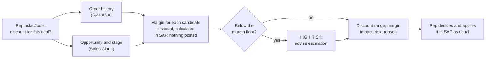

# Tutorial notes: Build an AI sales assistant for discount decisions

*Build a read-only agent that combines a customer's order history and margins from SAP S/4HANA Cloud with the open deal in SAP Sales Cloud, and tells the sales rep what discount range is safe, with the margin impact, the risk and the reason. My notes on SAP's 25-minute lab, with a link to SAP's screens at every step.*

> [!NOTE]
> **📍 At a glance**
> - **SAP's tutorial:** [Build an AI Sales Assistant Agent with Joule Studio, SAP Sales Cloud, and SAP S/4HANA Cloud](https://developers.sap.com/tutorials/build-an-ai-sales-assistant-agent) by Rebecca Yang · about 25 min · beginner · SAP runs it on a pre-release Joule Studio
> - **About this page:** *Added by Claude.* Written in my own words from SAP's tutorial, whose text and images may not be copied ([its licence](https://github.com/sap-tutorials/joule-studio/blob/main/LICENSE.txt)). The screen map is my own sketch; each step links to SAP's real screens.
> - **You need:**
>   - Joule Studio
>   - SAP S/4HANA Cloud: sales order history (Sales Order API), pricing and margin data (Pricing Conditions or Sales Order Simulation API)
>   - SAP Sales Cloud: open opportunities, deal stage and forecast (Opportunity API)
>   - some opportunity-to-order knowledge
> - **Builds on:** [The new Joule Studio](joule-studio-intent-based.md) (chapter 4), [the supplier performance notes](notes-supplier-performance-assistant-agent.md) (chapter 36, the same flow)
> - **Last checked:** 22 Nov 2026

**After this tutorial you can:**

- Write a two-sentence intent for an agent that spans two SAP systems
- Check a recommendation agent's guardrails: no writes, a margin floor, partial data, prompt injection
- Fix the two most likely test failures and read the reasoning in Traces

## 37.1 What you build

A discount adviser for the moment of negotiation. Today the rep combines order history (S/4HANA), the pipeline (Sales Cloud) and margin targets (S/4HANA pricing) in their head, sees the margin effect only after the order is posted, writes down no reason, and every rep discounts differently.

| Situation | The rep's question | What the agent uses |
|---|---|---|
| Repeat customer | How to keep margin without losing a safe deal | Order history and current margin from S/4HANA |
| New prospect asking for a big discount | How much margin to give up to win the first deal | The opportunity in Sales Cloud, plus the margin floor |
| Strategic account, mid-deal | Whether to concede without stalling the deal | All of it: history, pipeline and margin |

**Screen map: the Joule Studio workspace** *(my own sketch of the layout, not SAP's screenshot; numbers are SAP's steps)*

<svg viewBox="0 0 760 440" role="img" aria-label="Screen map of the Joule Studio workspace: icon rail, top bar with Develop and Manage tabs and Deploy, Solution Progress panel on the left, document view in the middle, Joule chat on the right" style="width:100%;height:auto;max-width:760px;font-family:inherit">
<rect x="1" y="1" width="758" height="438" rx="10" style="fill:var(--surface);stroke:var(--line);stroke-width:1.5"/>
<rect x="1" y="1" width="36" height="438" rx="10" style="fill:var(--code-bg);stroke:var(--line)"/>
<circle cx="19" cy="30" r="7" style="fill:var(--line)"/><circle cx="19" cy="62" r="7" style="fill:var(--line)"/><rect x="10" y="85" width="18" height="18" rx="4" style="fill:var(--accent)"/><circle cx="19" cy="126" r="7" style="fill:var(--line)"/>
<line x1="37" y1="46" x2="759" y2="46" style="stroke:var(--line)"/>
<text x="48" y="29" style="fill:var(--ink);font-size:13px;font-weight:600">AI Sales Assistant</text>
<rect x="174" y="16" width="34" height="16" rx="4" style="fill:var(--code-bg)"/><text x="180" y="28" style="fill:var(--muted);font-size:10px">Draft</text>
<rect x="398" y="12" width="118" height="24" rx="6" style="fill:var(--code-bg);stroke:var(--line)"/>
<rect x="400" y="14" width="56" height="20" rx="5" style="fill:var(--accent-soft)"/><text x="409" y="28" style="fill:var(--accent);font-size:11px;font-weight:600">Develop</text><text x="466" y="28" style="fill:var(--ink);font-size:11px">Manage</text>
<rect x="560" y="12" width="66" height="24" rx="6" style="fill:none;stroke:var(--accent)"/><text x="574" y="28" style="fill:var(--accent);font-size:11px;font-weight:600">Deploy</text>
<rect x="634" y="12" width="72" height="24" rx="6" style="fill:none;stroke:var(--line)"/><text x="645" y="28" style="fill:var(--ink);font-size:11px">Actions ▾</text>
<rect x="716" y="14" width="22" height="20" rx="4" style="fill:none;stroke:var(--line)"/>
<rect x="44" y="54" width="176" height="378" rx="6" style="fill:none;stroke:var(--line)"/>
<text x="54" y="74" style="fill:var(--ink);font-size:12px;font-weight:600">▾ Solution Progress</text>
<text x="62" y="98" style="fill:var(--ink);font-size:11px">Intent Summary</text><text x="200" y="98" style="fill:var(--accent);font-size:11px">✓</text>
<text x="62" y="120" style="fill:var(--ink);font-size:11px">Requirements</text><text x="200" y="120" style="fill:var(--accent);font-size:11px">✓</text>
<text x="62" y="142" style="fill:var(--ink);font-size:11px">Specification</text><text x="200" y="142" style="fill:var(--accent);font-size:11px">✓</text>
<text x="62" y="164" style="fill:var(--ink);font-size:11px">▾ Solution Artifacts</text>
<text x="76" y="184" style="fill:var(--muted);font-size:10.5px">the agent</text><text x="76" y="202" style="fill:var(--muted);font-size:10.5px">MCP servers / tools</text>
<line x1="52" y1="216" x2="212" y2="216" style="stroke:var(--line)"/>
<text x="54" y="236" style="fill:var(--ink);font-size:12px;font-weight:600">▾ Testing</text><text x="62" y="256" style="fill:var(--ink);font-size:11px">Overview</text>
<line x1="52" y1="270" x2="212" y2="270" style="stroke:var(--line)"/>
<text x="54" y="290" style="fill:var(--ink);font-size:12px;font-weight:600">▾ Preview</text><text x="62" y="310" style="fill:var(--ink);font-size:11px">the agent (chat test)</text>
<line x1="52" y1="324" x2="212" y2="324" style="stroke:var(--line)"/>
<text x="54" y="344" style="fill:var(--ink);font-size:12px;font-weight:600">▸ File tree</text><text x="62" y="364" style="fill:var(--muted);font-size:10.5px">intent.md, assets/,</text><text x="62" y="380" style="fill:var(--muted);font-size:10.5px">Python code, deploy_result</text>
<rect x="228" y="54" width="288" height="378" rx="6" style="fill:none;stroke:var(--line)"/>
<text x="240" y="74" style="fill:var(--ink);font-size:12px;font-weight:600">Document view</text>
<text x="240" y="96" style="fill:var(--muted);font-size:10.5px">Shows what you pick on the left:</text>
<text x="240" y="112" style="fill:var(--muted);font-size:10.5px">intent summary, PRD, specification,</text>
<text x="240" y="128" style="fill:var(--muted);font-size:10.5px">agent definition, test results</text>
<rect x="240" y="146" width="250" height="8" rx="3" style="fill:var(--line)"/><rect x="240" y="164" width="210" height="8" rx="3" style="fill:var(--line)"/><rect x="240" y="182" width="232" height="8" rx="3" style="fill:var(--line)"/>
<rect x="240" y="206" width="264" height="26" rx="4" style="fill:none;stroke:var(--line)"/><text x="250" y="223" style="fill:var(--ink);font-size:10.5px">▸ section</text>
<rect x="240" y="238" width="264" height="26" rx="4" style="fill:none;stroke:var(--line)"/><text x="250" y="255" style="fill:var(--ink);font-size:10.5px">▸ section</text>
<rect x="240" y="270" width="264" height="26" rx="4" style="fill:none;stroke:var(--line)"/><text x="250" y="287" style="fill:var(--ink);font-size:10.5px">▸ section</text>
<rect x="524" y="54" width="228" height="378" rx="6" style="fill:none;stroke:var(--line)"/>
<text x="536" y="74" style="fill:var(--ink);font-size:12px;font-weight:600">Joule chat</text>
<text x="536" y="96" style="fill:var(--muted);font-size:10.5px">Progress messages and summaries</text>
<rect x="536" y="108" width="200" height="40" rx="6" style="fill:var(--code-bg)"/><rect x="546" y="118" width="150" height="7" rx="3" style="fill:var(--line)"/><rect x="546" y="132" width="110" height="7" rx="3" style="fill:var(--line)"/>
<rect x="536" y="156" width="200" height="56" rx="6" style="fill:var(--code-bg)"/><rect x="546" y="166" width="170" height="7" rx="3" style="fill:var(--line)"/><rect x="546" y="180" width="140" height="7" rx="3" style="fill:var(--line)"/><rect x="546" y="194" width="160" height="7" rx="3" style="fill:var(--line)"/>
<rect x="536" y="384" width="204" height="34" rx="6" style="fill:none;stroke:var(--accent)"/><text x="546" y="405" style="fill:var(--muted);font-size:10.5px">Message Joule…</text>
<g style="font-size:10px;font-weight:700">
<circle cx="31" cy="83" r="8" style="fill:var(--accent);stroke:var(--surface);stroke-width:1.5"/><text x="28" y="87" style="fill:var(--surface);font-size:10px">2</text>
<circle cx="180" cy="94" r="9" style="fill:var(--accent)"/><text x="177" y="98" style="fill:var(--surface);font-size:10px">3</text>
<circle cx="140" cy="340" r="9" style="fill:var(--accent)"/><text x="137" y="344" style="fill:var(--surface);font-size:10px">6</text>
<circle cx="180" cy="116" r="9" style="fill:var(--accent)"/><text x="177" y="120" style="fill:var(--surface);font-size:10px">4</text>
<circle cx="180" cy="138" r="9" style="fill:var(--accent)"/><text x="177" y="142" style="fill:var(--surface);font-size:10px">5</text>
<circle cx="180" cy="160" r="9" style="fill:var(--accent)"/><text x="177" y="164" style="fill:var(--surface);font-size:10px">6</text>
<circle cx="140" cy="252" r="9" style="fill:var(--accent)"/><text x="137" y="256" style="fill:var(--surface);font-size:10px">7</text>
<circle cx="190" cy="306" r="9" style="fill:var(--accent)"/><text x="187" y="310" style="fill:var(--surface);font-size:10px">7</text>
<circle cx="593" cy="50" r="9" style="fill:var(--accent)"/><text x="590" y="54" style="fill:var(--surface);font-size:10px">8</text>
<circle cx="722" cy="401" r="9" style="fill:var(--accent)"/><text x="719" y="405" style="fill:var(--surface);font-size:10px">6</text>
<circle cx="488" cy="50" r="9" style="fill:var(--accent)"/><text x="485" y="54" style="fill:var(--surface);font-size:10px">8</text>
</g>
</svg>

- **2** The `<>` icon (Joule Studio) → *Create a new solution* → **Create** on the *Agent* tile
- **3** Intent Summary · **4** Requirements · **5** Specifications, and the chat's three-phase summary
- **6** The chat (start the build), Solution Artifacts, `agent.py` in the File tree
- **7** Testing → Overview, Preview with Traces · **8** Deploy, **Actions** for GitHub sync, **Manage**

## 37.2 Create the agent with a two-sentence intent (SAP step 2)

- **Screen:** Joule Work → `<>` (Joule Studio) → *Create a new solution* → **Create** on the **Agent** tile.
- **In the dialog:** keep **New Solution** · *Name* `AI Sales Assistant` · *Intent*: copy SAP's text from step 2 (a discount suggestion agent that analyses orders, pipeline and margin targets from Sales Cloud and S/4HANA Cloud and gives reps contextual recommendations).
- **Quick Create** (on by default) runs the whole pipeline; you still confirm the business goals: give at least one measurable goal, such as a margin or win-rate improvement; "no baseline yet" is fine. Keep choosing **Submit Answer**.
- 💡 **Why two sentences are enough:** they name the purpose (discount advice), the systems (Sales Cloud and S/4HANA Cloud), the data (orders, pipeline, margin targets) and the user (sales reps).
- [SAP's screens for step 2 ↗](https://developers.sap.com/tutorials/build-an-ai-sales-assistant-agent#step-2)

## 37.3 Check intent, milestones and fit (SAP step 3)

- **Screen:** *Solution Progress* → **Intent Summary**.
- **The challenge should say:** reps can't see history, pipeline and margin together, which leads to too much discount (lost margin) or too little (lost deals), and the agent advises at the moment of negotiation.
- **Five milestones** (names vary): connect to the data → assemble the context → produce the recommendation → talk with the rep → track the outcome. They become the test groups.
- **Fit-gap:** Sales Cloud and S/4HANA cover the data (fit); the reasoning that combines them is new (gap); *where exactly margin targets live* (pricing conditions or planning data) is settled during the specification.
- **Intent fit** of about 80% or more is good; lower means a missing element (purpose, systems, data or user).
- [SAP's screens for step 3 ↗](https://developers.sap.com/tutorials/build-an-ai-sales-assistant-agent#step-3)

## 37.4 Review the requirements (SAP step 4)

- **Screen:** *Solution Progress* → **Requirements**. Users: sales reps and managers. Check the business metric you gave is in *Business Metrics*.
- **Must-haves:** order history, pipeline data, margin reasoning, the recommendation, and chat-style refinement.
- **The boundaries to confirm:**

| Runs alone | Guardrails | Human decision |
|---|---|---|
| Read orders and opportunities; calculate margin in SAP; combine; recommend with reasons | No writes to SAP (no quotations, prices or master data) · margin below the floor → HIGH RISK, advise escalation · carry on with partial data and say so · detect and block prompt injection | The rep decides whether to apply the discount |

- [SAP's screens for step 4 ↗](https://developers.sap.com/tutorials/build-an-ai-sales-assistant-agent#step-4)

## 37.5 Look at the specification (SAP step 5)

- **Screen:** *Solution Progress* → **Specifications**: *Solution Setup*, then *Asset Implementation*.
- **The chat summary** maps the case to SAP's Lead to Cash process (sales planning and performance). No ready-made MCP servers exist for these APIs, so Joule Studio generates them from the API specs (downloaded as EDMX).
- **MCP servers** (usually 2 to 4, read-only): sales orders (S/4HANA), pricing or margin (Pricing Conditions *or* Sales Order Simulation, depending on the run), opportunities (Sales Cloud).
- [SAP's screens for step 5 ↗](https://developers.sap.com/tutorials/build-an-ai-sales-assistant-agent#step-5)

## 37.6 Build the solution (SAP step 6)

- **In *Message Joule*:** `execute specification/specification.md` (or "Build the solution"); ask "What is the status?" if it stalls.
- **Screen:** *Solution Artifacts* → the agent: *LLM Configuration* (a low creativity setting, so the same input gives the same advice) and *Agent Configurations*. Code: *File tree* → `assets` → agent → `app` → `agent.py`.
- **MCP Servers** show typed tools generated from each OData spec. **Evaluation → Generate scenarios** creates a first set.
- [SAP's screens for step 6 ↗](https://developers.sap.com/tutorials/build-an-ai-sales-assistant-agent#step-6)

## 37.7 Test and preview (SAP step 7)

- **Tests run by themselves:** content safety, prompt-injection resistance, each server's tools, and the full read → reason → recommend path.
- **When tests fail:**

| Failing tests | What to check |
|---|---|
| Prompt-injection resistance | The agent's *Custom Injection Resistance Instructions* field may block a harmless test input: narrow the pattern or extend the harmless test cases |
| The pricing or margin server's tools | It depends more on pricing setup than the other reads: the destination must point to a tenant with pricing conditions for the test customer, and the user needs pricing/simulation rights |

- **Preview → the agent:** ask for a discount strategy for SAP's demo customer *Best Run SAP Company*. The **Traces** tab shows the tools called, the data returned and the reasoning.
- [SAP's screens for step 7 ↗](https://developers.sap.com/tutorials/build-an-ai-sales-assistant-agent#step-7)

## 37.8 Deploy to development (SAP step 8)

- **Screen:** **Deploy** in the top bar, then **Deploy** in the dialog; `deploy_result.json` gets the endpoint and runtime ID. **GitHub sync** is under **Actions**; production isn't deployed from Joule Studio.
- **In use:** a rep asks Joule what discount to offer on a deal, and Joule routes it here. The agent reads the sources (carrying on if one fails), calculates the margin for each candidate discount in SAP without posting, classifies the risk, and answers with a range, the margin impact, the risk and the reason. A new percentage in a follow-up triggers a fresh margin calculation. Everything is logged; applying the discount stays the rep's job.
- **Monitor** it under **Manage**.
- [SAP's screens for step 8 ↗](https://developers.sap.com/tutorials/build-an-ai-sales-assistant-agent#step-8)

## 37.9 Pitfalls

- **Pricing must be maintained** for the test customer, or the margin server's tests fail.
- **The injection guard can be too strict** and block harmless input; tune it, don't switch it off.
- **Which pricing API you get varies** between runs (conditions or simulation); both are fine.

> [!TIP]
> **Before a real rollout** *(Added by Claude)*
> - Agree the margin floor per product group with sales management; it decides when advice turns HIGH RISK.
> - Keep the low creativity setting: reps and managers must get the same answer for the same deal.

## Check yourself

Does the agent ever write the discount to SAP?

- No. It calculates the margin in SAP without posting; the rep applies any discount through normal SAP steps

When is a recommendation flagged HIGH RISK?

- When the projected margin after the discount falls below the configured margin floor; it then advises escalation

Why does the agent use a low creativity setting?

- So the same inputs always give the same recommendation, which makes it reproducible and auditable

## How this page was checked

- **SAP's tutorial read in full on 22 Nov 2026:** all nine steps, on developers.sap.com.
- **Written in my own words.** Nothing copied from SAP's text or screenshots; the agent name and chat command are given exactly because you type them.
- **Screen map:** my simplified sketch of the Joule Studio workspace, drawn after viewing SAP's screenshots; not a copy.
- **Not built here:** no Joule Studio tenant in this workspace.

## Sources

- SAP Developer Center tutorial: https://developers.sap.com/tutorials/build-an-ai-sales-assistant-agent
- Its licence: https://github.com/sap-tutorials/joule-studio/blob/main/LICENSE.txt

Previous: [Tutorial notes: Build a supplier performance assistant with Joule Studio](notes-supplier-performance-assistant-agent.md) · Next: [Tutorial notes: Build a performance and goals recommendations agent](notes-performance-goals-recommendations-agent.md)
