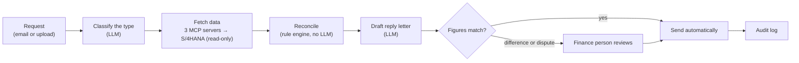

# Tutorial notes: Automate balance confirmations with a custom Joule agent

*Build an agent in the new Joule Studio that reads balance confirmation requests, checks them against SAP S/4HANA Cloud and drafts the reply letter. My notes on SAP's 30-minute lab, with a link to SAP's screens at every step.*

> [!NOTE]
> **📍 At a glance**
> - **SAP's tutorial:** [Automate Balance Confirmation Workflows in Financial Accounting with a Custom Joule Agent](https://developers.sap.com/tutorials/balance-confirmation-agent) by Samir Hamichi · about 30 min · beginner · SAP runs it on a pre-release Joule Studio
> - **About this page:** *Added by Claude.* Written in my own words from SAP's tutorial, whose text and images may not be copied ([its licence](https://github.com/sap-tutorials/joule-studio/blob/main/LICENSE.txt)). SAP's screenshots stay on SAP's page: each step below ends with a link that opens SAP's page at that step.
> - **You need:**
>   - the new Joule Studio on an SAP BTP tenant
>   - an SAP S/4HANA Cloud system with business partners, GL accounts and accounting documents
>   - basic FI period-end knowledge
> - **Builds on:** [The new Joule Studio](joule-studio-intent-based.md) (chapter 4)
> - **Last checked:** 21 Nov 2026

**After this tutorial you can:**

- Tell whether a Finance process is a good fit for an agent
- Take an idea through all of Joule Studio's phases: intent, requirements, specification, solution, testing, deployment
- Read what the generated requirements decide: how much runs without a human, what the LLM may do, and the guardrails

## 26.1 What you build

An agent that answers **balance confirmation requests**: a customer or vendor asks the company to confirm what is open between them on a given date.

| Request type | What the partner wants |
|---|---|
| Verification | "Here is our balance. Confirm it against your books." |
| Balance list | "Send us your full list of open items as of this date." |
| Exceptions only | "Reply only if your figures differ from ours." |

**Screen map: the Joule Studio workspace** *(my own sketch of the layout, not SAP's screenshot; numbers are SAP's steps)*

<svg viewBox="0 0 760 440" role="img" aria-label="Screen map of the Joule Studio workspace: icon rail, top bar with Develop and Manage tabs and Deploy, Solution Progress panel on the left, document view in the middle, Joule chat on the right" style="width:100%;height:auto;max-width:760px;font-family:inherit">
<rect x="1" y="1" width="758" height="438" rx="10" style="fill:var(--surface);stroke:var(--line);stroke-width:1.5"/>
<rect x="1" y="1" width="36" height="438" rx="10" style="fill:var(--code-bg);stroke:var(--line)"/>
<circle cx="19" cy="30" r="7" style="fill:var(--line)"/><circle cx="19" cy="62" r="7" style="fill:var(--line)"/><rect x="10" y="85" width="18" height="18" rx="4" style="fill:var(--accent)"/><circle cx="19" cy="126" r="7" style="fill:var(--line)"/>
<line x1="37" y1="46" x2="759" y2="46" style="stroke:var(--line)"/>
<text x="48" y="29" style="fill:var(--ink);font-size:13px;font-weight:600">Automated Processing of Balance Confirmations</text>
<rect x="352" y="16" width="34" height="16" rx="4" style="fill:var(--code-bg)"/><text x="358" y="28" style="fill:var(--muted);font-size:10px">Draft</text>
<rect x="398" y="12" width="118" height="24" rx="6" style="fill:var(--code-bg);stroke:var(--line)"/>
<rect x="400" y="14" width="56" height="20" rx="5" style="fill:var(--accent-soft)"/><text x="409" y="28" style="fill:var(--accent);font-size:11px;font-weight:600">Develop</text><text x="466" y="28" style="fill:var(--ink);font-size:11px">Manage</text>
<rect x="560" y="12" width="66" height="24" rx="6" style="fill:none;stroke:var(--accent)"/><text x="574" y="28" style="fill:var(--accent);font-size:11px;font-weight:600">Deploy</text>
<rect x="634" y="12" width="72" height="24" rx="6" style="fill:none;stroke:var(--line)"/><text x="645" y="28" style="fill:var(--ink);font-size:11px">Actions ▾</text>
<rect x="716" y="14" width="22" height="20" rx="4" style="fill:none;stroke:var(--line)"/>
<rect x="44" y="54" width="176" height="378" rx="6" style="fill:none;stroke:var(--line)"/>
<text x="54" y="74" style="fill:var(--ink);font-size:12px;font-weight:600">▾ Solution Progress</text>
<text x="62" y="98" style="fill:var(--ink);font-size:11px">Intent Summary</text><text x="200" y="98" style="fill:var(--accent);font-size:11px">✓</text>
<text x="62" y="120" style="fill:var(--ink);font-size:11px">Requirements</text><text x="200" y="120" style="fill:var(--accent);font-size:11px">✓</text>
<text x="62" y="142" style="fill:var(--ink);font-size:11px">Specification</text><text x="200" y="142" style="fill:var(--accent);font-size:11px">✓</text>
<text x="62" y="164" style="fill:var(--ink);font-size:11px">▾ Solution Artifacts</text>
<text x="76" y="184" style="fill:var(--muted);font-size:10.5px">the agent</text><text x="76" y="202" style="fill:var(--muted);font-size:10.5px">3 × MCP servers</text>
<line x1="52" y1="216" x2="212" y2="216" style="stroke:var(--line)"/>
<text x="54" y="236" style="fill:var(--ink);font-size:12px;font-weight:600">▾ Testing</text><text x="62" y="256" style="fill:var(--ink);font-size:11px">Overview</text>
<line x1="52" y1="270" x2="212" y2="270" style="stroke:var(--line)"/>
<text x="54" y="290" style="fill:var(--ink);font-size:12px;font-weight:600">▾ Preview</text><text x="62" y="310" style="fill:var(--ink);font-size:11px">the agent (chat test)</text>
<line x1="52" y1="324" x2="212" y2="324" style="stroke:var(--line)"/>
<text x="54" y="344" style="fill:var(--ink);font-size:12px;font-weight:600">▸ File tree</text><text x="62" y="364" style="fill:var(--muted);font-size:10.5px">intent.md, assets/,</text><text x="62" y="380" style="fill:var(--muted);font-size:10.5px">Python code, deploy_result</text>
<rect x="228" y="54" width="288" height="378" rx="6" style="fill:none;stroke:var(--line)"/>
<text x="240" y="74" style="fill:var(--ink);font-size:12px;font-weight:600">Document view</text>
<text x="240" y="96" style="fill:var(--muted);font-size:10.5px">Shows what you pick on the left:</text>
<text x="240" y="112" style="fill:var(--muted);font-size:10.5px">intent summary, PRD, specification,</text>
<text x="240" y="128" style="fill:var(--muted);font-size:10.5px">agent definition, test results</text>
<rect x="240" y="146" width="250" height="8" rx="3" style="fill:var(--line)"/><rect x="240" y="164" width="210" height="8" rx="3" style="fill:var(--line)"/><rect x="240" y="182" width="232" height="8" rx="3" style="fill:var(--line)"/>
<rect x="240" y="206" width="264" height="26" rx="4" style="fill:none;stroke:var(--line)"/><text x="250" y="223" style="fill:var(--ink);font-size:10.5px">▸ section</text>
<rect x="240" y="238" width="264" height="26" rx="4" style="fill:none;stroke:var(--line)"/><text x="250" y="255" style="fill:var(--ink);font-size:10.5px">▸ section</text>
<rect x="240" y="270" width="264" height="26" rx="4" style="fill:none;stroke:var(--line)"/><text x="250" y="287" style="fill:var(--ink);font-size:10.5px">▸ section</text>
<rect x="524" y="54" width="228" height="378" rx="6" style="fill:none;stroke:var(--line)"/>
<text x="536" y="74" style="fill:var(--ink);font-size:12px;font-weight:600">Joule chat</text>
<text x="536" y="96" style="fill:var(--muted);font-size:10.5px">Progress messages and summaries</text>
<rect x="536" y="108" width="200" height="40" rx="6" style="fill:var(--code-bg)"/><rect x="546" y="118" width="150" height="7" rx="3" style="fill:var(--line)"/><rect x="546" y="132" width="110" height="7" rx="3" style="fill:var(--line)"/>
<rect x="536" y="156" width="200" height="56" rx="6" style="fill:var(--code-bg)"/><rect x="546" y="166" width="170" height="7" rx="3" style="fill:var(--line)"/><rect x="546" y="180" width="140" height="7" rx="3" style="fill:var(--line)"/><rect x="546" y="194" width="160" height="7" rx="3" style="fill:var(--line)"/>
<rect x="536" y="384" width="204" height="34" rx="6" style="fill:none;stroke:var(--accent)"/><text x="546" y="405" style="fill:var(--muted);font-size:10.5px">Message Joule…</text>
<g style="font-size:10px;font-weight:700">
<circle cx="31" cy="83" r="8" style="fill:var(--accent);stroke:var(--surface);stroke-width:1.5"/><text x="28" y="87" style="fill:var(--surface)">2</text>
<circle cx="180" cy="94" r="9" style="fill:var(--accent)"/><text x="177" y="98" style="fill:var(--surface)">3</text>
<circle cx="180" cy="116" r="9" style="fill:var(--accent)"/><text x="177" y="120" style="fill:var(--surface)">4</text>
<circle cx="180" cy="138" r="9" style="fill:var(--accent)"/><text x="177" y="142" style="fill:var(--surface)">5</text>
<circle cx="180" cy="160" r="9" style="fill:var(--accent)"/><text x="177" y="164" style="fill:var(--surface)">6</text>
<circle cx="140" cy="252" r="9" style="fill:var(--accent)"/><text x="137" y="256" style="fill:var(--surface)">7</text>
<circle cx="190" cy="306" r="9" style="fill:var(--accent)"/><text x="187" y="310" style="fill:var(--surface)">7</text>
<circle cx="140" cy="340" r="9" style="fill:var(--accent)"/><text x="137" y="344" style="fill:var(--surface)">3</text>
<circle cx="722" cy="401" r="9" style="fill:var(--accent)"/><text x="719" y="405" style="fill:var(--surface)">6</text>
<circle cx="593" cy="50" r="9" style="fill:var(--accent)"/><text x="590" y="54" style="fill:var(--surface)">8</text>
<circle cx="488" cy="50" r="9" style="fill:var(--accent)"/><text x="485" y="54" style="fill:var(--surface)">8</text>
</g>
</svg>

- **3** Intent Summary, and `intent.md` in the File tree · **4** Requirements (the PRD) · **5** Specification
- **6** Solution Artifacts (agent, MCP servers) and the chat, where you type `execute specification` if the build stalls
- **7** Testing → Overview, and Preview to chat with the agent · **8** Deploy (top right), then the Manage tab to monitor it
- **2** The Joule Studio icon in the left rail. Step 2 itself happens before this screen: **Create** on the Joule Studio start page opens the Create Agent dialog.

**Why this process suits an agent** (SAP's four tests):

- It starts from a predictable event (a request arrives)
- It needs live S/4HANA data
- The checking logic is fixed rules, not judgement
- The output must be professional and traceable

Today the work is manual: switching between mail, SAP and a word processor, slow look-ups at period-end, letters that vary in wording, a patchy audit trail, and partners chasing late replies.

## 26.2 Create the agent and write the intent (SAP step 2)

- **Screen:** *Joule Work → Joule Studio* (left navigation) → **Create**. If you already have a project, use **+ New** in the *Solutions* panel.
- **In the Create Agent dialog:**
  - *Solution:* **New Solution**
  - *Name:* `Automated Processing of Balance Confirmations`
  - *Intent statement:* copy SAP's text from step 2. In short, it asks for an agent that processes incoming balance confirmation requests and produces compliant reply letters, to cut processing time and follow-up questions and make the communication traceable.
  - Tick **Quick Create** to skip the clarifying questions, then **Create**.
- **It still asks about business goals and success criteria** even with Quick Create. Answer them: they shape the success metrics in the requirements.
- **Write the intent as a business outcome, not as technical steps.** Joule Studio designs everything from it. If the result misses your goal, come back and change this text.
- [SAP's screens for step 2 ↗](https://developers.sap.com/tutorials/balance-confirmation-agent#step-2)

## 26.3 Check how Joule understood you (SAP step 3)

- **Screen:** the **Intent Summary** tab. The same content is saved as `intent.md` in the *File tree* panel.
- **Check, in order:**
  - the summary: is the scope what you meant? If not, edit the intent and submit again
  - *Fit Gap Analysis*
  - *Recommended Solution*: expect a Python agent that keeps the reconciliation in a rule engine, separate from the LLM
- ⚠️ SAP's text for this step mentions a "cutting stock algorithm". That belongs to a different lab (the cable roll optimiser); ignore it here.
- [SAP's screens for step 3 ↗](https://developers.sap.com/tutorials/balance-confirmation-agent#step-3)

## 26.4 Read the requirements (SAP step 4)

- **Screen:** *Solution Progress* → **Requirements** (low-code view of the product requirements document, PRD). Wait until it has been generated.
- **What to check in the PRD:**

| Area | What SAP's example decides |
|---|---|
| How much runs alone | Hybrid: exact matches are answered automatically; a difference above the set threshold, or a dispute, goes to a person first |
| What the LLM does | Classifies the request and writes the letter (through the generative AI hub) |
| What the LLM doesn't do | The reconciliation: a fixed rule engine compares the figures |
| Access to S/4HANA | Read-only: business partners, GL account line items, accounting documents |
| Guardrails | Never changes financial data · unsure classification → person · S/4HANA unreachable → queue and tell Finance · every letter checked against a template before sending |
| Architecture | The agent, one MCP server per SAP API, and SAP AI Core for the LLM |

- Your PRD may differ from SAP's. Check that yours matches what you need; the next phase may start on its own.
- [SAP's screens for step 4 ↗](https://developers.sap.com/tutorials/balance-confirmation-agent#step-4)

## 26.5 Look at the specification (SAP step 5)

- **Screen:** *Solution Progress* → **Specification**. Nothing here is written by you; it is all generated from the intent and PRD.
- **Under `assets/` you should find four parts:**
  - the agent itself (rules, prompts, classification, letter writing, routing)
  - an MCP server for the Business Partner API
  - an MCP server for the GL account line items API
  - an MCP server for the accounting documents API
- **Why one MCP server per API:** each server wraps one SAP OData API and presents it to the LLM as tools it can call. That is the usual pattern when an agent needs several SAP APIs.
- [SAP's screens for step 5 ↗](https://developers.sap.com/tutorials/balance-confirmation-agent#step-5)

## 26.6 Generate the solution (SAP step 6)

- **Wait** for the build. If it stops and waits, type `execute specification` in the coding chat.
- **Screen:** *Solution Artifacts* → the agent. The low-code view shows:
  - the LLM it uses (SAP's example: a Claude Sonnet model)
  - agent settings: circuit breaker, thread time-to-live, when to summarise
  - the three MCP servers, already wired up (no configuration needed)
  - an *Evaluation* section that can generate test scenarios from your intent
- **For the Python code,** switch to the *File tree* (pro-code) view.
- ⚠️ SAP's text ends this step with a warning about a "Batch Stock MCP server" and storage locations. That is another leftover from a different lab; this agent has no such server.
- [SAP's screens for step 6 ↗](https://developers.sap.com/tutorials/balance-confirmation-agent#step-6)

## 26.7 Test it (SAP step 7)

- **Testing starts by itself** after the build. Wait for it to finish, then open *Testing* → **Overview**.
- **Check that every test passes** and that the test areas cover your specification. When a test fails, Joule usually fixes it itself; if it gets stuck, ask it in the chat.
- **Quick manual test:** in the *Preview* panel, select the agent and send a request that needs no live data (a partner name, a partner number and "confirm the balance as of today"). The agent answers by describing what it can do.
- ⚠️ This preview does not call S/4HANA, so it doesn't prove the connection works.
- [SAP's screens for step 7 ↗](https://developers.sap.com/tutorials/balance-confirmation-agent#step-7)

## 26.8 Deploy and watch it (SAP step 8)

- **Screen:** **Deploy**, then **Deploy** again to confirm. Joule Studio runs it on SAP's managed service; you set up no infrastructure.
- **Afterwards,** `specification/deploy_result.json` holds the endpoint URL, runtime ID and deployment time.
- **Monitor it** in the **Manage** tab: runtime status, deployments, usage and audit logs.
- [SAP's screens for step 8 ↗](https://developers.sap.com/tutorials/balance-confirmation-agent#step-8)

## 26.9 Pitfalls

- **Pre-release:** SAP's lab uses a pre-release Joule Studio, so screen names may change. The step links always open SAP's current screens.
- **Generated content varies:** your intent summary, PRD and test count can differ from SAP's (SAP reports 42 tests and a 92% intent fit). Judge them against your own goal.
- **Two leftovers in SAP's text** (steps 3 and 6) refer to other labs.

> [!TIP]
> **Before a real rollout** *(Added by Claude)*
> - Give the S/4HANA communication user read access to the three APIs only, matching the read-only guardrail.
> - Agree the discrepancy threshold with the Finance lead; it decides how many letters a person must approve.

## Check yourself

Which parts of this agent use the LLM, and which don't?

- LLM: classifying the request and writing the reply letter
- No LLM: the reconciliation, done by a fixed rule engine on S/4HANA data

When does a reply need a person before it is sent?

- When the difference between the partner's figures and SAP's is above the set threshold
- When the request looks like a dispute, or the classification is unsure

Why does the specification create three MCP servers?

- One per SAP OData API the agent reads: business partners, GL account line items, accounting documents
- Each server turns one API into tools the LLM can call

## How this page was checked

- **SAP's tutorial read in full on 21 Nov 2026:** all nine steps, on developers.sap.com.
- **Written in my own words.** Nothing is copied from SAP's text or screenshots; the agent name is given exactly because you type it.
- **Screen map:** drawn by me on 22 Nov 2026 after viewing SAP's screenshots for steps 3 to 8. It shows only where things are, simplified; it is not a copy of any SAP image.
- **Not built here:** no Joule Studio tenant in this workspace.

## Sources

- SAP Developer Center tutorial: https://developers.sap.com/tutorials/balance-confirmation-agent
- Its licence: https://github.com/sap-tutorials/joule-studio/blob/main/LICENSE.txt

Previous: [Tutorial: Build a Billing Completeness Data Product with Joule Studio](tutorial-joule-studio-bdc-agent-create.md) · Next: [Tutorial notes: Manage budget variances for cost centers with a custom Joule agent](notes-budget-variance-agent.md)
