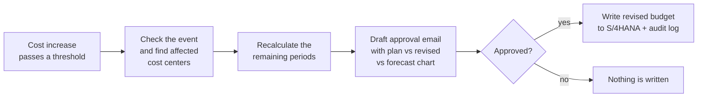

# Tutorial notes: Manage budget variances for cost centers with a custom Joule agent

*Build an agent that spots an unexpected cost increase, finds the cost centers it hits, proposes a revised budget, asks for approval and only then writes the change to SAP S/4HANA Cloud. My notes on SAP's 20-minute lab, with a link to SAP's screens at every step.*

> [!NOTE]
> **📍 At a glance**
> - **SAP's tutorial:** [Automate Budget Variance Management for Cost Centers with a Custom Joule Agent](https://developers.sap.com/tutorials/budget-variance-agent) by Martin Plummer · about 20 min · beginner · SAP runs it on a pre-release Joule Studio
> - **About this page:** *Added by Claude.* Written in my own words from SAP's tutorial, whose text and images may not be copied ([its licence](https://github.com/sap-tutorials/joule-studio/blob/main/LICENSE.txt)). The screen map is my own sketch; each step links to SAP's real screens.
> - **You need:** Joule Studio, and an SAP S/4HANA Cloud system with financial planning data and a cost center hierarchy
> - **Builds on:** [The new Joule Studio](joule-studio-intent-based.md) (chapter 4), [the balance confirmation notes](notes-balance-confirmation-agent.md) (chapter 26)
> - **Last checked:** 22 Nov 2026

**After this tutorial you can:**

- Write an intent statement that covers what the agent does, its data, its decisions and its guardrails
- Check an intent fit score and a PRD for an agent that **writes** to SAP, not just reads
- Deploy an agent to the development landscape and know how users then reach it

## 27.1 What you build

An agent for the moment a cost shock hits mid-year, for example an energy price rise. It detects the jump, works out which cost centers are affected, recalculates the remaining periods' budget, drafts an approval email with a chart, and writes the new budget back once someone approves.

| Kind of cost shock | What it looks like |
|---|---|
| Spot increase | A one-off event raises spend in one or a few periods (a supplier surcharge) |
| Sustained increase | A cost driver changes for the rest of the year (a new energy tariff) |
| Cascade increase | A shared-service cost center rises and passes the increase down to every center that uses it |

**Screen map: the Joule Studio workspace** *(my own sketch of the layout, not SAP's screenshot; numbers are SAP's steps)*

<svg viewBox="0 0 760 440" role="img" aria-label="Screen map of the Joule Studio workspace: icon rail, top bar with Develop and Manage tabs and Deploy, Solution Progress panel on the left, document view in the middle, Joule chat on the right" style="width:100%;height:auto;max-width:760px;font-family:inherit">
<rect x="1" y="1" width="758" height="438" rx="10" style="fill:var(--surface);stroke:var(--line);stroke-width:1.5"/>
<rect x="1" y="1" width="36" height="438" rx="10" style="fill:var(--code-bg);stroke:var(--line)"/>
<circle cx="19" cy="30" r="7" style="fill:var(--line)"/><circle cx="19" cy="62" r="7" style="fill:var(--line)"/><rect x="10" y="85" width="18" height="18" rx="4" style="fill:var(--accent)"/><circle cx="19" cy="126" r="7" style="fill:var(--line)"/>
<line x1="37" y1="46" x2="759" y2="46" style="stroke:var(--line)"/>
<text x="48" y="29" style="fill:var(--ink);font-size:13px;font-weight:600">Budgeting Agent for Cost Center Increases</text>
<rect x="326" y="16" width="34" height="16" rx="4" style="fill:var(--code-bg)"/><text x="332" y="28" style="fill:var(--muted);font-size:10px">Draft</text>
<rect x="398" y="12" width="118" height="24" rx="6" style="fill:var(--code-bg);stroke:var(--line)"/>
<rect x="400" y="14" width="56" height="20" rx="5" style="fill:var(--accent-soft)"/><text x="409" y="28" style="fill:var(--accent);font-size:11px;font-weight:600">Develop</text><text x="466" y="28" style="fill:var(--ink);font-size:11px">Manage</text>
<rect x="560" y="12" width="66" height="24" rx="6" style="fill:none;stroke:var(--accent)"/><text x="574" y="28" style="fill:var(--accent);font-size:11px;font-weight:600">Deploy</text>
<rect x="634" y="12" width="72" height="24" rx="6" style="fill:none;stroke:var(--line)"/><text x="645" y="28" style="fill:var(--ink);font-size:11px">Actions ▾</text>
<rect x="716" y="14" width="22" height="20" rx="4" style="fill:none;stroke:var(--line)"/>
<rect x="44" y="54" width="176" height="378" rx="6" style="fill:none;stroke:var(--line)"/>
<text x="54" y="74" style="fill:var(--ink);font-size:12px;font-weight:600">▾ Solution Progress</text>
<text x="62" y="98" style="fill:var(--ink);font-size:11px">Intent Summary</text><text x="200" y="98" style="fill:var(--accent);font-size:11px">✓</text>
<text x="62" y="120" style="fill:var(--ink);font-size:11px">Requirements</text><text x="200" y="120" style="fill:var(--accent);font-size:11px">✓</text>
<text x="62" y="142" style="fill:var(--ink);font-size:11px">Specification</text><text x="200" y="142" style="fill:var(--accent);font-size:11px">✓</text>
<text x="62" y="164" style="fill:var(--ink);font-size:11px">▾ Solution Artifacts</text>
<text x="76" y="184" style="fill:var(--muted);font-size:10.5px">the agent</text><text x="76" y="202" style="fill:var(--muted);font-size:10.5px">MCP servers / tools</text>
<line x1="52" y1="216" x2="212" y2="216" style="stroke:var(--line)"/>
<text x="54" y="236" style="fill:var(--ink);font-size:12px;font-weight:600">▾ Testing</text><text x="62" y="256" style="fill:var(--ink);font-size:11px">Overview</text>
<line x1="52" y1="270" x2="212" y2="270" style="stroke:var(--line)"/>
<text x="54" y="290" style="fill:var(--ink);font-size:12px;font-weight:600">▾ Preview</text><text x="62" y="310" style="fill:var(--ink);font-size:11px">the agent (chat test)</text>
<line x1="52" y1="324" x2="212" y2="324" style="stroke:var(--line)"/>
<text x="54" y="344" style="fill:var(--ink);font-size:12px;font-weight:600">▸ File tree</text><text x="62" y="364" style="fill:var(--muted);font-size:10.5px">intent.md, assets/,</text><text x="62" y="380" style="fill:var(--muted);font-size:10.5px">Python code, deploy_result</text>
<rect x="228" y="54" width="288" height="378" rx="6" style="fill:none;stroke:var(--line)"/>
<text x="240" y="74" style="fill:var(--ink);font-size:12px;font-weight:600">Document view</text>
<text x="240" y="96" style="fill:var(--muted);font-size:10.5px">Shows what you pick on the left:</text>
<text x="240" y="112" style="fill:var(--muted);font-size:10.5px">intent summary, PRD, specification,</text>
<text x="240" y="128" style="fill:var(--muted);font-size:10.5px">agent definition, test results</text>
<rect x="240" y="146" width="250" height="8" rx="3" style="fill:var(--line)"/><rect x="240" y="164" width="210" height="8" rx="3" style="fill:var(--line)"/><rect x="240" y="182" width="232" height="8" rx="3" style="fill:var(--line)"/>
<rect x="240" y="206" width="264" height="26" rx="4" style="fill:none;stroke:var(--line)"/><text x="250" y="223" style="fill:var(--ink);font-size:10.5px">▸ section</text>
<rect x="240" y="238" width="264" height="26" rx="4" style="fill:none;stroke:var(--line)"/><text x="250" y="255" style="fill:var(--ink);font-size:10.5px">▸ section</text>
<rect x="240" y="270" width="264" height="26" rx="4" style="fill:none;stroke:var(--line)"/><text x="250" y="287" style="fill:var(--ink);font-size:10.5px">▸ section</text>
<rect x="524" y="54" width="228" height="378" rx="6" style="fill:none;stroke:var(--line)"/>
<text x="536" y="74" style="fill:var(--ink);font-size:12px;font-weight:600">Joule chat</text>
<text x="536" y="96" style="fill:var(--muted);font-size:10.5px">Progress messages and summaries</text>
<rect x="536" y="108" width="200" height="40" rx="6" style="fill:var(--code-bg)"/><rect x="546" y="118" width="150" height="7" rx="3" style="fill:var(--line)"/><rect x="546" y="132" width="110" height="7" rx="3" style="fill:var(--line)"/>
<rect x="536" y="156" width="200" height="56" rx="6" style="fill:var(--code-bg)"/><rect x="546" y="166" width="170" height="7" rx="3" style="fill:var(--line)"/><rect x="546" y="180" width="140" height="7" rx="3" style="fill:var(--line)"/><rect x="546" y="194" width="160" height="7" rx="3" style="fill:var(--line)"/>
<rect x="536" y="384" width="204" height="34" rx="6" style="fill:none;stroke:var(--accent)"/><text x="546" y="405" style="fill:var(--muted);font-size:10.5px">Message Joule…</text>
<g style="font-size:10px;font-weight:700">
<circle cx="31" cy="83" r="8" style="fill:var(--accent);stroke:var(--surface);stroke-width:1.5"/><text x="28" y="87" style="fill:var(--surface);font-size:10px">2</text>
<circle cx="180" cy="94" r="9" style="fill:var(--accent)"/><text x="177" y="98" style="fill:var(--surface);font-size:10px">3</text>
<circle cx="140" cy="340" r="9" style="fill:var(--accent)"/><text x="137" y="344" style="fill:var(--surface);font-size:10px">3</text>
<circle cx="180" cy="116" r="9" style="fill:var(--accent)"/><text x="177" y="120" style="fill:var(--surface);font-size:10px">4</text>
<circle cx="180" cy="138" r="9" style="fill:var(--accent)"/><text x="177" y="142" style="fill:var(--surface);font-size:10px">5</text>
<circle cx="180" cy="160" r="9" style="fill:var(--accent)"/><text x="177" y="164" style="fill:var(--surface);font-size:10px">6</text>
<circle cx="140" cy="252" r="9" style="fill:var(--accent)"/><text x="137" y="256" style="fill:var(--surface);font-size:10px">7</text>
<circle cx="190" cy="306" r="9" style="fill:var(--accent)"/><text x="187" y="310" style="fill:var(--surface);font-size:10px">7</text>
<circle cx="593" cy="50" r="9" style="fill:var(--accent)"/><text x="590" y="54" style="fill:var(--surface);font-size:10px">8</text>
<circle cx="722" cy="401" r="9" style="fill:var(--accent)"/><text x="719" y="405" style="fill:var(--surface);font-size:10px">6</text>
</g>
</svg>

- **2** The Joule Studio icon; **Create** on the start page opens the Create Agent dialog
- **3** Intent Summary, and `intent.md` in the File tree · **4** Requirements (the PRD) · **5** Specification
- **6** Type `Build the solution` in the chat, then check Solution Artifacts and Preview
- **7** Testing → Overview, and Preview to chat with the agent · **8** Deploy (top right)

**What it replaces:** finance staff watching reports for anomalies by hand, tracing the hierarchy manually, recalculating in spreadsheets, writing approval mails for hours, and posting changes one by one with no linked audit record.

## 27.2 Create the agent and write the intent (SAP step 2)

- **Screen:** open **Joule Studio** → **Create** → the Create Agent dialog.
- **Name:** `Budgeting Agent for Cost Center Increases`
- **Intent statement:** copy SAP's text from step 2. It covers detecting the increase, finding affected cost centers, proposing a revised plan with its calculations, drafting the approval email with a comparison chart, and writing the update only after approval, with logging and settings for thresholds and time granularity.
- Choose **Quick Create** (it adds *Fast Track* to the intent), then **Create**, then answer the business-goals questions it still asks.
- **What makes a good intent:** it says what the agent does, which data it uses, which decisions it supports and which guardrails it keeps. SAP's statement covers all four; use it as a pattern.
- [SAP's screens for step 2 ↗](https://developers.sap.com/tutorials/budget-variance-agent#step-2)

## 27.3 Check the intent and its fit score (SAP step 3)

- **Screen:** **Intent Summary** tab; `intent.md` is in the *File tree*.
- **Read, in order:** the summary, the *Fit Gap Analysis*, the *Recommended Solution* (a Python agent that speaks the Agent-to-Agent protocol, A2A).
- **Intent fit score:** at the bottom of the solution card. 90% or more means the proposal matches your intent closely; lower means rewrite the intent.
- [SAP's screens for step 3 ↗](https://developers.sap.com/tutorials/budget-variance-agent#step-3)

## 27.4 Review the requirements (SAP step 4)

- **Screen:** *Solution Progress* → **Requirements**. The same PRD as raw Markdown is in the *File tree*.
- **Sections to read:**
  - *Business Context*: personas, pain points, success metrics, guardrails. This becomes the agent's boundaries for every later phase.
  - *Product Purpose and Value Proposition*: pitch, need, value, objectives.
  - *Requirements*: ranked, each with user stories and acceptance criteria.
  - *Solution Architecture*: what runs alone and what needs a person.
- **The split to check:** detecting anomalies against thresholds runs alone; writing a revised budget to S/4HANA always needs a person's approval.
- [SAP's screens for step 4 ↗](https://developers.sap.com/tutorials/budget-variance-agent#step-4)

## 27.5 Look at the specification (SAP step 5)

- **Screen:** *Solution Progress* → **Specification**, then open the `specification` folder in the *File tree*.
- It is only the blueprint: files and configuration, no code yet. Everything is readable before anything is deployed.
- [SAP's screens for step 5 ↗](https://developers.sap.com/tutorials/budget-variance-agent#step-5)

## 27.6 Build the solution (SAP step 6)

- **Start the build yourself:** type `Build the solution` in the Joule chat and wait.
- **Then:** the agent appears under **Preview**. Open it under **Solution Artifacts** to see its LLM, its settings and its MCP servers.
- **Evaluation section:** can generate test scenarios from your intent; it takes a few minutes.
- [SAP's screens for step 6 ↗](https://developers.sap.com/tutorials/budget-variance-agent#step-6)

## 27.7 Test it (SAP step 7)

- **Testing runs by itself** after the build. Open *Testing* → **Overview** and compare the test areas with your specification.
- Choose **Test Solution** and make sure everything passes. Joule usually fixes failures itself; if it gets stuck, ask it in the chat.
- **Chat test:** select the agent under *Preview* and ask what it is responsible for or how to test it.
- [SAP's screens for step 7 ↗](https://developers.sap.com/tutorials/budget-variance-agent#step-7)

## 27.8 Deploy to development (SAP step 8)

- **Screen:** **Deploy** (there are two buttons that do the same), then **Deploy** again to confirm.
- It runs on SAP's managed service on the Business AI Platform. `specification/deploy_result.json` then holds the endpoint, runtime ID and time.
- **This is the development landscape.** For governance, production deployment is not done from Joule Studio.
- **How users reach it:** deployed agents are found by Joule automatically. When a user asks something in the agent's area, Joule routes the question to it; users don't need to know the agent exists.
- [SAP's screens for step 8 ↗](https://developers.sap.com/tutorials/budget-variance-agent#step-8)

## 27.9 Pitfalls

- **This agent writes to S/4HANA.** Keep the approval gate in the PRD; if your generated PRD lets it write without approval, fix the intent and regenerate.
- **Low intent fit** (under 90%) is a signal to rewrite the intent, not to carry on.
- **The build may not start by itself:** in this lab you trigger it with `Build the solution`.
- **Development only:** a deployed agent here is not in production; plan a separate route to production.

> [!TIP]
> **Before a real rollout** *(Added by Claude)*
> - Agree the thresholds and the approvers per cost center hierarchy with Controlling before the first run.
> - Give the S/4HANA communication user write rights only for the budget/plan objects the agent changes.

## Check yourself

Which step of this agent always needs a person, and why?

- Writing the revised budget back to S/4HANA
- It changes financial plan data, so a human approval gate is a guardrail in the PRD

What does an intent fit score below 90% tell you?

- The proposed solution doesn't match your intent closely
- Rewrite the intent statement and resubmit before going on

After deployment, how does a business user find this agent?

- They don't need to: Joule routes matching questions to deployed agents automatically

## How this page was checked

- **SAP's tutorial read in full on 22 Nov 2026:** all nine steps, on developers.sap.com.
- **Written in my own words.** Nothing copied from SAP's text or screenshots; the agent name is given exactly because you type it.
- **Screen map:** my simplified sketch of the Joule Studio workspace, drawn after viewing SAP's screenshots; not a copy.
- **Not built here:** no Joule Studio tenant in this workspace.

## Sources

- SAP Developer Center tutorial: https://developers.sap.com/tutorials/budget-variance-agent
- Its licence: https://github.com/sap-tutorials/joule-studio/blob/main/LICENSE.txt

Previous: [Tutorial notes: Automate balance confirmations with a custom Joule agent](notes-balance-confirmation-agent.md) · Next: [Tutorial notes: Guide the financial close with a closing advisor agent](notes-financial-closing-advisor-agent.md)
