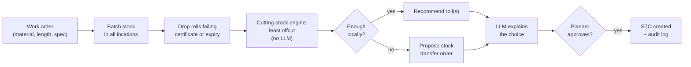

# Tutorial notes: Optimise cable roll selection with a custom Joule agent

*Build an agent that picks the cable roll, or set of rolls, that covers a work order with the least offcut, looks at other locations when local stock is short, and proposes a stock transfer for the planner to approve. My notes on SAP's 30-minute lab, with a link to SAP's screens at every step.*

> [!NOTE]
> **📍 At a glance**
> - **SAP's tutorial:** [Optimize Cable Roll Selection for Work Orders with a Custom Joule Agent](https://developers.sap.com/tutorials/cable-roll-optimizer-agent) by Ilya Belozerov · about 30 min · beginner · SAP runs it on a pre-release Joule Studio
> - **About this page:** *Added by Claude.* Written in my own words from SAP's tutorial, whose text and images may not be copied ([its licence](https://github.com/sap-tutorials/joule-studio/blob/main/LICENSE.txt)). The screen map is my own sketch; each step links to SAP's real screens.
> - **You need:** Joule Studio, and SAP S/4HANA Cloud with production orders that need cable (PP), batch stock in several storage locations (MM/WM), and stock transfer orders enabled (MM)
> - **Builds on:** [The new Joule Studio](joule-studio-intent-based.md) (chapter 4), [the balance confirmation notes](notes-balance-confirmation-agent.md) (chapter 26)
> - **Last checked:** 22 Nov 2026

**After this tutorial you can:**

- Write an intent that makes Joule Studio build a deterministic optimiser, not an LLM guess
- Read the engine-versus-LLM boundary and the guardrails in a PRD
- Check that an MCP server's write access is limited to one approved action

## 30.1 What you build

An agent for production planners. When a work order needs a length of cable, it chooses the rolls that cover it with the least waste.

| Situation | What makes it hard by hand |
|---|---|
| One local roll is enough | Many rolls to compare; people take the first one, not the best fit |
| Several local rolls needed | Finding the combination with least total offcut is a combinatorial problem |
| Not enough stock locally | No view across locations; transfers are raised late and for the wrong quantity |

**Screen map: the Joule Studio workspace** *(my own sketch of the layout, not SAP's screenshot; numbers are SAP's steps)*

<svg viewBox="0 0 760 440" role="img" aria-label="Screen map of the Joule Studio workspace: icon rail, top bar with Develop and Manage tabs and Deploy, Solution Progress panel on the left, document view in the middle, Joule chat on the right" style="width:100%;height:auto;max-width:760px;font-family:inherit">
<rect x="1" y="1" width="758" height="438" rx="10" style="fill:var(--surface);stroke:var(--line);stroke-width:1.5"/>
<rect x="1" y="1" width="36" height="438" rx="10" style="fill:var(--code-bg);stroke:var(--line)"/>
<circle cx="19" cy="30" r="7" style="fill:var(--line)"/><circle cx="19" cy="62" r="7" style="fill:var(--line)"/><rect x="10" y="85" width="18" height="18" rx="4" style="fill:var(--accent)"/><circle cx="19" cy="126" r="7" style="fill:var(--line)"/>
<line x1="37" y1="46" x2="759" y2="46" style="stroke:var(--line)"/>
<text x="48" y="29" style="fill:var(--ink);font-size:13px;font-weight:600">Cable Roll Optimizer</text>
<rect x="188" y="16" width="34" height="16" rx="4" style="fill:var(--code-bg)"/><text x="194" y="28" style="fill:var(--muted);font-size:10px">Draft</text>
<rect x="398" y="12" width="118" height="24" rx="6" style="fill:var(--code-bg);stroke:var(--line)"/>
<rect x="400" y="14" width="56" height="20" rx="5" style="fill:var(--accent-soft)"/><text x="409" y="28" style="fill:var(--accent);font-size:11px;font-weight:600">Develop</text><text x="466" y="28" style="fill:var(--ink);font-size:11px">Manage</text>
<rect x="560" y="12" width="66" height="24" rx="6" style="fill:none;stroke:var(--accent)"/><text x="574" y="28" style="fill:var(--accent);font-size:11px;font-weight:600">Deploy</text>
<rect x="634" y="12" width="72" height="24" rx="6" style="fill:none;stroke:var(--line)"/><text x="645" y="28" style="fill:var(--ink);font-size:11px">Actions ▾</text>
<rect x="716" y="14" width="22" height="20" rx="4" style="fill:none;stroke:var(--line)"/>
<rect x="44" y="54" width="176" height="378" rx="6" style="fill:none;stroke:var(--line)"/>
<text x="54" y="74" style="fill:var(--ink);font-size:12px;font-weight:600">▾ Solution Progress</text>
<text x="62" y="98" style="fill:var(--ink);font-size:11px">Intent Summary</text><text x="200" y="98" style="fill:var(--accent);font-size:11px">✓</text>
<text x="62" y="120" style="fill:var(--ink);font-size:11px">Requirements</text><text x="200" y="120" style="fill:var(--accent);font-size:11px">✓</text>
<text x="62" y="142" style="fill:var(--ink);font-size:11px">Specification</text><text x="200" y="142" style="fill:var(--accent);font-size:11px">✓</text>
<text x="62" y="164" style="fill:var(--ink);font-size:11px">▾ Solution Artifacts</text>
<text x="76" y="184" style="fill:var(--muted);font-size:10.5px">the agent</text><text x="76" y="202" style="fill:var(--muted);font-size:10.5px">MCP servers / tools</text>
<line x1="52" y1="216" x2="212" y2="216" style="stroke:var(--line)"/>
<text x="54" y="236" style="fill:var(--ink);font-size:12px;font-weight:600">▾ Testing</text><text x="62" y="256" style="fill:var(--ink);font-size:11px">Overview</text>
<line x1="52" y1="270" x2="212" y2="270" style="stroke:var(--line)"/>
<text x="54" y="290" style="fill:var(--ink);font-size:12px;font-weight:600">▾ Preview</text><text x="62" y="310" style="fill:var(--ink);font-size:11px">the agent (chat test)</text>
<line x1="52" y1="324" x2="212" y2="324" style="stroke:var(--line)"/>
<text x="54" y="344" style="fill:var(--ink);font-size:12px;font-weight:600">▸ File tree</text><text x="62" y="364" style="fill:var(--muted);font-size:10.5px">intent.md, assets/,</text><text x="62" y="380" style="fill:var(--muted);font-size:10.5px">Python code, deploy_result</text>
<rect x="228" y="54" width="288" height="378" rx="6" style="fill:none;stroke:var(--line)"/>
<text x="240" y="74" style="fill:var(--ink);font-size:12px;font-weight:600">Document view</text>
<text x="240" y="96" style="fill:var(--muted);font-size:10.5px">Shows what you pick on the left:</text>
<text x="240" y="112" style="fill:var(--muted);font-size:10.5px">intent summary, PRD, specification,</text>
<text x="240" y="128" style="fill:var(--muted);font-size:10.5px">agent definition, test results</text>
<rect x="240" y="146" width="250" height="8" rx="3" style="fill:var(--line)"/><rect x="240" y="164" width="210" height="8" rx="3" style="fill:var(--line)"/><rect x="240" y="182" width="232" height="8" rx="3" style="fill:var(--line)"/>
<rect x="240" y="206" width="264" height="26" rx="4" style="fill:none;stroke:var(--line)"/><text x="250" y="223" style="fill:var(--ink);font-size:10.5px">▸ section</text>
<rect x="240" y="238" width="264" height="26" rx="4" style="fill:none;stroke:var(--line)"/><text x="250" y="255" style="fill:var(--ink);font-size:10.5px">▸ section</text>
<rect x="240" y="270" width="264" height="26" rx="4" style="fill:none;stroke:var(--line)"/><text x="250" y="287" style="fill:var(--ink);font-size:10.5px">▸ section</text>
<rect x="524" y="54" width="228" height="378" rx="6" style="fill:none;stroke:var(--line)"/>
<text x="536" y="74" style="fill:var(--ink);font-size:12px;font-weight:600">Joule chat</text>
<text x="536" y="96" style="fill:var(--muted);font-size:10.5px">Progress messages and summaries</text>
<rect x="536" y="108" width="200" height="40" rx="6" style="fill:var(--code-bg)"/><rect x="546" y="118" width="150" height="7" rx="3" style="fill:var(--line)"/><rect x="546" y="132" width="110" height="7" rx="3" style="fill:var(--line)"/>
<rect x="536" y="156" width="200" height="56" rx="6" style="fill:var(--code-bg)"/><rect x="546" y="166" width="170" height="7" rx="3" style="fill:var(--line)"/><rect x="546" y="180" width="140" height="7" rx="3" style="fill:var(--line)"/><rect x="546" y="194" width="160" height="7" rx="3" style="fill:var(--line)"/>
<rect x="536" y="384" width="204" height="34" rx="6" style="fill:none;stroke:var(--accent)"/><text x="546" y="405" style="fill:var(--muted);font-size:10.5px">Message Joule…</text>
<g style="font-size:10px;font-weight:700">
<circle cx="31" cy="83" r="8" style="fill:var(--accent);stroke:var(--surface);stroke-width:1.5"/><text x="28" y="87" style="fill:var(--surface);font-size:10px">2</text>
<circle cx="180" cy="94" r="9" style="fill:var(--accent)"/><text x="177" y="98" style="fill:var(--surface);font-size:10px">3</text>
<circle cx="140" cy="340" r="9" style="fill:var(--accent)"/><text x="137" y="344" style="fill:var(--surface);font-size:10px">3</text>
<circle cx="180" cy="116" r="9" style="fill:var(--accent)"/><text x="177" y="120" style="fill:var(--surface);font-size:10px">4</text>
<circle cx="180" cy="138" r="9" style="fill:var(--accent)"/><text x="177" y="142" style="fill:var(--surface);font-size:10px">5</text>
<circle cx="180" cy="160" r="9" style="fill:var(--accent)"/><text x="177" y="164" style="fill:var(--surface);font-size:10px">6</text>
<circle cx="140" cy="252" r="9" style="fill:var(--accent)"/><text x="137" y="256" style="fill:var(--surface);font-size:10px">7</text>
<circle cx="190" cy="306" r="9" style="fill:var(--accent)"/><text x="187" y="310" style="fill:var(--surface);font-size:10px">7</text>
<circle cx="593" cy="50" r="9" style="fill:var(--accent)"/><text x="590" y="54" style="fill:var(--surface);font-size:10px">8</text>
<circle cx="488" cy="50" r="9" style="fill:var(--accent)"/><text x="485" y="54" style="fill:var(--surface);font-size:10px">8</text>
</g>
</svg>

- **2** Joule Studio → **Create** (or **+ New** in the Solutions panel)
- **3** Intent Summary, and `intent.md` in the File tree · **4** Requirements · **5** Specification
- **6** Solution Artifacts: the agent and its MCP servers · **7** Testing → Overview, then Preview
- **8** Deploy, **Actions** for GitHub sync, **Manage** to monitor

## 30.2 Create the agent and write the intent (SAP step 2)

- **Screen:** Joule Work → **Joule Studio** in the left navigation → **Create** (or **+ New** in *Solutions*).
- **Name:** `Cable Roll Optimizer` · **Intent statement:** copy SAP's text from step 2.
- **What SAP's intent asks for:** read the work order's cable material, length and spec; check batch stock in every location; recommend the single roll or combination with minimum waste; propose a stock transfer when local stock is short; let the planner approve before any SAP change; settings for waste threshold, location priority, and batch rules such as expiry and certificate.
- Choose **Quick Create** (*Fast Track*), **Create**, then confirm the business goals.
- 💡 **Name the objective exactly** ("minimise offcut"), not just "recommend". That is what makes Joule Studio build a deterministic engine instead of letting the LLM choose. A good optimisation intent states the objective, the data, the scenarios and the approval guardrail.
- [SAP's screens for step 2 ↗](https://developers.sap.com/tutorials/cable-roll-optimizer-agent#step-2)

## 30.3 Check the intent (SAP step 3)

- **Screen:** **Intent Summary** tab; `intent.md` in the *File tree*.
- **Expect** a Python agent with a separate cutting-stock engine and an LLM that only narrates. Check *Fit Gap Analysis* and *Recommended Solution*.
- [SAP's screens for step 3 ↗](https://developers.sap.com/tutorials/cable-roll-optimizer-agent#step-3)

## 30.4 Review the requirements (SAP step 4)

- **Screen:** *Solution Progress* → **Requirements** (Markdown version in the *File tree*). Personas should be the production planner and the warehouse operative.
- **What to check:**

| Area | What SAP's example decides |
|---|---|
| Runs alone | Reading work orders and running the optimiser |
| Needs the planner | Creating a stock transfer order in S/4HANA |
| Engine vs LLM | The engine selects rolls; the LLM only explains, and every number it shows comes from the engine |
| Guardrails | No STO without recorded approval · rolls failing certificate or expiry are excluded first · offcut above the threshold (for example 15% of the roll) is flagged for review · stale stock data is re-read, with a notice if that fails |

- [SAP's screens for step 4 ↗](https://developers.sap.com/tutorials/cable-roll-optimizer-agent#step-4)

## 30.5 Look at the specification (SAP step 5)

- **Screen:** *Solution Progress* → **Specification**. Still only the blueprint; no code.
- **Three parts in `assets/`:**
  - the agent: optimisation engine, batch validator, waste-threshold check, narration prompts, approval and STO trigger, audit log
  - **Production Order MCP server** (PP): work order data, **read-only**
  - **Batch Stock MCP server** (MM/WM): reads stock, and **writes only to create an STO**, after approval
- 💡 **Why not let the LLM optimise:** choosing rolls is a defined maths problem (one-dimensional cutting stock). An engine gives the same answer for the same input every time, which you can audit; an LLM can't promise that.
- [SAP's screens for step 5 ↗](https://developers.sap.com/tutorials/cable-roll-optimizer-agent#step-5)

## 30.6 Generate the solution (SAP step 6)

- **The build starts after the specification;** wait for it. Tests are created and run as part of it.
- **Screen:** *Solution Artifacts* → the agent: LLM (SAP's example: a Claude Sonnet model), settings (circuit breaker, thread time-to-live, summarisation), and the two MCP servers. *Evaluation* can generate scenarios. Code is in the *File tree*.
- **Check:** the STO write is reachable only through the approval path.
- ⚠️ **If you see a Batch Stock scope warning,** the storage location codes in `solution.yaml` probably don't match your plant's locations; stock queries then come back empty.
- [SAP's screens for step 6 ↗](https://developers.sap.com/tutorials/cable-roll-optimizer-agent#step-6)

## 30.7 Test it (SAP step 7)

- **Testing runs by itself.** Open *Testing* → **Overview**; all tests should pass.
- **Preview test without live data:** ask the agent which cable requirements it can help optimise.
- **When tests fail:**

| Symptom | Where to look |
|---|---|
| Single-roll passes, multi-roll fails | the engine's limits: `max_rolls_per_order` in `solution.yaml` and the combination logic in the engine code |
| STO creation fails | the Batch Stock server's write user lacks the S/4HANA authorisation for stock transfers (SAP names `M_MSEG_BWA` with movement type 351, or your system's equivalent) |

- [SAP's screens for step 7 ↗](https://developers.sap.com/tutorials/cable-roll-optimizer-agent#step-7)

## 30.8 Deploy to development (SAP step 8)

- **Screen:** **Deploy**, then **Deploy** again. The agent and both MCP servers go to SAP's managed service on the Business AI Platform; `deploy_result.json` gets the endpoint and runtime ID.
- **GitHub sync** is under **Actions**. Production isn't deployed from Joule Studio.
- Planners reach it through Joule's routing; monitor it under **Manage**.
- [SAP's screens for step 8 ↗](https://developers.sap.com/tutorials/cable-roll-optimizer-agent#step-8)

## 30.9 Pitfalls

- **Vague objective → LLM picks rolls.** Say "minimise offcut" in the intent.
- **Write scope:** only STO creation, only after approval. Check this in the specification and the code.
- **Empty stock in tests** usually means mismatched storage location codes.

> [!TIP]
> **Before a real rollout** *(Added by Claude)*
> - Agree the waste threshold and location priority with production planning; they decide how often a planner must step in.
> - Make sure batch certificate and expiry data are maintained, or good rolls will be excluded.

## Check yourself

Why is the roll choice made by an engine and not the LLM?

- It is a defined optimisation problem (cutting stock)
- An engine gives the same, auditable answer for the same input; an LLM can't guarantee that

What may the Batch Stock MCP server write, and when?

- Only a stock transfer order, and only after the planner approves

Multi-roll tests fail but single-roll tests pass. Where do you look?

- The engine's constraint settings, such as the maximum rolls per order, not the APIs

## How this page was checked

- **SAP's tutorial read in full on 22 Nov 2026:** all nine steps, on developers.sap.com.
- **Written in my own words.** Nothing copied from SAP's text or screenshots; the agent name, file and parameter names are given exactly because you look for them.
- **Screen map:** my simplified sketch of the Joule Studio workspace, drawn after viewing SAP's screenshots; not a copy.
- **Not built here:** no Joule Studio tenant in this workspace.

## Sources

- SAP Developer Center tutorial: https://developers.sap.com/tutorials/cable-roll-optimizer-agent
- Its licence: https://github.com/sap-tutorials/joule-studio/blob/main/LICENSE.txt

Previous: [Tutorial notes: Draft a financial close agent's intent in Joule Work](notes-joule-work-financial-close-intent.md) · Next: [Tutorial notes: Handle demand spikes with a delivery prioritisation agent](notes-demand-spike-agent.md)
