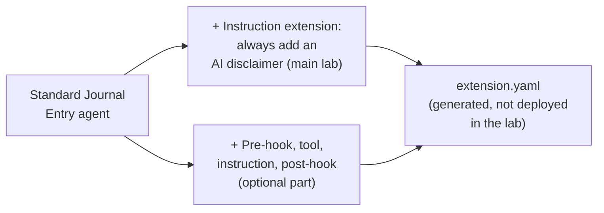

# Tutorial notes: Extend a standard Joule agent with intent-based development

*Run SAP's standard Journal Entry agent in Joule Work to see what it does out of the box, then extend it in Joule Studio, first with a simple instruction, then (optionally) with checks before and after posting, extra data and a report. My notes on SAP's 20-minute lab, with a link to SAP's screens at every step.*

> [!NOTE]
> **📍 At a glance**
> - **SAP's tutorial:** [Create an Extension for a Standard Agent](https://developers.sap.com/tutorials/create-agent-extension) by Martin Plummer · about 20 min · beginner · SAP runs it on a pre-release Joule Studio
> - **About this page:** *Added by Claude.* Written in my own words from SAP's tutorial, whose text and images may not be copied ([its licence](https://github.com/sap-tutorials/joule-studio/blob/main/LICENSE.txt)). The screen maps are my own sketches; each step links to SAP's real screens.
> - **You need:** Joule Studio, and SAP S/4HANA Cloud with the *Financial Closing Assistant* set up; SAP's sample file `agent_lab_journal_entry.xlsx` (download it from SAP's step 2)
> - **Builds on:** [The new Joule Studio](joule-studio-intent-based.md) (chapter 4, extensions in 4.6), [Extend SAP's AP Invoice Agent](tutorial-joule-studio-agent-extension.md) (chapter 12)
> - **Last checked:** 22 Nov 2026

**After this tutorial you can:**

- Call a standard agent in Joule Work by naming its assistant
- Create an instruction extension for a delivered agent from a plain-language intent
- Tell apart the four extension layers: pre-hook, tool extension, instruction extension, post-hook

## 36.1 What you build

SAP's **Journal Entry agent** (part of the Financial Closing Assistant) turns a request or an uploaded file into a journal entry proposal in S/4HANA Cloud Public Edition, with no extra checks. Real finance teams want more, and extensions add it without building a new agent.

| Layer | When it runs | In this lab's optional part |
|---|---|---|
| Pre-hook | Before posting | Flag any line over €45 and ask for approval |
| Tool extension | While processing | Read earlier postings through an MCP tool, for context |
| Instruction extension | Throughout, as a rule | Check the combination of cost center, G/L account, profit center and segment |
| Post-hook | After posting | Produce an HTML summary report |

**Screen maps** *(my own sketches of the layout, not SAP's screenshots; numbers are SAP's steps)*

*Joule Work, where you call the standard agent:*

<svg viewBox="0 0 760 440" role="img" aria-label="Screen map of a Joule Work conversation: icon rail on the left with chat and Joule Studio icons, conversation title at the top, your message and Joule's reply in the middle, message box at the bottom" style="width:100%;height:auto;max-width:760px;font-family:inherit">
<rect x="1" y="1" width="758" height="438" rx="10" style="fill:var(--surface);stroke:var(--line);stroke-width:1.5"/>
<rect x="1" y="1" width="40" height="438" rx="10" style="fill:var(--code-bg);stroke:var(--line)"/>
<rect x="12" y="20" width="18" height="18" rx="5" style="fill:var(--accent)"/>
<rect x="11" y="89" width="20" height="18" rx="4" style="fill:var(--accent-soft);stroke:var(--accent)"/><text x="46" y="102" style="fill:var(--muted);font-size:10px">chat</text>
<circle cx="21" cy="130" r="7" style="fill:var(--line)"/><text x="46" y="134" style="fill:var(--muted);font-size:10px">history</text>
<circle cx="21" cy="160" r="7" style="fill:var(--line)"/><circle cx="21" cy="190" r="7" style="fill:var(--line)"/>
<rect x="11" y="209" width="20" height="18" rx="4" style="fill:none;stroke:var(--ink)"/><text x="14" y="222" style="fill:var(--ink);font-size:9px;font-weight:700">&lt;&gt;</text><text x="46" y="222" style="fill:var(--muted);font-size:10px">Joule Studio</text>
<circle cx="21" cy="372" r="7" style="fill:var(--line)"/><circle cx="21" cy="400" r="9" style="fill:var(--accent-soft)"/>
<line x1="41" y1="50" x2="759" y2="50" style="stroke:var(--line)"/>
<rect x="56" y="18" width="16" height="14" rx="3" style="fill:none;stroke:var(--muted)"/>
<text x="82" y="30" style="fill:var(--ink);font-size:13px;font-weight:600">New Conversation</text><text x="728" y="30" style="fill:var(--muted);font-size:13px">···</text>
<rect x="430" y="64" width="250" height="60" rx="8" style="fill:var(--accent-soft)"/>
<text x="442" y="84" style="fill:var(--ink);font-size:11px;font-weight:600">You</text>
<rect x="442" y="92" width="220" height="7" rx="3" style="fill:var(--line)"/><rect x="442" y="106" width="180" height="7" rx="3" style="fill:var(--line)"/>
<rect x="150" y="138" width="290" height="150" rx="8" style="fill:none;stroke:var(--line)"/>
<text x="162" y="158" style="fill:var(--ink);font-size:11px;font-weight:600">Joule's reply</text>
<text x="162" y="178" style="fill:var(--muted);font-size:10.5px">✓ progress steps, then the answer:</text>
<rect x="162" y="190" width="260" height="7" rx="3" style="fill:var(--line)"/><rect x="162" y="204" width="230" height="7" rx="3" style="fill:var(--line)"/><rect x="162" y="218" width="250" height="7" rx="3" style="fill:var(--line)"/><rect x="162" y="232" width="200" height="7" rx="3" style="fill:var(--line)"/><rect x="162" y="246" width="240" height="7" rx="3" style="fill:var(--line)"/>
<rect x="160" y="352" width="450" height="56" rx="8" style="fill:none;stroke:var(--accent);stroke-width:1.5"/>
<text x="174" y="372" style="fill:var(--muted);font-size:11px">Message Joule…</text><text x="174" y="398" style="fill:var(--muted);font-size:12px">+  @</text>
<text x="300" y="428" style="fill:var(--muted);font-size:9.5px">Joule uses AI. Verify results.</text>
<g style="font-size:10px;font-weight:700">
<circle cx="31" cy="98" r="8" style="fill:var(--accent);stroke:var(--surface);stroke-width:1.5"/><text x="28" y="102" style="fill:var(--surface);font-size:10px">3</text>
<circle cx="700" cy="380" r="9" style="fill:var(--accent)"/><text x="697" y="384" style="fill:var(--surface);font-size:10px">3</text>
<circle cx="452" cy="150" r="9" style="fill:var(--accent)"/><text x="449" y="154" style="fill:var(--surface);font-size:10px">3</text>
</g>
</svg>

*Joule Studio, where you build the extension:*

<svg viewBox="0 0 760 440" role="img" aria-label="Screen map of the Joule Studio workspace: icon rail, top bar with Develop and Manage tabs and Deploy, Solution Progress panel on the left, document view in the middle, Joule chat on the right" style="width:100%;height:auto;max-width:760px;font-family:inherit">
<rect x="1" y="1" width="758" height="438" rx="10" style="fill:var(--surface);stroke:var(--line);stroke-width:1.5"/>
<rect x="1" y="1" width="36" height="438" rx="10" style="fill:var(--code-bg);stroke:var(--line)"/>
<circle cx="19" cy="30" r="7" style="fill:var(--line)"/><circle cx="19" cy="62" r="7" style="fill:var(--line)"/><rect x="10" y="85" width="18" height="18" rx="4" style="fill:var(--accent)"/><circle cx="19" cy="126" r="7" style="fill:var(--line)"/>
<line x1="37" y1="46" x2="759" y2="46" style="stroke:var(--line)"/>
<text x="48" y="29" style="fill:var(--ink);font-size:13px;font-weight:600">Journal Entry Extension</text>
<rect x="207" y="16" width="34" height="16" rx="4" style="fill:var(--code-bg)"/><text x="213" y="28" style="fill:var(--muted);font-size:10px">Draft</text>
<rect x="398" y="12" width="118" height="24" rx="6" style="fill:var(--code-bg);stroke:var(--line)"/>
<rect x="400" y="14" width="56" height="20" rx="5" style="fill:var(--accent-soft)"/><text x="409" y="28" style="fill:var(--accent);font-size:11px;font-weight:600">Develop</text><text x="466" y="28" style="fill:var(--ink);font-size:11px">Manage</text>
<rect x="560" y="12" width="66" height="24" rx="6" style="fill:none;stroke:var(--accent)"/><text x="574" y="28" style="fill:var(--accent);font-size:11px;font-weight:600">Deploy</text>
<rect x="634" y="12" width="72" height="24" rx="6" style="fill:none;stroke:var(--line)"/><text x="645" y="28" style="fill:var(--ink);font-size:11px">Actions ▾</text>
<rect x="716" y="14" width="22" height="20" rx="4" style="fill:none;stroke:var(--line)"/>
<rect x="44" y="54" width="176" height="378" rx="6" style="fill:none;stroke:var(--line)"/>
<text x="54" y="74" style="fill:var(--ink);font-size:12px;font-weight:600">▾ Solution Progress</text>
<text x="62" y="98" style="fill:var(--ink);font-size:11px">Intent Summary</text><text x="200" y="98" style="fill:var(--accent);font-size:11px">✓</text>
<text x="62" y="120" style="fill:var(--ink);font-size:11px">Requirements</text><text x="200" y="120" style="fill:var(--accent);font-size:11px">✓</text>
<text x="62" y="142" style="fill:var(--ink);font-size:11px">Specification</text><text x="200" y="142" style="fill:var(--accent);font-size:11px">✓</text>
<text x="62" y="164" style="fill:var(--ink);font-size:11px">▾ Solution Artifacts</text>
<text x="76" y="184" style="fill:var(--muted);font-size:10.5px">the agent</text><text x="76" y="202" style="fill:var(--muted);font-size:10.5px">MCP servers / tools</text>
<line x1="52" y1="216" x2="212" y2="216" style="stroke:var(--line)"/>
<text x="54" y="236" style="fill:var(--ink);font-size:12px;font-weight:600">▾ Testing</text><text x="62" y="256" style="fill:var(--ink);font-size:11px">Overview</text>
<line x1="52" y1="270" x2="212" y2="270" style="stroke:var(--line)"/>
<text x="54" y="290" style="fill:var(--ink);font-size:12px;font-weight:600">▾ Preview</text><text x="62" y="310" style="fill:var(--ink);font-size:11px">the agent (chat test)</text>
<line x1="52" y1="324" x2="212" y2="324" style="stroke:var(--line)"/>
<text x="54" y="344" style="fill:var(--ink);font-size:12px;font-weight:600">▸ File tree</text><text x="62" y="364" style="fill:var(--muted);font-size:10.5px">intent.md, assets/,</text><text x="62" y="380" style="fill:var(--muted);font-size:10.5px">Python code, deploy_result</text>
<rect x="228" y="54" width="288" height="378" rx="6" style="fill:none;stroke:var(--line)"/>
<text x="240" y="74" style="fill:var(--ink);font-size:12px;font-weight:600">Document view</text>
<text x="240" y="96" style="fill:var(--muted);font-size:10.5px">Shows what you pick on the left:</text>
<text x="240" y="112" style="fill:var(--muted);font-size:10.5px">intent summary, PRD, specification,</text>
<text x="240" y="128" style="fill:var(--muted);font-size:10.5px">agent definition, test results</text>
<rect x="240" y="146" width="250" height="8" rx="3" style="fill:var(--line)"/><rect x="240" y="164" width="210" height="8" rx="3" style="fill:var(--line)"/><rect x="240" y="182" width="232" height="8" rx="3" style="fill:var(--line)"/>
<rect x="240" y="206" width="264" height="26" rx="4" style="fill:none;stroke:var(--line)"/><text x="250" y="223" style="fill:var(--ink);font-size:10.5px">▸ section</text>
<rect x="240" y="238" width="264" height="26" rx="4" style="fill:none;stroke:var(--line)"/><text x="250" y="255" style="fill:var(--ink);font-size:10.5px">▸ section</text>
<rect x="240" y="270" width="264" height="26" rx="4" style="fill:none;stroke:var(--line)"/><text x="250" y="287" style="fill:var(--ink);font-size:10.5px">▸ section</text>
<rect x="524" y="54" width="228" height="378" rx="6" style="fill:none;stroke:var(--line)"/>
<text x="536" y="74" style="fill:var(--ink);font-size:12px;font-weight:600">Joule chat</text>
<text x="536" y="96" style="fill:var(--muted);font-size:10.5px">Progress messages and summaries</text>
<rect x="536" y="108" width="200" height="40" rx="6" style="fill:var(--code-bg)"/><rect x="546" y="118" width="150" height="7" rx="3" style="fill:var(--line)"/><rect x="546" y="132" width="110" height="7" rx="3" style="fill:var(--line)"/>
<rect x="536" y="156" width="200" height="56" rx="6" style="fill:var(--code-bg)"/><rect x="546" y="166" width="170" height="7" rx="3" style="fill:var(--line)"/><rect x="546" y="180" width="140" height="7" rx="3" style="fill:var(--line)"/><rect x="546" y="194" width="160" height="7" rx="3" style="fill:var(--line)"/>
<rect x="536" y="384" width="204" height="34" rx="6" style="fill:none;stroke:var(--accent)"/><text x="546" y="405" style="fill:var(--muted);font-size:10.5px">Message Joule…</text>
<g style="font-size:10px;font-weight:700">
<circle cx="31" cy="83" r="8" style="fill:var(--accent);stroke:var(--surface);stroke-width:1.5"/><text x="28" y="87" style="fill:var(--surface);font-size:10px">4</text>
<circle cx="180" cy="94" r="9" style="fill:var(--accent)"/><text x="177" y="98" style="fill:var(--surface);font-size:10px">4</text>
<circle cx="180" cy="116" r="9" style="fill:var(--accent)"/><text x="177" y="120" style="fill:var(--surface);font-size:10px">5</text>
<circle cx="180" cy="138" r="9" style="fill:var(--accent)"/><text x="177" y="142" style="fill:var(--surface);font-size:10px">5</text>
<circle cx="180" cy="160" r="9" style="fill:var(--accent)"/><text x="177" y="164" style="fill:var(--surface);font-size:10px">5</text>
<circle cx="722" cy="401" r="9" style="fill:var(--accent)"/><text x="719" y="405" style="fill:var(--surface);font-size:10px">5</text>
</g>
</svg>

- **3** Joule Work chat: call the assistant, upload the file, approve the mapping
- **4** Joule Studio → **Create** on the *Extension* tile → pick the agent → Intent Summary
- **5** The chat: generate requirements, create the specification, build; the result is in Solution Artifacts
- **6** Optional: a second extension, same flow

## 36.2 Prepare (SAP step 2)

- Download SAP's sample file `agent_lab_journal_entry.xlsx` from step 2 and save it on your desktop.
- [SAP's screens for step 2 ↗](https://developers.sap.com/tutorials/create-agent-extension#step-2)

## 36.3 See the standard agent first (SAP step 3)

- **Optional, but useful:** it shows the behaviour you are about to change.
- **Screen:** Joule Work chat. Address the assistant by name with `@Financial Closing Assistant`, followed by a request to create a journal entry proposal from a file (SAP's exact prompt is in step 3).
- **Then:** upload the sample file (Excel or CSV with company code, posting date and G/L account columns) → **Send** → **Approve Mapping**.
- **Result:** a proposal, ready in the *Manage Journal Entry Proposals* app. No checks, no flags, no report: that's the baseline.
- [SAP's screens for step 3 ↗](https://developers.sap.com/tutorials/create-agent-extension#step-3)

## 36.4 Create an instruction extension (SAP step 4)

- **Screen:** Joule Studio → **Create** on the **Extension** tile → *Create an Agent Extension*.
- **Pick the agent:** search the *Agent Catalog* for the Journal Entry agent → **Add**. You see its available extension points. → **Select Agent**.
- **Name:** `Journal Entry Extension` · **Intent:** copy SAP's text from step 4. It asks for a critical instruction: every reply to the user must carry a disclaimer that it is AI-generated.
- **Create**, then answer the questions (pick a business reason, **Submit Answer**; they vary), confirm the intent analysis, and read **Intent Summary** (also `intent.md` in the *File tree*).
- [SAP's screens for step 4 ↗](https://developers.sap.com/tutorials/create-agent-extension#step-4)

## 36.5 Requirements, specification, build (SAP step 5)

- **In the chat:** generate the requirements, then create the specification, then build the solution.
- **What you get:** clarifying questions, an intent summary and PRD, and a ready-to-deploy **`extension.yaml`**, with no hand-written YAML.
- ⚠️ **Don't deploy it in SAP's lab:** your lab user isn't allowed to, and a deployed extension would affect the other participants.
- [SAP's screens for step 5 ↗](https://developers.sap.com/tutorials/create-agent-extension#step-5)

## 36.6 Optional: a four-layer extension (SAP step 6)

- **Same agent, a new extension** named `Journal Entry Extension`. Copy SAP's longer intent from step 6.
- **What that intent asks for:**
  - stop and ask for approval if any line exceeds €45
  - then compare each line's company code, G/L account, cost center, profit center and segment with past postings in the Universal Journal (through an MCP tool)
  - tag each line *commonly used*, *rare pattern* or *no historical match*; accept the common ones and explain the others with suggestions
  - finally write a colour-coded HTML summary (green, yellow, red) and open it in the browser
- **Then** answer the questions and type `proceed` to move through the stages until the solution artifacts exist. Look at them; again, don't deploy.
- ⚠️ **This part needs features your system may not have.** If MCP tools and n8n hooks are switched off, Joule says so and proposes a reduced scope.
- [SAP's screens for step 6 ↗](https://developers.sap.com/tutorials/create-agent-extension#step-6)

## 36.7 Pitfalls

- **An extension changes SAP's agent for everyone using it.** That's why the lab forbids deploying.
- **Hooks and tool extensions depend on tenant features** (MCP tools, n8n hooks).
- **The instruction is only as good as its wording;** say CRITICAL or "must" for rules that must always apply, as SAP's example does.

> [!TIP]
> **Before a real rollout** *(Added by Claude)*
> - Agree the extension with the owner of the standard agent's process (here, the close team); it changes behaviour for every user.
> - Keep thresholds such as the €45 check as settings you can change, not buried in the instruction text.

## Check yourself

Name the four extension layers and when each runs.

- Pre-hook: before the action (posting)
- Tool extension: adds data or tools while processing
- Instruction extension: a rule the agent follows throughout
- Post-hook: after the action, for example a report

What file does Joule Studio generate for an agent extension?

- `extension.yaml`, ready to deploy, with no hand-editing

## How this page was checked

- **SAP's tutorial read in full on 22 Nov 2026:** all seven steps, on developers.sap.com.
- **Written in my own words.** SAP's prompts and intents are summarised, not copied; names you type (the assistant handle, extension name) are given exactly.
- **Screen maps:** my simplified sketches of Joule Work and the Joule Studio workspace, drawn after viewing SAP's screenshots; not copies.
- **Not built here:** no Joule Studio tenant in this workspace.

## Sources

- SAP Developer Center tutorial: https://developers.sap.com/tutorials/create-agent-extension
- Its licence: https://github.com/sap-tutorials/joule-studio/blob/main/LICENSE.txt

Previous: [Tutorial notes: Build a performance and goals recommendations agent](notes-performance-goals-recommendations-agent.md) · Next: [Tutorial notes: Create an invoice exception workflow with n8n in Joule Studio](notes-invoice-exception-agent-n8n.md)
