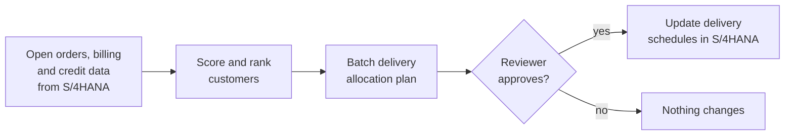

# Tutorial notes: Handle demand spikes with a delivery prioritisation agent

*Build an agent that ranks customers when stock can't cover every order, proposes a delivery plan, and changes the delivery schedules in SAP S/4HANA Cloud only after a person approves. My notes on SAP's 20-minute lab, with a link to SAP's screens at every step.*

> [!NOTE]
> **📍 At a glance**
> - **SAP's tutorial:** [Build an Agent to Handle Demand Spikes](https://developers.sap.com/tutorials/build-a-demand-spike-agent) by Martin Plummer · about 20 min · beginner · SAP runs it on a pre-release Joule Studio
> - **About this page:** *Added by Claude.* Written in my own words from SAP's tutorial, whose text and images may not be copied ([its licence](https://github.com/sap-tutorials/joule-studio/blob/main/LICENSE.txt)). The screen map is my own sketch; each step links to SAP's real screens.
> - **You need:** Joule Studio, and SAP S/4HANA Cloud Public Edition with the standard demo data
> - **Builds on:** [The new Joule Studio](joule-studio-intent-based.md) (chapter 4), [the budget variance notes](notes-budget-variance-agent.md) (chapter 27, the same flow)
> - **Last checked:** 22 Nov 2026

**After this tutorial you can:**

- Describe a scoring-and-ranking agent in one intent statement
- Check which actions a PRD lets the agent take alone, and which need approval
- Re-run tests and preview the agent before deploying it

## 31.1 What you build

A product suddenly sells far more than planned and stock runs short. Without a rule, planners split the stock by habit and familiarity, which can hurt the most valuable customers and send goods to customers with poor credit. The agent scores and ranks the customers, then proposes how to split the stock.

| Score input | Why it matters |
|---|---|
| Open order volume | How much each customer is waiting for |
| Revenue this year | How valuable the customer is |
| Credit rating | The financial risk of delivering |

**Screen map: the Joule Studio workspace** *(my own sketch of the layout, not SAP's screenshot; numbers are SAP's steps)*

<svg viewBox="0 0 760 440" role="img" aria-label="Screen map of the Joule Studio workspace: icon rail, top bar with Develop and Manage tabs and Deploy, Solution Progress panel on the left, document view in the middle, Joule chat on the right" style="width:100%;height:auto;max-width:760px;font-family:inherit">
<rect x="1" y="1" width="758" height="438" rx="10" style="fill:var(--surface);stroke:var(--line);stroke-width:1.5"/>
<rect x="1" y="1" width="36" height="438" rx="10" style="fill:var(--code-bg);stroke:var(--line)"/>
<circle cx="19" cy="30" r="7" style="fill:var(--line)"/><circle cx="19" cy="62" r="7" style="fill:var(--line)"/><rect x="10" y="85" width="18" height="18" rx="4" style="fill:var(--accent)"/><circle cx="19" cy="126" r="7" style="fill:var(--line)"/>
<line x1="37" y1="46" x2="759" y2="46" style="stroke:var(--line)"/>
<text x="48" y="29" style="fill:var(--ink);font-size:13px;font-weight:600">Demand Spike Delivery Prioritization Agent</text>
<rect x="333" y="16" width="34" height="16" rx="4" style="fill:var(--code-bg)"/><text x="339" y="28" style="fill:var(--muted);font-size:10px">Draft</text>
<rect x="398" y="12" width="118" height="24" rx="6" style="fill:var(--code-bg);stroke:var(--line)"/>
<rect x="400" y="14" width="56" height="20" rx="5" style="fill:var(--accent-soft)"/><text x="409" y="28" style="fill:var(--accent);font-size:11px;font-weight:600">Develop</text><text x="466" y="28" style="fill:var(--ink);font-size:11px">Manage</text>
<rect x="560" y="12" width="66" height="24" rx="6" style="fill:none;stroke:var(--accent)"/><text x="574" y="28" style="fill:var(--accent);font-size:11px;font-weight:600">Deploy</text>
<rect x="634" y="12" width="72" height="24" rx="6" style="fill:none;stroke:var(--line)"/><text x="645" y="28" style="fill:var(--ink);font-size:11px">Actions ▾</text>
<rect x="716" y="14" width="22" height="20" rx="4" style="fill:none;stroke:var(--line)"/>
<rect x="44" y="54" width="176" height="378" rx="6" style="fill:none;stroke:var(--line)"/>
<text x="54" y="74" style="fill:var(--ink);font-size:12px;font-weight:600">▾ Solution Progress</text>
<text x="62" y="98" style="fill:var(--ink);font-size:11px">Intent Summary</text><text x="200" y="98" style="fill:var(--accent);font-size:11px">✓</text>
<text x="62" y="120" style="fill:var(--ink);font-size:11px">Requirements</text><text x="200" y="120" style="fill:var(--accent);font-size:11px">✓</text>
<text x="62" y="142" style="fill:var(--ink);font-size:11px">Specification</text><text x="200" y="142" style="fill:var(--accent);font-size:11px">✓</text>
<text x="62" y="164" style="fill:var(--ink);font-size:11px">▾ Solution Artifacts</text>
<text x="76" y="184" style="fill:var(--muted);font-size:10.5px">the agent</text><text x="76" y="202" style="fill:var(--muted);font-size:10.5px">MCP servers / tools</text>
<line x1="52" y1="216" x2="212" y2="216" style="stroke:var(--line)"/>
<text x="54" y="236" style="fill:var(--ink);font-size:12px;font-weight:600">▾ Testing</text><text x="62" y="256" style="fill:var(--ink);font-size:11px">Overview</text>
<line x1="52" y1="270" x2="212" y2="270" style="stroke:var(--line)"/>
<text x="54" y="290" style="fill:var(--ink);font-size:12px;font-weight:600">▾ Preview</text><text x="62" y="310" style="fill:var(--ink);font-size:11px">the agent (chat test)</text>
<line x1="52" y1="324" x2="212" y2="324" style="stroke:var(--line)"/>
<text x="54" y="344" style="fill:var(--ink);font-size:12px;font-weight:600">▸ File tree</text><text x="62" y="364" style="fill:var(--muted);font-size:10.5px">intent.md, assets/,</text><text x="62" y="380" style="fill:var(--muted);font-size:10.5px">Python code, deploy_result</text>
<rect x="228" y="54" width="288" height="378" rx="6" style="fill:none;stroke:var(--line)"/>
<text x="240" y="74" style="fill:var(--ink);font-size:12px;font-weight:600">Document view</text>
<text x="240" y="96" style="fill:var(--muted);font-size:10.5px">Shows what you pick on the left:</text>
<text x="240" y="112" style="fill:var(--muted);font-size:10.5px">intent summary, PRD, specification,</text>
<text x="240" y="128" style="fill:var(--muted);font-size:10.5px">agent definition, test results</text>
<rect x="240" y="146" width="250" height="8" rx="3" style="fill:var(--line)"/><rect x="240" y="164" width="210" height="8" rx="3" style="fill:var(--line)"/><rect x="240" y="182" width="232" height="8" rx="3" style="fill:var(--line)"/>
<rect x="240" y="206" width="264" height="26" rx="4" style="fill:none;stroke:var(--line)"/><text x="250" y="223" style="fill:var(--ink);font-size:10.5px">▸ section</text>
<rect x="240" y="238" width="264" height="26" rx="4" style="fill:none;stroke:var(--line)"/><text x="250" y="255" style="fill:var(--ink);font-size:10.5px">▸ section</text>
<rect x="240" y="270" width="264" height="26" rx="4" style="fill:none;stroke:var(--line)"/><text x="250" y="287" style="fill:var(--ink);font-size:10.5px">▸ section</text>
<rect x="524" y="54" width="228" height="378" rx="6" style="fill:none;stroke:var(--line)"/>
<text x="536" y="74" style="fill:var(--ink);font-size:12px;font-weight:600">Joule chat</text>
<text x="536" y="96" style="fill:var(--muted);font-size:10.5px">Progress messages and summaries</text>
<rect x="536" y="108" width="200" height="40" rx="6" style="fill:var(--code-bg)"/><rect x="546" y="118" width="150" height="7" rx="3" style="fill:var(--line)"/><rect x="546" y="132" width="110" height="7" rx="3" style="fill:var(--line)"/>
<rect x="536" y="156" width="200" height="56" rx="6" style="fill:var(--code-bg)"/><rect x="546" y="166" width="170" height="7" rx="3" style="fill:var(--line)"/><rect x="546" y="180" width="140" height="7" rx="3" style="fill:var(--line)"/><rect x="546" y="194" width="160" height="7" rx="3" style="fill:var(--line)"/>
<rect x="536" y="384" width="204" height="34" rx="6" style="fill:none;stroke:var(--accent)"/><text x="546" y="405" style="fill:var(--muted);font-size:10.5px">Message Joule…</text>
<g style="font-size:10px;font-weight:700">
<circle cx="31" cy="83" r="8" style="fill:var(--accent);stroke:var(--surface);stroke-width:1.5"/><text x="28" y="87" style="fill:var(--surface);font-size:10px">2</text>
<circle cx="180" cy="94" r="9" style="fill:var(--accent)"/><text x="177" y="98" style="fill:var(--surface);font-size:10px">3</text>
<circle cx="140" cy="340" r="9" style="fill:var(--accent)"/><text x="137" y="344" style="fill:var(--surface);font-size:10px">3</text>
<circle cx="180" cy="116" r="9" style="fill:var(--accent)"/><text x="177" y="120" style="fill:var(--surface);font-size:10px">4</text>
<circle cx="180" cy="138" r="9" style="fill:var(--accent)"/><text x="177" y="142" style="fill:var(--surface);font-size:10px">5</text>
<circle cx="180" cy="160" r="9" style="fill:var(--accent)"/><text x="177" y="164" style="fill:var(--surface);font-size:10px">6</text>
<circle cx="140" cy="252" r="9" style="fill:var(--accent)"/><text x="137" y="256" style="fill:var(--surface);font-size:10px">7</text>
<circle cx="190" cy="306" r="9" style="fill:var(--accent)"/><text x="187" y="310" style="fill:var(--surface);font-size:10px">7</text>
<circle cx="593" cy="50" r="9" style="fill:var(--accent)"/><text x="590" y="54" style="fill:var(--surface);font-size:10px">8</text>
<circle cx="722" cy="401" r="9" style="fill:var(--accent)"/><text x="719" y="405" style="fill:var(--surface);font-size:10px">6</text>
<circle cx="488" cy="50" r="9" style="fill:var(--accent)"/><text x="485" y="54" style="fill:var(--surface);font-size:10px">8</text>
</g>
</svg>

- **2** Joule Studio → **Create** · **3** Intent Summary, and `intent.md` in the File tree
- **4** Requirements · **5** Specification · **6** Type `Build the solution` in the chat
- **7** Testing → Overview (with **Test Solution**), and Preview · **8** Deploy, then **Manage**

## 31.2 Create the agent and write the intent (SAP step 2)

- **Screen:** **Joule Studio** → **Create**.
- **Name:** `Demand Spike Delivery Prioritization Agent` · **Intent statement:** copy SAP's text from step 2.
- **What SAP's intent says:** a demand spike causes a shortage; stock must be split across customers of different importance; score and rank them by open orders, revenue this year and credit rating; produce a prioritised delivery batch plan; a person approves before the agent updates the delivery schedules in S/4HANA Cloud Public Edition.
- Choose **Quick Create**, **Create**, then confirm the business goals.
- [SAP's screens for step 2 ↗](https://developers.sap.com/tutorials/build-a-demand-spike-agent#step-2)

## 31.3 Check the intent (SAP step 3)

- **Screen:** **Intent Summary** tab; `intent.md` in the *File tree*.
- **Read** the summary, *Fit Gap Analysis* and *Recommended Solution* (a Python A2A agent). The **intent fit score** should be 90% or more.
- [SAP's screens for step 3 ↗](https://developers.sap.com/tutorials/build-a-demand-spike-agent#step-3)

## 31.4 Review the requirements (SAP step 4)

- **Screen:** *Solution Progress* → **Requirements** (Markdown in the *File tree*). Expand *Requirements* and *Solution Architecture*.
- **The split to check:**

| Runs alone | Needs a person |
|---|---|
| Reading open sales orders, billing history and credit data | Any change to outbound delivery schedules in S/4HANA |
| Scoring and ranking customers | Overriding the default scoring weights for an event |
| Building the delivery allocation plan | |

- [SAP's screens for step 4 ↗](https://developers.sap.com/tutorials/build-a-demand-spike-agent#step-4)

## 31.5 Look at the specification (SAP step 5)

- **Screen:** *Solution Progress* → **Specification**, then the `specification` folder in the *File tree*. Only the blueprint; no code yet.
- [SAP's screens for step 5 ↗](https://developers.sap.com/tutorials/build-a-demand-spike-agent#step-5)

## 31.6 Build the solution (SAP step 6)

- **Type `Build the solution`** in the chat and wait.
- The agent appears under **Preview**; open it under **Solution Artifacts** for its LLM, settings and MCP servers. *Evaluation* can generate scenarios (a few minutes).
- [SAP's screens for step 6 ↗](https://developers.sap.com/tutorials/build-a-demand-spike-agent#step-6)

## 31.7 Test it (SAP step 7)

- **Testing runs by itself.** Open *Testing* → **Overview** and compare the test areas with the specification.
- **Test Solution** runs the tests again; a second run sometimes finds something new.
- **Preview:** ask the agent what it is responsible for or how to test it.
- [SAP's screens for step 7 ↗](https://developers.sap.com/tutorials/build-a-demand-spike-agent#step-7)

## 31.8 Deploy to development (SAP step 8)

- **Screen:** **Deploy**, then **Deploy** again. It runs on SAP's managed service on the Business AI Platform; `deploy_result.json` gets the endpoint and runtime ID.
- Production isn't deployed from Joule Studio. Planners reach the agent through Joule's routing; monitor it under **Manage**.
- [SAP's screens for step 8 ↗](https://developers.sap.com/tutorials/build-a-demand-spike-agent#step-8)

## 31.9 Pitfalls

- **Weights are a business decision.** Changing them per event needs approval; don't let the PRD make that automatic.
- **Writes to delivery schedules** happen only after approval; check this survived into the PRD and specification.

> [!TIP]
> **Before a real rollout** *(Added by Claude)*
> - Agree the default weights of the three score inputs with sales and credit management, and write them down.
> - Decide who approves the plan when the usual reviewer is away; a spike is exactly when delays hurt.

## Check yourself

Which three inputs does the agent use to rank customers?

- Open order volume, revenue this year, credit rating

Name two actions that need a person's approval.

- Changing outbound delivery schedules in S/4HANA
- Overriding the default scoring weights for an event

## How this page was checked

- **SAP's tutorial read in full on 22 Nov 2026:** all nine steps, on developers.sap.com.
- **Written in my own words.** Nothing copied from SAP's text or screenshots; the agent name is given exactly because you type it.
- **Screen map:** my simplified sketch of the Joule Studio workspace, drawn after viewing SAP's screenshots; not a copy.
- **Not built here:** no Joule Studio tenant in this workspace.

## Sources

- SAP Developer Center tutorial: https://developers.sap.com/tutorials/build-a-demand-spike-agent
- Its licence: https://github.com/sap-tutorials/joule-studio/blob/main/LICENSE.txt

Previous: [Tutorial notes: Optimise cable roll selection with a custom Joule agent](notes-cable-roll-optimizer-agent.md) · Next: [Tutorial notes: Build a supplier disruption response agent with the Joule Studio CLI](notes-supplier-disruption-response-agent.md)
