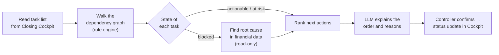

# Tutorial notes: Guide the financial close with a closing advisor agent

*Build an agent that reads the closing task list, works out what is ready, blocked or at risk, and tells the controller what to do next, in order and with reasons. My notes on SAP's 20-minute lab, with a link to SAP's screens at every step.*

> [!NOTE]
> **📍 At a glance**
> - **SAP's tutorial:** [Guide Financial Closing Activities with an Intelligent Closing Advisor Agent](https://developers.sap.com/tutorials/financial-closing-advisor-agent) by Samir Hamichi · about 20 min · beginner · SAP runs it on a pre-release Joule Studio
> - **About this page:** *Added by Claude.* Written in my own words from SAP's tutorial, whose text and images may not be copied ([its licence](https://github.com/sap-tutorials/joule-studio/blob/main/LICENSE.txt)). The screen map is my own sketch; each step links to SAP's real screens.
> - **You need:**
>   - Joule Studio
>   - SAP S/4HANA Cloud with the **Financial Closing Cockpit** set up: a task list for the period, with sequence, dependencies, owners and statuses
>   - access to the closing postings (depreciation, accruals, GR/IR clearing, revaluation, allocations) and some period-end experience
> - **Builds on:** [The new Joule Studio](joule-studio-intent-based.md) (chapter 4), [the balance confirmation notes](notes-balance-confirmation-agent.md) (chapter 26)
> - **Last checked:** 22 Nov 2026

**After this tutorial you can:**

- Write an intent that produces a dependency engine with reasoning, not just a status reader
- Spot in the specification which MCP server may write and which only reads
- Keep a stalled build moving, and version the generated code with GitHub sync

## 28.1 What you build

A closing advisor for the financial controller. It gives one live view of the closing task list, follows the dependencies, warns early about blocked and at-risk tasks, and recommends the next tasks in the right order with the reason.

| Task state | Meaning | Example |
|---|---|---|
| Actionable | All predecessors done, nothing blocking: what the agent recommends | Currency revaluation can run once prior adjustments are posted |
| Blocked | A predecessor is open, failed or waiting on someone | Depreciation waits for the asset team's master-data cut-off |
| At risk | Running or planned, but close to its deadline | Intercompany matching still has open items hours before close |

**The usual close order:** pre-close checks → operational close (accruals, GR/IR, recurring entries) → assets and valuation → intercompany → allocations and settlements → reporting checks → period lock.

**Screen map: the Joule Studio workspace** *(my own sketch of the layout, not SAP's screenshot; numbers are SAP's steps)*

<svg viewBox="0 0 760 440" role="img" aria-label="Screen map of the Joule Studio workspace: icon rail, top bar with Develop and Manage tabs and Deploy, Solution Progress panel on the left, document view in the middle, Joule chat on the right" style="width:100%;height:auto;max-width:760px;font-family:inherit">
<rect x="1" y="1" width="758" height="438" rx="10" style="fill:var(--surface);stroke:var(--line);stroke-width:1.5"/>
<rect x="1" y="1" width="36" height="438" rx="10" style="fill:var(--code-bg);stroke:var(--line)"/>
<circle cx="19" cy="30" r="7" style="fill:var(--line)"/><circle cx="19" cy="62" r="7" style="fill:var(--line)"/><rect x="10" y="85" width="18" height="18" rx="4" style="fill:var(--accent)"/><circle cx="19" cy="126" r="7" style="fill:var(--line)"/>
<line x1="37" y1="46" x2="759" y2="46" style="stroke:var(--line)"/>
<text x="48" y="29" style="fill:var(--ink);font-size:13px;font-weight:600">Financial Closing Advisor</text>
<rect x="221" y="16" width="34" height="16" rx="4" style="fill:var(--code-bg)"/><text x="227" y="28" style="fill:var(--muted);font-size:10px">Draft</text>
<rect x="398" y="12" width="118" height="24" rx="6" style="fill:var(--code-bg);stroke:var(--line)"/>
<rect x="400" y="14" width="56" height="20" rx="5" style="fill:var(--accent-soft)"/><text x="409" y="28" style="fill:var(--accent);font-size:11px;font-weight:600">Develop</text><text x="466" y="28" style="fill:var(--ink);font-size:11px">Manage</text>
<rect x="560" y="12" width="66" height="24" rx="6" style="fill:none;stroke:var(--accent)"/><text x="574" y="28" style="fill:var(--accent);font-size:11px;font-weight:600">Deploy</text>
<rect x="634" y="12" width="72" height="24" rx="6" style="fill:none;stroke:var(--line)"/><text x="645" y="28" style="fill:var(--ink);font-size:11px">Actions ▾</text>
<rect x="716" y="14" width="22" height="20" rx="4" style="fill:none;stroke:var(--line)"/>
<rect x="44" y="54" width="176" height="378" rx="6" style="fill:none;stroke:var(--line)"/>
<text x="54" y="74" style="fill:var(--ink);font-size:12px;font-weight:600">▾ Solution Progress</text>
<text x="62" y="98" style="fill:var(--ink);font-size:11px">Intent Summary</text><text x="200" y="98" style="fill:var(--accent);font-size:11px">✓</text>
<text x="62" y="120" style="fill:var(--ink);font-size:11px">Requirements</text><text x="200" y="120" style="fill:var(--accent);font-size:11px">✓</text>
<text x="62" y="142" style="fill:var(--ink);font-size:11px">Specification</text><text x="200" y="142" style="fill:var(--accent);font-size:11px">✓</text>
<text x="62" y="164" style="fill:var(--ink);font-size:11px">▾ Solution Artifacts</text>
<text x="76" y="184" style="fill:var(--muted);font-size:10.5px">the agent</text><text x="76" y="202" style="fill:var(--muted);font-size:10.5px">MCP servers / tools</text>
<line x1="52" y1="216" x2="212" y2="216" style="stroke:var(--line)"/>
<text x="54" y="236" style="fill:var(--ink);font-size:12px;font-weight:600">▾ Testing</text><text x="62" y="256" style="fill:var(--ink);font-size:11px">Overview</text>
<line x1="52" y1="270" x2="212" y2="270" style="stroke:var(--line)"/>
<text x="54" y="290" style="fill:var(--ink);font-size:12px;font-weight:600">▾ Preview</text><text x="62" y="310" style="fill:var(--ink);font-size:11px">the agent (chat test)</text>
<line x1="52" y1="324" x2="212" y2="324" style="stroke:var(--line)"/>
<text x="54" y="344" style="fill:var(--ink);font-size:12px;font-weight:600">▸ File tree</text><text x="62" y="364" style="fill:var(--muted);font-size:10.5px">intent.md, assets/,</text><text x="62" y="380" style="fill:var(--muted);font-size:10.5px">Python code, deploy_result</text>
<rect x="228" y="54" width="288" height="378" rx="6" style="fill:none;stroke:var(--line)"/>
<text x="240" y="74" style="fill:var(--ink);font-size:12px;font-weight:600">Document view</text>
<text x="240" y="96" style="fill:var(--muted);font-size:10.5px">Shows what you pick on the left:</text>
<text x="240" y="112" style="fill:var(--muted);font-size:10.5px">intent summary, PRD, specification,</text>
<text x="240" y="128" style="fill:var(--muted);font-size:10.5px">agent definition, test results</text>
<rect x="240" y="146" width="250" height="8" rx="3" style="fill:var(--line)"/><rect x="240" y="164" width="210" height="8" rx="3" style="fill:var(--line)"/><rect x="240" y="182" width="232" height="8" rx="3" style="fill:var(--line)"/>
<rect x="240" y="206" width="264" height="26" rx="4" style="fill:none;stroke:var(--line)"/><text x="250" y="223" style="fill:var(--ink);font-size:10.5px">▸ section</text>
<rect x="240" y="238" width="264" height="26" rx="4" style="fill:none;stroke:var(--line)"/><text x="250" y="255" style="fill:var(--ink);font-size:10.5px">▸ section</text>
<rect x="240" y="270" width="264" height="26" rx="4" style="fill:none;stroke:var(--line)"/><text x="250" y="287" style="fill:var(--ink);font-size:10.5px">▸ section</text>
<rect x="524" y="54" width="228" height="378" rx="6" style="fill:none;stroke:var(--line)"/>
<text x="536" y="74" style="fill:var(--ink);font-size:12px;font-weight:600">Joule chat</text>
<text x="536" y="96" style="fill:var(--muted);font-size:10.5px">Progress messages and summaries</text>
<rect x="536" y="108" width="200" height="40" rx="6" style="fill:var(--code-bg)"/><rect x="546" y="118" width="150" height="7" rx="3" style="fill:var(--line)"/><rect x="546" y="132" width="110" height="7" rx="3" style="fill:var(--line)"/>
<rect x="536" y="156" width="200" height="56" rx="6" style="fill:var(--code-bg)"/><rect x="546" y="166" width="170" height="7" rx="3" style="fill:var(--line)"/><rect x="546" y="180" width="140" height="7" rx="3" style="fill:var(--line)"/><rect x="546" y="194" width="160" height="7" rx="3" style="fill:var(--line)"/>
<rect x="536" y="384" width="204" height="34" rx="6" style="fill:none;stroke:var(--accent)"/><text x="546" y="405" style="fill:var(--muted);font-size:10.5px">Message Joule…</text>
<g style="font-size:10px;font-weight:700">
<circle cx="31" cy="83" r="8" style="fill:var(--accent);stroke:var(--surface);stroke-width:1.5"/><text x="28" y="87" style="fill:var(--surface);font-size:10px">2</text>
<circle cx="180" cy="94" r="9" style="fill:var(--accent)"/><text x="177" y="98" style="fill:var(--surface);font-size:10px">3</text>
<circle cx="140" cy="340" r="9" style="fill:var(--accent)"/><text x="137" y="344" style="fill:var(--surface);font-size:10px">6</text>
<circle cx="180" cy="116" r="9" style="fill:var(--accent)"/><text x="177" y="120" style="fill:var(--surface);font-size:10px">4</text>
<circle cx="180" cy="138" r="9" style="fill:var(--accent)"/><text x="177" y="142" style="fill:var(--surface);font-size:10px">5</text>
<circle cx="180" cy="160" r="9" style="fill:var(--accent)"/><text x="177" y="164" style="fill:var(--surface);font-size:10px">6</text>
<circle cx="140" cy="252" r="9" style="fill:var(--accent)"/><text x="137" y="256" style="fill:var(--surface);font-size:10px">7</text>
<circle cx="190" cy="306" r="9" style="fill:var(--accent)"/><text x="187" y="310" style="fill:var(--surface);font-size:10px">7</text>
<circle cx="593" cy="50" r="9" style="fill:var(--accent)"/><text x="590" y="54" style="fill:var(--surface);font-size:10px">8</text>
<circle cx="722" cy="401" r="9" style="fill:var(--accent)"/><text x="719" y="405" style="fill:var(--surface);font-size:10px">6</text>
<circle cx="488" cy="50" r="9" style="fill:var(--accent)"/><text x="485" y="54" style="fill:var(--surface);font-size:10px">8</text>
</g>
</svg>

- **2** The Joule Studio icon (shown as `<>` in the Joule Work left navigation) → **Create**
- **3** Intent Summary (make sure **Develop** is selected) · **4** Requirements · **5** Specification, and its files in the File tree
- **6** The chat (start the build), Solution Artifacts, and `agent.py` in the File tree
- **7** Testing → Overview, and Preview · **8** Deploy, **Actions** for GitHub sync, then **Manage** to monitor

## 28.2 Create the agent and write the intent (SAP step 2)

- **Screen:** in Joule Work, select `<>` (Joule Studio) in the left navigation → **Create**.
- **In the dialog:** *Solution* **New Solution** · *Name* `Financial Closing Advisor` · *Intent statement*: copy SAP's text from step 2.
- **What SAP's intent asks for:** read every closing task's status from the Closing Cockpit, sort them into done / running / blocked / pending, evaluate the dependency chain and priority, recommend the next tasks in order with reasons, find the root cause of blocks and suggest fixes, with settings for calendar, owners, escalation thresholds and deadline alerts.
- Choose **Quick Create** (*Fast Track*), then **Create**, then confirm the business goals it still asks for.
- 💡 **Why the intent must mention sequence and reasoning:** reading statuses is easy. Without asking for ordered recommendations with reasons, Joule Studio may build only a status dashboard instead of a dependency engine.
- [SAP's screens for step 2 ↗](https://developers.sap.com/tutorials/financial-closing-advisor-agent#step-2)

## 28.3 Check the intent (SAP step 3)

- **Screen:** *Solution Progress* → **Intent Summary**. If the middle area is empty, switch to **Develop** in the top bar.
- **Read:** the summary, *Fit-Gap Analysis*, *Recommended Solution* (a Python A2A agent), and the **intent fit score** at the bottom (aim for 90% or more).
- **With Fast Track** you can still change the intent: ask Joule in the chat to update it.
- [SAP's screens for step 3 ↗](https://developers.sap.com/tutorials/financial-closing-advisor-agent#step-3)

## 28.4 Review the requirements (SAP step 4)

- **Screen:** *Solution Progress* → **Requirements**; the Markdown version is in the *File tree*.
- **Sections and why they matter:**

| Section | Check that it… |
|---|---|
| Product Purpose & Value Proposition | names the controller as user and the close as the problem |
| Business Metrics | has KPIs you could actually measure |
| Requirements | has user stories with acceptance criteria and priorities |
| Solution Architecture | lists the agent, its MCP servers and the APIs |
| Agent Extensibility & Instrumentation | says what is logged and monitored |
| Automation & Agent Behaviour | separates what runs alone from what needs approval, plus the guardrails |
| Milestones | gives checkpoints you can trace |

- [SAP's screens for step 4 ↗](https://developers.sap.com/tutorials/financial-closing-advisor-agent#step-4)

## 28.5 Look at the specification (SAP step 5)

- **Screen:** *Solution Progress* → **Specifications**; select any file in the tree to read it on the right.
- **Two MCP servers, two roles:**
  - **Closing Cockpit server:** the main source (tasks, statuses, sequence, dependencies). It may also **write** a status update, but only after the controller confirms.
  - **Financial data server:** read-only, used to find why a task is blocked.
- [SAP's screens for step 5 ↗](https://developers.sap.com/tutorials/financial-closing-advisor-agent#step-5)

## 28.6 Build the solution (SAP step 6)

- **Start it in the chat:** `execute specification/specification.md` (plain wording such as "Build the solution" also works).
- **If nothing seems to happen,** ask Joule "What is the status?", then tell it to continue.
- **What gets built:** the dependency engine, the root-cause analyser, both MCP integrations, the LLM narration, deadline scoring and escalation alerts, the confirmation flow, the guardrails (including a predecessor check and protection against stale status) and audit logging.
- **Screen:** *Solution Artifacts* → the agent: *Tools and Skills* (MCP servers, skills) and *Evaluation*. The Python code is `agent.py` in the *File tree*.
- [SAP's screens for step 6 ↗](https://developers.sap.com/tutorials/financial-closing-advisor-agent#step-6)

## 28.7 Test it (SAP step 7)

- **Testing runs by itself.** Open *Testing* → **Overview** and check every test passes; Joule fixes most failures itself.
- **Preview** the agent and ask what it is responsible for. Before deployment it uses **mock data**, so not everything can be tested here.
- [SAP's screens for step 7 ↗](https://developers.sap.com/tutorials/financial-closing-advisor-agent#step-7)

## 28.8 Deploy to development (SAP step 8)

- **Screen:** **Deploy**, then **Deploy** again. Both MCP servers are deployed with the agent to SAP's managed service on the Business AI Platform; `deploy_result.json` gets the endpoint and runtime ID.
- **GitHub sync:** under **Actions** in the top bar, to version the generated code or work as a team.
- **Production** is not deployed from Joule Studio (governance).
- **Users** reach it through Joule, which routes matching questions to it. Monitor it in the **Manage** tab.
- [SAP's screens for step 8 ↗](https://developers.sap.com/tutorials/financial-closing-advisor-agent#step-8)

## 28.9 Pitfalls

- **The LLM explains; the engine decides.** Task state comes from the rule engine. If your PRD lets the LLM judge task state, fix the intent.
- **One write path only:** status updates in the Cockpit, after the controller confirms. Check the specification keeps the financial data server read-only.
- **Preview uses mock data:** a good preview answer doesn't prove the Cockpit connection.
- **An empty middle panel** usually means you are on *Manage*, not *Develop*.

> [!TIP]
> **Before a real rollout** *(Added by Claude)*
> - Clean up the Closing Cockpit task list first: missing dependencies or owners make the recommendations wrong.
> - Agree the deadline-proximity and escalation thresholds with the close owner.

## Check yourself

Why must the intent mention sequence and reasoning, not just status?

- Status alone produces a status reader or dashboard
- Asking for ordered recommendations with reasons makes Joule Studio build a dependency engine

Which of the two MCP servers may write, and when?

- The Closing Cockpit server: task status updates, only after the controller confirms
- The financial data server only reads, for root-cause analysis

The build seems stuck. What do you do?

- Ask Joule "What is the status?" in the chat, then tell it to continue

## How this page was checked

- **SAP's tutorial read in full on 22 Nov 2026:** all nine steps, on developers.sap.com.
- **Written in my own words.** Nothing copied from SAP's text or screenshots; the agent name and chat command are given exactly because you type them.
- **Screen map:** my simplified sketch of the Joule Studio workspace, drawn after viewing SAP's screenshots; not a copy.
- **Not built here:** no Joule Studio tenant in this workspace.

## Sources

- SAP Developer Center tutorial: https://developers.sap.com/tutorials/financial-closing-advisor-agent
- Its licence: https://github.com/sap-tutorials/joule-studio/blob/main/LICENSE.txt

Previous: [Tutorial notes: Manage budget variances for cost centers with a custom Joule agent](notes-budget-variance-agent.md) · Next: [Tutorial notes: Draft a financial close agent's intent in Joule Work](notes-joule-work-financial-close-intent.md)
