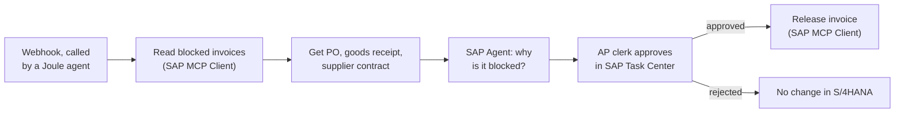

# Tutorial notes: Create an invoice exception workflow with n8n in Joule Studio

*Describe an invoice-exception process in plain words and let Joule Studio generate an n8n workflow: it reads blocked supplier invoices from SAP S/4HANA Cloud, lets an SAP agent find why each is blocked, asks an AP clerk to approve in SAP Task Center, and releases approved invoices. A look-and-learn preview: you explore what's generated, you don't run it. My notes on SAP's 20-minute lab, with a link to SAP's screens at every step.*

> [!NOTE]
> **📍 At a glance**
> - **SAP's tutorial:** [How to create an Invoice Exception Agent with an n8n Workflow](https://developers.sap.com/tutorials/create-invoice-exception-agent-with-n8n) by Zeena Qarqash · about 20 min · beginner · SAP runs it on a pre-release Joule Studio
> - **About this page:** *Added by Claude.* Written in my own words from SAP's tutorial, whose text and images may not be copied ([its licence](https://github.com/sap-tutorials/joule-studio/blob/main/LICENSE.txt)). The screen map is my own sketch; each step links to SAP's real screens.
> - **You need:** Joule Studio, and a configured connection to SAP S/4HANA
> - **Builds on:** [The new Joule Studio](joule-studio-intent-based.md) (chapter 4), [the n8n triage agent](tutorial-joule-studio-n8n-workflow-create.md) (chapter 24)
> - **Last checked:** 22 Nov 2026

**After this tutorial you can:**

- Create an *n8n Workflow* solution from an intent, instead of an agent
- See how Joule grounds a design in the SAP Knowledge Graph, SAP Signavio and SAP LeanIX
- Read a generated workflow on the n8n canvas, node by node

## 37.1 What you build

Accounts payable has a backlog of **blocked (parked) invoices** where the three-way match between purchase order, goods receipt and invoice failed. That costs early-payment discounts and supplier goodwill, pushes up days payable outstanding, eats AP time, and leaves risk open at month end.

**Screen map: the Joule Studio workspace with the n8n canvas** *(my own sketch of the layout, not SAP's screenshot; numbers are SAP's steps)*

<svg viewBox="0 0 760 440" role="img" aria-label="Screen map of the Joule Studio workspace with the n8n workflow canvas: icon rail, top bar with Develop and Manage tabs and Deploy, Solution Progress panel on the left, document view in the middle, Joule chat on the right" style="width:100%;height:auto;max-width:760px;font-family:inherit">
<rect x="1" y="1" width="758" height="438" rx="10" style="fill:var(--surface);stroke:var(--line);stroke-width:1.5"/>
<rect x="1" y="1" width="36" height="438" rx="10" style="fill:var(--code-bg);stroke:var(--line)"/>
<circle cx="19" cy="30" r="7" style="fill:var(--line)"/><circle cx="19" cy="62" r="7" style="fill:var(--line)"/><rect x="10" y="85" width="18" height="18" rx="4" style="fill:var(--accent)"/><circle cx="19" cy="126" r="7" style="fill:var(--line)"/>
<line x1="37" y1="46" x2="759" y2="46" style="stroke:var(--line)"/>
<text x="48" y="29" style="fill:var(--ink);font-size:13px;font-weight:600">Invoice Exception Agent</text>
<rect x="207" y="16" width="34" height="16" rx="4" style="fill:var(--code-bg)"/><text x="213" y="28" style="fill:var(--muted);font-size:10px">Draft</text>
<rect x="398" y="12" width="118" height="24" rx="6" style="fill:var(--code-bg);stroke:var(--line)"/>
<rect x="400" y="14" width="56" height="20" rx="5" style="fill:var(--accent-soft)"/><text x="409" y="28" style="fill:var(--accent);font-size:11px;font-weight:600">Develop</text><text x="466" y="28" style="fill:var(--ink);font-size:11px">Manage</text>
<rect x="560" y="12" width="66" height="24" rx="6" style="fill:none;stroke:var(--accent)"/><text x="574" y="28" style="fill:var(--accent);font-size:11px;font-weight:600">Deploy</text>
<rect x="634" y="12" width="72" height="24" rx="6" style="fill:none;stroke:var(--line)"/><text x="645" y="28" style="fill:var(--ink);font-size:11px">Actions ▾</text>
<rect x="716" y="14" width="22" height="20" rx="4" style="fill:none;stroke:var(--line)"/>
<rect x="44" y="54" width="176" height="378" rx="6" style="fill:none;stroke:var(--line)"/>
<text x="54" y="74" style="fill:var(--ink);font-size:12px;font-weight:600">▾ Solution Progress</text>
<text x="62" y="98" style="fill:var(--ink);font-size:11px">Intent Summary</text><text x="200" y="98" style="fill:var(--accent);font-size:11px">✓</text>
<text x="62" y="120" style="fill:var(--ink);font-size:11px">Requirements</text><text x="200" y="120" style="fill:var(--accent);font-size:11px">✓</text>
<text x="62" y="142" style="fill:var(--ink);font-size:11px">Specification</text><text x="200" y="142" style="fill:var(--accent);font-size:11px">✓</text>
<text x="62" y="164" style="fill:var(--ink);font-size:11px">▾ Solution Artifacts</text>
<text x="76" y="184" style="fill:var(--muted);font-size:10.5px">blocked-invoice-</text><text x="76" y="202" style="fill:var(--muted);font-size:10.5px">release-workflow</text>
<line x1="52" y1="216" x2="212" y2="216" style="stroke:var(--line)"/>
<text x="54" y="236" style="fill:var(--ink);font-size:12px;font-weight:600">▾ Testing</text><text x="62" y="256" style="fill:var(--ink);font-size:11px">Overview</text>
<line x1="52" y1="270" x2="212" y2="270" style="stroke:var(--line)"/>

<line x1="52" y1="324" x2="212" y2="324" style="stroke:var(--line)"/>
<text x="54" y="344" style="fill:var(--ink);font-size:12px;font-weight:600">▸ File tree</text><text x="62" y="364" style="fill:var(--muted);font-size:10.5px">specification.md, assets/</text><text x="62" y="380" style="fill:var(--muted);font-size:10.5px">(workflow JSON), solution.yaml</text>
<rect x="228" y="54" width="288" height="378" rx="6" style="fill:none;stroke:var(--line)"/>
<text x="240" y="74" style="fill:var(--ink);font-size:12px;font-weight:600">n8n workflow canvas</text>
<text x="240" y="92" style="fill:var(--muted);font-size:10.5px">opens from Solution Artifacts → the workflow</text>
<rect x="244" y="118" width="26" height="26" rx="5" style="fill:var(--accent-soft);stroke:var(--accent)"/><text x="257" y="158" text-anchor="middle" style="fill:var(--ink);font-size:9px">Webhook</text><text x="257" y="169" text-anchor="middle" style="fill:var(--ink);font-size:9px">trigger</text>
<rect x="300" y="118" width="26" height="26" rx="5" style="fill:var(--accent-soft);stroke:var(--accent)"/><text x="313" y="158" text-anchor="middle" style="fill:var(--ink);font-size:9px">Blocked</text><text x="313" y="169" text-anchor="middle" style="fill:var(--ink);font-size:9px">invoices</text>
<line x1="270" y1="131" x2="300" y2="131" style="stroke:var(--muted);stroke-width:1.2"/>
<rect x="356" y="118" width="26" height="26" rx="5" style="fill:var(--accent-soft);stroke:var(--accent)"/><text x="369" y="158" text-anchor="middle" style="fill:var(--ink);font-size:9px">PO, GR,</text><text x="369" y="169" text-anchor="middle" style="fill:var(--ink);font-size:9px">contract</text>
<line x1="326" y1="131" x2="356" y2="131" style="stroke:var(--muted);stroke-width:1.2"/>
<rect x="412" y="118" width="26" height="26" rx="5" style="fill:var(--accent-soft);stroke:var(--accent)"/><text x="425" y="158" text-anchor="middle" style="fill:var(--ink);font-size:9px">Build</text><text x="425" y="169" text-anchor="middle" style="fill:var(--ink);font-size:9px">context</text>
<line x1="382" y1="131" x2="412" y2="131" style="stroke:var(--muted);stroke-width:1.2"/>
<path d="M438 131 L476 131 L476 182 L257 182 L257 212" style="fill:none;stroke:var(--muted);stroke-width:1.2"/>
<rect x="244" y="212" width="26" height="26" rx="5" style="fill:var(--accent-soft);stroke:var(--accent)"/><text x="257" y="252" text-anchor="middle" style="fill:var(--ink);font-size:9px">SAP Agent:</text><text x="257" y="263" text-anchor="middle" style="fill:var(--ink);font-size:9px">block reason</text>
<rect x="316" y="212" width="26" height="26" rx="5" style="fill:var(--accent-soft);stroke:var(--accent)"/><text x="329" y="252" text-anchor="middle" style="fill:var(--ink);font-size:9px">Task Center</text><text x="329" y="263" text-anchor="middle" style="fill:var(--ink);font-size:9px">approval</text>
<line x1="270" y1="225" x2="316" y2="225" style="stroke:var(--muted);stroke-width:1.2"/>
<rect x="388" y="212" width="26" height="26" rx="5" style="fill:var(--accent-soft);stroke:var(--accent)"/><text x="401" y="252" text-anchor="middle" style="fill:var(--ink);font-size:9px">Route</text><text x="401" y="263" text-anchor="middle" style="fill:var(--ink);font-size:9px">decision</text>
<line x1="342" y1="225" x2="388" y2="225" style="stroke:var(--muted);stroke-width:1.2"/>
<rect x="452" y="212" width="26" height="26" rx="5" style="fill:var(--accent-soft);stroke:var(--accent)"/><text x="465" y="252" text-anchor="middle" style="fill:var(--ink);font-size:9px">Release</text><text x="465" y="263" text-anchor="middle" style="fill:var(--ink);font-size:9px">invoice</text>
<line x1="414" y1="225" x2="452" y2="225" style="stroke:var(--muted);stroke-width:1.2"/>
<rect x="300" y="318" width="146" height="26" rx="6" style="fill:none;stroke:var(--warn);stroke-width:1.5"/>
<text x="312" y="335" style="fill:var(--warn);font-size:10.5px;font-weight:600">Execute workflow</text>
<text x="294" y="360" style="fill:var(--warn);font-size:9.5px">don't press it in this preview lab</text>
<line x1="228" y1="404" x2="516" y2="404" style="stroke:var(--line)"/>
<text x="240" y="421" style="fill:var(--muted);font-size:10.5px">Logs ▴</text>
<g style="font-size:10px;font-weight:700"><circle cx="500" cy="74" r="9" style="fill:var(--accent)"/><text x="497" y="78" style="fill:var(--surface);font-size:10px">6</text></g>
<rect x="524" y="54" width="228" height="378" rx="6" style="fill:none;stroke:var(--line)"/>
<text x="536" y="74" style="fill:var(--ink);font-size:12px;font-weight:600">Joule chat</text>
<text x="536" y="96" style="fill:var(--muted);font-size:10.5px">Progress messages and summaries</text>
<rect x="536" y="108" width="200" height="40" rx="6" style="fill:var(--code-bg)"/><rect x="546" y="118" width="150" height="7" rx="3" style="fill:var(--line)"/><rect x="546" y="132" width="110" height="7" rx="3" style="fill:var(--line)"/>
<rect x="536" y="156" width="200" height="56" rx="6" style="fill:var(--code-bg)"/><rect x="546" y="166" width="170" height="7" rx="3" style="fill:var(--line)"/><rect x="546" y="180" width="140" height="7" rx="3" style="fill:var(--line)"/><rect x="546" y="194" width="160" height="7" rx="3" style="fill:var(--line)"/>
<rect x="536" y="384" width="204" height="34" rx="6" style="fill:none;stroke:var(--accent)"/><text x="546" y="405" style="fill:var(--muted);font-size:10.5px">Message Joule…</text>
<g style="font-size:10px;font-weight:700">
<circle cx="31" cy="83" r="8" style="fill:var(--accent);stroke:var(--surface);stroke-width:1.5"/><text x="28" y="87" style="fill:var(--surface);font-size:10px">2</text>
<circle cx="180" cy="94" r="9" style="fill:var(--accent)"/><text x="177" y="98" style="fill:var(--surface);font-size:10px">2</text>
<circle cx="722" cy="401" r="9" style="fill:var(--accent)"/><text x="719" y="405" style="fill:var(--surface);font-size:10px">2</text>
<circle cx="180" cy="116" r="9" style="fill:var(--accent)"/><text x="177" y="120" style="fill:var(--surface);font-size:10px">3</text>
<circle cx="180" cy="138" r="9" style="fill:var(--accent)"/><text x="177" y="142" style="fill:var(--surface);font-size:10px">4</text>
<circle cx="140" cy="340" r="9" style="fill:var(--accent)"/><text x="137" y="344" style="fill:var(--surface);font-size:10px">5</text>
<circle cx="180" cy="160" r="9" style="fill:var(--accent)"/><text x="177" y="164" style="fill:var(--surface);font-size:10px">6</text>
</g>
</svg>

- **2** Joule Studio → **Create** on the *n8n Workflow* tile; Intent Summary; in the chat, **Activate Skill** shows the intent analysis
- **3** Requirements (the PRD) · **4** Specifications · **5** File tree: `specification.md`, `assets` (the workflow JSON), `solution.yaml`
- **6** Solution Artifacts → `blocked-invoice-release-workflow` opens the canvas. Don't press **Execute workflow** or **Deploy** in this lab

## 37.2 Create the n8n workflow solution (SAP step 2)

- **Screen:** Joule Work → **Joule Studio**. The *Create a New Solution* dialog shows only for your first project; otherwise choose **New** in the *Solutions* pane (top left). Choose **Create** on the **n8n Workflow** tile.
- **Name:** `Invoice Exception Agent` · **Intent:** copy SAP's text from step 2. It describes: a webhook trigger called by a Joule agent; read all blocked supplier invoices through the SAP MCP Client; an SAP agent finds the block reason from PO, goods receipt and supplier contract; the clerk sees the findings in SAP Task Center (human in the loop); approved invoices are released through the MCP Client.
- Keep **Quick Create**, then **Create**.
- **What Joule does with it:**
  - runs its intent-analysis skill (open it with **Activate Skill** in the chat)
  - walks the **SAP Knowledge Graph**, a map of your SAP entities (supplier, PO, goods receipt, invoice) and the APIs that link them, so the design uses real API paths
  - can use your **SAP Signavio** process models and variants, so the design follows your actual process
  - gives a **fit-gap analysis** (what SAP already covers vs what needs building, clean-core) and an **intent fit** score
- **Everything is files:** edit the `.md` files directly, in the Intent Summary, or by asking Joule; changes show everywhere at once. *Solution Progress* ticks off each finished phase.
- [SAP's screens for step 2 ↗](https://developers.sap.com/tutorials/create-invoice-exception-agent-with-n8n#step-2)

## 37.3 Review the requirements (SAP step 3)

- **Screen:** *Solution Progress* → **Requirements**.
- **The business need:** a block always comes from one of three mismatches (PO price or quantity, missing goods receipt, contract deviation), each needing manual digging.
- **Objectives, in order:** faster decisions on blocked invoices; one combined analysis for the clerk; **no release without the clerk's approval**.
- **Architecture:** Joule queries your **SAP LeanIX** architecture repository to propose target systems, APIs and integration patterns that fit your landscape.
- **The split to check:**

| Runs alone | Needs the AP clerk |
|---|---|
| Read blocked invoices; get PO, GR and contract data; run the agent analysis; create the Task Center task; reply to the calling Joule agent | Releasing any invoice in S/4HANA |

- **Guardrails:** every release needs the clerk's sign-off (no automatic path); a rejection writes nothing back; the webhook always answers, even if a step fails. **Joule also asks you who the approver is** instead of guessing.
- [SAP's screens for step 3 ↗](https://developers.sap.com/tutorials/create-invoice-exception-agent-with-n8n#step-3)

## 37.4 Read the specification (SAP step 4)

- **Screen:** *Solution Progress* → **Specifications**; expand each section.
- **The six parts:** webhook trigger → read blocked invoices → get PO, GR and contract → agent analysis → approval in Task Center → act on the decision (release where allowed).
- **Remember:** the specification is the plan. It doesn't mean every integration or agent setting is ready to run.
- [SAP's screens for step 4 ↗](https://developers.sap.com/tutorials/create-invoice-exception-agent-with-n8n#step-4)

## 37.5 Look at the generated files (SAP step 5)

- **Screen:** *File tree*.
  - `specification.md`: the workflow's layout, steps and integrations
  - `assets`: the generated n8n workflow, as JSON
  - `solution.yaml`: the solution's structure and assets
- [SAP's screens for step 5 ↗](https://developers.sap.com/tutorials/create-invoice-exception-agent-with-n8n#step-5)

## 37.6 Explore the workflow on the canvas (SAP step 6)

- **Screen:** *Solution Artifacts* → **`blocked-invoice-release-workflow`** opens the visual n8n editor.
- **Follow the nodes:** read blocked invoices → add PO, GR and contract → the embedded **AI Agent node** analyses the block → **SAP Human-in-the-Loop** sends it to the clerk → the decision is processed (release, or handle the rejection).
- ⚠️ **Preview limits:** setting up the AI agent, running, testing and deploying aren't part of this preview. **Don't press *Execute workflow* or *Deploy*.**
- [SAP's screens for step 6 ↗](https://developers.sap.com/tutorials/create-invoice-exception-agent-with-n8n#step-6)

## 37.7 Pitfalls

- **It's a design you explore,** not a running workflow. The canvas shows the plan, not a tested automation.
- **Name the approver** when Joule asks; it won't assume one.
- **The release is the only write,** and only after approval. Check the PRD keeps it that way.

> [!TIP]
> **Before a real rollout** *(Added by Claude)*
> - Agree which block reasons may be released at all; some (for example missing goods receipts) may need the warehouse first.
> - Give the MCP Client's S/4HANA user release rights only for the company codes in scope.

## Check yourself

Which three mismatches usually cause a blocked invoice?

- PO price or quantity difference, missing goods receipt, deviation from the supplier contract

What does the SAP Knowledge Graph give Joule here?

- A map of SAP entities and the APIs between them, so the generated design uses real API paths from supplier to PO to goods receipt

What happens to S/4HANA when the clerk rejects?

- Nothing: a rejection writes nothing back

## How this page was checked

- **SAP's tutorial read in full on 22 Nov 2026:** all seven steps, on developers.sap.com.
- **Written in my own words.** SAP's intent is summarised, not copied; the solution and workflow names are given exactly because you type or look for them.
- **Screen map:** my simplified sketch of the workspace and n8n canvas, drawn after viewing SAP's screenshots; not a copy.
- **Not built here:** no Joule Studio tenant in this workspace.

## Sources

- SAP Developer Center tutorial: https://developers.sap.com/tutorials/create-invoice-exception-agent-with-n8n
- Its licence: https://github.com/sap-tutorials/joule-studio/blob/main/LICENSE.txt

Previous: [Tutorial notes: Extend a standard Joule agent with intent-based development](notes-create-agent-extension.md) · Next: [Reference: Joule setup building blocks](reference-joule-setup-building-blocks.md)
