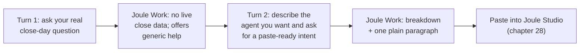

# Tutorial notes: Draft a financial close agent's intent in Joule Work

*Use two chat turns in Joule Work to find out that the agent you need doesn't exist yet, and to get a ready-to-paste intent statement for Joule Studio. My notes on SAP's 10-minute lab, with a link to SAP's screens at every step.*

> [!NOTE]
> **📍 At a glance**
> - **SAP's tutorial:** [Draft a Financial Close Recommendation Agent Intent with Joule Work](https://developers.sap.com/tutorials/get-productive-with-joule-work-for-financial-closing-advisor) by Rebecca Yang · about 10 min · beginner
> - **About this page:** *Added by Claude.* Written in my own words from SAP's tutorial, whose text and images may not be copied ([its licence](https://github.com/sap-tutorials/joule-studio/blob/main/LICENSE.txt)). The screen map is my own sketch; each step links to SAP's real screens.
> - **You need:** Joule Work, and an S/4HANA Cloud system with a close in progress (only as context: nothing is written)
> - **Do it before:** [the closing advisor notes](notes-financial-closing-advisor-agent.md) (chapter 28), where you paste the intent this produces
> - **Last checked:** 22 Nov 2026

**After this tutorial you can:**

- Use Joule Work to check whether an agent for your need already exists
- Get Joule Work to write a Joule Studio intent statement for you, with all the guardrails in it
- Check that intent for its required parts before you paste it

## 29.1 What you do

Two turns in one Joule Work conversation, then you switch to Joule Studio.

**Screen map: a Joule Work conversation** *(my own sketch of the layout, not SAP's screenshot; numbers are SAP's steps)*

<svg viewBox="0 0 760 440" role="img" aria-label="Screen map of a Joule Work conversation: icon rail on the left with chat and Joule Studio icons, conversation title at the top, your message and Joule's reply in the middle, message box at the bottom" style="width:100%;height:auto;max-width:760px;font-family:inherit">
<rect x="1" y="1" width="758" height="438" rx="10" style="fill:var(--surface);stroke:var(--line);stroke-width:1.5"/>
<rect x="1" y="1" width="40" height="438" rx="10" style="fill:var(--code-bg);stroke:var(--line)"/>
<rect x="12" y="20" width="18" height="18" rx="5" style="fill:var(--accent)"/>
<rect x="11" y="89" width="20" height="18" rx="4" style="fill:var(--accent-soft);stroke:var(--accent)"/><text x="46" y="102" style="fill:var(--muted);font-size:10px">chat</text>
<circle cx="21" cy="130" r="7" style="fill:var(--line)"/><text x="46" y="134" style="fill:var(--muted);font-size:10px">history</text>
<circle cx="21" cy="160" r="7" style="fill:var(--line)"/><circle cx="21" cy="190" r="7" style="fill:var(--line)"/>
<rect x="11" y="209" width="20" height="18" rx="4" style="fill:none;stroke:var(--ink)"/><text x="14" y="222" style="fill:var(--ink);font-size:9px;font-weight:700">&lt;&gt;</text><text x="46" y="222" style="fill:var(--muted);font-size:10px">Joule Studio</text>
<circle cx="21" cy="372" r="7" style="fill:var(--line)"/><circle cx="21" cy="400" r="9" style="fill:var(--accent-soft)"/>
<line x1="41" y1="50" x2="759" y2="50" style="stroke:var(--line)"/>
<rect x="56" y="18" width="16" height="14" rx="3" style="fill:none;stroke:var(--muted)"/>
<text x="82" y="30" style="fill:var(--ink);font-size:13px;font-weight:600">New Conversation</text><text x="728" y="30" style="fill:var(--muted);font-size:13px">···</text>
<rect x="430" y="64" width="250" height="60" rx="8" style="fill:var(--accent-soft)"/>
<text x="442" y="84" style="fill:var(--ink);font-size:11px;font-weight:600">You</text>
<rect x="442" y="92" width="220" height="7" rx="3" style="fill:var(--line)"/><rect x="442" y="106" width="180" height="7" rx="3" style="fill:var(--line)"/>
<rect x="150" y="138" width="290" height="150" rx="8" style="fill:none;stroke:var(--line)"/>
<text x="162" y="158" style="fill:var(--ink);font-size:11px;font-weight:600">Joule's reply</text>
<text x="162" y="178" style="fill:var(--muted);font-size:10.5px">✓ progress steps, then the answer:</text>
<rect x="162" y="190" width="260" height="7" rx="3" style="fill:var(--line)"/><rect x="162" y="204" width="230" height="7" rx="3" style="fill:var(--line)"/><rect x="162" y="218" width="250" height="7" rx="3" style="fill:var(--line)"/><rect x="162" y="232" width="200" height="7" rx="3" style="fill:var(--line)"/><rect x="162" y="246" width="240" height="7" rx="3" style="fill:var(--line)"/>
<rect x="160" y="352" width="450" height="56" rx="8" style="fill:none;stroke:var(--accent);stroke-width:1.5"/>
<text x="174" y="372" style="fill:var(--muted);font-size:11px">Message Joule…</text><text x="174" y="398" style="fill:var(--muted);font-size:12px">+  @</text>
<text x="300" y="428" style="fill:var(--muted);font-size:9.5px">Joule uses AI. Verify results.</text>
<g style="font-size:10px;font-weight:700">
<circle cx="31" cy="98" r="8" style="fill:var(--accent);stroke:var(--surface);stroke-width:1.5"/><text x="28" y="102" style="fill:var(--surface);font-size:10px">1</text>
<circle cx="210" cy="34" r="9" style="fill:var(--accent)"/><text x="207" y="38" style="fill:var(--surface);font-size:10px">1</text>
<circle cx="700" cy="380" r="9" style="fill:var(--accent)"/><text x="697" y="384" style="fill:var(--surface);font-size:10px">1</text>
<circle cx="452" cy="150" r="9" style="fill:var(--accent)"/><text x="449" y="154" style="fill:var(--surface);font-size:10px">2</text>
<circle cx="35" cy="204" r="8" style="fill:var(--accent);stroke:var(--surface);stroke-width:1.5"/><text x="32" y="208" style="fill:var(--surface);font-size:10px">3</text>
</g>
</svg>

- **1** Start a **New Conversation** from the chat icon and type the turn-1 question in the message box
- **2** Same conversation: type the turn-2 request; the reply card holds the breakdown and the paragraph
- **3** The `<>` icon opens Joule Studio, where the paragraph goes into the intent field

## 29.2 Turn 1: ask the real close-day question (SAP step 1)

- **Screen:** Joule Work → chat → new conversation → message box.
- **What to ask:** copy SAP's turn-1 question from step 1. In short: you are a few days into the month-end close, with accruals, journals, reconciliations, intercompany, FX and sub-ledger tie-outs in flight; you have the task list and know the sequence, but you need help seeing where things actually stand in the numbers.
- **What Joule Work usually replies** (wording varies by run): it understands the close context, says it can't see your live ledger or close status, and offers fallbacks: general guidance, reports, or single tasks it can run. In SAP's screenshot it even hands over to an existing closing assistant.
- **The point of turn 1:** the agent you need, one that reads live close data and ranks what to do with reasons, isn't available ready-made. That gap justifies building it.
- [SAP's screens for step 1 ↗](https://developers.sap.com/tutorials/get-productive-with-joule-work-for-financial-closing-advisor#step-1)

## 29.3 Turn 2: describe the agent and ask for the intent (SAP step 2)

- **Same conversation.** Copy SAP's turn-2 request from step 2. In short: you want your own *Financial Close Recommendation Agent* that looks at live data in those six areas, ranks the work by materiality, blocking, deadline and risk, shows its evidence, flags anything odd or overdue, admits missing data instead of guessing, only recommends (never posts), stays short and ends with one next action. You ask for a structured breakdown **and** one plain paragraph with no headings or bullets.
- **Check the paragraph contains all eight parts:**

| Part | What it must say |
|---|---|
| Name | Financial Close Recommendation Agent |
| Scope | the six close areas |
| Ranking | materiality, blocking dependencies, deadline, risk |
| Output | clear tiers, with reasons and evidence |
| Anomalies | flags odd or overdue items |
| Missing data | says so, never guesses |
| Boundary | recommends only, never posts or executes |
| Shape | short, ends with the single next action |

- **If a part is missing,** ask Joule Work in the same chat to add it back, then copy the paragraph.
- 💡 **Why the two guardrails belong in the intent:** "recommends only" and "one next action" decide whether controllers keep using the agent. Put in the intent, they become design rules when Joule Studio builds it, not afterthoughts.
- **Your paragraph will differ** from SAP's and from your next run. That's fine: Joule Studio reads the meaning, so it only has to contain all eight parts.
- [SAP's screens for step 2 ↗](https://developers.sap.com/tutorials/get-productive-with-joule-work-for-financial-closing-advisor#step-2)

## 29.4 Paste it into Joule Studio (SAP step 3)

- **Screen:** `<>` → Joule Studio → **Create** → new agent solution → paste the paragraph into *Intent Statement*.
- **Then follow** [the closing advisor notes](notes-financial-closing-advisor-agent.md) (chapter 28) through requirements, specification, build, tests and deployment. Once deployed, you can call the agent back in Joule Work on close day.
- [SAP's screens for step 3 ↗](https://developers.sap.com/tutorials/get-productive-with-joule-work-for-financial-closing-advisor#step-3)

## 29.5 Pitfalls

- **Turn 1 is not a dead end.** Whatever Joule Work offers, the signal is the same: the agent you need isn't off the shelf.
- **Don't paste the breakdown,** only the single paragraph.
- **Nothing here touches S/4HANA;** the close data is only context for the conversation.

## Check yourself

What is turn 1 for, if Joule Work can't answer it?

- To confirm the agent you need doesn't already exist
- Its limits become the specification of what to build

Which two guardrails should be in the intent, not added later?

- The agent only recommends, never posts or executes
- Every answer ends with the single next action

## How this page was checked

- **SAP's tutorial read in full on 22 Nov 2026:** all three steps, on developers.sap.com.
- **Written in my own words.** SAP's two prompts are summarised, not copied; open SAP's steps 1 and 2 to copy them.
- **Screen map:** my simplified sketch of a Joule Work conversation, drawn after viewing SAP's screenshots; not a copy.

## Sources

- SAP Developer Center tutorial: https://developers.sap.com/tutorials/get-productive-with-joule-work-for-financial-closing-advisor
- Its licence: https://github.com/sap-tutorials/joule-studio/blob/main/LICENSE.txt

Previous: [Tutorial notes: Guide the financial close with a closing advisor agent](notes-financial-closing-advisor-agent.md) · Next: [Tutorial notes: Optimise cable roll selection with a custom Joule agent](notes-cable-roll-optimizer-agent.md)
