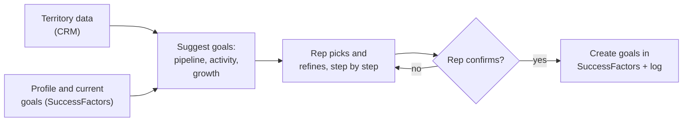

# Tutorial notes: Build a performance and goals recommendations agent

*Build an agent that helps a sales rep set quarterly goals: it reads the territory from a CRM and the rep's profile and goals from SAP SuccessFactors, suggests goals grounded in real numbers, and writes the confirmed goals into SuccessFactors. My notes on SAP's 30-minute lab, with a link to SAP's screens at every step.*

> [!NOTE]
> **📍 At a glance**
> - **SAP's tutorial:** [Build a Performance and Goals Recommendations Agent with Joule Studio, CRM, and SAP SuccessFactors](https://developers.sap.com/tutorials/build-performance-goals-recommendations-agent) by Paulina Bujnicka · about 30 min · beginner · SAP runs it on a pre-release Joule Studio
> - **About this page:** *Added by Claude.* Written in my own words from SAP's tutorial, whose text and images may not be copied ([its licence](https://github.com/sap-tutorials/joule-studio/blob/main/LICENSE.txt)). The screen map is my own sketch; each step links to SAP's real screens.
> - **You need:** Joule Studio; a CRM with territory data behind an API or OData endpoint; SAP SuccessFactors with Goal Management on and an API user that can read and write goals
> - **Builds on:** [The new Joule Studio](joule-studio-intent-based.md) (chapter 4), [Joule with SuccessFactors](joule-integration-successfactors.md) (chapter 15)
> - **Last checked:** 22 Nov 2026

**After this tutorial you can:**

- Describe a step-by-step, conversational agent in one intent statement
- Check that a write to SuccessFactors only happens after explicit confirmation
- Test it with mock data and deploy it to development

## 35.1 What you build

A goal-setting coach for sales reps. Reps often skip goal setting or copy last quarter's, because the territory data is spread over reports, the CRM and SuccessFactors aren't linked, and goals end up vague and hard to measure. The agent gathers the numbers and walks the rep through choosing goals.

| Goal type | Based on | Example data |
|---|---|---|
| Pipeline | The opportunities the rep has now | Opportunities in the territory, account potential |
| Activity | How much engagement is planned | Accounts managed, leads in the territory |
| Growth | Improving on past results | Past sales, territory trends |

**Screen map: the Joule Studio workspace** *(my own sketch of the layout, not SAP's screenshot; numbers are SAP's steps)*

<svg viewBox="0 0 760 440" role="img" aria-label="Screen map of the Joule Studio workspace: icon rail, top bar with Develop and Manage tabs and Deploy, Solution Progress panel on the left, document view in the middle, Joule chat on the right" style="width:100%;height:auto;max-width:760px;font-family:inherit">
<rect x="1" y="1" width="758" height="438" rx="10" style="fill:var(--surface);stroke:var(--line);stroke-width:1.5"/>
<rect x="1" y="1" width="36" height="438" rx="10" style="fill:var(--code-bg);stroke:var(--line)"/>
<circle cx="19" cy="30" r="7" style="fill:var(--line)"/><circle cx="19" cy="62" r="7" style="fill:var(--line)"/><rect x="10" y="85" width="18" height="18" rx="4" style="fill:var(--accent)"/><circle cx="19" cy="126" r="7" style="fill:var(--line)"/>
<line x1="37" y1="46" x2="759" y2="46" style="stroke:var(--line)"/>
<text x="48" y="29" style="fill:var(--ink);font-size:13px;font-weight:600">Performance and Goals Recommendations</text>
<rect x="300" y="16" width="34" height="16" rx="4" style="fill:var(--code-bg)"/><text x="306" y="28" style="fill:var(--muted);font-size:10px">Draft</text>
<rect x="398" y="12" width="118" height="24" rx="6" style="fill:var(--code-bg);stroke:var(--line)"/>
<rect x="400" y="14" width="56" height="20" rx="5" style="fill:var(--accent-soft)"/><text x="409" y="28" style="fill:var(--accent);font-size:11px;font-weight:600">Develop</text><text x="466" y="28" style="fill:var(--ink);font-size:11px">Manage</text>
<rect x="560" y="12" width="66" height="24" rx="6" style="fill:none;stroke:var(--accent)"/><text x="574" y="28" style="fill:var(--accent);font-size:11px;font-weight:600">Deploy</text>
<rect x="634" y="12" width="72" height="24" rx="6" style="fill:none;stroke:var(--line)"/><text x="645" y="28" style="fill:var(--ink);font-size:11px">Actions ▾</text>
<rect x="716" y="14" width="22" height="20" rx="4" style="fill:none;stroke:var(--line)"/>
<rect x="44" y="54" width="176" height="378" rx="6" style="fill:none;stroke:var(--line)"/>
<text x="54" y="74" style="fill:var(--ink);font-size:12px;font-weight:600">▾ Solution Progress</text>
<text x="62" y="98" style="fill:var(--ink);font-size:11px">Intent Summary</text><text x="200" y="98" style="fill:var(--accent);font-size:11px">✓</text>
<text x="62" y="120" style="fill:var(--ink);font-size:11px">Requirements</text><text x="200" y="120" style="fill:var(--accent);font-size:11px">✓</text>
<text x="62" y="142" style="fill:var(--ink);font-size:11px">Specification</text><text x="200" y="142" style="fill:var(--accent);font-size:11px">✓</text>
<text x="62" y="164" style="fill:var(--ink);font-size:11px">▾ Solution Artifacts</text>
<text x="76" y="184" style="fill:var(--muted);font-size:10.5px">the agent</text><text x="76" y="202" style="fill:var(--muted);font-size:10.5px">MCP servers / tools</text>
<line x1="52" y1="216" x2="212" y2="216" style="stroke:var(--line)"/>
<text x="54" y="236" style="fill:var(--ink);font-size:12px;font-weight:600">▾ Testing</text><text x="62" y="256" style="fill:var(--ink);font-size:11px">Overview</text>
<line x1="52" y1="270" x2="212" y2="270" style="stroke:var(--line)"/>
<text x="54" y="290" style="fill:var(--ink);font-size:12px;font-weight:600">▾ Preview</text><text x="62" y="310" style="fill:var(--ink);font-size:11px">the agent (chat test)</text>
<line x1="52" y1="324" x2="212" y2="324" style="stroke:var(--line)"/>
<text x="54" y="344" style="fill:var(--ink);font-size:12px;font-weight:600">▸ File tree</text><text x="62" y="364" style="fill:var(--muted);font-size:10.5px">intent.md, assets/,</text><text x="62" y="380" style="fill:var(--muted);font-size:10.5px">Python code, deploy_result</text>
<rect x="228" y="54" width="288" height="378" rx="6" style="fill:none;stroke:var(--line)"/>
<text x="240" y="74" style="fill:var(--ink);font-size:12px;font-weight:600">Document view</text>
<text x="240" y="96" style="fill:var(--muted);font-size:10.5px">Shows what you pick on the left:</text>
<text x="240" y="112" style="fill:var(--muted);font-size:10.5px">intent summary, PRD, specification,</text>
<text x="240" y="128" style="fill:var(--muted);font-size:10.5px">agent definition, test results</text>
<rect x="240" y="146" width="250" height="8" rx="3" style="fill:var(--line)"/><rect x="240" y="164" width="210" height="8" rx="3" style="fill:var(--line)"/><rect x="240" y="182" width="232" height="8" rx="3" style="fill:var(--line)"/>
<rect x="240" y="206" width="264" height="26" rx="4" style="fill:none;stroke:var(--line)"/><text x="250" y="223" style="fill:var(--ink);font-size:10.5px">▸ section</text>
<rect x="240" y="238" width="264" height="26" rx="4" style="fill:none;stroke:var(--line)"/><text x="250" y="255" style="fill:var(--ink);font-size:10.5px">▸ section</text>
<rect x="240" y="270" width="264" height="26" rx="4" style="fill:none;stroke:var(--line)"/><text x="250" y="287" style="fill:var(--ink);font-size:10.5px">▸ section</text>
<rect x="524" y="54" width="228" height="378" rx="6" style="fill:none;stroke:var(--line)"/>
<text x="536" y="74" style="fill:var(--ink);font-size:12px;font-weight:600">Joule chat</text>
<text x="536" y="96" style="fill:var(--muted);font-size:10.5px">Progress messages and summaries</text>
<rect x="536" y="108" width="200" height="40" rx="6" style="fill:var(--code-bg)"/><rect x="546" y="118" width="150" height="7" rx="3" style="fill:var(--line)"/><rect x="546" y="132" width="110" height="7" rx="3" style="fill:var(--line)"/>
<rect x="536" y="156" width="200" height="56" rx="6" style="fill:var(--code-bg)"/><rect x="546" y="166" width="170" height="7" rx="3" style="fill:var(--line)"/><rect x="546" y="180" width="140" height="7" rx="3" style="fill:var(--line)"/><rect x="546" y="194" width="160" height="7" rx="3" style="fill:var(--line)"/>
<rect x="536" y="384" width="204" height="34" rx="6" style="fill:none;stroke:var(--accent)"/><text x="546" y="405" style="fill:var(--muted);font-size:10.5px">Message Joule…</text>
<g style="font-size:10px;font-weight:700">
<circle cx="31" cy="83" r="8" style="fill:var(--accent);stroke:var(--surface);stroke-width:1.5"/><text x="28" y="87" style="fill:var(--surface);font-size:10px">2</text>
<circle cx="180" cy="94" r="9" style="fill:var(--accent)"/><text x="177" y="98" style="fill:var(--surface);font-size:10px">3</text>
<circle cx="140" cy="340" r="9" style="fill:var(--accent)"/><text x="137" y="344" style="fill:var(--surface);font-size:10px">3</text>
<circle cx="180" cy="116" r="9" style="fill:var(--accent)"/><text x="177" y="120" style="fill:var(--surface);font-size:10px">4</text>
<circle cx="180" cy="138" r="9" style="fill:var(--accent)"/><text x="177" y="142" style="fill:var(--surface);font-size:10px">5</text>
<circle cx="180" cy="160" r="9" style="fill:var(--accent)"/><text x="177" y="164" style="fill:var(--surface);font-size:10px">6</text>
<circle cx="140" cy="252" r="9" style="fill:var(--accent)"/><text x="137" y="256" style="fill:var(--surface);font-size:10px">7</text>
<circle cx="190" cy="306" r="9" style="fill:var(--accent)"/><text x="187" y="310" style="fill:var(--surface);font-size:10px">7</text>
<circle cx="593" cy="50" r="9" style="fill:var(--accent)"/><text x="590" y="54" style="fill:var(--surface);font-size:10px">8</text>
<circle cx="488" cy="50" r="9" style="fill:var(--accent)"/><text x="485" y="54" style="fill:var(--surface);font-size:10px">8</text>
</g>
</svg>

- **2** Joule Studio → **Create** · **3** Intent Summary, and `intent.md` in the File tree · **4** Requirements · **5** Specification
- **6** Solution Artifacts: the agent and its MCP servers · **7** Testing → Overview, then *Preview with Mock Data*
- **8** Deploy; **Git actions** in the top bar for GitHub sync; **Manage** to monitor

## 35.2 Create the agent and write the intent (SAP step 2)

- **Screen:** **Joule Studio** → **Create**.
- **Name:** `Performance and Goals Recommendations` · **Intent:** copy SAP's text from step 2.
- **What SAP's intent asks for:** a step-by-step conversation with the rep; each quarter, read accounts, leads, opportunities and past sales from the CRM; read the rep's profile and current goals from SuccessFactors; suggest goals across pipeline, activity and growth; help choose and refine them; create them in SuccessFactors only after explicit confirmation.
- Choose **Quick Create**, **Create**, then confirm the business goals.
- 💡 **A good intent covers four things:** what the agent does, which data, which decisions, which guardrails. This one does, so Joule Studio needs no technical input.
- [SAP's screens for step 2 ↗](https://developers.sap.com/tutorials/build-performance-goals-recommendations-agent#step-2)

## 35.3 Check the intent (SAP step 3)

- **Screen:** **Intent Summary** tab; `intent.md` in the *File tree*.
- **Read** the summary, *Fit Gap Analysis* and *Recommended Solution* (a Python A2A agent). The **intent fit score** should be 90% or more.
- [SAP's screens for step 3 ↗](https://developers.sap.com/tutorials/build-performance-goals-recommendations-agent#step-3)

## 35.4 Review the requirements (SAP step 4)

- **Screen:** *Solution Progress* → **Requirements** (Markdown in the *File tree*). Personas: the sales rep and the manager.
- **The split to check:** reading the SuccessFactors profile and existing goals runs alone; **writing any goal to SuccessFactors needs the rep's approval**.
- [SAP's screens for step 4 ↗](https://developers.sap.com/tutorials/build-performance-goals-recommendations-agent#step-4)

## 35.5 Look at the specification (SAP step 5)

- **Screen:** *Solution Progress* → **Specification**: read the summary; it is only the blueprint.
- [SAP's screens for step 5 ↗](https://developers.sap.com/tutorials/build-performance-goals-recommendations-agent#step-5)

## 35.6 Generate the solution (SAP step 6)

- **The build runs after the specification;** tests are created and run with it.
- **What gets built:** the agent and MCP servers, the CRM and SuccessFactors Goal Management connections, the LLM link for the conversation, a territory metrics step that turns CRM data into grounded numbers for the LLM, the confirmation gate before any SuccessFactors write, and audit logging.
- **Screen:** *Solution Artifacts* → the agent: LLM (SAP's example: a Claude Sonnet model), settings, MCP servers, *Evaluation*. Code is in the pro-code (*Files*) view.
- **MCP servers:** they use the SuccessFactors **Goal Plan** API (read existing goals, write confirmed ones) and the **Employee Profile** API (read the rep at the start of each session). No setup needed.
- ⚠️ SAP's text for this step also mentions an anomaly engine, scenario calculations and charts. That's left over from the budget variance lab; this agent has none of them.
- [SAP's screens for step 6 ↗](https://developers.sap.com/tutorials/build-performance-goals-recommendations-agent#step-6)

## 35.7 Test it (SAP step 7)

- **Testing runs by itself.** Open *Testing* → **Overview**; everything should pass (Joule fixes most failures itself).
- **Screen:** the agent under **Preview with Mock Data**. Ask what it is responsible for: it answers without calling the CRM or SuccessFactors.
- [SAP's screens for step 7 ↗](https://developers.sap.com/tutorials/build-performance-goals-recommendations-agent#step-7)

## 35.8 Deploy to development (SAP step 8)

- **Screen:** **Deploy**, then **Deploy** again; `deploy_result.json` gets the endpoint and runtime ID.
- **GitHub sync** is under **Git actions** in the top bar here (other labs call it *Actions*). Production isn't deployed from Joule Studio.
- Reps reach it through Joule's routing; monitor it under **Manage**.
- [SAP's screens for step 8 ↗](https://developers.sap.com/tutorials/build-performance-goals-recommendations-agent#step-8)

## 35.9 Pitfalls

- **The write needs confirmation:** check the PRD and specification keep the gate before creating goals.
- **The SuccessFactors API user** needs both read and write rights on goals, or the write-back tests fail.
- **A leftover paragraph in SAP's step 6** describes another lab's engine; ignore it.

> [!TIP]
> **Before a real rollout** *(Added by Claude)*
> - Agree with HR which goal plan and template the agent writes to, and who may change goals after they're created.
> - Check the CRM territory data is current at quarter start; stale numbers give stale goals.

## Check yourself

Which action of this agent needs the rep's approval?

- Creating (writing) goals in SuccessFactors

Which two SuccessFactors APIs do the MCP servers use?

- Goal Plan (read and write goals) and Employee Profile (read the rep's profile)

## How this page was checked

- **SAP's tutorial read in full on 22 Nov 2026:** all nine steps, on developers.sap.com.
- **Written in my own words.** Nothing copied from SAP's text or screenshots; the agent name is given exactly because you type it.
- **Screen map:** my simplified sketch of the Joule Studio workspace, drawn after viewing SAP's screenshots; not a copy.
- **Not built here:** no Joule Studio tenant in this workspace.

## Sources

- SAP Developer Center tutorial: https://developers.sap.com/tutorials/build-performance-goals-recommendations-agent
- Its licence: https://github.com/sap-tutorials/joule-studio/blob/main/LICENSE.txt

Previous: [Tutorial notes: Build an AI sales assistant for discount decisions](notes-ai-sales-assistant-agent.md) · Next: [Tutorial notes: Extend a standard Joule agent with intent-based development](notes-create-agent-extension.md)
