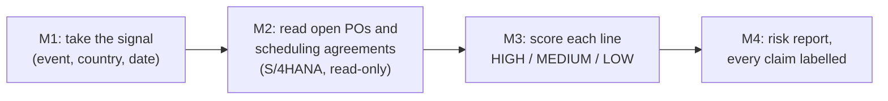

# Tutorial notes: Build a supplier disruption response agent with the Joule Studio CLI

*Build, on your own laptop, an agent that takes a supplier disruption (what, where, since when), finds the open purchase orders and scheduling agreements at risk in SAP S/4HANA Public Cloud, scores them HIGH, MEDIUM or LOW, and labels every statement as fact, assumption or recommendation. My notes on SAP's 40-minute lab, with a link to SAP's screens at every step.*

> [!NOTE]
> **📍 At a glance**
> - **SAP's tutorial:** [Build a Supplier Disruption Response Agent on SAP S/4HANA](https://developers.sap.com/tutorials/build-a-supplier-disruption-response-agent-on-sap) by Paulina Bujnicka · about 40 min · intermediate
> - **About this page:** *Added by Claude.* Written in my own words from SAP's tutorial, whose text and images may not be copied ([its licence](https://github.com/sap-tutorials/joule-studio/blob/main/LICENSE.txt)). The CLI commands and the YAML block are SAP's sample code, which that licence publishes under Apache 2.0. The screen map is my own sketch; each step links to SAP's real screens.
> - **You need:** Joule Work and Joule Studio, VS Code, the Joule Studio CLI (`jl`) and a supported coding agent (SAP uses OpenCode). No starter repo.
> - **Builds on:** [The new Joule Studio](joule-studio-intent-based.md) (chapter 4). The other notes in this section use the web workspace; this one uses the **local / CLI** route.
> - **Last checked:** 22 Nov 2026

**After this tutorial you can:**

- Run Joule Studio's intent-based development (IBD) from a terminal with a coding agent
- Keep the generated design to the APIs your tenant actually has
- Find the model setting, the scoring thresholds, the output labels and the offline test pattern in generated code
- Deploy in mock-data mode and trace a run milestone by milestone

## 32.1 What you build, and the two ways to use Joule Studio

| Mode | For | How you work |
|---|---|---|
| Web | Developers and business analysts | In the browser workspace (the other notes in this section) |
| Local / CLI | Developers and technical PMs | `jl` CLI plus a coding agent on your laptop (this page) |

**The scenario:** you are a procurement manager. A key supplier in Taiwan stops production after a factory fire. The agent should, in under 30 minutes, find every at-risk open purchase order and scheduling agreement line and score it.



| Label | Used for |
|---|---|
| [Confirmed Fact] | Values read from SAP (PO number, supplier, delivery date) |
| [Assumption] | Scoring thresholds and geographic assumptions |
| [Recommendation] | Suggested actions, such as re-routing |

**Targets:** at-risk POs found in under 15 minutes, full triage in under 30, every recommendation labelled. **Two MCP servers**, both read-only and generated during the lab: purchase orders (`CE_PURCHASEORDER_0001`) and scheduling agreements (`API_SCHED_AGRMT_PROCESS_SRV`).

**Screen map: VS Code for the CLI flow** *(my own sketch of the layout, not SAP's screenshot; numbers are SAP's steps)*

<div class="screenmap">
<svg viewBox="0 0 760 440" role="img" aria-label="Screen map of VS Code for the Joule Studio CLI flow: Explorer with the project files on the left, editor in the middle, terminal at the bottom running jl and the coding agent chat" style="width:100%;height:auto;max-width:760px;font-family:inherit">
<rect x="1" y="1" width="758" height="438" rx="10" style="fill:var(--surface);stroke:var(--line);stroke-width:1.5"/>
<rect x="1" y="1" width="34" height="438" rx="10" style="fill:var(--code-bg);stroke:var(--line)"/>
<rect x="9" y="18" width="18" height="18" rx="3" style="fill:var(--accent)"/><circle cx="18" cy="56" r="7" style="fill:var(--line)"/><circle cx="18" cy="84" r="7" style="fill:var(--line)"/>
<rect x="35" y="1" width="176" height="438" style="fill:var(--code-bg);opacity:.55"/>
<text x="46" y="26" style="fill:var(--ink);font-size:11px;font-weight:700">EXPLORER</text>
<text x="46" y="52" style="fill:var(--ink);font-size:11px;font-weight:600">▾ your-project-folder</text>
<text x="58" y="74" style="fill:var(--muted);font-size:10.5px">.agents/skills/  (IBD skills)</text>
<text x="58" y="92" style="fill:var(--muted);font-size:10.5px">intent.md</text>
<text x="58" y="110" style="fill:var(--muted);font-size:10.5px">product-requirements-…md</text>
<text x="58" y="128" style="fill:var(--muted);font-size:10.5px">specification/</text>
<text x="58" y="146" style="fill:var(--muted);font-size:10.5px">solution.yaml</text>
<text x="58" y="164" style="fill:var(--muted);font-size:10.5px">assets/&lt;agent&gt;/asset.yaml</text>
<text x="58" y="182" style="fill:var(--muted);font-size:10.5px">assets/&lt;agent&gt;/app/agent.py</text>
<text x="58" y="200" style="fill:var(--muted);font-size:10.5px">assets/&lt;agent&gt;/tests/</text>
<line x1="211" y1="1" x2="211" y2="439" style="stroke:var(--line)"/>
<rect x="212" y="2" width="160" height="26" style="fill:var(--surface);stroke:var(--line)"/><text x="224" y="20" style="fill:var(--ink);font-size:11px">intent.md  ×</text>
<line x1="212" y1="28" x2="759" y2="28" style="stroke:var(--line)"/>
<text x="226" y="54" style="fill:var(--ink);font-size:12px;font-weight:600">Editor</text>
<text x="226" y="74" style="fill:var(--muted);font-size:10.5px">Read intent.md, the PRD and specification.md;</text>
<text x="226" y="90" style="fill:var(--muted);font-size:10.5px">open code with Ctrl+P; edit asset.yaml</text>
<rect x="226" y="104" width="300" height="8" rx="3" style="fill:var(--line)"/><rect x="226" y="122" width="260" height="8" rx="3" style="fill:var(--line)"/><rect x="226" y="140" width="320" height="8" rx="3" style="fill:var(--line)"/><rect x="226" y="158" width="240" height="8" rx="3" style="fill:var(--line)"/><rect x="226" y="176" width="290" height="8" rx="3" style="fill:var(--line)"/>
<line x1="212" y1="236" x2="759" y2="236" style="stroke:var(--line)"/>
<text x="226" y="256" style="fill:var(--ink);font-size:10.5px;font-weight:700">TERMINAL</text>
<rect x="212" y="266" width="547" height="172" style="fill:var(--code-bg)"/>
<text x="226" y="290" style="fill:var(--ink);font-size:11px;font-family:var(--font-mono)">$ jl login '…'   $ jl init opencode</text>
<text x="226" y="310" style="fill:var(--ink);font-size:11px;font-family:var(--font-mono)">$ opencode --auto</text>
<rect x="420" y="322" width="320" height="104" rx="6" style="fill:var(--surface);stroke:var(--accent)"/>
<text x="432" y="342" style="fill:var(--ink);font-size:11px;font-weight:600">Coding agent chat (in the terminal)</text>
<text x="432" y="362" style="fill:var(--muted);font-size:10.5px">intent prompt → answer questions →</text>
<text x="432" y="378" style="fill:var(--muted);font-size:10.5px">"Continue with PRD" → "Create specification"</text>
<text x="432" y="394" style="fill:var(--muted);font-size:10.5px">→ "Execute specification" → "deploy the agent"</text>
<text x="432" y="414" style="fill:var(--muted);font-size:10.5px">→ send the test message</text>
<g style="font-size:10px;font-weight:700">
<circle cx="196" cy="48" r="9" style="fill:var(--accent)"/><text x="193" y="52" style="fill:var(--surface);font-size:10px">2</text>
<circle cx="300" cy="252" r="9" style="fill:var(--accent)"/><text x="297" y="256" style="fill:var(--surface);font-size:10px">3</text>
<circle cx="722" cy="300" r="9" style="fill:var(--accent)"/><text x="719" y="304" style="fill:var(--surface);font-size:10px">4</text>
<circle cx="722" cy="74" r="9" style="fill:var(--accent)"/><text x="719" y="78" style="fill:var(--surface);font-size:10px">5</text>
<circle cx="196" cy="214" r="9" style="fill:var(--accent)"/><text x="193" y="218" style="fill:var(--surface);font-size:10px">6</text>
</g>
</svg>
</div>

- **2** Explorer: create and open your project folder; terminal: `jl` commands and login
- **3** Terminal: `jl init`, then start the coding agent · **4–7** The coding agent chat: intent, review commands, build, deploy
- **5–6** Editor: read `intent.md`, the PRD and the specification, then the generated code · **6** Explorer: the generated file structure
- In the **Joule Studio web UI:** your user icon (bottom left) → *Settings* → *Develop* → *CLI Authorization* for the sign-in URL (step 2), and the **Tracing** tab for debugging (step 8)

## 32.2 Set up VS Code and log in (SAP step 2)

- **Screen:** open VS Code, close any welcome page, open the Explorer (Ctrl+Shift+E), **Open Folder**, create a new folder with a unique name on the desktop and open it (trust the authors if asked).
- **Terminal:** *Terminal → New Terminal* (Ctrl+\`). It should start in your project folder.
- **Check the CLI, get your sign-in URL, log in** *(SAP sample code, Apache 2.0)*:

```bash
jl --help
jl version
jl login '<your Sign-in URL>'
```

- **Where the URL comes from:** Joule Studio web UI → user icon (bottom left) → *Settings* → *Develop* → *CLI Authorization* → copy the sign-in URL. Keep the single quotes around it. A browser window confirms the login.
- **Later logins:** `jl login` alone reuses the stored URL. A *401 Unauthorized* means the session expired: log in again.
- **Which coding agent:** any supported one; `jl init -h` lists them. The steps are the same for all.
- [SAP's screens for step 2 ↗](https://developers.sap.com/tutorials/build-a-supplier-disruption-response-agent-on-sap#step-2)

## 32.3 Initialise the project and start the coding agent (SAP step 3)

```bash
jl init opencode
opencode --auto
```

- `jl init` fetches the **IBD skills** into the skills folder (`.agents/skills/` for OpenCode) and writes the config (`opencode.json` holds the MCP and permission settings).
- ⚠️ **Don't edit the IBD skills.** They encode the deployment conventions; change your agent's own code instead.
- `--auto` turns on auto-approve, so you don't confirm every step. Only use it if you accept that the agent acts without asking.
- [SAP's screens for step 3 ↗](https://developers.sap.com/tutorials/build-a-supplier-disruption-response-agent-on-sap#step-3)

## 32.4 Give the intent and answer its questions (SAP step 4)

- **In the coding agent chat,** paste SAP's intent prompt from step 4. In short: a procurement manager on S/4HANA Public Cloud; a Taiwan supplier halted by a fire; retrieve open POs and scheduling agreements for affected suppliers; score each HIGH / MEDIUM / LOW by delivery proximity, open value and geographic overlap; label every output. Adding `FastTrack.` at the end skips the questions.
- **Answering the questions quickly** (SAP gives a cheat sheet; the gist):

| Question | Answer |
|---|---|
| What does success look like? | All affected POs covered in 15 minutes; scored report in 30 |
| Which systems? | S/4HANA Public Cloud, for both document types |
| Which process? | Source to Pay, the supplier disruption part |
| Compliance? | Every item labelled fact, assumption or recommendation |
| Which APIs? | Only `CE_PURCHASEORDER_0001`, `API_SCHED_AGRMT_PROCESS_SRV`, `CE_SUPPLIERLIST_0001`; others aren't registered on the lab tenant and fail at deployment |

- **Then** confirm the business goals table, and accept the draft `intent.md`.
- **What happens meanwhile:** the intent is parsed, mapped to SAP's Reference Business Architecture (Source to Pay), checked against SAP's Knowledge Graph (fit-gap), APIs are discovered, and an intent fit score is given (target **0.7 or more** in this flow).
- **Low score?** Make sure S/4HANA Public Cloud and both APIs are named in the intent.
- **Every run differs** (questions, order, documents); judge by the checklists, not by SAP's screenshots.
- [SAP's screens for step 4 ↗](https://developers.sap.com/tutorials/build-a-supplier-disruption-response-agent-on-sap#step-4)

## 32.5 Review intent, PRD and specification (SAP step 5)

- **Only three APIs exist on the lab tenant:** the two above plus the preferred supplier list `CE_SUPPLIERLIST_0001`. Versions such as `CE_SUPPLIERLIST_0002`, on-premise APIs, the business partner API and the on-premise PO API are **not** available, even if IBD proposes them.
- **Checklist and the command to move on:**

| Document | Check | Then type |
|---|---|---|
| `intent.md` | Source to Pay, S/4HANA Public Cloud, a fit-gap analysis, a pro-code Python agent | `Continue with PRD` |
| `product-requirements-document.md` | sensible metrics and personas, only the tenant's MCP servers, milestones as requirements, the HIGH/MEDIUM/LOW model as a requirement | `Create specification` |
| `specification/<agent>/specification.md` | two or three MCP servers from the allowed APIs only, the risk-scoring logic, guidance in `.md` skill files | `Execute specification` |

- **Missing something?** Tell the agent in plain words, for example to show the scoring reason per line.
- **A wrong API in the specification?** Stop and tell the agent to remove it and use only the allowed list.
- [SAP's screens for step 5 ↗](https://developers.sap.com/tutorials/build-a-supplier-disruption-response-agent-on-sap#step-5)

## 32.6 Let it build, and hunt through the code (SAP step 6)

- **The build takes 10–20 minutes.** If the agent pauses, type `continue`. Open files by name with Ctrl+P.
- **Five things to find** (names may differ per run):

| Look for | Where | Why |
|---|---|---|
| The model setting (`get_model_name`, marked `@agent_model`) | `app/agent.py` | This is what shows as the LLM setting in Joule Studio |
| Milestone logs (`[M1.achieved]` … ) | `app/agent.py` | Show progress in the traces |
| Risk scoring and its HIGH thresholds (delivery days, value) | a tools file, a skill file, or `agent.py` | Thresholds are labelled *assumptions* because they are settings, not facts |
| The labelling functions | the tools | Facts from APIs, assumptions for thresholds, recommendations for actions |
| `app/mcp_tools.py`, a thin wrapper around the SDK's `get_mcp_tools` | `app/` | Tests replace it, so they run without a live gateway |

- **Tests:** a `tests/` folder in the agent asset, with a test per tool, an end-to-end test that makes no network calls, and a `conftest.py` that stubs the MCP tools.
- **File structure to check:** `solution.yaml` at the root listing all assets; under `assets/`, the agent (with `asset.yaml`, a mock-data file, `tests/`, `app/`) and one folder per MCP server, each with a `mcp-translation/` folder holding `translation.json` and the API spec. Only registered APIs should have a server folder; ask the agent to remove any other.
- [SAP's screens for step 6 ↗](https://developers.sap.com/tutorials/build-a-supplier-disruption-response-agent-on-sap#step-6)

## 32.7 Deploy in mock-data mode and say hello (SAP step 7)

- **Switch on mock data:** in `assets/<your-agent>/asset.yaml`, add this env block *(SAP sample code, Apache 2.0)*:

```yaml
container:
  buildPath: .
  port: 5000
  env:
    - name: IBD_TESTING
      value: "1"
```

- With this, the agent answers from mock data instead of live S/4HANA: predictable results, even if live services aren't ready.
- **Deploy:** type `deploy the agent` in the coding agent chat. It runs `jl solution validate` itself and deploys to the SAP-managed Joule Studio runtime in 1–2 minutes.
- **Check it answers,** any of three ways: open it in the Joule Studio web UI and chat; ask the coding agent to send "hi" to it through Joule; or use the A2A CLI *(SAP sample code, Apache 2.0)*:

```bash
jl a2a message "hi" --solution <your-solution-id> --asset <your-agent-name>
```

- [SAP's screens for step 7 ↗](https://developers.sap.com/tutorials/build-a-supplier-disruption-response-agent-on-sap#step-7)

## 32.8 Run the disruption scenario (SAP step 8)

- **Send SAP's test message** from step 8: a factory fire at a Taiwan supplier, starting on a given date, asking which POs and scheduling agreements are at risk.
- **Checklist by milestone:**
  - **M1:** it repeats the event, country and date and says triage is starting
  - **M2:** open POs and scheduling agreement lines for Taiwan suppliers, labelled *[Confirmed Fact]*
  - **M3:** each line HIGH / MEDIUM / LOW, with the reason (delivery proximity, open value, geography), thresholds labelled *[Assumption]*, sorted from HIGH down
  - **M4:** a summary with every item labelled and actions labelled *[Recommendation]*
- **A milestone missing?** Open the **Tracing** tab in Joule Studio: each span shows which tool ran, with which inputs, and how long it took.
- [SAP's screens for step 8 ↗](https://developers.sap.com/tutorials/build-a-supplier-disruption-response-agent-on-sap#step-8)

## 32.9 Pitfalls

- **APIs not on the tenant** are the main failure: IBD can propose valid catalogue APIs that your tenant hasn't registered. Check the PRD and specification against the allowed list.
- **Don't edit the IBD skills;** they control how the solution is deployed.
- **Mock-data mode** proves the pipeline, not the live S/4HANA connection.
- **Generated code varies** between runs; look for the patterns, not exact file names.

> [!TIP]
> **Before a real rollout** *(Added by Claude)*
> - Agree the HIGH thresholds (delivery days, open value) with purchasing; the agent rightly calls them assumptions.
> - Remove `IBD_TESTING` before connecting to live data, and test once against real POs.

## Check yourself

<details class="qa"><summary>Why are the scoring thresholds labelled as assumptions?</summary>

- They are settings someone chose, not data from SAP
- The manager can see what is fact and what depends on a chosen limit

</details>

<details class="qa"><summary>Why do the tests import the MCP tools through a small wrapper module?</summary>

- The tests replace that wrapper with a stub
- So they run offline, without a live Agent Gateway connection

</details>

<details class="qa"><summary>The specification lists an API your tenant doesn't have. What do you do?</summary>

- Stop before building, and tell the coding agent to remove it and use only the registered APIs
- Otherwise the deployment fails

</details>

## How this page was checked

- **SAP's tutorial read in full on 22 Nov 2026:** all nine steps, on developers.sap.com.
- **Written in my own words.** SAP's prompts and test message are summarised; the shell commands and the YAML block are SAP's sample code (Apache 2.0), copied with this credit.
- **Screen map:** my own simplified sketch of VS Code for this flow; not a copy of SAP's screenshots.
- **Not built here:** no Joule Studio tenant or `jl` CLI in this workspace.

## Sources

- SAP Developer Center tutorial: https://developers.sap.com/tutorials/build-a-supplier-disruption-response-agent-on-sap
- Its licence (sample code under Apache 2.0): https://github.com/sap-tutorials/joule-studio/blob/main/LICENSE.txt

Previous: [Tutorial notes: Handle demand spikes with a delivery prioritisation agent](notes-demand-spike-agent.md) · Next: [Tutorial notes: Build a supplier performance assistant with Joule Studio](notes-supplier-performance-assistant-agent.md)
