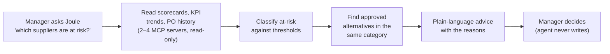

# Tutorial notes: Build a supplier performance assistant with Joule Studio

*Build a read-only agent that watches supplier scorecards, delivery and quality trends and purchase history in SAP S/4HANA Cloud, flags suppliers heading for trouble, and suggests approved alternatives. My notes on SAP's 25-minute lab, with a link to SAP's screens at every step.*

> [!NOTE]
> **📍 At a glance**
> - **SAP's tutorial:** [Build a Supplier Performance Assistant Agent with Joule Studio and SAP S/4HANA Cloud](https://developers.sap.com/tutorials/build-a-supplier-performance-assistant-agent) by Rebecca Yang · about 25 min · beginner · SAP runs it on a pre-release Joule Studio
> - **About this page:** *Added by Claude.* Written in my own words from SAP's tutorial, whose text and images may not be copied ([its licence](https://github.com/sap-tutorials/joule-studio/blob/main/LICENSE.txt)). The screen map is my own sketch; each step links to SAP's real screens.
> - **You need:**
>   - Joule Studio
>   - SAP S/4HANA Cloud with supplier evaluation scores (Supplier Evaluation Scorecard API), operational KPI trends (Operational Score API), purchase order history (Purchase Order API), and maintained approved-supplier data
>   - some procure-to-pay and supplier evaluation knowledge
> - **Builds on:** [The new Joule Studio](joule-studio-intent-based.md) (chapter 4), [the closing advisor notes](notes-financial-closing-advisor-agent.md) (chapter 28)
> - **Last checked:** 22 Nov 2026

**After this tutorial you can:**

- Write a one-sentence intent that still gives Joule Studio everything it needs
- Check milestones, fit-gap findings and the guardrails of a read-only advisory agent
- Diagnose the two most likely test failures, and read the agent's reasoning in Traces

## 33.1 What you build

An early-warning assistant for procurement managers. Supplier reviews happen monthly or quarterly, but problems build up in weeks; the three data sources sit in separate Fiori apps; alternatives are searched by hand under pressure; and nobody records why a supplier was flagged.

| Warning sign | What it looks like | Where the agent sees it |
|---|---|---|
| Delivery | On-time rate falling, lead times growing | Operational Score API: delivery trends |
| Quality | More rejections, repeated inspection failures | Operational Score API, checked against PO history |
| Price or contract drift | Prices above contract, worse quotes or payment terms | Scorecard and Purchase Order APIs, across orders |

**Screen map: the Joule Studio workspace** *(my own sketch of the layout, not SAP's screenshot; numbers are SAP's steps)*

<svg viewBox="0 0 760 440" role="img" aria-label="Screen map of the Joule Studio workspace: icon rail, top bar with Develop and Manage tabs and Deploy, Solution Progress panel on the left, document view in the middle, Joule chat on the right" style="width:100%;height:auto;max-width:760px;font-family:inherit">
<rect x="1" y="1" width="758" height="438" rx="10" style="fill:var(--surface);stroke:var(--line);stroke-width:1.5"/>
<rect x="1" y="1" width="36" height="438" rx="10" style="fill:var(--code-bg);stroke:var(--line)"/>
<circle cx="19" cy="30" r="7" style="fill:var(--line)"/><circle cx="19" cy="62" r="7" style="fill:var(--line)"/><rect x="10" y="85" width="18" height="18" rx="4" style="fill:var(--accent)"/><circle cx="19" cy="126" r="7" style="fill:var(--line)"/>
<line x1="37" y1="46" x2="759" y2="46" style="stroke:var(--line)"/>
<text x="48" y="29" style="fill:var(--ink);font-size:13px;font-weight:600">Supplier Performance Assistant</text>
<rect x="254" y="16" width="34" height="16" rx="4" style="fill:var(--code-bg)"/><text x="260" y="28" style="fill:var(--muted);font-size:10px">Draft</text>
<rect x="398" y="12" width="118" height="24" rx="6" style="fill:var(--code-bg);stroke:var(--line)"/>
<rect x="400" y="14" width="56" height="20" rx="5" style="fill:var(--accent-soft)"/><text x="409" y="28" style="fill:var(--accent);font-size:11px;font-weight:600">Develop</text><text x="466" y="28" style="fill:var(--ink);font-size:11px">Manage</text>
<rect x="560" y="12" width="66" height="24" rx="6" style="fill:none;stroke:var(--accent)"/><text x="574" y="28" style="fill:var(--accent);font-size:11px;font-weight:600">Deploy</text>
<rect x="634" y="12" width="72" height="24" rx="6" style="fill:none;stroke:var(--line)"/><text x="645" y="28" style="fill:var(--ink);font-size:11px">Actions ▾</text>
<rect x="716" y="14" width="22" height="20" rx="4" style="fill:none;stroke:var(--line)"/>
<rect x="44" y="54" width="176" height="378" rx="6" style="fill:none;stroke:var(--line)"/>
<text x="54" y="74" style="fill:var(--ink);font-size:12px;font-weight:600">▾ Solution Progress</text>
<text x="62" y="98" style="fill:var(--ink);font-size:11px">Intent Summary</text><text x="200" y="98" style="fill:var(--accent);font-size:11px">✓</text>
<text x="62" y="120" style="fill:var(--ink);font-size:11px">Requirements</text><text x="200" y="120" style="fill:var(--accent);font-size:11px">✓</text>
<text x="62" y="142" style="fill:var(--ink);font-size:11px">Specification</text><text x="200" y="142" style="fill:var(--accent);font-size:11px">✓</text>
<text x="62" y="164" style="fill:var(--ink);font-size:11px">▾ Solution Artifacts</text>
<text x="76" y="184" style="fill:var(--muted);font-size:10.5px">the agent</text><text x="76" y="202" style="fill:var(--muted);font-size:10.5px">MCP servers / tools</text>
<line x1="52" y1="216" x2="212" y2="216" style="stroke:var(--line)"/>
<text x="54" y="236" style="fill:var(--ink);font-size:12px;font-weight:600">▾ Testing</text><text x="62" y="256" style="fill:var(--ink);font-size:11px">Overview</text>
<line x1="52" y1="270" x2="212" y2="270" style="stroke:var(--line)"/>
<text x="54" y="290" style="fill:var(--ink);font-size:12px;font-weight:600">▾ Preview</text><text x="62" y="310" style="fill:var(--ink);font-size:11px">the agent (chat test)</text>
<line x1="52" y1="324" x2="212" y2="324" style="stroke:var(--line)"/>
<text x="54" y="344" style="fill:var(--ink);font-size:12px;font-weight:600">▸ File tree</text><text x="62" y="364" style="fill:var(--muted);font-size:10.5px">intent.md, assets/,</text><text x="62" y="380" style="fill:var(--muted);font-size:10.5px">Python code, deploy_result</text>
<rect x="228" y="54" width="288" height="378" rx="6" style="fill:none;stroke:var(--line)"/>
<text x="240" y="74" style="fill:var(--ink);font-size:12px;font-weight:600">Document view</text>
<text x="240" y="96" style="fill:var(--muted);font-size:10.5px">Shows what you pick on the left:</text>
<text x="240" y="112" style="fill:var(--muted);font-size:10.5px">intent summary, PRD, specification,</text>
<text x="240" y="128" style="fill:var(--muted);font-size:10.5px">agent definition, test results</text>
<rect x="240" y="146" width="250" height="8" rx="3" style="fill:var(--line)"/><rect x="240" y="164" width="210" height="8" rx="3" style="fill:var(--line)"/><rect x="240" y="182" width="232" height="8" rx="3" style="fill:var(--line)"/>
<rect x="240" y="206" width="264" height="26" rx="4" style="fill:none;stroke:var(--line)"/><text x="250" y="223" style="fill:var(--ink);font-size:10.5px">▸ section</text>
<rect x="240" y="238" width="264" height="26" rx="4" style="fill:none;stroke:var(--line)"/><text x="250" y="255" style="fill:var(--ink);font-size:10.5px">▸ section</text>
<rect x="240" y="270" width="264" height="26" rx="4" style="fill:none;stroke:var(--line)"/><text x="250" y="287" style="fill:var(--ink);font-size:10.5px">▸ section</text>
<rect x="524" y="54" width="228" height="378" rx="6" style="fill:none;stroke:var(--line)"/>
<text x="536" y="74" style="fill:var(--ink);font-size:12px;font-weight:600">Joule chat</text>
<text x="536" y="96" style="fill:var(--muted);font-size:10.5px">Progress messages and summaries</text>
<rect x="536" y="108" width="200" height="40" rx="6" style="fill:var(--code-bg)"/><rect x="546" y="118" width="150" height="7" rx="3" style="fill:var(--line)"/><rect x="546" y="132" width="110" height="7" rx="3" style="fill:var(--line)"/>
<rect x="536" y="156" width="200" height="56" rx="6" style="fill:var(--code-bg)"/><rect x="546" y="166" width="170" height="7" rx="3" style="fill:var(--line)"/><rect x="546" y="180" width="140" height="7" rx="3" style="fill:var(--line)"/><rect x="546" y="194" width="160" height="7" rx="3" style="fill:var(--line)"/>
<rect x="536" y="384" width="204" height="34" rx="6" style="fill:none;stroke:var(--accent)"/><text x="546" y="405" style="fill:var(--muted);font-size:10.5px">Message Joule…</text>
<g style="font-size:10px;font-weight:700">
<circle cx="31" cy="83" r="8" style="fill:var(--accent);stroke:var(--surface);stroke-width:1.5"/><text x="28" y="87" style="fill:var(--surface);font-size:10px">2</text>
<circle cx="180" cy="94" r="9" style="fill:var(--accent)"/><text x="177" y="98" style="fill:var(--surface);font-size:10px">3</text>
<circle cx="140" cy="340" r="9" style="fill:var(--accent)"/><text x="137" y="344" style="fill:var(--surface);font-size:10px">6</text>
<circle cx="180" cy="116" r="9" style="fill:var(--accent)"/><text x="177" y="120" style="fill:var(--surface);font-size:10px">4</text>
<circle cx="180" cy="138" r="9" style="fill:var(--accent)"/><text x="177" y="142" style="fill:var(--surface);font-size:10px">5</text>
<circle cx="180" cy="160" r="9" style="fill:var(--accent)"/><text x="177" y="164" style="fill:var(--surface);font-size:10px">6</text>
<circle cx="140" cy="252" r="9" style="fill:var(--accent)"/><text x="137" y="256" style="fill:var(--surface);font-size:10px">7</text>
<circle cx="190" cy="306" r="9" style="fill:var(--accent)"/><text x="187" y="310" style="fill:var(--surface);font-size:10px">7</text>
<circle cx="593" cy="50" r="9" style="fill:var(--accent)"/><text x="590" y="54" style="fill:var(--surface);font-size:10px">8</text>
<circle cx="722" cy="401" r="9" style="fill:var(--accent)"/><text x="719" y="405" style="fill:var(--surface);font-size:10px">6</text>
<circle cx="488" cy="50" r="9" style="fill:var(--accent)"/><text x="485" y="54" style="fill:var(--surface);font-size:10px">8</text>
</g>
</svg>

- **2** Joule Studio → the *Create a new solution* page → **Create** on the *Agent* tile
- **3** Intent Summary · **4** Requirements · **5** Specifications, and the chat's summary of all three
- **6** The chat (start the build), Solution Artifacts (LLM, MCP servers, Evaluation), `agent.py` in the File tree
- **7** Testing → Overview, Preview with its Traces tab · **8** Deploy, **Actions** for GitHub sync, **Manage**

## 33.2 Create the agent with a one-sentence intent (SAP step 2)

- **Screen:** Joule Work → **Joule Studio**. The *Create a new solution* page offers four solution types; choose **Create** on the **Agent** tile.
- **In the dialog:** keep **New Solution** · *Name* `Supplier Performance Assistant` · *Intent*: copy SAP's one sentence from step 2 (monitor supplier performance, find at-risk suppliers, recommend approved alternatives, using SAP procurement data).
- **Quick Create** is on by default here: it runs intent → PRD → specification → build → test by itself. You still confirm the business goals.
- **Business goals can be asked in different ways:** free text, checkboxes, or several questions in a row. Give at least one measurable goal (for example, fewer supply disruptions or faster detection); "no baseline yet" or "use defaults" is fine for baseline and timeline. Keep choosing **Submit Answer** until it starts writing `intent.md`.
- 💡 **Why one sentence is enough:** it names the purpose (monitor), the decision (who is at risk), the action (recommend alternatives) and the data (SAP procurement data). Joule Studio works out the APIs, thresholds and guardrails.
- [SAP's screens for step 2 ↗](https://developers.sap.com/tutorials/build-a-supplier-performance-assistant-agent#step-2)

## 33.3 Check intent, milestones and fit (SAP step 3)

- **Screen:** *Solution Progress* → **Intent Summary**: business challenge, business goals table, key milestones.
- **The challenge should say** that teams spot bad suppliers too late, that today's review is manual and reactive, and that the agent must monitor continuously, flag and suggest alternatives.
- **Milestones** (names vary): supplier data read → at-risk suppliers found → alternatives recommended → answer delivered. They later become the groups of tests.
- **Fit-gap findings:** S/4HANA already has the APIs (fit); automatic risk detection and alternative suggestions don't exist in standard SAP (the gap). Joule may mention SAP Ariba products as another route; this lab stays on S/4HANA only, with no extra licences.
- **Intent fit:** about 80% or more is a strong match. Much lower usually means one of the four elements is missing from the intent.
- [SAP's screens for step 3 ↗](https://developers.sap.com/tutorials/build-a-supplier-performance-assistant-agent#step-3)

## 33.4 Review the requirements (SAP step 4)

- **Screen:** *Solution Progress* → **Requirements**. Category *AI Agent*; users are procurement and category managers. Check the meaning, not SAP's exact wording.
- **Check** that *Business Metrics* carries the goal you confirmed, and that *Solution Architecture* lists the Python A2A agent and one MCP server per OData API.
- **The boundaries to confirm:**

| Runs alone | Guardrails | Human decision |
|---|---|---|
| Read scorecards, KPI trends and PO history; classify at-risk; rank approved alternatives; write the advice | No writes to SAP at all · alternatives only from the approved supplier list · if a source is down, carry on and say so · detect and block prompt injection | The manager decides whether to start a sourcing action |

- [SAP's screens for step 4 ↗](https://developers.sap.com/tutorials/build-a-supplier-performance-assistant-agent#step-4)

## 33.5 Look at the specification (SAP step 5)

- **Screen:** *Solution Progress* → **Specifications**: a *Solution Setup* part and *Asset Implementation* parts. Expand the agent's entry: each PRD requirement becomes a setup → API specs → implementation sequence.
- **Read the chat summary:** S/4HANA as the core system (Ariba excluded), the PRD's must-haves and guardrails, and the OData specs downloaded as EDMX files.
- **MCP servers:** usually 2 to 4, one per API Joule chose (scorecards, operational scores, purchase orders), all read-only.
- [SAP's screens for step 5 ↗](https://developers.sap.com/tutorials/build-a-supplier-performance-assistant-agent#step-5)

## 33.6 Build the solution (SAP step 6)

- **In the chat's *Message Joule* box:** `execute specification/specification.md` (or "Build the solution"). If it goes quiet, ask "What is the status?". The build takes several minutes.
- **Screen:** *Solution Artifacts* → the agent: *LLM Configuration* (model and a low creativity setting for repeatable advice) and *Agent Configurations*; defaults are fine.
- **Code:** *File tree* → `assets` → your agent → `app` → `agent.py`: the reasoning loop, state machine, LLM gateway, MCP providers and circuit breaker.
- **MCP Servers:** each exposes typed tools generated from its OData spec; the agent picks tools at runtime.
- **Evaluation:** a new solution shows no evaluations; choose **Generate scenarios** to create a first set.
- [SAP's screens for step 6 ↗](https://developers.sap.com/tutorials/build-a-supplier-performance-assistant-agent#step-6)

## 33.7 Test and preview (SAP step 7)

- **Tests run by themselves:** content safety, prompt-injection resistance, each MCP server's tools, and the full read → detect → recommend path. All must pass before **Deploy**.
- **When tests fail:**

| Failing tests | Likely cause |
|---|---|
| Scorecard server tool calls | Supplier evaluation templates and scoring periods aren't set up for the test suppliers, the destination points to the wrong tenant, or the test user can't read scorecards |
| At-risk classification | The PRD's thresholds differ from what the tests expect: align the agent settings or the test data |

- **Preview → the agent:** it introduces itself, then ask which suppliers are trending toward risk (mock data before deployment).
- **Traces tab:** shows each reasoning step, which MCP tools ran, what came back, and how it reached its verdict.
- [SAP's screens for step 7 ↗](https://developers.sap.com/tutorials/build-a-supplier-performance-assistant-agent#step-7)

## 33.8 Deploy to development (SAP step 8)

- **Screen:** **Deploy** in the top bar, then **Deploy** in the dialog. Agent and MCP servers go to SAP's managed service on the Business AI Platform; `deploy_result.json` gets the endpoint and runtime ID. **GitHub sync** is under **Actions**; production isn't deployed from Joule Studio.
- **In use:** a manager asks Joule about at-risk suppliers or alternatives, and Joule routes the question to this agent. It reads the sources (carrying on if one fails), classifies, finds approved alternatives, writes the advice with reasons, answers follow-ups from the same context, and logs every step with OpenTelemetry. Any re-sourcing stays the manager's job in standard SAP.
- **Monitor** it under **Manage**.
- [SAP's screens for step 8 ↗](https://developers.sap.com/tutorials/build-a-supplier-performance-assistant-agent#step-8)

## 33.9 Pitfalls

- **Supplier evaluation must be live** in the S/4HANA tenant, or the scorecard tests fail.
- **Thresholds live in two places** (PRD and tests); keep them in step.
- **The number of MCP servers varies** (2 to 4) between runs; that's expected.

> [!TIP]
> **Before a real rollout** *(Added by Claude)*
> - Make sure the approved supplier list and categories are current, or the alternatives will be wrong.
> - Agree the at-risk thresholds with the category managers and record them in the PRD.

## Check yourself

Which four elements make a one-sentence intent work?

- Purpose, decision, action and data source

Name three guardrails of this agent.

- No writes to SAP
- Alternatives only from the approved supplier list
- Carries on with the sources it has and flags any missing one (also: blocks prompt injection)

Scorecard tool tests fail. What do you check first?

- That supplier evaluation templates and scoring periods exist for the test suppliers, the destination points to that tenant, and the user can read scorecards

## How this page was checked

- **SAP's tutorial read in full on 22 Nov 2026:** all nine steps, on developers.sap.com.
- **Written in my own words.** Nothing copied from SAP's text or screenshots; the agent name and chat command are given exactly because you type them.
- **Screen map:** my simplified sketch of the Joule Studio workspace, drawn after viewing SAP's screenshots; not a copy.
- **Not built here:** no Joule Studio tenant in this workspace.

## Sources

- SAP Developer Center tutorial: https://developers.sap.com/tutorials/build-a-supplier-performance-assistant-agent
- Its licence: https://github.com/sap-tutorials/joule-studio/blob/main/LICENSE.txt

Previous: [Tutorial notes: Build a supplier disruption response agent with the Joule Studio CLI](notes-supplier-disruption-response-agent.md) · Next: [Tutorial notes: Build an AI sales assistant for discount decisions](notes-ai-sales-assistant-agent.md)
