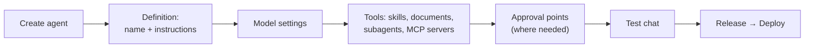

# Practice: 10 Joule agent assignments

*Ten graded agent builds on top of your skills S1 to S10: choosing tools, asking for missing details, waiting for approval, calling an MCP server, and delegating to subagents.*

> [!NOTE]
> **📍 At a glance**
> - **Source:** the course's *Joule Agent Creation Workbook* (12 pages; course-made, summarising SAP's material), rewritten and condensed
> - **You will build:** agents A1 to A10
> - **You need:**
>   - your released skills from [chapter 17](practice-joule-skills.md)
>   - the *AI Agent Builder Activation* switch on in the control tower ([3.2a](joule-studio-classic.md))
>   - for A9, an MCP server reachable through a BTP destination
> - **Level:** beginner to advanced · **Builds on:** [Building an agent](joule-studio-classic.md) (3.5, 3.6), [Create a Joule agent](tutorial-joule-agent-create.md)
> - **Last checked:** 21 Nov 2026

**After these assignments you can:**

- Write agent instructions that make the model pick the right tool
- Gather missing inputs in conversation and confirm before any write
- Put a person's approval in front of a risky action
- Add an MCP server and subagents as tools

## 18.1 Skill or agent, and how to instruct one

| | Skill | Agent |
|---|---|---|
| You design | The exact steps: trigger → action(s) → message | A goal, instructions and tools |
| At run time | Always the same path | The model decides which tool, when, in what order |
| Good for | "Retrieve X", "create Y" | Judgement across steps; routing; checking with a person |

**Instructions in four parts** (the workbook's pattern):

1. **Role and goal:** "You help warehouse staff with stock questions."
2. **Data and tools:** which tool to use for which question.
3. **Action:** what to do with the result, for example compare stock with a requested quantity.
4. **Exceptions:** when to say "not found", when to ask the user, when to stop for approval.

- **Tool descriptions matter as much as instructions.** The agent reads each tool's description to choose it, just as Joule reads a skill's description ([chapter 17](practice-joule-skills.md), 17.2).
- **Vibe coding** can draft the instructions and suggest tools, if the *Generative AI* switch is on ([3.2a](joule-studio-classic.md)). Then refine by hand.

## 18.2 The ten assignments

| # | Agent | Tools | Practises | Done when |
|---|---|---|---|---|
| A1 | Customer 360 | S1, S2 | Picking the right tool | A question about a partner *and* an order uses both and combines them |
| A2 | Inventory helper | S3 | Reasoning on a result | Returns stock and a correct "enough / short by N" verdict |
| A3 | Procurement requester | S4 | Asking for missing details; confirming | Nothing is created before the user confirms |
| A4 | Restocking | S3, S4 | Threshold logic, then a write | Low stock → recommendation and PR; healthy stock → no action |
| A5 | HR helpdesk | S6, S10 | Routing: transactional vs grounded | A two-part question is answered by both tools |
| A6 | AP watchdog | S7 | Repeated calls, ranking | Suppliers ranked by overdue amount with a recommendation |
| A7 | Onboarding with approval | S8 | Human approval before an automation | The badge automation runs only after explicit approval |
| A8 | Maintenance fulfilment | S9, S4 | End-to-end with oversight | Blocked order → approved PR for the shortfall → clear status |
| A9 | Agent with an MCP tool | S3 + MCP server | A non-SAP tool | One answer uses both the SAP skill and the MCP tool |
| A10 | Multi-agent orchestrator | A2, A3 as subagents | Delegation | "Check stock and raise a PR if low" is split across the two subagents |

### A1 · Customer 360 *(foundational)*

Build guide

- **Instructions:** use the business partner tool for partner questions and the sales order tool for order questions; use both and combine for mixed questions; always state the IDs looked up; say plainly when a tool returns nothing.
- **Test:** "Who is BP 10100001 and what's the status of order 12345?" → the agent calls S1, then S2, and gives one answer.
- **Stretch:** offer a short "anything else about this customer?" follow-up.

### A2 · Inventory helper *(foundational)*

Build guide

- **Instructions:** look up stock for a material in a plant; when the user names a quantity, compare and state "enough", or by how much it's short or in surplus. Keep it brief.
- **Model settings:** try two models and compare the "enough or not" judgement.
- **Stretch:** when short, suggest checking another plant.

### A3 · Procurement requester *(foundational → intermediate)*

Build guide

- **Instructions:**
  - A PR needs material, quantity, plant and delivery date. Ask for anything missing, one question at a time.
  - Then summarise and ask the user to confirm. Only after a yes, call S4 and report the PR number.
- **Why:** this is *slot-filling* plus a confirmation gate before a write, the safest pattern for any create action.

### A4 · Restocking *(intermediate)*

Build guide

- **Instructions:**
  - Read stock (S3). Compare it with the threshold the user gives (default 50).
  - If it's below, recommend a quantity and, on the user's go-ahead, raise a PR (S4). If it's healthy, say no action is needed.
  - Always show the reasoning: stock vs threshold.
- **Stretch:** accept several materials and return one restocking plan.

### A5 · HR helpdesk *(intermediate)*

Build guide

- **Instructions:** leave balance questions → the time-off tool (S6); policy questions → the grounded policy tool (S10); two-part questions → both. If the policy doesn't cover it, say so and suggest HR.
- **Test:** "How many vacation days do I have, and what's the notice period for leave?"
- **Stretch:** add a "request time off" skill and route action requests to it.

### A6 · AP watchdog *(intermediate)*

Build guide

- **Instructions:** for each supplier given, call the overdue payables tool (S7); rank by overdue total, highest first; explain the risk plainly and recommend who to pay first. No alarmist wording for small amounts.
- **Stretch:** ground the agent on a payment-terms document and factor the terms into the ranking.

### A7 · Onboarding with approval *(intermediate → advanced)*

Build guide

- **Instructions:** restate the employee ID and the action, ask the manager to approve, and only then call the badge tool (S8). Never trigger it without approval; confirm afterwards.
- **Approval:** the workbook switches on a human-in-the-loop approval on the badge action, so the agent pauses at that step.
- **Stretch:** require approval only when more than three badges are requested at once.

> [!NOTE]
> **Approval settings: check your tenant**
> - The SAP Help pages read for this book on 21 Nov 2026 didn't describe a separate approval setting for agent tools.
> - If your tenant has none, use A3's pattern: the instructions make the agent summarise and wait for an explicit "yes" before any write.

### A8 · Maintenance fulfilment *(advanced)*

Build guide

- **Instructions:**
  - Check the maintenance order's components (S9). If all are in stock, report "ready".
  - If any are short, list them, propose a PR for the missing quantity and wait for the planner's approval. Then raise it (S4).
  - Finish with a clear status.
- **Why:** the flagship pattern: several tools, autonomous steps, a person approving the write.
- **Stretch:** one consolidated PR for all short components.

### A9 · Agent with an MCP tool *(advanced)*

Build guide

- **Prerequisite:** an MCP server reachable over HTTP, registered as a BTP destination for Joule Studio. Select it in the agent's **MCP Servers** tab; its tools appear automatically ([3.6](joule-studio-classic.md)).
- **Instructions:** take stock figures from S3 and outside facts (for example supplier lead times) from the MCP tool; combine them into one recommendation, saying which figure came from SAP and which from outside.
- **Stretch:** add a second MCP tool and let the agent choose between them.

### A10 · Multi-agent orchestrator *(advanced)*

Build guide

- **Tools:** the released agents A2 (inventory) and A3 (procurement), added as **subagents**.
- **Instructions:** split a request into parts; send stock questions to A2 and PR requests to A3; combine the results; confirm before any PR is created; tell the user what each specialist reported.
- **Rule from SAP:** an agent can call a subagent, but not the other way round; no cycles ([3.5](joule-studio-classic.md)).
- **Stretch:** add the AP watchdog (A6) as a third subagent for a supplier check before ordering.

## 18.3 Show your work

For each agent, keep:

- the instructions you wrote
- the tools, subagents and MCP servers attached
- a test-chat transcript that meets the "done when" test, including any approval step

## How this page was checked

- **Course workbook read in full on 21 Nov 2026:** *Joule Agent Creation Workbook* (12 pages).
  - It is course-made and states that it summarises SAP's material. This page condenses it in new wording.
- **Checked against SAP Help (21 Nov 2026):**
  - the *AI Agent Builder Activation* and *Generative AI* switches (3.2a)
  - no SAP page found describing a separate approval setting for agent tools; hence the note under A7
- **Not built here:** no Joule Studio tenant in this workspace.

## Sources

- BTPAI course Drive: *Joule-Agent-Creation-Workbook.pdf* (BT072)
- SAP Help, *Deploy a Project* (Joule Studio, classic edition): https://help.sap.com/docs/joule-studio-classic/joule-studio-classic-edition/deploy-project
- SAP Help, *Create a Joule Agent with Vibe Coding*: https://help.sap.com/docs/joule-studio-classic/joule-studio-classic-edition/create-joule-agent-with-vibe-coding

Previous: [Practice: 10 Joule skill assignments](practice-joule-skills.md) · Next: [Reference: Joule setup building blocks](reference-joule-setup-building-blocks.md)
