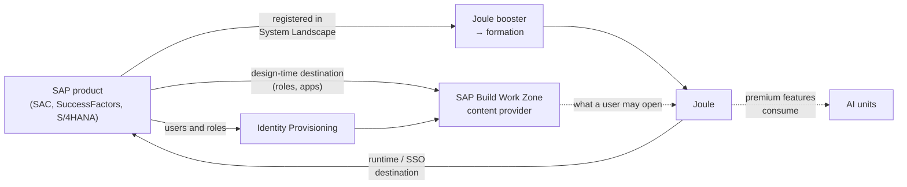

# Reference: Joule setup building blocks

*The five pieces every Joule setup reuses, in one place: destinations, booster and formation, Work Zone, Identity Provisioning and AI units.*

> [!NOTE]
> **📍 At a glance**
> - **Use it for:** a quick lookup while you work through chapters 3 to 16
> - **What it is:** a summary of what the book already says; no new sources
> - **Level:** reference
> - **Builds on:** [Global account tools](../sap-btp/btp-global-account-tools.md), [Subaccount walkthrough](../sap-btp/btp-subaccount-walkthrough.md), [Identity and trust](../sap-btp/btp-identity-trust-federation.md), [Joule for Consultants](joule-for-consultants.md), [The Joule family](joule-family.md)
> - **Last checked:** 21 Nov 2026

## 19.1 How the blocks fit

**Typical order for any Joule integration** (chapters 13, 15, 16):

1. Trust: the subaccount trusts your Identity Authentication (IAS) tenant.
2. Register the product in the global account (*System Landscape → Systems*).
3. SAP Build Work Zone, standard edition: subscription, instance and service key.
4. Run the Joule booster, or add the system to an existing Joule formation.
5. Destinations: the ones the booster does not manage.
6. Content provider in Work Zone's Channel Manager.
7. Identity Provisioning: source, target, then simulate, read and schedule.
8. Permissions for users in the product and in BTP.
9. Test in Joule from the product.

## 19.2 Destinations

- A **destination** stores how to reach another system: URL, authentication, user or OAuth client ([SAP BTP 8.10](../sap-btp/btp-subaccount-walkthrough.md)).
- You create it in the **subaccount**. Joule Studio sees it only after an admin adds it in the **control tower** ([3.3](joule-studio-classic.md)).
- Skills use a **destination variable**; you pick the real destination when you test or deploy.
- An on-premise system also needs **Cloud Connector**.

| Destination | Used for | Key settings | Chapter |
|---|---|---|---|
| `S4HANA_MOCK`, `Badge_Service` | Action projects for Joule skills | HTTP, no authentication; `sap.processautomation.enabled` = `true`, `sap.applicationdevelopment.actions.enabled` = `true`, `sap.build.usage` = `odata_gen` | [5](tutorial-joule-skill-setup.md) |
| `sample-maintenance-service` | Imported agent project | Created *From File*; basic authentication; no action properties needed | [10](tutorial-joule-agent-create.md) |
| `SAC_SWZ_DT` / `SAC_SWZ_RT` | SAC roles into Work Zone / Joule calls SAC as the user | DT: `…/api/v1/cdm`, OAuth2ClientCredentials. RT: duplicate of `DYN_SAC_SSO`, SAML bearer | [13](tutorial-joule-sac-analytical-insights.md) |
| `LPS_SFSF_dt` / `LPS_SFSF_rt` / `SFSF_SSO` | SuccessFactors content and runtime | Managed in the backend for setups after 13 Oct 2026; older setups maintain them by hand | [15](joule-integration-successfactors.md) |
| PCE `…dt`, `…rt`, nominations, `S4HANA_PCE_SSO` | S/4HANA Private Edition content, apps, cards, SSO | OnPremise through Cloud Connector; lowercase names; principal propagation for SSO | [16.2](joule-integration-other-sap-solutions.md) |
| SharePoint destination | Document grounding | `https://graph.microsoft.com`, OAuth2Password, scope `…/.default` | [16.5](joule-integration-other-sap-solutions.md) |
| `NavigationService` | Older Joule setups | Not needed by hand for setups after 13 Oct 2025 | [13](tutorial-joule-sac-analytical-insights.md) |

## 19.3 Booster and formation

- A **booster** is a guided setup wizard in the global account ([SAP BTP 6.3](../sap-btp/btp-global-account-tools.md)).
- A **formation** groups SAP systems for one scenario and sets up baseline trust between them ([SAP BTP 6.5](../sap-btp/btp-global-account-tools.md)).
- The **Joule booster** creates the *Integration with Joule* formation:
  - **Select Integrations:** the products where users open Joule.
  - **Select Capabilities:** extra packages, for example SAP Analytics Cloud.
  - It creates some destinations itself, for example `DYN_SAC_SSO` and `LPS_SFSF_rt`.
- **Joule already running?** Do not run the booster again: add the system to the existing formation instead ([13](tutorial-joule-sac-analytical-insights.md), [16.3](joule-integration-other-sap-solutions.md)).
- **Registering a system** first: *Systems → Add System → Get Token*, then paste the token in the product ([15](joule-integration-successfactors.md) for SuccessFactors, [16.3](joule-integration-other-sap-solutions.md) for S/4HANA Public).

## 19.4 SAP Build Work Zone: the content provider

- Work Zone's navigation service decides which apps and content a user may reach through Joule.
- It needs two inputs: the product's **roles and content** (content provider), and the **users with their roles** (Identity Provisioning).
- **Content provider:** *Site Manager → Channel Manager → + New → Content Provider*.

| Field | Usual value |
|---|---|
| Title / ID | `sac.analytics` (SAC), `sfsf` (SuccessFactors), your own ID (S/4HANA) |
| Design-Time / Runtime Destination | the product's DT and RT destinations (19.2) |
| Runtime Destination for Dynamic Data | Use default runtime destination |
| Automatically add all content items to subaccount | on |
| Use the Identity Provisioning service to provision user authorizations | on |

- The **service key** of the Work Zone instance feeds the Identity Provisioning target (19.5).

## 19.5 Identity Provisioning (IPS)

- IPS copies **users** and their **roles as groups** from a source system to a target system ([SAP BTP 10.3](../sap-btp/btp-identity-trust-federation.md)).
- For Joule, the target is **SAP Build Work Zone, standard edition**. Its properties come from the Work Zone service key; [15.2](joule-integration-successfactors.md) has a snippet that builds them.
- The target's `cflp.providerId` must equal the content provider ID (19.4).

| Source | Settings that matter | Chapter |
|---|---|---|
| SAP Analytics Cloud | its own source system; `sac.api.version` = `2` before the first save; `ips.http.header.x-sap-scim-groups-v3` = `true` | [13](tutorial-joule-sac-analytical-insights.md) |
| SAP SuccessFactors | SCIM API, not OData; group entity `Ignore` = `false`; `sf.user.filter` | [15](joule-integration-successfactors.md) |
| S/4HANA Private Edition | SAP Application Server ABAP through an RFC destination; Cloud Identity Services connectivity plan | [16.2](joule-integration-other-sap-solutions.md) |
| S/4HANA Public Edition | URL and user from arrangement `SAP_COM_0193`; `s4hana.cloud.api.version` = `1` | [16.3](joule-integration-other-sap-solutions.md) |

**Jobs, in this order:** *Simulate* → check *Provisioning Logs* → *Read* → check again → *Resync* if roles are missing → **schedule** *Read* at least every 24 hours.

## 19.6 AI units

- SAP's currency for **Premium AI**, bought yearly into one pool. Base AI needs none ([1.6](joule-for-consultants.md), [2.8](joule-family.md)).

| What consumes AI units | Rate | Chapter |
|---|---|---|
| Joule for Consultants | 35 AI units per assigned user per month, 22,900 pooled requests per user | [1](joule-for-consultants.md) |
| Joule agents | 0.02 (standard) or 0.05 (advanced) AI units per action | [2](joule-family.md) |
| Document grounding | 0.005 AI units per record (a started 50-MB block) | [16.5](joule-integration-other-sap-solutions.md) |
| Joule Studio | authoring free; production runtime billed on consumption | [2](joule-family.md) |

- SKU, list price, expiry and free offers change often; see [Current facts to re-check](reference-current-facts.md).

## How this page was built

- Compiled on 21 Nov 2026 from SAP BTP chapters 6, 8 and 10 and this book's chapters 1, 2, 3, 5, 10, 13, 15 and 16. No new sources and no new claims.
- When a chapter changes, update the matching row here.

## Sources

- The chapters linked in each section above.

Previous: [Practice: 10 Joule agent assignments](practice-joule-agents.md) · Next: [Reference: Glossary](reference-glossary.md)
