# Tutorial: Create a Joule agent in Joule Studio Classic

*Import a project with five ready-made skills, and build an agent that checks whether a maintenance order can go ahead based on material stock.*

> [!NOTE]
> **📍 At a glance**
> - **SAP tutorial:** [Use Joule Studio, Classic Edition to Create an Agent](https://developers.sap.com/tutorials/joulestudio-agent-create.html)
> - **You will build:** the agent *Maintenance Fulfillment Validator*, using five imported skills, tested in your private environment
> - **You need:** Joule Studio Classic; tutorials [5](tutorial-joule-skill-setup.md) to [7](tutorial-joule-skill-create.md) for the basics
> - **Level:** beginner to intermediate · **Time:** about 30 minutes (SAP's estimate)
> - **Concepts:** [Joule Studio Classic](joule-studio-classic.md), 3.5 to 3.8
> - **Last checked:** 21 Nov 2026

**After this tutorial you can:**

- Create a destination from a file and import a project from an `.mtar` file
- Configure an agent's expertise, instructions, additional context, models and tools
- Test an agent in your private environment and follow its work in the timeline

## 10.1 What you build

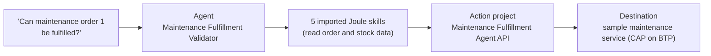

- The backend is a sample CAP service that SAP runs on BTP. Document grounding is left out, because it needs SAP AI Core.

## 10.2 Steps

*Steps and screenshots adapted from SAP's tutorial (© SAP SE, [CC BY 4.0](https://creativecommons.org/licenses/by/4.0/)). Steps reworded; screenshots resized; a user's name and a user ID in the service address blurred.*

- **The scenario:** maintenance planners check by hand, across systems and spreadsheets, whether the materials for a maintenance order are in stock. The agent does that check.
- **Skills come ready-made:** you import them, because this tutorial is about the agent, not the skills.

### Step 1: Create the destination from a file

1. Download SAP's destination file `sample-maintenance-service.json` (link on SAP's tutorial page).
2. In the **BTP cockpit**, go to **Connectivity → Destinations**.
3. Choose **Create → From File → Create**, select the downloaded file, and choose **OK**.
4. Select the imported destination and choose **Check Connection**.
   - The destination uses basic authentication with a technical user; the file brings the details, and the password stays hidden.
   - If SAP's sample service is down, SAP's page points to its source so you can run your own copy.

    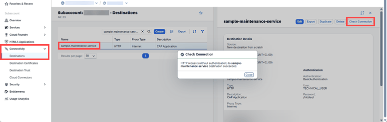

### Step 2: Activate your private environment and link the destination

- **Private environments** are isolated spaces for trying agents and skills without touching shared or productive environments.

1. In the **lobby**, choose **Control Tower → Environments**, then **Activate Private Environment**.
   - A new environment, *Private*, appears with you as author.

    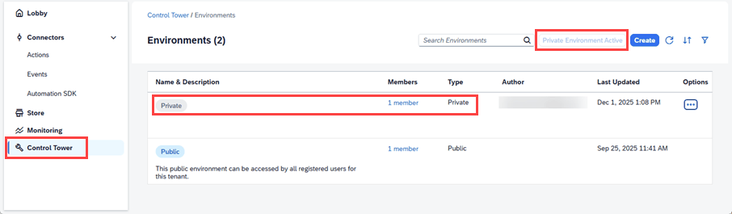

2. Choose **Control Tower → Destinations → Add**, select your destination and choose **Next**.

    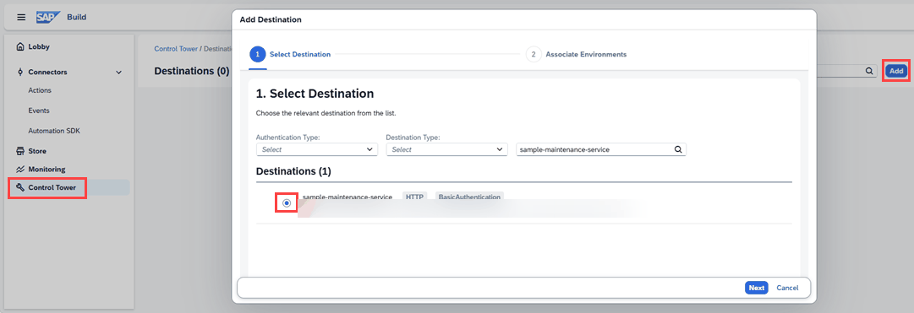

3. Choose **All Environments** and **Add Destination**.
   - SAP picks *All Environments* to save clicks while learning.

    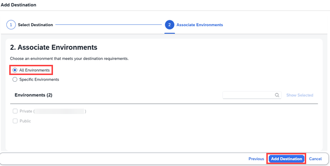

4. Refresh the page if the destination does not show yet.

    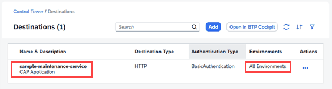

### Step 3: Import the project with the skills

1. Download SAP's project file `MaintenanceOrder_SKILLS.mtar` (link on SAP's tutorial page).
2. In the **lobby**, choose **Import**. Upload the file, select it, and choose **Import**.

    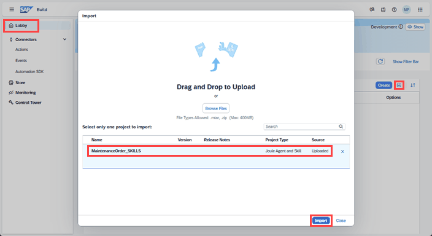

3. Choose **Close**. The project appears in the lobby.

    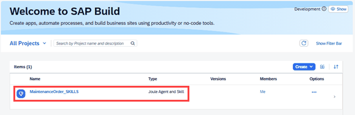

4. Open the project. It holds five Joule skills, ready to use:
   - *Get Maintenance Order Details*, *GetOrderOperations*, *GetOperationComponents*, *GetMaterialDetails*, *GetMaterialStockLevels*
   - An action project, *Maintenance Fulfillment Agent API*, came with it and is already published (**Connectors → Actions**).

    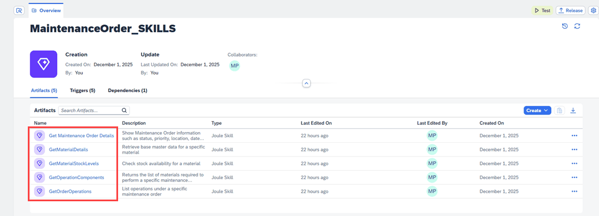

### Step 4: Create the agent

1. On the project's overview, choose **Create → Joule Agent**.

    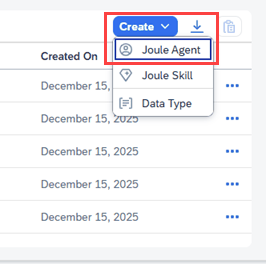

2. Enter:
   - **Name:** `Maintenance Fulfillment Validator`
   - **Description:** "Agent to check if maintenance orders can proceed based on material stock levels."
   - Shorten the identifier if it is too long, then choose **Create**.
   - **The description matters**, as for skills: Joule reads it to decide when to call this agent. Make it clear and business-oriented.

    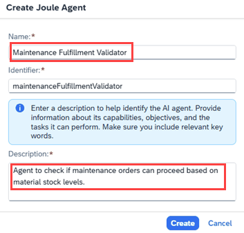

3. The agent editor opens. Its tabs: *Expertise and Instructions*, *Model Settings*, *MCP Servers*, *Tools*, *Agent Output*.

    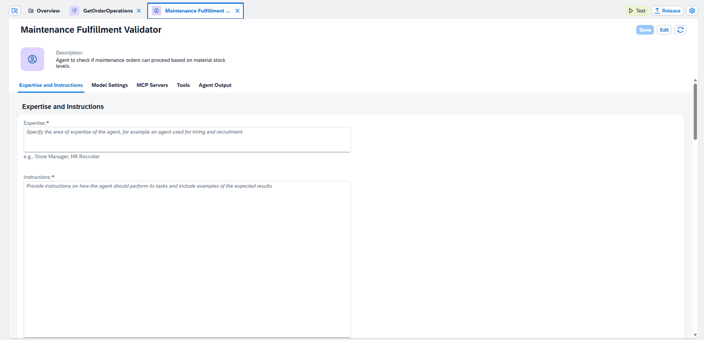

### Step 5: Configure the agent's behaviour

SAP gives three texts to paste on its page. Their content, in short:

1. **Expertise** (one line): validates maintenance orders, checks material stock, and recommends actions.
2. **Instructions** (a long text), in this order:
   1. Get the maintenance order ID first, and do not continue without it.
   2. Read the order's details and all its operations and components.
   3. Check stock for every component, including reservations, open purchase orders, blocked stock and batch, shelf-life or quality limits.
   4. Decide whether every material is available in the required quantity.
   5. If yes, confirm that the order is ready. If not, name each short material (required versus available, and why).
   6. Recommend actions: buy, expedite an existing order, transfer stock, or use an approved substitute. Say whether the whole order or only some operations are affected, and how urgent it is.
   7. Always end with a short summary.
3. **Additional Context:** a clear, professional and supportive tone, for maintenance planners and operations teams; no vague language.

    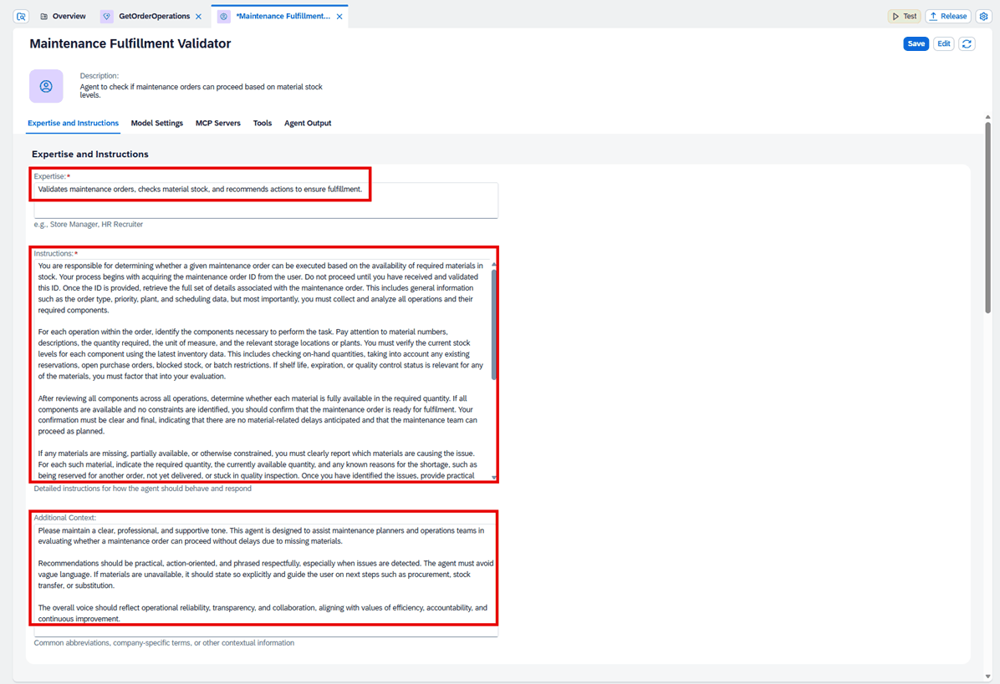

4. Open **Model Settings** and keep the defaults for now. What you see there:
   - **LLM provider**, a **base model** and an **advanced model** (OpenAI, GPT-4o mini and GPT-4o in SAP's screenshot)
   - an optional **backup LLM provider**
   - **Agent execution steps:** the maximum number of thinking steps, and pre- and post-processing steps
   - SAP's note: the pre- and post-processing steps make the agent break down the task, which improves planning and the answer.

    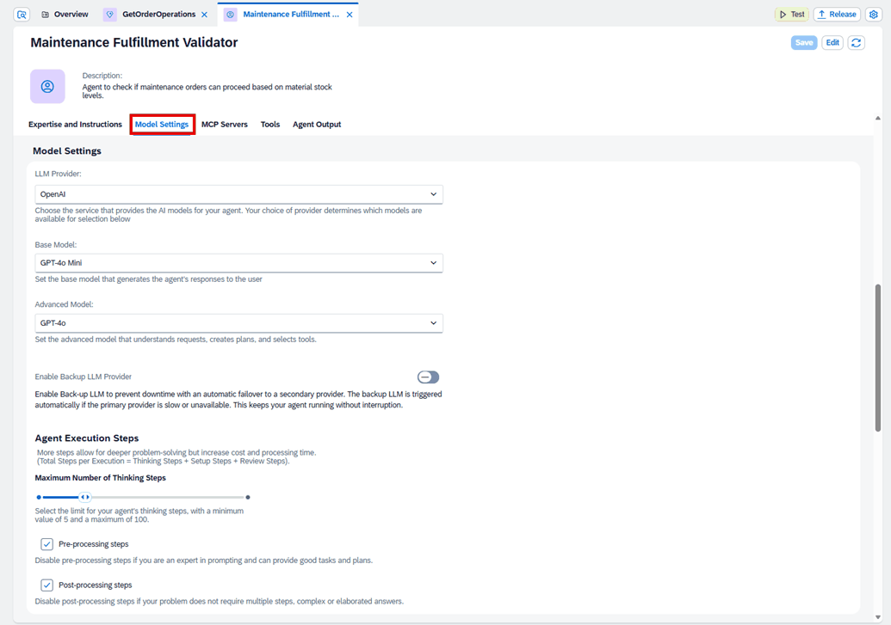

5. Open **Tools** and choose **Add Tool → Joule Skill**. The other tool types are *Calculator* and *Documents*.

    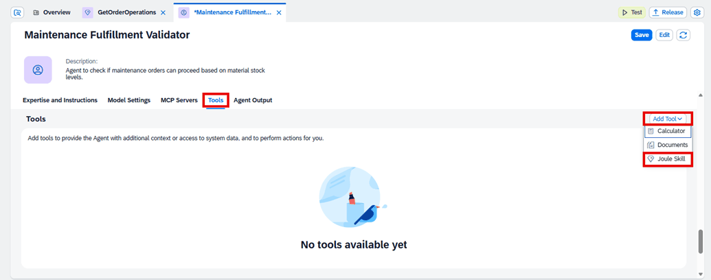

6. Select all five skills and choose **Add**.

    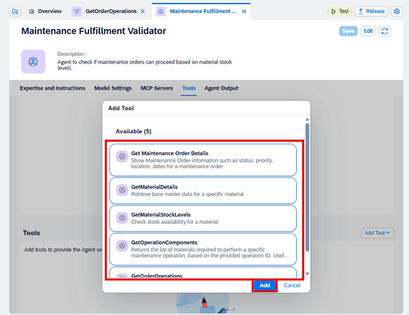

7. Choose **Save**. The agent can now reason over the five skills and call them as it needs.

    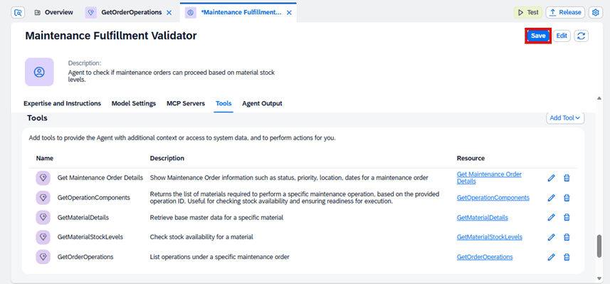

### Step 6: Test in your private environment

1. Choose **Test** in the agent editor.

    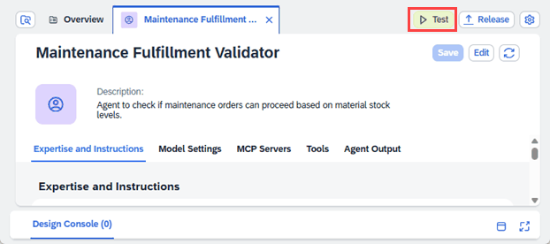

2. Choose your **Private** environment, and for the variable `fullfilmentCAPapp` choose your `sample-maintenance-service` destination. Choose **Continue**.

    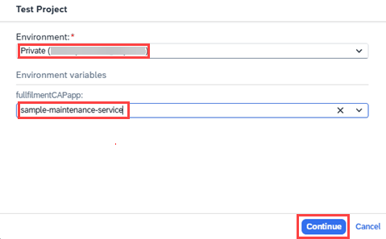

3. A test chat opens, with an empty *Timeline* next to it.

    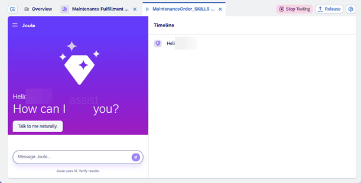

4. Send: *"Hello, I would like to check whether Maintenance Order ID 1 can be fulfilled based on current material availability"*.

    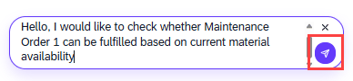

5. The agent works through the order step by step and answers:
   - The order **cannot** be fulfilled: material 1 needs 1.5 and has 0 in stock; materials 2 and 3 are available.
   - It recommends buying material 1, checking for open purchase orders, a stock transfer or a substitute.

    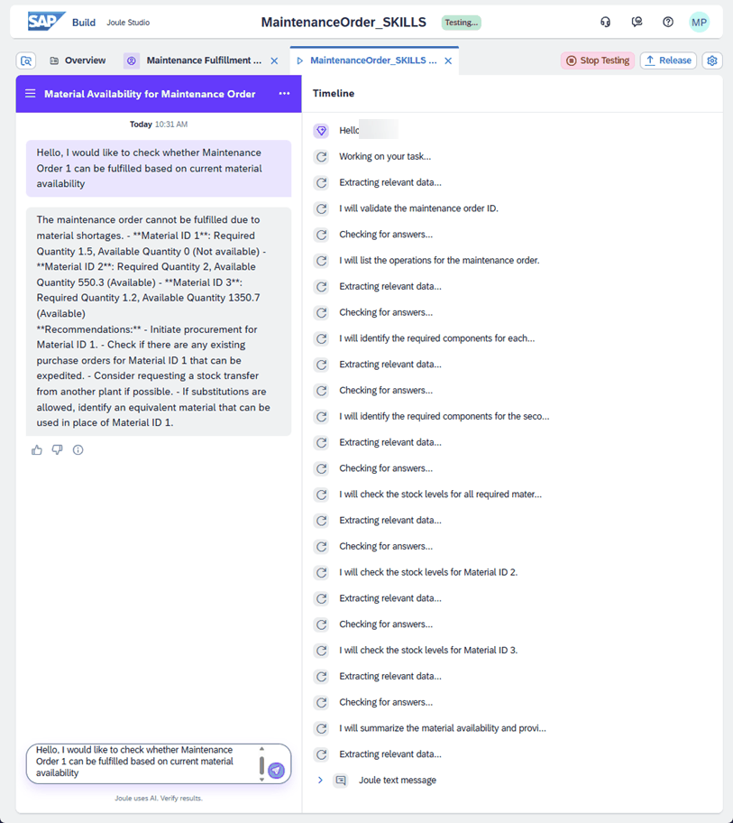

6. In the **Timeline**, expand the nodes. Click a skill name to see its inputs and outputs under *Details*.
   - For example, *GetMaterialStockLevels* returns the available quantity per warehouse.

    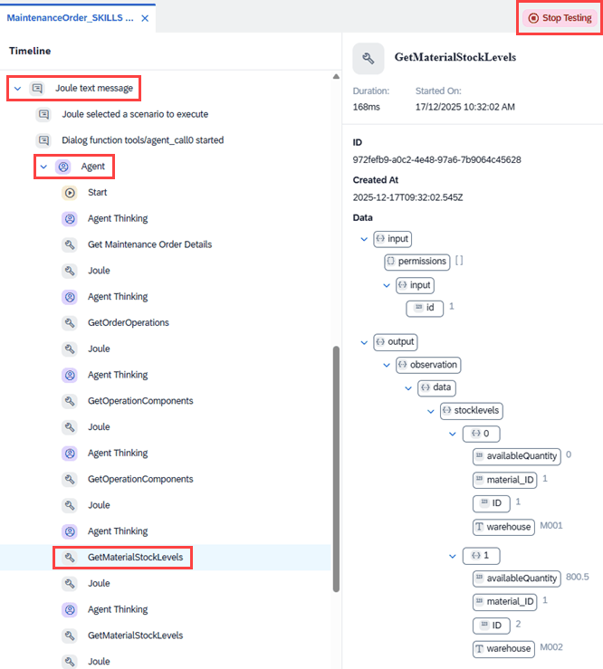

7. Choose **Stop Testing**.
   - Try other prompts or models if you like. When it works in your private environment, you can deploy it to a shared environment.

## 10.3 Why it works

- **The description** decides when Joule picks this agent, exactly as for skills.
- **The instructions** are the agent's program: a fixed order, a clear decision rule and a fixed ending (3.5).
- **Skills as tools:** the agent plans, calls skills one by one, checks the results and repeats until it can answer, within the step limit (3.6).
- **The imported destination** has no action properties, because the action project arrives ready-made; nothing is generated from it (3.3).

## 10.4 Common mistakes and tips (seen in class)

| What you see | Why | Fix |
|---|---|---|
| "Project already imported" | Someone in the same tenant imported it first | Rename your copy after import (prefix your name). If the name still clashes, the name inside the `.mtar` file must be changed |
| The test panel shows little detail | The current UI shows the steps in the thinking panel | Expand the thinking and the timeline nodes |
| The agent stops halfway | Too few execution steps | Keep the default 25; raise it for many components |

- **Instructions are hard to write?** Describe the task to an AI assistant and ask it for a concise prompt (*meta-prompting*), then edit the result.
- **Try more than one model:** run the same two or three requests with each provider before you pick.

## 10.5 The same idea with Northwind (Lecture 11)

- Agent *Get Orders Info* with two skills, *Get Orders* and *Get Customer by Key*.
- Instructions told it to fetch the orders, look up each customer, and answer with order ID and company name instead of the customer ID.
- Vague instructions mixed orders and customers in the answer. Step-by-step instructions with the output format fixed it.

> [!IMPORTANT]
> **🏭 In production**
> - This agent only reads. Before you add skills that create purchase requisitions or stock transfers, switch on *Require user confirmation* for them (3.5).
> - Keep the instruction text under version control; small wording changes alter the agent's decisions.
>
> *Added by Claude*

## Check yourself

Is SAP AI Core required for Joule Studio skills and agents?

- No; only for document grounding, which this tutorial leaves out
- Models for agents come from SAP's central service

Why does the agent ask for the order ID before doing anything?

- Its instructions say to get and validate the ID first
- Without it, every later skill call would fail or guess

## How this page was checked

- **SAP tutorial read in full on 21 Nov 2026** (created Dec 2025, last updated by SAP on 21 Aug 2026).
- **Steps rebuilt on 21 Nov 2026** from the tutorial's source file, with all 22 of its screenshots.
  - Every screenshot was checked for personal data. Blurred: the user's first name in the test chat (two screenshots), and a user ID inside the sample service's address (two screenshots).
  - SAP's long instruction texts are summarised, not copied; paste the originals from SAP's page.
  - SAP's page has a *Test yourself* heading, but its public source contains no questions, so none were taken over.
- **Lecture 12 recording:** captions 2:12 to 2:31 (import, agent set-up, meta-prompting, test). **Lecture 11:** 2:11 to 2:45 (the Northwind agent).
- Not run by me: there is no SAP Build tenant in this workspace.

## Sources

- SAP Developer Center, *Use Joule Studio, Classic Edition to Create an Agent*: https://developers.sap.com/tutorials/joulestudio-agent-create.html
- Tutorial source and screenshots: https://github.com/sap-tutorials/sap-build-process-automation (© SAP SE, licensed CC BY 4.0)
- SAP Help, *Create a Joule Agent*: https://help.sap.com/docs/joule-studio-classic/joule-studio-classic-edition/create-joule-agent
- BTPAI course, Lecture 11 Part A (BT023) and Lecture 12 (BT025) recordings

Previous: [Tutorial: Run an automated process from a Joule skill](tutorial-joule-skill-process.md) · Next: [Tutorial: Build an HR assistant with intent-based development](tutorial-joule-studio-hr-assistant.md)
