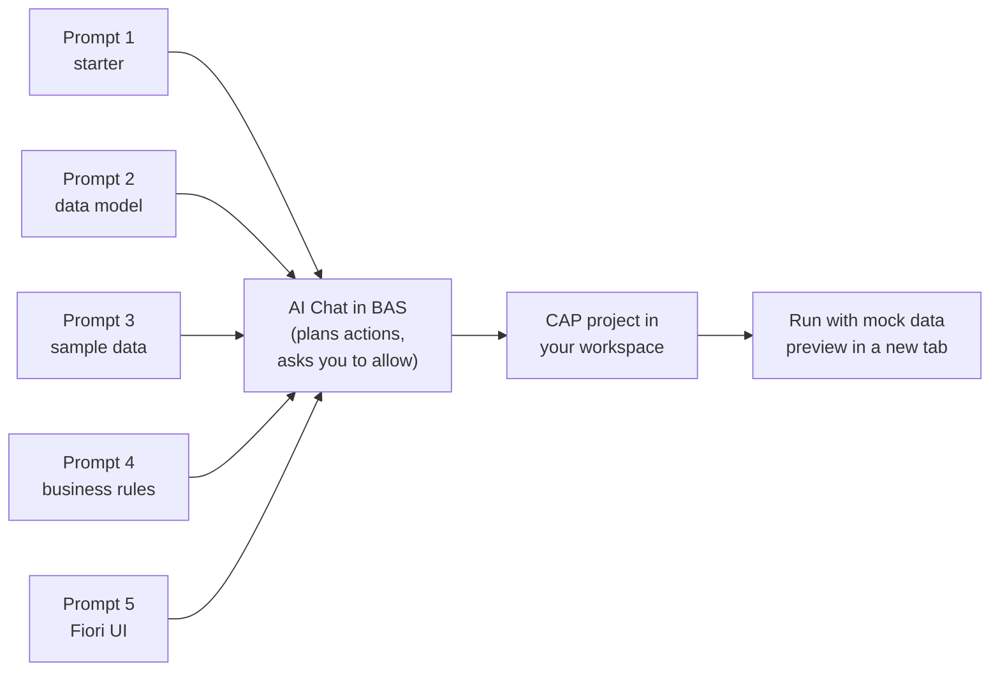

# Tutorial: Build a full-stack CAP app with AI Chat (Joule) in Business Application Studio

*Generate a working CAP application, with data model, sample data, business rules and an SAP Fiori UI, from a few plain-language prompts in SAP Business Application Studio.*

> [!NOTE]
> **📍 At a glance**
> - **Sources:** the course's prompt sheet *Full stack application with Joule in BAS* (course Drive), and SAP Help's *AI Chat* pages for SAP Business Application Studio (read 21 Nov 2026)
> - **You will build:** a CAP app for business partners, addresses, products and purchase orders, with sample data, validation rules and a Fiori UI, then run it
> - **You need:** SAP Business Application Studio (BAS) on the *build-code* (SAP Build Code) or *build-default* (SAP Build) plan, or your own model key
> - **Level:** beginner to intermediate
> - **Concepts:** [Prompt engineering](../sap-ai/prompt-engineering.md), [The Joule family](joule-family.md)
> - **Last checked:** 21 Nov 2026

> [!WARNING]
> **The course's SAP tutorial is gone**
> - The course sheet says to follow SAP's tutorial *Develop a Full-Stack CAP Application with Joule*.
> - On 21 Nov 2026 that address opened SAP Help's *AI Chat* page instead. The steps below follow SAP Help's current *AI Chat* pages.

**After this tutorial you can:**

- Open AI Chat in BAS and choose a model
- Generate a CAP app one layer at a time (model, data, logic, UI) and review each result
- Run the app with sample data and check the business rules

## 14.1 What you build



## 14.2 Steps

*Prompts from the course sheet (Mentors Pool); BAS steps from SAP Help, read 21 Nov 2026.*

### Step 1: Get AI Chat ready

1. In BAS, create and start a dev space of type **Full Stack Cloud Application**, SAP's dev space type for CAP and SAP Fiori apps.
2. Open the chat: in the upper toolbar, open the chat menu and choose **Open Chat**.
3. Pick a model in the chat's model selector:
   - **build-code or build-default plan:** preconfigured models are ready. SAP gives them for limited use, with per-user fair-use limits.
   - **GitHub Copilot:** choose *GitHub Copilot* and connect with your **organisation's** GitHub account; personal accounts are not supported.
   - **SAP AI Core or another LLM provider:** **Manage Models… → + Add Models…**, pick the provider, name the group, paste the provider's service key, then choose a model.

> [!WARNING]
> **Two things SAP Help warns about**
> - **Free quota ends:** the complimentary AI quota for BAS in SAP Build Code and SAP Build expires on **31 Dec 2026**. From 1 Jan 2027 you bring your own key (*What's New for SAP Business Application Studio*).
> - **Your files are context:** Joule uses your project's source files as context, so keep personal data out of them.

### Step 2: Generate the app, one layer at a time

After each prompt, AI Chat shows the actions it plans and may ask you to **Allow** or **Keep** them. Review the new files in your workspace before you send the next prompt.

1. **Starter:**

    ```text
    Create a Cloud Application Programming (CAP) application for managing business partners,
    addresses, products, and purchase orders. The application should include entities for
    Business Partners, Addresses, Products, Purchase Orders, and Purchase Order Items,
    with proper associations between them.
    ```

2. **Data model:**

    ```text
    Generate a CAP data model with the following structure:
    - BusinessPartner: email, phone number, company name; association to one Address.
    - Address: city, street, building, country; association back to one BusinessPartner.
    - Product: product ID, category, description, price, dimensions; association to one
      BusinessPartner (supplier).
    - PurchaseOrder: order ID, status, gross/net/tax amounts; association to one
      BusinessPartner and multiple PurchaseOrderItems.
    - PurchaseOrderItem: item position, product, gross/net/tax amounts; association back
      to one PurchaseOrder and one Product.
    ```

3. **Sample data:**

    ```text
    Generate 5 sample records for each entity (BusinessPartner, Address, Product,
    PurchaseOrder, PurchaseOrderItem) to demonstrate how the data would look. Ensure
    associations are correctly linked (e.g., products tied to suppliers, orders tied to
    business partners, items tied to orders).
    ```

4. **Business rules:** the course asks for logic files with these rules per entity:

    | Entity | Rules |
    |---|---|
    | BusinessPartner | valid email; phone number in a standard format with country code; no delete while purchase orders exist |
    | Address | latitude and longitude in range; end date after start date; action: distance between two addresses |
    | Product | unique product ID; price not negative; action: apply a discount |
    | PurchaseOrder | gross, net and tax calculated before saving; partner fixed once the status is final; action: cancel the order |
    | PurchaseOrderItem | item position unique per order; amounts consistent with the product; action: update the product by availability |

   - Send them as one prompt that starts with *"Create logic.js files for each entity with the following rules:"* and lists the table's rules.
5. **UI:** ask for a list report SAP Fiori elements UI on the purchase orders.
   - SAP's own example asks for the app and its UI in one prompt: *"Create an SAP CAP application and UI for managing …"*.

> [!NOTE]
> **Slash commands in the course sheet**
> - The course sheet puts Joule commands before the prompts: `/cap-gen-app`, `/cap-gen-model`, `/cap-edit-model`, `/cap-gen-data`, `/cap-edit-data`, `/cap-app-logic` and `/fiori-gen-cap-ui`.
> - SAP Help's current AI Chat pages describe plain prompts and do not list these commands.
> - If your BAS still offers them, type the command and then the prompt; otherwise send the prompt on its own.

### Step 3: Run and check

1. In the chat, ask: *"Run the application with mock data."* Then choose **Open in a New Tab** to preview it.
   - If the run fails because port 4004 is in use, ask AI Chat to use a different port (SAP Help's tip).
2. Check the rules from prompt 4 in the running app, for example:
   - Delete a business partner that has purchase orders: it should be refused.
   - Save a product with a negative price: it should be rejected.

### Step 4 (optional): Connect a real SAP service

- This needs at least one system configured in your BTP account, with the backend authorisations for its OData service.
- SAP Help's example second prompt: *"Find and add a sales order external service and connect it to the contract budget entity. Add sample data and include the sales order in the contract budget list report UI."*
- Select the system and the service when asked, then run with live data.

### Practice: three more apps from the course sheet

Build each with the same four prompts (starter, model, sample data, rules):

| App | Entities | Rules to ask for |
|---|---|---|
| Employee directory | Employee (name, email, job title) → one Department (name, location); 10 employees, 3 departments | valid, unique email; no department delete while employees are assigned |
| Bookstore inventory | Book (title, author, price, stock), Customer (name, email), Order (date, total; one customer, many books); 5 books, 5 customers | unique titles; price not negative; stock goes down when an order is placed; valid email; total calculated |
| Event management | Event (title, date, location), Attendee (name, email), Registration (one event, one attendee); 3 events, 10 attendees | unique event titles; valid email; no duplicate registration for the same event |

## 14.3 Why it works

- **One layer per prompt:** model, then data, then rules, then UI. Each result is small enough to review before the next builds on it.
- **Explicit structure in the prompt:** naming every field and association leaves the model less to guess (SAP AI chapter 5).
- **AI Chat acts, you approve:** it plans actions in your workspace and waits for *Allow* or *Keep*, so nothing runs unseen unless you switch on auto-approval.

## 14.4 Things to watch

| What you see | Why | Fix |
|---|---|---|
| No AI Chat, or AI features greyed out | An administrator disabled AI features at account level | Ask the admin (SAP Help: *Enable or Disable AI Features*) |
| Many confirmation prompts | AI Chat asks before running terminal commands | Approve each, or set **Settings → Chat → Tools → Terminal: Auto Approve** to true |
| The app does not start | Port 4004 is taken | Ask AI Chat to use another port |
| Results differ from the course | Model, plan and project context change the output | Review and correct each layer; SAP Help says results may vary |

> [!IMPORTANT]
> **🏭 In production**
> - Treat generated code as a first draft: read the data model and every rule handler, and add tests before you rely on them.
> - Keep terminal auto-approval off outside a throwaway dev space; an approved command runs with your credentials.
> - Generated sample data is for demos only; never paste real customer data into prompts or project files.
>
> *Added by Claude*

## Check yourself

<details class="qa"><summary>Why send four small prompts instead of one big one?</summary>

- Each layer (model, data, rules, UI) can be reviewed and fixed before the next one builds on it
- Errors stay small and easy to trace

</details>

<details class="qa"><summary>Which BAS plans give you AI Chat models without your own key?</summary>

- *build-code* (SAP Build Code) and *build-default* (SAP Build), with preconfigured models
- Their free quota ends on 31 Dec 2026; after that you bring your own key

</details>

## How this page was checked

- **Course sheet read in full on 21 Nov 2026:** *Full stack application with Joule in BAS*; it has prompts only, no screenshots.
- **SAP Help read on 21 Nov 2026:** *AI Chat*, *Development Scenarios with AI Chat*, *Generative AI-Powered Development* and *What's New for SAP Business Application Studio*.
- **SAP's tutorial address checked:** it now opens the *AI Chat* page.
- **Course and SAP differ** on the slash commands; shown both ways in the note in step 2.
- Not run by me: there is no BAS dev space in this workspace.

## Sources

- Mentors Pool course Drive: *Full stack application with Joule in BAS* (BT067)
- SAP Help, *AI Chat*: https://help.sap.com/docs/bas/sap-business-application-studio/ai-chat
- SAP Help, *Development Scenarios with AI Chat*: https://help.sap.com/docs/bas/sap-business-application-studio/development-scenarios-with-ai-chat
- SAP Help, *Generative AI-Powered Development*: https://help.sap.com/docs/bas/sap-business-application-studio/generative-ai-powered-development
- SAP Help, *What's New for SAP Business Application Studio*: https://help.sap.com/docs/bas/sap-business-application-studio/what-s-new-for-sap-business-application-studio
- SAP Help, *Full Stack Cloud Application* (dev space type): https://help.sap.com/docs/bas/sap-business-application-studio/full-stack-cloud-application
- SAP Developer Center, *Develop a Full-Stack CAP Application with Joule* (retired; now opens the AI Chat page): https://developers.sap.com/tutorials/build-code-complex.html

Previous: [Tutorial: Bring SAP Analytics Cloud insights into Joule](tutorial-joule-sac-analytical-insights.md) · Next: [Joule with SAP SuccessFactors: the integration steps](joule-integration-successfactors.md)
