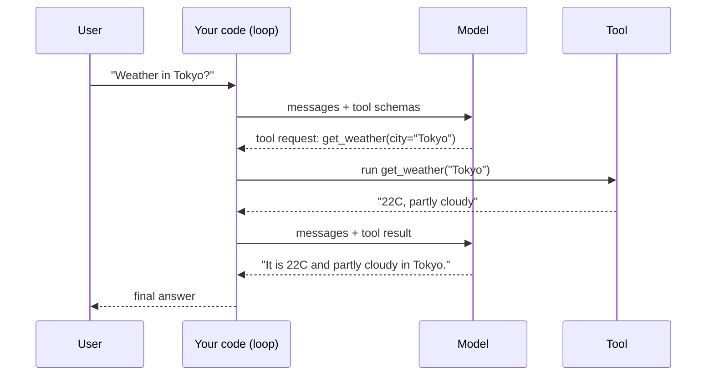

# Primer: what an agent is
> lead: An agent is an LLM that decides which tool to call, inside a loop, with its memory kept as a growing list of messages. Every later chapter is a better-engineered version of this loop.
meta: Part A | Classes 01 to 05 condensed | 15 min read

## Why it matters

Frameworks change every year, but this loop does not. Interviewers who ask about LangChain, LangGraph or MCP are usually checking whether you understand what sits underneath. If you can write the loop on a whiteboard, every framework question becomes easier.

## Core ideas

### 1. LLM calls are stateless

:::key The model remembers nothing
Each API call takes an input and returns an output. A chat app only *looks* like it remembers because it **resends the whole conversation on every message**. Memory is something you build around the model.
:::

### 2. Model, chatbot, agent

| | Model | Chatbot | Agent |
| --- | --- | --- | --- |
| Has history | No | Yes | Yes |
| Has tools | No | No | Yes |
| Decides what to do next | No | No | Yes |

An agent has three parts: a **brain** (the LLM), **memory** (the message list) and **tools** (functions it may call).

### 3. The model never runs a tool

:::trap "The model calls the function"
It does not. The model only returns a **request**: a tool name and its arguments. Your code runs the function and sends the result back as a new message. This is why you can validate, log, approve or block any call before it runs.
:::

### 4. The model sees a description, not your function

You give the model a schema for each tool: a name, a description and the parameters. The **description** is what it reads to decide when to use the tool, so write it like an instruction.

```python
get_weather_schema = {
    "type": "function",
    "function": {
        "name": "get_weather",
        "description": "Get the current weather for a city. Use this whenever "
                       "the user asks about weather in a specific place.",
        "parameters": {
            "type": "object",
            "properties": {"city": {"type": "string", "description": "e.g. 'Tokyo'"}},
            "required": ["city"],
        },
    },
}
```

One question can trigger **several tool calls in a single reply**. In class, a single question about capitals produced three calls at once.

## The agentic loop



```python
def run_agent(messages, max_turns=4):
    for _ in range(max_turns):
        response = client.chat.completions.create(
            model=model, messages=messages, tools=TOOL_SCHEMAS)
        message = response.choices[0].message

        if not message.tool_calls:               # plain text = final answer
            messages.append({"role": "assistant", "content": message.content})
            return message.content

        messages.append(message)                 # keep the model's tool request
        for call in message.tool_calls:          # may be several in one reply
            args = json.loads(call.function.arguments)
            result = TOOLS_BY_NAME[call.function.name](**args)
            messages.append({"role": "tool",
                             "tool_call_id": call.id,
                             "content": str(result)})
    return "Reached max_turns without a final answer."
```

:::key Why the loop calls the model again
The model cannot see a tool's output until you **append it as a message**. So after every tool run, you call the model again. The loop ends when the model replies with plain text instead of a tool request.
:::

## Under the hood

- **Memory is a Python list.** In the terminal chat, `conversation_memory` is one growing list. In Streamlit it lives in `st.session_state`, because plain variables reset on every rerun.
- **`max_turns` is a safety cap.** Without it, a confused model can loop forever and run up cost.
- **No tool means no tool call.** Asked for a currency conversion with no currency tool defined, the model answered in plain text instead of inventing a call.
- **Providers share one shape.** OpenAI, Groq and OpenRouter use the same chat format. Anthropic's SDK differs: `client.messages.create()` and `response.content[0].text`.
- **Structured output.** To get reliable data, ask for JSON only, strip any code fences, then validate with Pydantic before trusting a field.
- **Safe `eval`.** The calculator tool allowed only digits, operators and parentheses before running `eval()`.

## Common mistakes

| Mistake | Symptom | Fix |
| --- | --- | --- |
| Not appending the tool result | Model asks for the same tool again | Append a `tool` message with the matching `tool_call_id` |
| No turn cap | Endless loop, surprise bill | Always set `max_turns` |
| Trusting model JSON blindly | Crash on a missing field | Strip fences, parse, validate with Pydantic |
| Memory in a local variable (Streamlit) | Forgets after each interaction | Use `st.session_state` |
| Vague tool description | Wrong tool chosen, or none | Write the description as an instruction |

## Interview corner

:::pitch
An agent is an LLM in a loop. It reads the conversation, decides whether to answer or call a tool, my code runs the tool and returns the result as a message, and the loop repeats until the model answers in plain text. Memory is just the message list I keep resending.
:::

:::qa Why do LLMs need memory added to them?
Each API call is stateless. The app stores the messages and sends the **full history** on every call, so the model can use earlier turns.

**Follow-up to expect:** "What is the cost of that?" Tokens grow with every turn, which is why later chapters cover trimming and summarising history.
:::

:::qa Who actually executes a tool call?
My code does. The model only emits the tool name and arguments. That separation lets me validate arguments, log calls, require approval or block a call before anything runs.
:::

:::qa How is an agent different from a chatbot?
A chatbot has history. An agent also has **tools** and a **loop** in which the model decides what to do next, including whether to stop.
:::

:::qa What stops an agent looping forever?
A turn cap such as `max_turns`, plus timeouts and clear tool descriptions. Production systems also add budgets and monitoring.
:::

:::qa The model returned an empty answer with a tool call. Is that a bug?
No. When the model wants a tool, `content` is empty and the useful data is in `tool_calls`. Your loop should check for `tool_calls` first.
:::

## Quick revision

- [ ] I can explain statelessness in two sentences
- [ ] I can draw brain, memory and tools
- [ ] I can write the loop from memory and say why it calls the model again
- [ ] I know the model returns a request, not a result
- [ ] I can explain why the tool description matters
